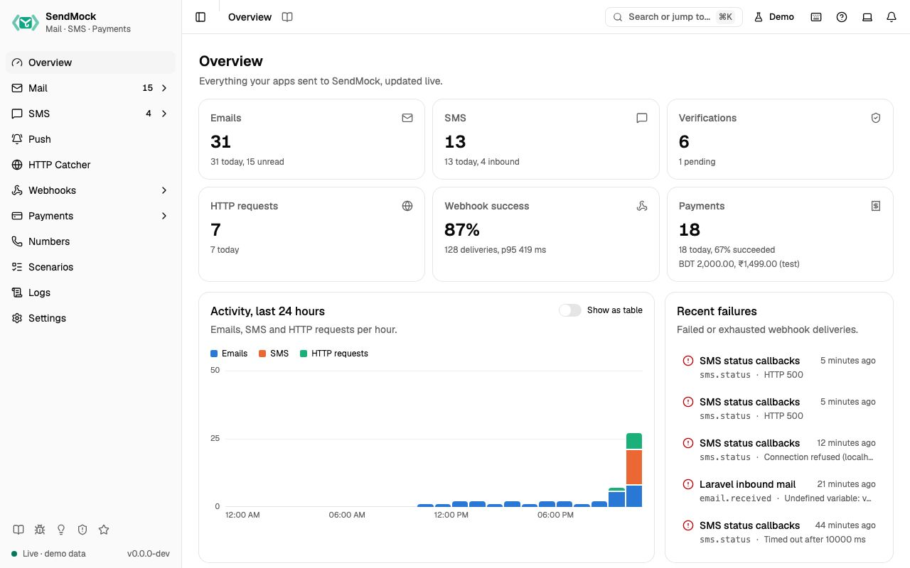
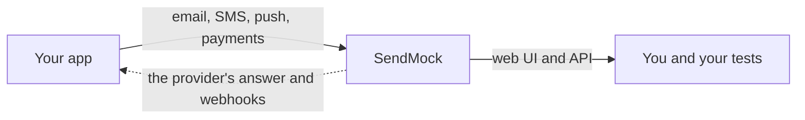

# SendMock

[](https://github.com/shibbirweb/sendmock/actions/workflows/ci.yml?query=branch%3Adevelop)
[](https://github.com/shibbirweb/sendmock/releases)
[](https://www.npmjs.com/package/sendmock)
[](https://crates.io/crates/sendmock)
[](https://hub.docker.com/r/shibbirweb/sendmock)
[](#license)
[](https://shibbirweb.github.io/sendmock/docs/)
[](https://shibbirweb.github.io/sendmock/demo/)

**SendMock is a local stand-in for the email, SMS, push and payment services your app talks to.** It is one small program you run on your machine, in Docker or in CI.

**The problem:** while you build and test an app, it sends real things. A sign-up test emails a real address, an OTP test texts a real phone and costs money, a checkout test needs a payment sandbox, and the webhooks those services send back are hard to trigger on demand. Teams end up with shared test inboxes, borrowed phones, provider sandboxes and flaky tests.

**What SendMock does:** your app sends to SendMock instead, over SMTP or the same HTTP APIs it already uses for Twilio, SendGrid, Stripe, FCM and others (only the address changes). SendMock keeps every message, shows it in a web UI, pulls out codes and links for your tests, and sends realistic webhooks back to your app. Nothing reaches a real inbox, phone or payment provider, and it costs nothing.

**Documentation:** <https://shibbirweb.github.io/sendmock/docs/>

**Live demo:** <https://shibbirweb.github.io/sendmock/demo/>

**Website:** <https://shibbirweb.github.io/sendmock/>



## How it works

Your app sends to SendMock instead of the real provider:



No message reaches a real inbox, phone or provider unless you set up a real relay and allow the recipient.

**Watch the video:** SendMock: Test Email, SMS and Payment Webhooks on Localhost

[](https://youtu.be/OHR7pVFGTl4)

## What it catches

- **Email** over SMTP (and POP3 to read it back), with HTML, text and source previews, link and spam checks, one-time code extraction, and a Mailpit-compatible API.
- **SMS and verification codes** through the APIs of Twilio, Vonage and other providers, with conversation threads and replies.
- **Push notifications** sent through FCM, Expo and OneSignal.
- **Payments** through Stripe, PayPal, Razorpay, Paddle, bKash, SSLCommerz and your own gateways, with checkout pages and simulated outcomes.
- **Webhooks** sent back to your app, in Standard Webhooks or each provider's own format, with rules, templates and delivery logs.
- **Any HTTP request** sent to a catcher bin, with mock responses.

Everything works from the web UI, the REST API, the `sendmock` CLI and an MCP server for AI agents.

## Install

| System | Command |
| --- | --- |
| macOS, Linux (Homebrew) | `brew install shibbirweb/tap/sendmock` |
| macOS, Linux (script) | `curl -fsSL https://github.com/shibbirweb/sendmock/releases/latest/download/install.sh \| sh` |
| Windows (PowerShell) | `irm https://github.com/shibbirweb/sendmock/releases/latest/download/install.ps1 \| iex` |
| Windows (Scoop) | `scoop bucket add shibbirweb https://github.com/shibbirweb/scoop-bucket`, then `scoop install shibbirweb/sendmock` |
| Any system with Node.js | `npx sendmock` (no install) |
| Any system with Bun | `bunx sendmock` (no install) |
| Docker | `docker run --rm -p 1025:1025 -p 8025:8025 ghcr.io/shibbirweb/sendmock` |

WinGet, Chocolatey, apt, dnf, Nix, Cargo, the beta of each channel, plain binaries, a Helm chart, a Docker Desktop extension and a menu bar app are on the [install page](https://shibbirweb.github.io/sendmock/docs/install/).

Only the beta is published so far: use the beta of each channel, such as `brew install shibbirweb/tap/sendmock-beta` or `ghcr.io/shibbirweb/sendmock:beta`, from the [install page](https://shibbirweb.github.io/sendmock/docs/install/). The commands above work from 1.0.0.

## Quick start

1. Start SendMock:

   ```bash
   sendmock
   ```

2. Open the web UI at http://127.0.0.1:8025.

3. Point your app's SMTP settings at host `127.0.0.1`, port `1025`. [Connect your app](https://shibbirweb.github.io/sendmock/docs/connect/) has the settings for PHP, Node.js, Python, Go, Java, Rust, Ruby and .NET.

SendMock listens on `127.0.0.1` only, so nothing outside your machine can reach it. `sendmock --demo` starts it with sample data to look around, `sendmock --help` lists the flags, and `sendmock help --all` every command.

## Send your first message

Everything your app sends shows up in the web UI at once. The examples below are in JavaScript (Node.js); any language works the same way, since SendMock speaks plain SMTP and HTTP.

### Email over SMTP

Use these settings in your app or mail library. No password or TLS is needed:

| Setting | Value |
| --- | --- |
| Host | `127.0.0.1` |
| Port | `1025` |
| Username and password | none (any are accepted) |
| Encryption | none |

For example, with [Nodemailer](https://nodemailer.com):

```js
import nodemailer from "nodemailer";

const transporter = nodemailer.createTransport({
  host: "127.0.0.1",
  port: 1025,
  secure: false,
});

await transporter.sendMail({
  from: "app@example.com",
  to: "user@example.com",
  subject: "Welcome",
  html: "<p>Your code is <b>482913</b></p>",
});
```

[Connect your app](https://shibbirweb.github.io/sendmock/docs/connect/) has the same settings for PHP, Python, Go, Java, Rust, Ruby and .NET.

### Email and SMS over the REST API

This example uses `fetch` in JavaScript or TypeScript. From any other language, send the same JSON in an HTTP `POST` request.

Send an email:

```js
await fetch("http://127.0.0.1:8025/api/v1/send", {
  method: "POST",
  headers: { "Content-Type": "application/json" },
  body: JSON.stringify({
    from: "app@example.com",
    to: ["user@example.com"],
    subject: "Welcome",
    html: "<p>Your code is <b>482913</b></p>",
  }),
});
```

Send an SMS:

```js
await fetch("http://127.0.0.1:8025/api/v1/sms", {
  method: "POST",
  headers: { "Content-Type": "application/json" },
  body: JSON.stringify({
    from: "+15550001111",
    to: "+15550002222",
    body: "Your code is 482913",
  }),
});
```

### Through your provider's SDK

Keep your Twilio, Vonage, SendGrid, Mailgun, Postmark, Resend, SES, Stripe, FCM or Expo code and change its base URL to `http://127.0.0.1:8025/providers/<provider>`, for example `http://127.0.0.1:8025/providers/twilio`.

### Learn more

- [Email](https://shibbirweb.github.io/sendmock/docs/mail/): attachments, outcomes such as bounces, replies, and the provider APIs.
- [SMS](https://shibbirweb.github.io/sendmock/docs/sms/): Twilio and Vonage SDKs, delivery status, test numbers and replies.
- [Push notifications](https://shibbirweb.github.io/sendmock/docs/push/), [payments](https://shibbirweb.github.io/sendmock/docs/payments/) and [webhooks](https://shibbirweb.github.io/sendmock/docs/webhooks/).
- [Providers](https://shibbirweb.github.io/sendmock/docs/providers/): every emulated provider API and its base URL.
- [REST API reference](https://shibbirweb.github.io/sendmock/api/): every endpoint, with a playground.

## Use it from an AI agent

SendMock ships an MCP server and a skill, so an agent in Claude Code, Codex, Cursor, Gemini CLI or VS Code can read the codes your app sent, set up webhooks and check what happened:

```bash
sendmock ai install --target claude-code
```

[Use SendMock from AI agents](https://shibbirweb.github.io/sendmock/docs/ai/) covers each agent.

## Run it from source

You need [Rust](https://rustup.rs) and [Bun](https://bun.sh).

1. Build the web UI:

   ```bash
   cd web
   ```

   ```bash
   bun install --frozen-lockfile
   ```

   ```bash
   bun run build
   ```

2. Start SendMock from the repository root:

   ```bash
   cd ..
   ```

   ```bash
   cargo run -p sendmock
   ```

3. Open <http://127.0.0.1:8025>.

## Contributing

Read [CONTRIBUTING.md](.github/CONTRIBUTING.md) to set up and make a change, and [AGENTS.md](AGENTS.md) for the rules every change follows. Report security problems privately as described in [SECURITY.md](.github/SECURITY.md).

## License

SendMock is licensed under either of

- the Apache License, Version 2.0 ([LICENSE-APACHE](LICENSE-APACHE)), or
- the MIT license ([LICENSE-MIT](LICENSE-MIT)),

at your option.
