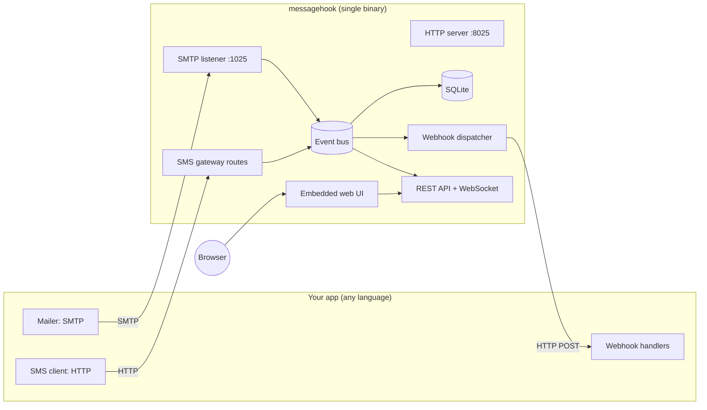

# 02. Architecture

## High-level view



Everything runs in one process on one tokio runtime. Two listeners by default:

| Listener | Default | Purpose |
|----------|---------|---------|
| SMTP | `127.0.0.1:1025` | Receive email |
| HTTP | `127.0.0.1:8025` | Web UI, REST API, WebSocket, MCP (streamable HTTP), native send APIs, `/providers/*`, `/catch/*` |

Optional extra listeners (off by default):

| Listener | Example | Purpose |
|----------|---------|---------|
| Provider port | `--provider-addr 127.0.0.1:8026` | SMS and email provider emulation at the **real provider paths** (Twilio, Verify, SendGrid, Resend, ...), for SDKs that only let you change the host. See [04-sms.md](04-sms.md) and [03-email.md](03-email.md#http-send-apis). |
| SMTPS | `--smtps-addr 127.0.0.1:1465` | implicit TLS SMTP |
| HTTP catcher port | `--catcher-addr 127.0.0.1:8030` | capture any request at any path ([15-http-catcher.md](15-http-catcher.md)) |

Inside the Docker image all listeners bind `0.0.0.0` ([09-distribution.md](09-distribution.md#docker)).

## Internal components

| Component | Responsibility |
|-----------|----------------|
| `smtp` | Async SMTP state machine, STARTTLS, AUTH, size limits. Hands raw bytes to `mail`. |
| `mail` | MIME parsing, header extraction, attachments, snippet, OTP/link extraction, email provider HTTP send APIs, delivery outcome simulation, HTML/link/spam checks, release and auto-forward. |
| `sms` | Native and provider-compatible send endpoints (incl. Twilio Messaging Services and WhatsApp), Twilio Verify, segment/encoding calculation, delivery status simulation, inbound SMS simulation. |
| `catcher` | HTTP catcher bins, mock response rules, presets ([15-http-catcher.md](15-http-catcher.md)). |
| `payments` | Payment gateway emulation: native and provider APIs, hosted test checkout, test cards, IPN/webhook events, refunds, disputes ([17-payments.md](17-payments.md)). |
| `logs` | SMTP session transcripts and API request log (including rejected requests). |
| `seed` | Loads, applies and exports `messagehook.seed.toml`; `reset` restores the seed state. |
| `events` | In-process broadcast bus (`tokio::sync::broadcast`). Every received or changed item becomes an `Event`. |
| `store` | SQLite access, migrations, retention/pruning, full-text search. |
| `webhooks` | Endpoint registry, rule matching, payload rendering, signing, persistent delivery queue, retries. |
| `api` | REST handlers, WebSocket push, OpenAPI document. |
| `web` | Serves embedded static UI assets with SPA fallback. |
| `config` | CLI flags, env vars, optional TOML file, runtime-editable settings. |
| `ops` | Operation registry: every feature defined once (input, output, handler, read-only/destructive flag) and exposed through REST, CLI and MCP. See [14-ai-integration.md](14-ai-integration.md). |
| `cli` | Client commands for every operation, `--json` output, scenarios, `ai install`. |
| `mcp` | MCP server (stdio and streamable HTTP) generated from the operation registry. |

### Event flow

1. A message arrives (SMTP `DATA` completes, or an SMS send request is accepted).
2. The component persists it through `store` and publishes `email.received` / `sms.sent` on the bus.
3. Subscribers react independently:
   - `api` pushes it to connected browsers over WebSocket.
   - `webhooks` evaluates rules and enqueues deliveries.
   - `sms` schedules simulated status transitions (`queued` -> `sent` -> `delivered`), each of which is another event.

This keeps ingestion fast: SMTP and SMS handlers never wait on webhook calls.

Opens follow the same path: the UI (or the API) calls an `open` endpoint, `store` updates `opened_at` / `open_count`, and `email.opened` / `sms.opened` is published for webhooks and other browser tabs. Every open is also appended to an `opens` table (subject type, subject id, source, user agent, at) for the UI history.

## Tech stack

### Backend (Rust, edition 2024)

| Concern | Crate | Notes |
|---------|-------|-------|
| Async runtime | `tokio` | multi-thread runtime, small worker count by default |
| HTTP server | `axum`, `tower-http` | compression, CORS, tracing, static files |
| WebSocket | `axum` (ws feature) | realtime UI updates |
| SMTP | custom on `tokio` | small, receive-only state machine (see [03-email.md](03-email.md)) |
| TLS | `rustls`, `tokio-rustls`, `rcgen` | STARTTLS / HTTPS with auto-generated self-signed cert |
| MIME parsing | `mail-parser` | robust, zero-copy, handles broken real-world mail |
| Storage | `rusqlite` (bundled, FTS5) | no system SQLite dependency; `spawn_blocking` or a small pool |
| Migrations | `refinery` or hand-rolled `user_version` | embedded SQL migrations |
| Compression | `zstd` | raw `.eml` bodies compressed at rest |
| HTTP client | `reqwest` (rustls) | webhook delivery |
| Signing | `hmac`, `sha2`, `sha1`, `base64` | Standard Webhooks HMAC-SHA256 native signatures, Twilio-style HMAC-SHA1 |
| Outbound SMTP | `lettre` (rustls) | release and auto-forward to a real relay |
| CA roots | `webpki-roots` | outbound HTTPS/TLS without OS certificate stores (Docker `scratch`) |
| Templates | `minijinja` (+ `minijinja-contrib`) | webhook URL/header/body templates, variables, filters |
| Fake data | `fake` | random names, emails, sentences for webhook variables |
| Randomness | `rand`, `uuid` | random generators, UUID v4/v7 |
| Embedding UI | `rust-embed` | compile `web/dist` into the binary |
| CLI / config | `clap` (derive, env), `serde`, `toml` | flags, `MESSAGEHOOK_*` env vars, `messagehook.toml` |
| IDs | `ulid` | sortable IDs, good for pagination |
| Logging | `tracing`, `tracing-subscriber` | |
| OpenAPI | `utoipa` | spec served at `/api/openapi.json` |
| JSON Schema | `schemars` | shared input/output schemas for CLI, MCP tools and OpenAPI |
| MCP | `rmcp` | official Rust MCP SDK, stdio and streamable HTTP |
| Phone numbers | `phonenumber` (optional) | E.164 normalisation and validation |

Release profile: `opt-level = "z"` or `3` (benchmark both), `lto = "fat"`, `codegen-units = 1`, `strip = true`, `panic = "abort"`.

### Frontend

| Concern | Choice |
|---------|--------|
| Runtime / package manager | Bun |
| Bundler / dev server | Vite (run via `bun --bun vite`) |
| Framework | React 19 + TypeScript |
| Styling | Tailwind CSS v4 |
| Components | shadcn/ui (Radix primitives), lucide-react icons, sonner toasts |
| Data fetching | TanStack Query |
| Routing | TanStack Router (file-based, typed) |
| Tables | TanStack Table (webhook logs, message lists) |
| Code/JSON view | Shiki (lazy loaded) for raw source and payload viewers |
| Template editor | CodeMirror 6 (lazy loaded) with Jinja/JSON modes and autocomplete |
| Mock API (Stage A) | MSW 2 (HTTP + WebSocket interception), in-memory mock DB, `@faker-js/faker` fixtures |
| Mock template preview | `nunjucks` (Jinja-compatible) until the backend `/webhooks/render` exists |
| API types | Generated from the OpenAPI spec (`openapi-typescript`) |

In development, Vite proxies `/api` and `/ws` to the Rust server. In release builds, `bun run build` outputs `web/dist`, which `rust-embed` bakes into the binary.

## Repository layout

```
messagehook/
├── Cargo.toml              # workspace root
├── crates/
│   ├── messagehook/                # binary: CLI, wiring, config
│   ├── messagehook-core/           # shared types: Event, Email, Sms, errors
│   ├── messagehook-store/          # SQLite, migrations, search, retention
│   ├── messagehook-smtp/           # SMTP server
│   ├── messagehook-sms/            # SMS gateway + provider emulation
│   ├── messagehook-webhooks/       # rules, rendering, delivery queue
│   ├── messagehook-ops/            # operation registry shared by REST, CLI and MCP
│   ├── messagehook-api/            # axum routes, websocket, openapi, static UI
│   ├── messagehook-cli/            # client commands, scenarios, ai install
│   └── messagehook-mcp/            # MCP server (rmcp), tools, resources, prompts
├── ai/
│   └── skill/              # agent skill source (SKILL.md + references), embedded in the binary
├── web/                    # Bun + Vite + React + shadcn/ui
│   ├── package.json
│   ├── src/
│   └── dist/               # build output, embedded by messagehook-api (git-ignored)
├── website/                # docs site + API playground (Fumadocs, shadcn, Magic UI), GitHub Pages
├── docs/
│   ├── plan/               # this plan
│   └── wiki/               # user docs (source for the website and GitHub wiki)
├── CHANGELOG.md            # [Unreleased] becomes release notes
├── examples/               # per-language sample apps (see 08-integrations.md)
├── scripts/                # build, version.ts, install.sh, install.ps1
├── Dockerfile
└── .github/workflows/      # ci, beta, beta-publish, stable, stable-promote, stable-publish, release, docker-edge, website
```

A workspace keeps compile units small and boundaries clear. If it feels heavy early on, start as one crate with the same module names and split later.

## Data model (SQLite)

All IDs are ULIDs (string). Timestamps are UTC milliseconds.

### `emails`

| Column | Type | Notes |
|--------|------|-------|
| id | TEXT PK | ULID |
| received_at | INTEGER | |
| message_id | TEXT | `Message-ID` header |
| from_addr | TEXT | |
| to_addrs, cc_addrs, bcc_addrs | TEXT (JSON) | BCC derived from envelope RCPT minus headers |
| envelope_from, envelope_to | TEXT / JSON | SMTP envelope |
| subject | TEXT | |
| snippet | TEXT | first ~200 chars of text body |
| size | INTEGER | raw bytes |
| has_html, has_text | INTEGER | booleans |
| attachment_count | INTEGER | |
| is_read | INTEGER | UI read flag (mark unread resets this only) |
| opened_at | INTEGER | first open time, null if never opened |
| open_count | INTEGER | total opens (UI, manual, API) |
| tags | TEXT (JSON) | from `X-Tags` header or user tagging |
| raw | BLOB | zstd-compressed original message |
| smtp_auth_user | TEXT | if the client authenticated |
| source | TEXT | `smtp`, `sendmail`, `native_api`, `sendgrid`, `mailgun`, `postmark`, `resend`, `ses`, `brevo`, `verify` |
| source_request | TEXT (JSON) | original HTTP send request (provider APIs), incl. template ID and data |
| smtp_session_id | TEXT | link to `smtp_sessions` |
| delivery_status | TEXT | simulated outcome: `delivered`, `deferred`, `bounced`, `complained`, `unsubscribed` (null when not simulated) |

`emails_fts` (FTS5) indexes subject, from, to, text body for search. `email_timeline` (email_id, kind, detail JSON, at) records received, opened, delivered, bounced, released, forwarded, webhook sent.

### `sms_messages`

| Column | Type | Notes |
|--------|------|-------|
| id | TEXT PK | ULID; provider-style ID also stored (e.g. `SM...` for Twilio) |
| provider_id | TEXT | ID returned to the client in provider format |
| direction | TEXT | `outbound` (app sent it) or `inbound` (simulated reply to app) |
| api | TEXT | `native`, `twilio`, `vonage`, ... |
| channel | TEXT | `sms` or `whatsapp` |
| messaging_service_sid | TEXT | Twilio Messaging Service used, if any |
| from_number, to_number | TEXT | normalised E.164 where possible |
| body | TEXT | |
| encoding | TEXT | `GSM-7` or `UCS-2` |
| segments | INTEGER | |
| media | TEXT (JSON) | MMS media URLs |
| status | TEXT | `queued`, `sent`, `delivered`, `undelivered`, `failed`, `received` |
| error_code | TEXT | simulated provider error |
| status_callback | TEXT | per-message callback URL from the request |
| account | TEXT | account SID / API key used |
| request_raw | TEXT (JSON) | original request, for debugging |
| opened_at | INTEGER | first simulated read time (outbound only) |
| open_count | INTEGER | total simulated reads |
| created_at, updated_at | INTEGER | |

`sms_status_history` (sms_id, status, at) keeps the full transition timeline.

### Verify, numbers, catcher, logs

- `verify_services` (sid, friendly_name, code_length, fixed_code, ttl) and `verifications` (sid, service_sid, to, channel, code, status, attempts, sends, expires_at, linked sms/email id).
- `numbers` (virtual numbers, channels, inbound URL/template, status callback) and `messaging_services` (sid, name, number pool).
- `http_bins`, `http_requests` for the HTTP catcher ([15-http-catcher.md](15-http-catcher.md)).
- `payments`, `payment_events`, `refunds`, `disputes`, `subscriptions` for payment emulation ([17-payments.md](17-payments.md#payment-data-model)).
- `smtp_sessions` (id, remote_addr, helo, tls, auth_mech, auth_user, transcript, result, started_at, ended_at) and `api_requests` (id, api, method, path, headers, body, response_status, response_body, duration_ms, created_at).
- `webhook_saved` (named saved deliveries / fixtures) and `tag_rules`, `forward_rules` (filter + action).

### Webhooks

- `webhook_endpoints`: id, name, url_template, method, query (JSON), headers (JSON templates), secret, format, body_mode, body_content_type, body_template / body_fields, render_mode, timeout_ms, max_attempts, enabled.
- `webhook_variables`: global and per-endpoint variables (see [12-webhook-variables.md](12-webhook-variables.md)).
- `webhook_templates`, `webhook_template_revisions`: custom payload templates; built-in and file templates are loaded in memory (see [13-webhook-templates.md](13-webhook-templates.md)). Endpoints reference them via `template_id`, `template_mode`, `overrides`.
- `webhook_rules`: id, endpoint_id, events (JSON list), filter (JSON), enabled, order.
- `webhook_deliveries`: id, endpoint_id, rule_id (nullable for manual), event_type, subject_id (email/sms id), trigger (`auto`, `manual`, `replay`), attempt, status, request (method, url, headers, body), response (status, headers, body truncated to 64 KB), duration_ms, error, next_attempt_at, created_at.

### `settings`

Key/value table for runtime-editable settings (retention, SMS simulation profile, UI preferences) so the UI can change them without restarting.

### Retention

- `--max-emails` / `--max-sms` (default 1000 each) and optional `--max-age` (e.g. `7d`).
- A background task prunes oldest rows and runs `VACUUM` occasionally.
- `--db memory` (or `:memory:`) for ephemeral CI runs.
- Configuration (endpoints, rules, templates, variables, numbers, services, bins, saved deliveries) is never pruned; only traffic (emails, SMS, verifications, HTTP requests, logs, deliveries) is.

## Configuration and seed file

Two files, both optional:

- **`messagehook.toml`**: how the server runs (ports, DB path, auth, relay SMTP, retention). Precedence: flags > `MESSAGEHOOK_*` env > `messagehook.toml` > defaults.
- **`messagehook.seed.toml`**: the **state** to start from, as code: webhook endpoints, rules, templates, variables (secrets via `${ENV_VAR}` references, never literal), virtual numbers, Messaging Services, Verify services (incl. fixed codes), HTTP catcher bins and responses, tag/forward rules, saved deliveries, settings (SMS profile, opened-event options, chaos), and optional local email templates for provider template IDs.

```toml
[[webhook.endpoints]]
name = "app-inbound-mail"
url = "http://localhost:8000/webhooks/mail"
template = "postmark.inbound"
secret = "${APP_WEBHOOK_SECRET}"

[[webhook.rules]]
endpoint = "app-inbound-mail"
events = ["email.received"]
filter = { field = "to", op = "matches", value = "*@inbound.local" }

[[verify.services]]
sid = "VA00000000000000000000000000000000"
name = "My App"
fixed_code = "123456"

[[numbers]]
number = "+15550001111"
label = "Support line"
inbound_url = "http://localhost:8000/sms/inbound"
inbound_template = "twilio.inbound_sms"
```

Behaviour:

- Loaded at startup from `--seed <file>` (or `./messagehook.seed.toml`, or `/config/messagehook.seed.toml` in Docker). Items are upserted by name/SID, so restarting is idempotent.
- **`reset`** (UI, API, CLI, MCP) wipes traffic and restores exactly the seed state, so every test run starts identically.
- **`messagehook seed export`** (and a Settings button) writes the current configuration back to a seed file, so a setup built in the UI (or by an AI agent) can be committed to the app's repo.
- `messagehook seed apply <file>` applies a seed to a running instance; `messagehook seed validate <file>` checks it without applying.
- Seed items show a "from seed" badge in the UI; editing them in the UI marks them as diverged until the next export.

## Code organisation

Layers (transport, operations, domain, storage), SOLID as applied to Rust traits and React hooks, and the standard patterns (repository, service, strategy, adapter, registry, observer, command, builder, value object) are defined in the repository's [AGENTS.md](../../AGENTS.md#design-principles), which every contributor and AI agent follows. Provider emulations are adapters registered in a provider registry, so adding a provider never changes existing ones.

## Concurrency and performance notes

- SMTP sessions are cheap tokio tasks; `DATA` is streamed into a bounded buffer with a configurable max size (default 25 MB).
- SQLite runs in WAL mode; writes go through a single writer task to avoid lock contention; reads use a small pool.
- Raw email is parsed once on ingest for indexed fields; full parse for display happens on demand and is cached in a small LRU.
- Webhook dispatcher uses a bounded concurrency limit (default 8) and persists the queue, so restarts do not lose pending retries.

## Security posture

- Binds to `127.0.0.1` by default. Binding to `0.0.0.0` (e.g. in Docker) prints a warning unless UI auth is set.
- Optional UI/API basic auth (`--ui-auth user:pass` or htpasswd file).
- Optional SMTP AUTH enforcement (`--smtp-auth accept-any | file | none`).
- HTML email preview renders in a sandboxed `iframe` with a strict CSP; remote images blocked by default with a "load images" toggle.
- Webhook secrets stored in the DB, masked in the UI and API responses.
