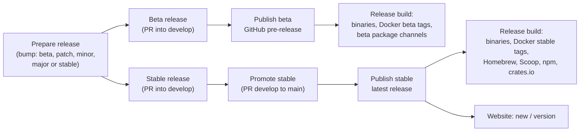

# 16. Website, API Playground and Release Channels

Two things that work together:

1. A **public website on GitHub Pages** (in this repo) with the docs, a live **API playground** and an in-browser demo of the app, built with **Magic UI** animated components.
2. A **two-channel release model**: `develop` ships **beta** releases, `main` ships **stable** releases, cut by workflows, never by hand. This copies the proven setup from the `phpdebugger` (Peep) repository (`.github/workflows/beta*.yml`, `stable*.yml`, `release.yml`, `website.yml`, `scripts/version.ts`).

---

## Part 1: Website

### Stack

| Concern | Choice | Notes |
|---------|--------|-------|
| Location | `website/` in this repo | own `package.json`, Bun |
| Framework | Next.js (static export, `output: 'export'`) + **Fumadocs** | MDX docs, sidebar, static search, versioned builds; static export and search mode to be confirmed against current Fumadocs docs in Phase U0 |
| Styling | Tailwind CSS v4 + shadcn/ui | same tokens as the app UI (`web/`) so the site and app look like one product |
| Animated components | **Magic UI** (React + Tailwind + Motion, installed through the shadcn CLI registry) | landing page, feature sections, playground polish |
| AI-assisted building | **Magic UI MCP server** in the repo's `.mcp.json` | lets Claude Code / Cursor pull Magic UI components correctly (installer: `@magicuidesign/cli`; exact Claude Code command to verify) |
| Hosting | GitHub Pages via Actions (`actions/upload-pages-artifact`, `actions/deploy-pages`) | `https://<owner>.github.io/<repo>/`, custom domain later |
| Diagrams | Mermaid | architecture, release flow |

Animations respect `prefers-reduced-motion` (Magic UI components are wrapped so they render a static state when reduced motion is on) and are kept out of the docs reading area so they never slow down reference pages.

### Site map

| Path | Content |
|------|---------|
| `/` | Landing page |
| `/docs/` | User docs: getting started, install (binary, Docker, Homebrew, ...), connect your app (per language), email, SMS, Verify, webhooks, templates, variables, HTTP catcher, CLI, MCP and AI, configuration and seed file, troubleshooting |
| `/api/` | API reference generated from the OpenAPI spec, with the playground on every endpoint |
| `/playground/` | Full-screen playground (request builder + response + event stream) |
| `/cli/` | CLI reference generated from `docs/api/cli-reference.json`: every command with its arguments, flags, example and links ([21](21-reference-and-examples.md#3-the-cli-and-mcp-reference-pages)) |
| `/mcp/` | MCP reference generated from `docs/api/mcp-tools.json`: every tool and resource with its inputs, annotations, example call and links |
| `/demo/` | The real SendMock web UI built in mock mode (Stage A mock layer), fully clickable in the browser |
| `/templates/` | Catalogue of built-in webhook payload templates, generated from the template TOML files |
| `/changelog/` | Rendered `CHANGELOG.md`, with beta and stable releases marked |
| `/download/` | OS-detected install instructions, stable and beta side by side |
| `/next/...` | The same site built from `develop` (beta docs), with a "Beta" banner |
| `/v0.x/...` | Older stable minor versions |
| `/llms.txt`, `/llms-full.txt` | Machine-readable docs for AI agents |

### Landing page with Magic UI

| Section | Magic UI component (planned) | Idea |
|---------|------------------------------|------|
| Hero | Animated gradient text, shimmer/rainbow button, retro grid or dot pattern background | "Catch every email, SMS and webhook locally" with Download and Try the demo buttons |
| How it works | **Animated Beam** | Your app -> SendMock (SMTP, SMS API, HTTP) -> UI, and SendMock -> webhooks back to your app, with beams animating along each path |
| Quick start | **Terminal** (typing animation) | tabs for macOS (Homebrew), Windows (`install.ps1`), Linux (`install.sh`) and Docker (`docker pull`, then `docker run` with both ports published), each installing and then starting SendMock, the visitor's system selected first, with a copy button for the install command and manual download links to the release archives below it (changed 2026-10-27: no OTP step, which confused readers before they know what SendMock catches) |
| Works with | **Marquee** | Language logos (PHP, Node, Python, Go, Java, Rust, Ruby, .NET) and provider names (Twilio, SendGrid, Mailgun, Postmark, Resend, Slack, ...) as text badges |
| Features | **Bento Grid** with **Marquee** and **Animated List** | six equal cards in a 3 by 2 grid: Email, SMS + Verify, Webhooks, Payments, HTTP Catcher, AI agents. Each has a preview panel of one height with a small product scene (emails flowing past with their checks, text messages arriving, webhook deliveries, a test checkout, caught HTTP calls, an agent using MCP tools), then the icon, title and a three-line description; an arrow at the end of the title row links to its docs page (the card itself is not a link). Install and Docker live in the quick start, not here (changed 2026-10-27, U3 feedback F7) |
| Numbers | **Number Ticker** | built-in provider APIs, languages with connection guides, REST API operations; each number links to the page that lists what it counts (Supported providers, Connect your app, the API reference), and a unit test keeps the providers page and the count in sync (changed 2026-10-27, U3 feedback F8) |
| Product shots | **Safari** / **iPhone** mockups, **Hero Video Dialog** | app screenshots and a short tour video |
| AI section | Animated list | an agent session: `sendmock_status` -> `sendmock_sms_wait` -> OTP |
| Promotional video | **Safari** mockup as the poster, play button | "Stop testing on real inboxes and phones": the poster in both themes, a play button and three benefit points; replaces the closing call to action, which repeated the hero (changed 2026-10-27, U3 feedback F6). See [Promotional video](#promotional-video-decided-2026-10-27) |
| Footer | none (plain links) | the logo and tagline with a GitHub icon, then Product, Get started and Community link columns, and a bottom bar with the year (changed 2026-10-27, U3 feedback F5) |

Exact component names are checked against the Magic UI registry when the site is built.

### Promotional video (decided 2026-10-27)

The promotional video has its own plan: [23. Promotional video](23-promotional-video.md) (goal, audience, length, production, captions, hosting, and the film's structure). The landing page's video section is in the table above.

### API playground

The playground is the main interactive feature. Because GitHub Pages is static, it never needs a backend of its own:

| Target | How it works | When to use |
|--------|--------------|-------------|
| **Demo (default)** | Requests are answered **in the browser** by the same MSW mock layer built in Stage A (`web/src/mocks`, shared as a workspace package). State persists in the tab; realtime events stream from the mock generator | Anyone can try every endpoint without installing anything |
| **Your local SendMock** | Requests go to `http://localhost:8025` (editable). SendMock allows the docs site origin via CORS by default (`--cors-origins`, removable), and only when the user clicks **Connect**. Browsers may show a local network access permission prompt; the page explains it | Real requests against your own running instance |
| **Custom URL** | Any reachable SendMock (team instance, Docker host) with an API token field | Shared or remote instances |

Features:

- Generated from the **OpenAPI spec** (frozen at the end of Stage A, later generated by `utoipa` and published per release), so `/` shows the stable API and `/next/` the beta API.
- Request builder from the schema (path/query/body forms plus raw JSON editor), auth header, examples per endpoint.
- **Code snippets** for every request in cURL, PHP, JavaScript, Python, Go, Java, Rust, Ruby and C#, kept in sync with the form.
- Response viewer (status, headers, pretty JSON, timing) and a live **event stream** panel (WebSocket/SSE) showing events the request triggered.
- **Scenario mode:** run multi-step flows (send SMS -> wait -> get OTP -> verify) as a guided walkthrough, using the same step format as `sendmock scenario run`.
- **Provider endpoints too:** Twilio, Verify, SendGrid, ... wire APIs can be tried in Demo mode and against the provider port in Local mode.
- "Open in demo UI" link: after a request, jump to `/demo/` to see the captured message.

Fumadocs' built-in OpenAPI pages may be used for the reference text; the interactive playground is our own React component set (shadcn + Magic UI) so it can target the in-browser mock and local instance without the server-side proxy Fumadocs' playground expects.

### Docs content and generated reference

- **Source of truth:** user docs live as Markdown in `docs/wiki/` (as in phpdebugger), synced into `website/` at build time, and optionally published to the GitHub wiki by `wiki.yml`. The planning docs live separately in `docs/plan/` and are not published on the website.
- **Generated pages** (so docs never drift from code), checked in CI:
  - CLI reference and MCP tool list from the `sendmock-ops` registry.
  - Built-in template catalogue from the template TOML files.
  - Template functions and filters from `/webhooks/template-reference`.
  - Magic numbers / magic addresses tables, provider compatibility tables.
  - Configuration flags and env vars from `clap`.
- Screenshots for docs are generated from the mock-mode UI with Playwright (stable, reproducible fixtures).

### Install with AI (decided 2026-10-27, owner feedback F16)

A reader who uses an AI coding agent (Claude Code, Codex, Cursor, Gemini CLI, ...) can let it install SendMock instead of following the steps by hand.

- **The prompt.** Getting started and Install each have an **Install with AI** section with one copyable prompt. The agent is told to:
  1. check the computer first and report what it found: the operating system and CPU, whether Docker is installed and running, whether Homebrew is there, and whether `sendmock` is already installed;
  2. ask, in plain words, whether to run SendMock with **Docker** (nothing installed on the computer, easy to remove, fits a Docker Compose project; needs Docker running) or as the **binary** (one small program, starts instantly, no Docker needed), and recommend one from what it found;
  3. ask for **stable** (recommended) or **beta** (newest features first);
  4. use only the official commands, listed in the prompt itself, so an agent without web access can follow it; show each command with what it does and wait for an OK;
  5. stop with a clear message when a download fails because there is no release yet, and point to the live demo;
  6. start SendMock, check it works, and tell the user the web UI address, the SMTP host and port for their app, and how to stop it;
  7. change nothing else on the computer.
- **One source.** The prompt lives in `docs/wiki/install.md`; Getting started repeats it word for word, and a website test checks the two match and that every command in the prompt is one of the Install page's own commands.
- **From just the site's address.** An agent given only `https://shibbirweb.github.io/sendmock/` can find the way:
  - `/llms.txt` (the [llms.txt](https://llmstxt.org/) convention) is built with each docs version: what SendMock is, the same install instructions for agents, and every docs page with its link and description. This is the website half of AI-06; the binary's own `/llms.txt` stays in Phase 4.
  - The landing page's quick start has an **AI** tab after macOS, Windows, Linux and Docker: three stages in a window of the platform terminals' height: (1) the **whole** prompt to read for three seconds (scrolling it, or reduced motion, holds this stage until **Show the agent run**); (2) a pointer clicks the copy button, the prompt is selected and "Copied to clipboard" shows; (3) an AI coding agent's window rather than a plain terminal: an "AI coding agent" title bar, the prompt pasted into the **message box** ("Pasted text, N lines") and sent, the agent "Thinking…" before each reply (what it found, Docker or the binary with one line on each), your answers **typed into the message box** and sent, a **Run command** card waiting for your OK, and SendMock running. The window scrolls to each new message until the reader scrolls; a copy button for the whole prompt; and links to the Install with AI steps and `/llms.txt`. The prompt stays in the page HTML while another tab is open, and the page head links to `/llms.txt` too. (Changed 2026-10-27 from a separate card, owner request.)
- Criteria: WS-09 in [acceptance](acceptance/07-distribution-website.md#ws-09-install-with-ai).

### Versioned builds

Every release keeps its own docs, so what a reader sees matches the version they run, and the beta channel has its own docs. Built in U3 (W17, owner feedback F14, 2026-10-27) so the first release freezes its docs with no extra work; same approach as phpdebugger's `website/scripts/build-versions.ts`.

#### Which versions exist

| Path | Built from | Label in the switcher | Banner |
| --- | --- | --- | --- |
| `/` | the newest stable tag of the newest minor (`v0.3.2`) | **Stable v0.3.2** | none |
| `/next/` | `develop` | **Beta (next)** | "Beta docs: they follow `develop` and the beta channel." with a link to the stable docs |
| `/v0.2/`, `/v0.1/`, ... | the newest stable tag of each older minor | **v0.2.4** | "Docs for v0.2, an older release." with a link to the latest |
| `/` before the first stable tag | `develop` | **Preview** | "Preview: SendMock has no stable release yet. These docs follow `develop`." |

- Stable tags are `vX.Y.Z` with no pre-release part. Beta tags (`vX.Y.Z-beta.N`) do not get their own docs: the beta channel always reads `/next/`.
- Before the first stable tag, `/` and `/next/` are both built from `develop`, so links to `/next/` work from day one.
- The version list is worked out from the tags by one pure function (`website/lib/docs-versions.ts`, unit tested), never typed by hand.

#### How a version is built

- `scripts/build-docs-versions.ts` builds every version into `website/out/<path>/` and is what `website.yml` runs on deploys. The existing `scripts/build-pages-site.ts` builds one version (website plus `/demo/`) and takes the base path of that version.
- `develop` (and the Preview `/`) build from the working tree. A tag builds in a temporary `git worktree` of that tag: its own `docs/wiki`, `docs/api` and `web/` (so its demo is that release's UI), with the **current** `website/` code copied over it, so every version has today's look, switcher and fixes. The working tree is never changed.
- Every build gets `NEXT_PUBLIC_DOCS_VERSION` (its own key) and `NEXT_PUBLIC_DOCS_VERSIONS` (the whole list as JSON), so each version's switcher lists all versions. Because every deploy rebuilds every version, a new release shows up in old versions' switchers too.
- The demo of each version gets `VITE_DOCS_URL` (`<base>/docs/`, `<base>/next/docs/`, ...), so the in-app guide links (F11) and the Help menu open the docs of the same version.
- Each version has its own static search index under its own path, so search only finds pages of the version being read.
- Pull requests build only the working tree (as the Preview `/`) to catch broken pages; deploys build every version.

#### The switcher and banner

- The switcher sits at the top of the docs sidebar, under search: a dropdown with every version, the current one ticked. Picking one opens **the same page** in that version (the path after the version prefix is kept); a page that does not exist there opens the site's "Page not found" page, which links to the docs home of every version.
- The banner shows on every page of a non-stable version (landing, docs, API, CLI, MCP and playground), above the header.
- The running app links to its own docs version: stable installs to `/`, beta, edge and dev installs to `/next/` (see [In-app update channel](#in-app-update-channel)).

#### Deploys

- `website.yml` builds every version and deploys to Pages when: a release is published, `develop` changes the website or docs (updates `/next/`), or "Run workflow". Deploys always check out `develop` with the full history, since `/next/` and the website code come from it and the stable versions from their tags.
- One-time setup: Settings > Pages > Source: GitHub Actions; Environments > `github-pages` > Deployment branches and tags: allow `develop`, `main` and the tags `v*` (a published release runs on its tag).

#### Criteria

WS-03.1 (unchanged) plus WS-03.4 to WS-03.7 in [acceptance](acceptance/07-distribution-website.md#ws-03-docs-and-versions).

---

## Part 2: Branches and release channels

### Branches

| Branch | Role |
|--------|------|
| `develop` | Beta line. All pull requests target it. Default branch until the first stable release |
| `main` | Stable line. Only receives merges from `develop` when a stable release is promoted. Default branch after the first stable release |
| `release/vX.Y.Z[-beta.N]` | Short-lived branches opened by the release workflows |
| `feat/*`, `fix/*`, `docs/*` | Normal work, merged into `develop` by pull request |

Branch protection on `develop` and `main`: pull requests only, CI must pass.

### Versioning

- SemVer: betas are `X.Y.Z-beta.N`, stables `X.Y.Z`.
- **Version source of truth:** the workspace `Cargo.toml` `[workspace.package] version`. `scripts/version.ts` (Bun) keeps every copy in sync (`Cargo.toml` files, `Cargo.lock`, `web/package.json`, `website/package.json`, npm wrapper `package.json`, Docker labels) and CI fails when they disagree.
- The version is **worked out, never typed** (decided 2026-10-27, owner feedback F15): a person only picks the kind of release in the **Prepare release** workflow, and the workflow writes the version and the release notes. Nobody edits a version number or `CHANGELOG.md` by hand.

#### The bump choices

The Prepare release workflow has one choice, `bump`, plus a dry-run switch:

| `bump` | From stable `0.3.1` | From beta `0.4.0-beta.2` |
| --- | --- | --- |
| `beta` | the first beta of the next version the commits call for: `0.3.2-beta.1` if only `fix:` landed, `0.4.0-beta.1` with any `feat:`, `1.0.0-beta.1` with a `feat!:` or `fix!:` | the next beta: `0.4.0-beta.3` |
| `patch` | `0.3.2-beta.1` | refused: a patch is smaller than the version in progress |
| `minor` | `0.4.0-beta.1` | refused: `0.4.0` is already in progress |
| `major` | `1.0.0-beta.1` | `1.0.0-beta.1` (the 0.4 betas are left behind) |
| `stable` | refused: there is no beta to finish | `0.4.0`, only when `0.4.0-beta.2` is published and nothing untried landed on top (docs, tests and chores are allowed) |

Every stable goes through at least one beta, so the beta channel always tries a version first.

#### The changelog

- `CHANGELOG.md` at the repository root is **written by the Prepare release workflow only**. Each release adds one section at the top, built from the pull requests merged into `develop` since the last tag:

  | Pull request title | Changelog group |
  | --- | --- |
  | `feat!:` or `fix!:` | **Breaking changes** |
  | `feat:` | **Added** |
  | `fix:` | **Fixed** |
  | `docs:`, `test:`, `chore:`, `ci:`, `refactor:` | left out |

- Each line is the pull request title without its prefix and ticket, with the first letter capitalised and the PR linked: `feat:[U3] add Inbox and Messages to the Mail and SMS sidebar menus` becomes `- Add Inbox and Messages to the Mail and SMS sidebar menus (#37)`.
- The pull request title is therefore the release note: write it for users, in the commit format. A change users should not read about uses `chore:`.
- A stable section collects its betas: `0.4.0` lists everything since `0.3.1`, so stable readers do not need the beta sections.
- The section is the GitHub release body word for word, and the website's `/changelog/` page renders the whole file.

```bash
bun scripts/version.ts show            # 0.4.0-beta.2
bun scripts/version.ts check           # all files agree
bun scripts/version.ts next beta       # what bump=beta would make, without writing
bun scripts/version.ts bump minor      # write the next version into every file
bun scripts/version.ts changelog       # write the CHANGELOG.md section for the new version
bun scripts/version.ts notes 0.4.0     # print a version's section (the release body)
```

### Workflows

| Workflow | Trigger | Does |
|----------|---------|------|
| `ci.yml` | push to `develop`/`main`, pull requests | Rust (fmt, clippy, tests on 3 OSes), web and website (lint, typecheck, tests, build), version check, docs check, OpenAPI contract tests |
| `release-prepare.yml` (Prepare release) | manual, on `develop`, choice `bump` (`beta`, `patch`, `minor`, `major`, `stable`) and `dry_run` | Checks CI passed and no release is in progress, works out the version from the choice (see [The bump choices](#the-bump-choices)), writes it into every file with `scripts/version.ts`, writes the `CHANGELOG.md` section from the merged pull requests, and opens release PR `chore:[REL-N] release X.Y.Z[-beta.N]`; with `dry_run` it only prints the version and the section |
| `beta-publish.yml` | CI finished on `develop` | If `develop` holds an unpublished beta version: creates the GitHub **pre-release** with its changelog section as the body and calls `release.yml` |
| `stable-promote.yml` | CI finished on `develop` | If `develop` holds an untagged stable version: opens the `develop` -> `main` PR (merge commit, never squash) |
| `stable-publish.yml` | CI finished on `main` | If `main` holds an untagged stable version: creates the GitHub **release** (marked latest) with its changelog section as the body and calls `release.yml` |
| `release.yml` | called by the publish workflows, a manual release, or "Run workflow" to rebuild | Builds all targets, checksums, Docker images, package manager updates for the right channel (table below); runs the binary tests on every platform before anything is published ([09](09-distribution.md#binary-tests-on-every-platform-decided-2026-10-27)); version comes from the code and must match the tag |
| `docker-edge.yml` | push to `develop` | Builds and pushes the `edge` image for people who want every merge |
| `website.yml` | see [Versioned builds](#versioned-builds) | Builds all doc versions and deploys GitHub Pages |
| `wiki.yml` (optional) | push to `main` touching `docs/wiki` | Mirrors docs to the GitHub wiki |

Repository settings needed: "Allow GitHub Actions to create and approve pull requests"; Pages source = GitHub Actions; secrets for Docker Hub, Homebrew tap and Scoop bucket tokens, npm token, cosign (keyless OIDC preferred), optional crates.io token.



### What each channel publishes

| Channel | Beta (from `develop`) | Stable (from `main`) |
|---------|------------------------|----------------------|
| GitHub Releases | pre-release `vX.Y.Z-beta.N` with binaries and checksums, and the rolling `beta` pre-release moved to the same files (fixed download links, [09](09-distribution.md#release-archives)) | release `vX.Y.Z` marked latest |
| Docker (GHCR + Docker Hub) | `beta`, `X.Y.Z-beta.N` (plus `edge` on every `develop` push) | `latest`, `X`, `X.Y`, `X.Y.Z` |
| Homebrew tap | `sendmock-beta` formula | `sendmock` formula |
| Scoop bucket | `sendmock-beta` manifest | `sendmock` manifest |
| `.deb` and `.rpm` (release assets) | attached to the pre-release | attached to the release |
| APT and YUM repository (from 1.0) | `beta` component | `stable` component |
| WinGet, Chocolatey (from 1.0) | not published | new version submitted |
| AUR (from 1.0) | `sendmock-beta-bin` | `sendmock-bin` |
| COPR, Nixpkgs (from 1.0) | not published | new version |
| npm wrapper | dist-tag `beta` | dist-tag `latest` |
| Install scripts | `install.sh --channel beta`, `install.ps1 -Channel beta` (run as a script block, since `irm ... \| iex` takes no arguments) | default |
| crates.io | not published | published |
| Website | `/next/` | `/` (previous minor moves to `/vX.Y/`) |
| Testcontainers modules | default image tag `beta` on request | default image tag = matching stable |

### In-app update channel

- Settings > About shows the running version and channel (`stable`, `beta`, `edge`, `dev`).
- The UI and `sendmock version` link to the matching changelog entry and docs version (`/` or `/next/`).

#### Update checker (extended 2026-10-27, owner feedback F15)

- **Modes**, in Settings > About, `sendmock.toml` (`update_check`) and `SENDMOCK_UPDATE_CHECK`:
  - `off` (the default): SendMock never calls out.
  - `manual`: only **Check for updates**, `sendmock update check` and the MCP tool call GitHub.
  - `daily`: also checks once on start and then once a day.
- **What it compares:** the running version against GitHub Releases for its channel. Stable installs are offered stables only; beta installs are offered the newer of the newest beta and the newest stable; `edge` and `dev` builds are offered nothing and say so.
- **What it shows:** the new version, its date, its release notes (the changelog section) and the upgrade command for how SendMock was installed: `brew upgrade sendmock`, `scoop update sendmock`, `docker pull ghcr.io/shibbirweb/sendmock:<tag>`, the install script again, or `npm install -g sendmock@<tag>`. The install method is baked in at build time by each package (`SENDMOCK_INSTALL_METHOD`); when unknown, the release page link is shown.
- **Where:** the result in Settings > About; with `daily`, one notification in the header bell per new version ("SendMock 0.4.0 is available"), and a line in `sendmock version` and `sendmock status` from the last check.
- **Privacy and failure:** one unauthenticated `GET` to the GitHub Releases API with no identifiers, cached for 24 hours; when GitHub cannot be reached it says "Could not check for updates" and never retries in a loop.
- **Surfaces:** `GET /api/v1/updates` (`409` while the mode is `off`, `502` "Could not check for updates" when GitHub cannot be reached), `sendmock update check`, MCP `sendmock_update_check`; the mode is a setting (`update_check_mode`, replacing the boolean `is_update_check_enabled`). The answer (`UpdateCheckResult`) carries the running version, channel and install method, whether the channel is checked at all (`is_channel_checked`, false for edge and dev), the offered release (`available_release`: version, `published_at`, `release_notes_markdown`, `release_url` and `upgrade_command`, null when the method is unknown), `checked_at` and `is_from_cache`.
- **When:** the mode select, the notification and the upgrade command are UI work on mock data (U3); the real check ships with the first beta (Phase 1), since that is the first version anyone can update from.
- **Upgrade commands follow the running platform (decided 2026-10-28, owner feedback F18):** the server builds the command for the operating system it runs on (detected at run time, never guessed from the browser), the channel and the install method, and every command is one the [Install page](../wiki/install.md) gives for that platform and channel:
  - Install script on macOS and Linux: `curl -fsSL https://github.com/shibbirweb/sendmock/releases/latest/download/install.sh | sh`, with `-s -- --channel beta` for beta.
  - Install script on Windows (PowerShell): `irm https://github.com/shibbirweb/sendmock/releases/latest/download/install.ps1 | iex`, and `& ([scriptblock]::Create((irm https://github.com/shibbirweb/sendmock/releases/latest/download/install.ps1))) -Channel beta` for beta.
  - Homebrew (macOS and Linux only): `brew upgrade shibbirweb/tap/sendmock`, or `sendmock-beta`.
  - Scoop (Windows only): `scoop update sendmock`, or `sendmock-beta`.
  - Docker (any platform, multi-arch image): `docker pull ghcr.io/shibbirweb/sendmock:<version>`.
  - npm (any platform): `npm install -g sendmock@<version>`.
  - An install method that does not exist on the platform (Homebrew on Windows, Scoop on macOS or Linux) or an unknown one gets no command, only the release page link.
  - Methods added later (`.deb`, `.rpm`, APT, YUM, WinGet and others from 1.0) add their own platform's command the same way.
  - A test checks the commands against the Install page so the two never drift apart: on mock data `web/tests/repository/upgrade-commands.test.ts` does it now, and Phase 1 adds the same check for the server's commands.
- **Built on mock data (U3 W18, 2026-10-28):** Settings > About has the Off, Manual and Daily choice, Check for updates, and the result with the date, release notes, a copyable upgrade command and the release page link. With Daily, the UI checks on start and once a day and adds one bell notification per new version (the announced versions are kept per browser). The demo controls pick a pretend install, each on a platform (beta with Homebrew on macOS by default, stable with Docker, Scoop on Windows, npm, the install script on Linux or on Windows, an unknown method, already the newest, edge, dev) and can make GitHub unreachable; the mock keeps a check for 24 hours like the server will. Phase 1 adds the real check, `sendmock.toml` and `SENDMOCK_UPDATE_CHECK`, the baked-in install method, the platform detected at run time, and the line in `sendmock version` and `sendmock status`.
- Criteria: PL-05.6, PL-05.10 to PL-05.13 and DS-05.3 to DS-05.5. The UI half of PL-05.6 and PL-05.10 to PL-05.13 is tested on mock data (`web/tests/e2e/update-check.spec.ts`, unit tests in `web/src/mocks/updates/`, `web/tests/repository/upgrade-commands.test.ts`); the criteria are ticked in Phase 1 with the server tests, like the other PL-05 settings.

### Commit and PR conventions

Conventional prefixes drive the version bump and changelog grouping (`feat:`, `fix:`, `feat!:` for breaking, `docs:`, `chore:`, `test:`, `refactor:`). Release commits use `chore:[REL-N] release X.Y.Z[-beta.N]`. PR test plans are plain bullet lists.

---

## Roadmap placement

- **Phase U0:** `develop` and `main` branches, branch protection, `ci.yml` for `web/` and `website/`, website skeleton (Fumadocs + Magic UI landing draft), `website.yml` deploying to Pages with `/demo/` = mock-mode UI. This replaces the generic "static preview build" as the shareable preview URL.
- **Phase U3:** API reference and **playground in Demo mode** generated from the frozen OpenAPI spec; landing page polished with Magic UI; docs IA drafted.
- **Phase 0:** `scripts/version.ts` (bump choices and changelog writing), `CHANGELOG.md` (created by the first Prepare release run), all release workflows (`release-prepare.yml`, `beta-publish.yml`, `stable-promote.yml`, `stable-publish.yml`, `release.yml`, `docker-edge.yml`). Versioned website builds (`/next/`, switcher, banner) moved to U3 W17 on 2026-10-27, so the first release freezes its docs.
- **Phase 1:** first beta `0.1.0-beta.1` (email backend) published through the beta channel, made with Prepare release `bump: minor`; the real update check; playground **Local mode** with CORS support in SendMock.
- **Phases 2-4:** a beta per phase (or more often); docs pages and generated references grow with each feature.
- **Phase 5:** first stable `1.0.0` promoted to `main`; all stable channels go live; `main` becomes the default branch.
