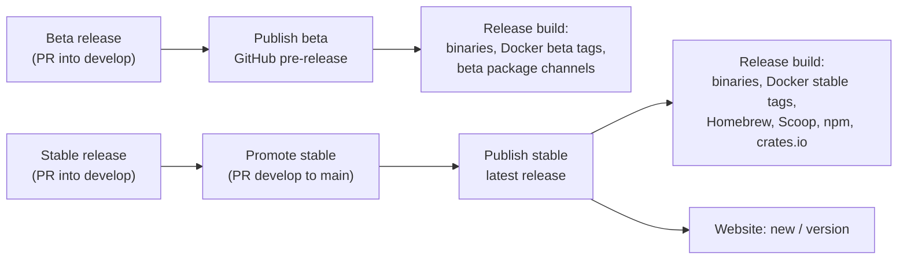

# 16. Website, API Playground and Release Channels

Two things that work together:

1. A **public website on GitHub Pages** (in this repo) with the docs, a live **API playground** and an in-browser demo of the app, built with **Magic UI** animated components.
2. A **two-channel release model**: `develop` ships **beta** releases, `main` ships **stable** releases, cut by workflows, never by hand. This copies the proven setup from the `phpdebugger` (Peep) repository (`.github/workflows/beta*.yml`, `stable*.yml`, `release.yml`, `website.yml`, `scripts/version.ts`).

---

## Part 1: Website

### Stack

| Concern | Choice | Notes |
|---------|--------|-------|
| Location | `website/` in this repo | own `package.json`, Bun |
| Framework | Next.js (static export, `output: 'export'`) + **Fumadocs** | MDX docs, sidebar, static search, versioned builds; static export and search mode to be confirmed against current Fumadocs docs in Phase U0 |
| Styling | Tailwind CSS v4 + shadcn/ui | same tokens as the app UI (`web/`) so the site and app look like one product |
| Animated components | **Magic UI** (React + Tailwind + Motion, installed through the shadcn CLI registry) | landing page, feature sections, playground polish |
| AI-assisted building | **Magic UI MCP server** in the repo's `.mcp.json` | lets Claude Code / Cursor pull Magic UI components correctly (installer: `@magicuidesign/cli`; exact Claude Code command to verify) |
| Hosting | GitHub Pages via Actions (`actions/upload-pages-artifact`, `actions/deploy-pages`) | `https://<owner>.github.io/<repo>/`, custom domain later |
| Diagrams | Mermaid | architecture, release flow |

Animations respect `prefers-reduced-motion` (Magic UI components are wrapped so they render a static state when reduced motion is on) and are kept out of the docs reading area so they never slow down reference pages.

### Site map

| Path | Content |
|------|---------|
| `/` | Landing page |
| `/docs/` | User docs: getting started, install (binary, Docker, Homebrew, ...), connect your app (per language), email, SMS, Verify, webhooks, templates, variables, HTTP catcher, CLI, MCP and AI, configuration and seed file, troubleshooting |
| `/api/` | API reference generated from the OpenAPI spec, with the playground on every endpoint |
| `/playground/` | Full-screen playground (request builder + response + event stream) |
| `/cli/` | CLI reference generated from `docs/api/cli-reference.json`: every command with its arguments, flags, example and links ([21](21-reference-and-examples.md#3-the-cli-and-mcp-reference-pages)) |
| `/mcp/` | MCP reference generated from `docs/api/mcp-tools.json`: every tool and resource with its inputs, annotations, example call and links |
| `/demo/` | The real SendMock web UI built in mock mode (Stage A mock layer), fully clickable in the browser |
| `/templates/` | Catalogue of built-in webhook payload templates, generated from the template TOML files |
| `/changelog/` | Rendered `CHANGELOG.md`, with beta and stable releases marked |
| `/download/` | OS-detected install instructions, stable and beta side by side |
| `/next/...` | The same site built from `develop` (beta docs), with a "Beta" banner |
| `/v0.x/...` | Older stable minor versions |
| `/llms.txt`, `/llms-full.txt` | Machine-readable docs for AI agents |

### Landing page with Magic UI

| Section | Magic UI component (planned) | Idea |
|---------|------------------------------|------|
| Hero | Animated gradient text, shimmer/rainbow button, retro grid or dot pattern background | "Catch every email, SMS and webhook locally" with Download and Try the demo buttons |
| How it works | **Animated Beam** | Your app -> SendMock (SMTP, SMS API, HTTP) -> UI, and SendMock -> webhooks back to your app, with beams animating along each path |
| Quick start | **Terminal** (typing animation) | `brew install ...`, SendMock, then a captured OTP appearing |
| Works with | **Marquee** | Language logos (PHP, Node, Python, Go, Java, Rust, Ruby, .NET) and provider names (Twilio, SendGrid, Mailgun, Postmark, Resend, Slack, ...) as text badges |
| Features | **Bento Grid** with **Magic Card** / **Border Beam** | Email, SMS + Verify, Webhooks, Templates, HTTP catcher, AI/MCP, Docker |
| Numbers | **Number Ticker** | binary size, startup time, providers emulated, languages |
| Product shots | **Safari** / **iPhone** mockups, **Hero Video Dialog** | app screenshots and a short tour video |
| AI section | Animated list | an agent session: `sendmock_status` -> `sendmock_sms_wait` -> OTP |
| Footer CTA | Confetti on copy of the install command, shiny text | |

Exact component names are checked against the Magic UI registry when the site is built.

### API playground

The playground is the main interactive feature. Because GitHub Pages is static, it never needs a backend of its own:

| Target | How it works | When to use |
|--------|--------------|-------------|
| **Demo (default)** | Requests are answered **in the browser** by the same MSW mock layer built in Stage A (`web/src/mocks`, shared as a workspace package). State persists in the tab; realtime events stream from the mock generator | Anyone can try every endpoint without installing anything |
| **Your local SendMock** | Requests go to `http://localhost:8025` (editable). SendMock allows the docs site origin via CORS by default (`--cors-origins`, removable), and only when the user clicks **Connect**. Browsers may show a local network access permission prompt; the page explains it | Real requests against your own running instance |
| **Custom URL** | Any reachable SendMock (team instance, Docker host) with an API token field | Shared or remote instances |

Features:

- Generated from the **OpenAPI spec** (frozen at the end of Stage A, later generated by `utoipa` and published per release), so `/` shows the stable API and `/next/` the beta API.
- Request builder from the schema (path/query/body forms plus raw JSON editor), auth header, examples per endpoint.
- **Code snippets** for every request in cURL, PHP, JavaScript, Python, Go, Java, Rust, Ruby and C#, kept in sync with the form.
- Response viewer (status, headers, pretty JSON, timing) and a live **event stream** panel (WebSocket/SSE) showing events the request triggered.
- **Scenario mode:** run multi-step flows (send SMS -> wait -> get OTP -> verify) as a guided walkthrough, using the same step format as `sendmock scenario run`.
- **Provider endpoints too:** Twilio, Verify, SendGrid, ... wire APIs can be tried in Demo mode and against the provider port in Local mode.
- "Open in demo UI" link: after a request, jump to `/demo/` to see the captured message.

Fumadocs' built-in OpenAPI pages may be used for the reference text; the interactive playground is our own React component set (shadcn + Magic UI) so it can target the in-browser mock and local instance without the server-side proxy Fumadocs' playground expects.

### Docs content and generated reference

- **Source of truth:** user docs live as Markdown in `docs/wiki/` (as in phpdebugger), synced into `website/` at build time, and optionally published to the GitHub wiki by `wiki.yml`. The planning docs live separately in `docs/plan/` and are not published on the website.
- **Generated pages** (so docs never drift from code), checked in CI:
  - CLI reference and MCP tool list from the `sendmock-ops` registry.
  - Built-in template catalogue from the template TOML files.
  - Template functions and filters from `/webhooks/template-reference`.
  - Magic numbers / magic addresses tables, provider compatibility tables.
  - Configuration flags and env vars from `clap`.
- Screenshots for docs are generated from the mock-mode UI with Playwright (stable, reproducible fixtures).

### Versioned builds

Same approach as phpdebugger's `website/scripts/build-versions.ts`:

- `/` = latest stable minor (from its newest stable tag), `/next/` = `develop`, `/v0.1/`, `/v0.2/` ... = older stable minors.
- Each version is built from its own `docs/wiki` and its own OpenAPI spec (`git archive <ref>`), with the current site look and a version switcher.
- `website.yml` builds every version and deploys to Pages when: a stable release is published, `develop` changes docs (updates `/next/`), `main` changes the website, or "Run workflow". Pull requests only build the working tree to catch broken pages.
- One-time setup: Settings > Pages > Source: GitHub Actions; Environments > `github-pages` > allow `main` and `develop`.

---

## Part 2: Branches and release channels

### Branches

| Branch | Role |
|--------|------|
| `develop` | Beta line. All pull requests target it. Default branch until the first stable release |
| `main` | Stable line. Only receives merges from `develop` when a stable release is promoted. Default branch after the first stable release |
| `release/vX.Y.Z[-beta.N]` | Short-lived branches opened by the release workflows |
| `feat/*`, `fix/*`, `docs/*` | Normal work, merged into `develop` by pull request |

Branch protection on `develop` and `main`: pull requests only, CI must pass.

### Versioning

- SemVer: betas are `X.Y.Z-beta.N`, stables `X.Y.Z`.
- **Version source of truth:** the workspace `Cargo.toml` `[workspace.package] version`. `scripts/version.ts` (Bun) keeps every copy in sync (`Cargo.toml` files, `Cargo.lock`, `web/package.json`, `website/package.json`, npm wrapper `package.json`, Docker labels) and CI fails when they disagree.
- The version is **worked out, never typed**: from a stable, the first beta of the next minor (patch if only fixes landed, major for a `feat!:` commit); from a beta, the next beta.
- `CHANGELOG.md` with an `[Unreleased]` section that every user-visible pull request updates; it becomes the release notes.

```bash
bun scripts/version.ts show        # 0.3.0-beta.2
bun scripts/version.ts check       # all files agree
bun scripts/version.ts pending     # what the next release would be
bun scripts/version.ts notes 0.3.0 # release notes for a version
bun scripts/version.ts bump beta   # beta | release | patch | minor | major | x.y.z
```

### Workflows

| Workflow | Trigger | Does |
|----------|---------|------|
| `ci.yml` | push to `develop`/`main`, pull requests | Rust (fmt, clippy, tests on 3 OSes), web and website (lint, typecheck, tests, build), version check, docs check, OpenAPI contract tests |
| `beta.yml` | manual, on `develop` | Checks CI passed and no release is in progress, bumps to the next beta, opens release PR `chore:[REL-N] release X.Y.Z-beta.N` with notes from `[Unreleased]` (dry-run option) |
| `beta-publish.yml` | CI finished on `develop` | If `develop` holds an unpublished beta version: creates the GitHub **pre-release** and calls `release.yml` |
| `stable.yml` | manual, on `develop` | Only finishes a **published beta with nothing untried on top** (docs/tests/chores allowed); dates the changelog and opens release PR `chore:[REL-N] release X.Y.Z` |
| `stable-promote.yml` | CI finished on `develop` | If `develop` holds an untagged stable version: opens the `develop` -> `main` PR (merge commit, never squash) |
| `stable-publish.yml` | CI finished on `main` | If `main` holds an untagged stable version: creates the GitHub **release** (marked latest) and calls `release.yml` |
| `release.yml` | called by the publish workflows, a manual release, or "Run workflow" to rebuild | Builds all targets, checksums, Docker images, package manager updates for the right channel (table below); version comes from the code and must match the tag |
| `docker-edge.yml` | push to `develop` | Builds and pushes the `edge` image for people who want every merge |
| `website.yml` | see [Versioned builds](#versioned-builds) | Builds all doc versions and deploys GitHub Pages |
| `wiki.yml` (optional) | push to `main` touching `docs/wiki` | Mirrors docs to the GitHub wiki |

Repository settings needed: "Allow GitHub Actions to create and approve pull requests"; Pages source = GitHub Actions; secrets for Docker Hub, Homebrew tap and Scoop bucket tokens, npm token, cosign (keyless OIDC preferred), optional crates.io token.



### What each channel publishes

| Channel | Beta (from `develop`) | Stable (from `main`) |
|---------|------------------------|----------------------|
| GitHub Releases | pre-release `vX.Y.Z-beta.N` with binaries and checksums | release `vX.Y.Z` marked latest |
| Docker (GHCR + Docker Hub) | `beta`, `X.Y.Z-beta.N` (plus `edge` on every `develop` push) | `latest`, `X`, `X.Y`, `X.Y.Z` |
| Homebrew tap | `sendmock-beta` formula | `sendmock` formula |
| Scoop bucket | `sendmock-beta` manifest | `sendmock` manifest |
| npm wrapper | dist-tag `beta` | dist-tag `latest` |
| Install scripts | `install.sh --channel beta` | default |
| crates.io | not published | published |
| Website | `/next/` | `/` (previous minor moves to `/vX.Y/`) |
| Testcontainers modules | default image tag `beta` on request | default image tag = matching stable |

### In-app update channel

- Settings > About shows the running version and channel (`stable`, `beta`, `edge`, `dev`).
- Opt-in update check reads GitHub Releases; stable installs are only offered stables, beta installs are offered betas and stables.
- The UI and `sendmock version` link to the matching changelog entry and docs version (`/` or `/next/`).

### Commit and PR conventions

Conventional prefixes drive the version bump and changelog grouping (`feat:`, `fix:`, `feat!:` for breaking, `docs:`, `chore:`, `test:`, `refactor:`). Release commits use `chore:[REL-N] release X.Y.Z[-beta.N]`. PR test plans are plain bullet lists.

---

## Roadmap placement

- **Phase U0:** `develop` and `main` branches, branch protection, `ci.yml` for `web/` and `website/`, website skeleton (Fumadocs + Magic UI landing draft), `website.yml` deploying to Pages with `/demo/` = mock-mode UI. This replaces the generic "static preview build" as the shareable preview URL.
- **Phase U3:** API reference and **playground in Demo mode** generated from the frozen OpenAPI spec; landing page polished with Magic UI; docs IA drafted.
- **Phase 0:** `scripts/version.ts`, `CHANGELOG.md`, all release workflows (`beta*`, `stable*`, `release.yml`, `docker-edge.yml`), versioned website builds (`/next/`).
- **Phase 1:** first beta `0.1.0-beta.1` (email backend) published through the beta channel; playground **Local mode** with CORS support in SendMock.
- **Phases 2-4:** a beta per phase (or more often); docs pages and generated references grow with each feature.
- **Phase 5:** first stable `1.0.0` promoted to `main`; all stable channels go live; `main` becomes the default branch.
