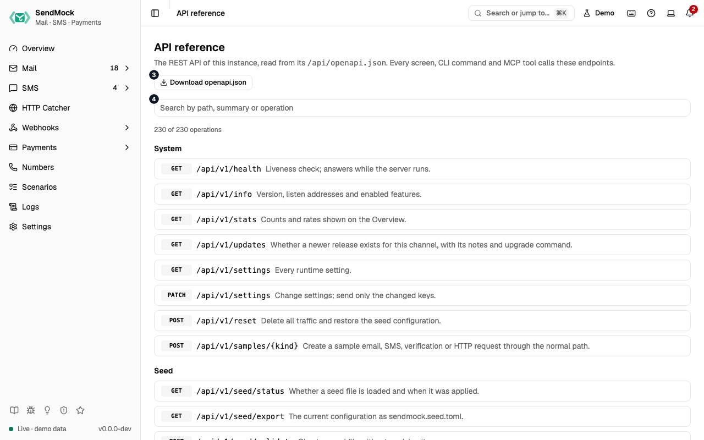

> Every control and text this screen shows, in screen order. The list is read from the demo by a crawl, and CI fails when the screen changes without its entry here.

The API reference, opened from Help, lists every REST operation the running SendMock serves.

The screen as a whole: [Reference](../reference/index.md).

The numbers match the entries below. The picture shows the first screenful; controls further down, and texts, have no marker.

## On the screen

### 1. API reference

Heading.

- **What it does:** Names the screen, in the header and above the list.

### 2. The REST API of this instance, read from its /api/openapi.json . Every screen, CLI command and MCP tool calls these endpoints.

Text.

- **What it does:** Explains the screen: it reads the running instance's own OpenAPI document.

### 3. Download openapi.json

Link.

- **What it does:** Downloads the OpenAPI document.

### 4. Search the API

Search field.

- **What it does:** Filters operations by path, summary or operation id.

### 5. # of # operations

Status.

- **What it does:** How many operations match the search, of all.

### 6. System

Heading.

- **What it does:** The System operations; each opens to show its parameters, body, answer and a curl command.

### 7. Seed

Heading.

- **What it does:** The Seed operations; each opens to show its parameters, body, answer and a curl command.

### 8. Logs

Heading.

- **What it does:** The Logs operations; each opens to show its parameters, body, answer and a curl command.

### 9. Test helpers

Heading.

- **What it does:** The Test helpers operations; each opens to show its parameters, body, answer and a curl command.

### 10. Automation

Heading.

- **What it does:** The Automation operations; each opens to show its parameters, body, answer and a curl command.

### 11. Email

Heading.

- **What it does:** The Email operations; each opens to show its parameters, body, answer and a curl command.

### 12. Inbound routes

Heading.

- **What it does:** The Inbound routes operations; each opens to show its parameters, body, answer and a curl command.

### 13. Tag rules

Heading.

- **What it does:** The Tag rules operations; each opens to show its parameters, body, answer and a curl command.

### 14. Forward rules

Heading.

- **What it does:** The Forward rules operations; each opens to show its parameters, body, answer and a curl command.

### 15. SMS

Heading.

- **What it does:** The SMS operations; each opens to show its parameters, body, answer and a curl command.

### 16. Outcome rules

Heading.

- **What it does:** The Outcome rules operations; each opens to show its parameters, body, answer and a curl command.

### 17. Verify

Heading.

- **What it does:** The Verify operations; each opens to show its parameters, body, answer and a curl command.

### 18. Numbers

Heading.

- **What it does:** The Numbers operations; each opens to show its parameters, body, answer and a curl command.

### 19. Email providers

Heading.

- **What it does:** The Email providers operations; each opens to show its parameters, body, answer and a curl command.

### 20. SMS providers

Heading.

- **What it does:** The SMS providers operations; each opens to show its parameters, body, answer and a curl command.

### 21. HTTP Catcher

Heading.

- **What it does:** The HTTP Catcher operations; each opens to show its parameters, body, answer and a curl command.

### 22. Payments

Heading.

- **What it does:** The Payments operations; each opens to show its parameters, body, answer and a curl command.

### 23. Checkout

Heading.

- **What it does:** The Checkout operations; each opens to show its parameters, body, answer and a curl command.

### 24. Payment flows

Heading.

- **What it does:** The Payment flows operations; each opens to show its parameters, body, answer and a curl command.

### 25. Payment gateways

Heading.

- **What it does:** The Payment gateways operations; each opens to show its parameters, body, answer and a curl command.

### 26. Payment methods

Heading.

- **What it does:** The Payment methods operations; each opens to show its parameters, body, answer and a curl command.

### 27. Webhook endpoints

Heading.

- **What it does:** The Webhook endpoints operations; each opens to show its parameters, body, answer and a curl command.

### 28. Webhook rules

Heading.

- **What it does:** The Webhook rules operations; each opens to show its parameters, body, answer and a curl command.

### 29. Webhook deliveries

Heading.

- **What it does:** The Webhook deliveries operations; each opens to show its parameters, body, answer and a curl command.

### 30. Saved deliveries

Heading.

- **What it does:** The Saved deliveries operations; each opens to show its parameters, body, answer and a curl command.

### 31. Webhook templates

Heading.

- **What it does:** The Webhook templates operations; each opens to show its parameters, body, answer and a curl command.

### 32. Webhook variables

Heading.

- **What it does:** The Webhook variables operations; each opens to show its parameters, body, answer and a curl command.

## When the data cannot load

### 33. Could not load the API reference. Try again

Message.

- **What it does:** Shown when the OpenAPI document could not be loaded.
- **Errors:** Check SendMock is running, then press Try again.

### 34. Could not load the API reference.

Text.

- **What it does:** The message inside the alert.

### 35. Try again

Button.

- **What it does:** Loads it again.
