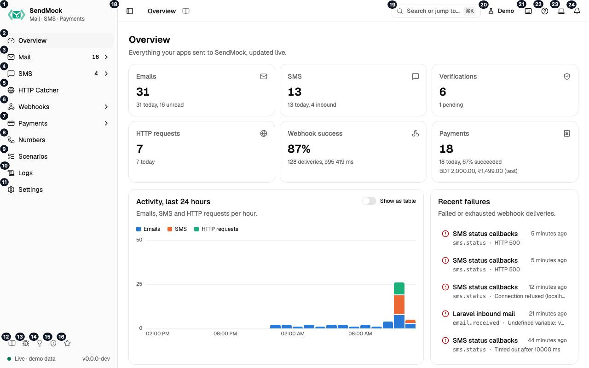

> Every control and text this screen shows, in screen order. The list is read from the demo by a crawl, and CI fails when the screen changes without its entry here.

The sidebar on the left and the header across the top are the same on every screen. The header also shows the open screen's name and a link to its guide page; those are listed on each screen's own Deeper page.

The screen as a whole: [Tour of the app](../tour.md).

The numbers match the entries below. The picture shows the first screenful; controls further down, and texts, have no marker.

## On the screen

### 1. SendMock Mail · SMS · Payments

Link.

- **What it does:** Opens the Overview, the dashboard of everything SendMock caught today.
- **Links to:** [Overview](../overview.md).

### 2. Overview

Link.

- **What it does:** Opens Overview. The keyboard shortcut is `g` then `o`.
- **Where its text comes from:** The sidebar is built from one list in the app, the same one the command palette and the shortcuts use, so the three never disagree.
- **Links to:** [Overview](../overview.md).

### 3. Mail

Link.

- **What it does:** Opens Mail, the inbox of every caught email; under it, Providers lists the email APIs SendMock answers. The keyboard shortcut is `g` then `m`.
- **Where its text comes from:** The sidebar is built from one list in the app, the same one the command palette and the shortcuts use, so the three never disagree.
- **Links to:** [Mail](../mail/index.md).

### 4. SMS

Link.

- **What it does:** Opens SMS, the conversations of every SMS; under it are Verify (`g` then `v`) and Providers. The keyboard shortcut is `g` then `s`.
- **Where its text comes from:** The sidebar is built from one list in the app, the same one the command palette and the shortcuts use, so the three never disagree.
- **Links to:** [SMS](../sms/index.md).

### 5. HTTP Catcher

Link.

- **What it does:** Opens HTTP Catcher, where bins capture the HTTP requests your app sends. The keyboard shortcut is `g` then `h`.
- **Where its text comes from:** The sidebar is built from one list in the app, the same one the command palette and the shortcuts use, so the three never disagree.
- **Links to:** [HTTP Catcher](../http/index.md).

### 6. Webhooks

Link.

- **What it does:** Opens Webhooks; under it are Overview, Endpoints, Rules, Inbound routes, Deliveries (`g` then `d`), Composer, Templates, Variables and Saved. The keyboard shortcut is `g` then `w`.
- **Where its text comes from:** The sidebar is built from one list in the app, the same one the command palette and the shortcuts use, so the three never disagree.
- **Links to:** [Webhooks](../webhooks/index.md).

### 7. Payments

Link.

- **What it does:** Opens Payments; under it are All payments, Gateways, Methods, Flows and Subscriptions. The keyboard shortcut is `g` then `p`.
- **Where its text comes from:** The sidebar is built from one list in the app, the same one the command palette and the shortcuts use, so the three never disagree.
- **Links to:** [Payments](../payments/index.md).

### 8. Numbers

Link.

- **What it does:** Opens Numbers, the virtual phone numbers and their webhooks. The keyboard shortcut is `g` then `n`.
- **Where its text comes from:** The sidebar is built from one list in the app, the same one the command palette and the shortcuts use, so the three never disagree.
- **Links to:** [Numbers](../numbers.md).

### 9. Scenarios

Link.

- **What it does:** Opens Scenarios, where multi-step checks are written and run. The keyboard shortcut is `g` then `c`.
- **Where its text comes from:** The sidebar is built from one list in the app, the same one the command palette and the shortcuts use, so the three never disagree.
- **Links to:** [Scenarios](../scenarios.md).

### 10. Logs

Link.

- **What it does:** Opens Logs, the SMTP sessions and the provider API requests. The keyboard shortcut is `g` then `l`.
- **Where its text comes from:** The sidebar is built from one list in the app, the same one the command palette and the shortcuts use, so the three never disagree.
- **Links to:** [Logs](../logs.md).

### 11. Settings

Link.

- **What it does:** Opens Settings, every setting by section. The keyboard shortcut is `g` then `,`.
- **Where its text comes from:** The sidebar is built from one list in the app, the same one the command palette and the shortcuts use, so the three never disagree.
- **Links to:** [Settings](../settings.md).

### 12. Documentation

Link.

- **What it does:** Opens the docs of the version you run, in a new tab.
- **Where its text comes from:** The docs address is built into the app.

### 13. Report an issue

Link.

- **What it does:** Opens GitHub's bug report form in a new tab, filled in with your SendMock version, release channel, operating system and browser. Nothing else is sent, and nothing at all until you submit the form.
- **Where its text comes from:** The version and channel come from `GET /api/v1/info`; the system and browser from the browser itself.

### 14. Request a feature

Link.

- **What it does:** Opens GitHub's feature request form in a new tab, filled in the same way as Report an issue.

### 15. Report a security issue

Link.

- **What it does:** Opens GitHub's private security advisory form, so a vulnerability is not reported in public.

### 16. Star on GitHub

Link.

- **What it does:** Opens the SendMock repository on GitHub in a new tab.

### 17. Live · demo data, version #.#.#-dev

Status.

- **What it does:** Shows whether the app is connected to SendMock's realtime stream (Live, Connecting, or Offline, retrying), where the data comes from (the server, or demo data on the website demo) and the app's version.
- **Where its text comes from:** The connection state of the realtime stream, and the version the app was built with.
- **Errors:** Offline, retrying means the realtime stream dropped: the app keeps trying, and screens still load when you open them. If it stays offline, check SendMock is still running.

### 18. Toggle Sidebar

Button.

- **What it does:** Collapses the sidebar to icons, or opens it again. On a phone it opens the sidebar as a panel. The keyboard shortcut is `⌘` or `Ctrl` with `B`.
- **What it changes:** Remembered in the browser for your next visit.

### 19. Search or jump to... ⌘K

Button.

- **What it does:** Opens the command palette: type a screen's name to go to it, or run one of its actions, Switch theme (`T`) and Show keyboard shortcuts (`?`). `⌘` or `Ctrl` with `K` opens it from anywhere.

### 20. Demo controls

Button.

- **What it does:** Only on the website demo: opens the demo controls, which add sample traffic, slow down or fail the demo API, switch between the standard, large and empty data sets, and turn the live traffic every 12 seconds on or off.
- **What it changes:** Only the demo in your browser tab; reloading the page starts a fresh demo.

### 21. Keyboard shortcuts

Button.

- **What it does:** Opens the list of keyboard shortcuts. `?` opens it too.

### 22. Help

Button.

- **What it does:** Opens the Help menu: Documentation, Keyboard shortcuts, What's new, Report an issue, Request a feature, Report a security issue and Star on GitHub, the same links as the sidebar's.

### 23. Change theme

Button.

- **What it does:** Opens a menu to pick System, Light or Dark. System follows your computer's setting. `T` switches to the next theme from anywhere.
- **What it changes:** Remembered in the browser for your next visit.

### 24. Notifications

Button.

- **What it does:** Opens the list of recent notifications: new emails, new SMS and failed webhook deliveries, each opening what it is about. Clear all empties the list. When there are unread notifications the button says how many.
- **Where its text comes from:** Events from the realtime stream while the app is open; Settings > Notifications chooses which ones notify.
- **Links to:** The email, conversation or delivery each notification is about, and [Settings](../settings.md).
