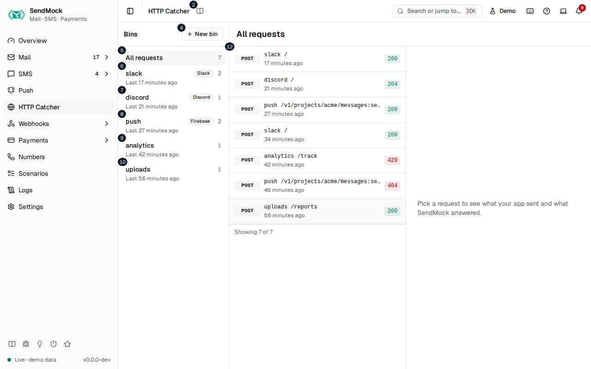

> Every control and text this screen shows, in screen order. The list is read from the demo by a crawl, and CI fails when the screen changes without its entry here.

The HTTP Catcher keeps every request your app sends to a bin's catch URL, and answers as the service it stands in for.

The screen as a whole: [HTTP Catcher](../http/index.md).

The numbers match the entries below. The picture shows the first screenful; controls further down, and texts, have no marker.

## On the screen

### 1. HTTP Catcher

Heading.

- **What it does:** Names the open screen in the header.

### 2. Read the HTTP Catcher guide

Link.

- **What it does:** Opens this screen's page in the user guide, in a new tab.
- **Links to:** [HTTP Catcher](../../http/index.md).

### 3. Bins

Heading.

- **What it does:** The bins: each has a catch URL that keeps every request sent to it.
- **Same action elsewhere:** REST [`GET /api/v1/http/bins`](/api/http-catcher/#getHttpBins), CLI [`sendmock http bin list`](/cli/http-catcher/#http-bin-list), MCP [`sendmock_http_bin_list`](/mcp/http-catcher/#sendmock_http_bin_list)

### 4. New bin

Button.

- **What it does:** Opens New bin.

### 5. All requests #

Button.

- **What it does:** Shows the requests of every bin, with their count.
- **Same action elsewhere:** REST [`GET /api/v1/http/requests`](/api/http-catcher/#getHttpRequests), CLI [`sendmock http list`](/cli/http-catcher/#http-list), MCP [`sendmock_http_list`](/mcp/http-catcher/#sendmock_http_list)

### 6. slack Slack # Last # minutes ago

Button.

- **What it does:** A bin (here the demo's `slack` bin with the Slack preset): its name, preset, request count and last request. Shows its requests.

### 7. discord Discord # Last # minutes ago

Button.

- **What it does:** The demo's `discord` bin, answering as Discord does.

### 8. push Firebase # Last # minutes ago

Button.

- **What it does:** The demo's `push` bin, answering as Firebase Cloud Messaging does.

### 9. analytics # Last # minutes ago

Button.

- **What it does:** The demo's `analytics` bin, with no preset.

### 10. uploads # Last # minutes ago

Button.

- **What it does:** The demo's `uploads` bin, with no preset.

### 11. All requests

Heading.

- **What it does:** The requests of the chosen bin, newest first.

### 12. Select all loaded requests

Checkbox.

- **What it does:** Ticks every row loaded in the list, or clears the ticks; it shows a dash when only some are ticked, and the toolbar says how many are selected. Ticked rows can be marked read, marked unread or deleted together. X ticks the open or focused row.

### 13. Delete all requests

Button.

- **What it does:** Asks first, naming how many go and what stays, then deletes every row the list shows, in the picked project. While a search or filter is on it reads Delete matching and deletes only what it matches. On a bin only its requests go; on All requests every bin's. Bins, catch URLs and rules stay.
- **What it changes:** Publishes one `traffic.cleared` event, so every open tab refreshes; settings and configuration stay.
- **Same action elsewhere:** REST [`DELETE /api/v1/http/requests`](/api/http-catcher/#deleteHttpRequests), CLI [`sendmock http clear`](/cli/http-catcher/#http-clear), MCP [`sendmock_http_clear`](/mcp/http-catcher/#sendmock_http_clear)

### 14. Select POST request to …

Checkbox, in each row.

- **What it does:** Ticks this row, so the toolbar can act on it. Shown on hover, on focus and while anything is ticked, and always on touch screens.

### 15. Unread

Badge, in each row.

- **What it does:** Marks a captured request nobody opened yet. Opening it marks it read; Mark unread puts the dot back, and the sidebar counts the unread ones.
- **Where its text comes from:** The item's `is_read` field.

### 16. POST … # minutes ago #

Button, in each row.

- **What it does:** A captured request: its method, path, when it came and the status SendMock answered; shows it.
- **Same action elsewhere:** REST [`GET /api/v1/http/requests/{requestId}`](/api/http-catcher/#getHttpRequestsByRequestId), CLI [`sendmock http show`](/cli/http-catcher/#http-show), MCP [`sendmock_http_get`](/mcp/http-catcher/#sendmock_http_get)

### 17. Pick a request to see what your app sent and what SendMock answered.

Text.

- **What it does:** Shown until a request is open.

## A bin is open

### 18. slack

Heading.

- **What it does:** The open bin's name (here `slack`).

### 19. Requests

Tab.

- **What it does:** The bin's captured requests.

### 20. Responses

Tab.

- **What it does:** What the bin answers: its default reply and the rules that answer some requests differently, with delays and failure rates.
- **Links to:** [Advanced: catcher responses](../../advanced/catcher-responses.md).
- **Same action elsewhere:** REST [`GET /api/v1/http/bins/{binId}/responses`](/api/http-catcher/#getHttpBinsByBinIdResponses), CLI [`sendmock http response list`](/cli/http-catcher/#http-response-list), MCP [`sendmock_http_response_list`](/mcp/http-catcher/#sendmock_http_response_list)

### 21. Copy catch URL

Button.

- **What it does:** Copies the bin's catch URL, `/catch/<bin>/...`, to point your app at.

### 22. Delete bin

Button.

- **What it does:** Deletes the bin and its requests, after you confirm.
- **Same action elsewhere:** REST [`DELETE /api/v1/http/bins/{binId}`](/api/http-catcher/#deleteHttpBinsByBinId), CLI [`sendmock http bin delete`](/cli/http-catcher/#http-bin-delete), MCP [`sendmock_http_bin_delete`](/mcp/http-catcher/#sendmock_http_bin_delete)

### 23. Select POST request to /

Checkbox, in each row.

- **What it does:** Ticks this row, so the toolbar can act on it. Shown on hover, on focus and while anything is ticked, and always on touch screens.

### 24. POST / # minutes ago #

Button, in each row.

- **What it does:** A request in this bin; shows it.

## A request is open

### 25. Copy URL

Button.

- **What it does:** Copies the full URL the request was sent to.

### 26. Month #, #, #:# from #.#.#.#, answered in # ms

Text.

- **What it does:** When the request came, from which address, and how long SendMock took to answer.

### 27. Copy as cURL

Button.

- **What it does:** Copies the request as a curl command.

### 28. Forward to URL

Button.

- **What it does:** Sends the same request on to another URL, such as your local handler, and shows its answer.
- **Same action elsewhere:** REST [`POST /api/v1/http/requests/{requestId}/forward`](/api/http-catcher/#postHttpRequestsByRequestIdForward), CLI [`sendmock http forward`](/cli/http-catcher/#http-forward), MCP [`sendmock_http_forward`](/mcp/http-catcher/#sendmock_http_forward)

### 29. Send to webhook

Button.

- **What it does:** Sends the request's `http.captured` event to a webhook endpoint now.
- **Same action elsewhere:** REST [`POST /api/v1/webhooks/endpoints/{endpointId}/send`](/api/webhook-endpoints/#postWebhooksEndpointsByEndpointIdSend), CLI [`sendmock webhook send`](/cli/webhook-endpoints/#webhook-send), MCP [`sendmock_webhook_send`](/mcp/webhook-endpoints/#sendmock_webhook_send)

### 30. Preview

Tab.

- **What it does:** How the message would look in the service the preset copies (here Slack).

### 31. Body

Tab.

- **What it does:** The body as received, formatted when it is JSON or a form.

### 32. Headers

Tab.

- **What it does:** Every header received.

### 33. Query

Tab.

- **What it does:** The query parameters.

### 34. Response

Tab.

- **What it does:** What SendMock answered: status, headers and body, and which rule chose it.

### 35. Incoming webhook APP

Text.

- **What it does:** In the Slack preview: the sender as Slack would show it.

### 36. Email bounced

Text.

- **What it does:** In the Slack preview: the message text (here a bounce alert).

### 37. unknown-user@example.com did not get Your verification code .

Text.

- **What it does:** In the Slack preview: the message's details.

### 38. Reason # #.#.# user unknown

Text.

- **What it does:** In the Slack preview: a field of the message.

### 39. Provider SendMock

Text.

- **What it does:** In the Slack preview: a field of the message.

### 40. Sent by acme-app worker

Text.

- **What it does:** In the Slack preview: the message's footer.

## New bin dialog

### 41. New bin

Heading.

- **What it does:** The New bin dialog.

### 42. Requests to its catch URL are kept here and answered with its reply.

Text.

- **What it does:** Explains a bin.

### 43. Name

Field.

- **What it does:** The bin's name, which is also its catch URL's first path part.

### 44. http://#.#.#.#:#/catch/\<name>

Text.

- **What it does:** The catch URL the bin will have.

### 45. Preset

Drop-down.

- **What it does:** A service to answer as: Slack, Discord, Teams, Google Chat, Telegram, FCM, Expo, OneSignal or generic.

### 46. Answers # \{"ok":true\}.

Text.

- **What it does:** What the chosen preset answers.

### 47. Cancel

Button.

- **What it does:** Closes the dialog without doing anything.

### 48. Add bin

Button.

- **What it does:** Adds the bin.
- **Same action elsewhere:** REST [`POST /api/v1/http/bins`](/api/http-catcher/#postHttpBins), CLI [`sendmock http bin create`](/cli/http-catcher/#http-bin-create), MCP [`sendmock_http_bin_create`](/mcp/http-catcher/#sendmock_http_bin_create)

### 49. Close

Button.

- **What it does:** Closes the dialog.

## With no data yet

### 50. slack Slack # No requests yet

Button.

- **What it does:** A bin with no requests yet.

### 51. discord Discord # No requests yet

Button.

- **What it does:** A bin with no requests yet.

### 52. push Firebase # No requests yet

Button.

- **What it does:** A bin with no requests yet.

### 53. analytics # No requests yet

Button.

- **What it does:** A bin with no requests yet.

### 54. uploads # No requests yet

Button.

- **What it does:** A bin with no requests yet.

### 55. No requests caught yet.

Text.

- **What it does:** Shown while no request has come.

## When the data cannot load

### 56. Could not load the HTTP bins. Try again

Message.

- **What it does:** Shown when the bins could not be loaded.
- **Errors:** Check SendMock is running, then press Try again.

### 57. Could not load the HTTP bins.

Text.

- **What it does:** The message inside the alert.

### 58. Try again

Button.

- **What it does:** Loads the bins again.
- **Same action elsewhere:** REST [`GET /api/v1/http/bins`](/api/http-catcher/#getHttpBins), CLI [`sendmock http bin list`](/cli/http-catcher/#http-bin-list), MCP [`sendmock_http_bin_list`](/mcp/http-catcher/#sendmock_http_bin_list)
