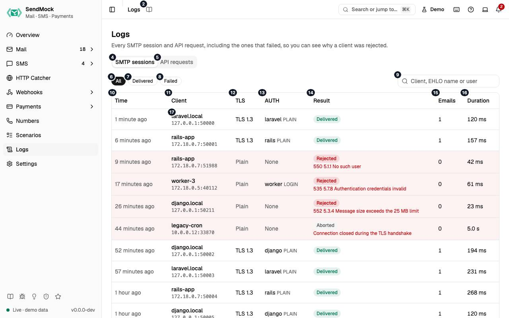

> Every control and text this screen shows, in screen order. The list is read from the demo by a crawl, and CI fails when the screen changes without its entry here.

Logs keeps every SMTP session and every API request, failed ones included, to see why a client was refused.

The screen as a whole: [Logs](../logs.md).

The numbers match the entries below. The picture shows the first screenful; controls further down, and texts, have no marker.

## On the screen

### 1. Logs

Heading.

- **What it does:** Names the screen, in the header and above the tabs.

### 2. Read the Logs guide

Link.

- **What it does:** Opens this screen's page in the user guide, in a new tab.
- **Links to:** [Logs](../../logs.md).

### 3. Every SMTP session and API request, including the ones that failed, so you can see why a client was rejected.

Text.

- **What it does:** Explains the screen.

### 4. SMTP sessions

Tab.

- **What it does:** Every SMTP connection, newest first.
- **Same action elsewhere:** REST [`GET /api/v1/logs/smtp`](/api/logs/#getLogsSmtp), CLI [`sendmock logs smtp`](/cli/logs/#logs-smtp), MCP [`sendmock_logs_smtp`](/mcp/logs/#sendmock_logs_smtp)

### 5. API requests

Tab.

- **What it does:** Every request to the native and provider APIs, rejected ones included.
- **Same action elsewhere:** REST [`GET /api/v1/logs/http`](/api/logs/#getLogsHttp), CLI [`sendmock logs http`](/cli/logs/#logs-http), MCP [`sendmock_logs_http`](/mcp/logs/#sendmock_logs_http)

### 6. All

Button.

- **What it does:** Shows every session.

### 7. Delivered

Button.

- **What it does:** Shows sessions that stored at least one email.

### 8. Failed

Button.

- **What it does:** Shows sessions that ended with an error, such as a refused login or a message too large.

### 9. Search SMTP sessions

Field.

- **What it does:** Filters by client, address or reply.

### 10. Select all loaded SMTP sessions

Checkbox.

- **What it does:** Ticks every row loaded in the list, or clears the ticks; it shows a dash when only some are ticked, and the toolbar says how many are selected. Ticked rows can be deleted together. X ticks the open or focused row.

### 11. Delete all SMTP sessions

Button.

- **What it does:** Asks first, naming how many go and what stays, then deletes every row the list shows, in the picked project. While a search or filter is on it reads Delete matching and deletes only what it matches. The emails they delivered stay in Mail.
- **What it changes:** Publishes one `traffic.cleared` event, so every open tab refreshes; settings and configuration stay.
- **Same action elsewhere:** REST [`DELETE /api/v1/logs/smtp`](/api/logs/#deleteLogsSmtp), CLI [`sendmock logs smtp delete-all`](/cli/logs/#logs-smtp-delete-all), MCP [`sendmock_logs_smtp_delete_all`](/mcp/logs/#sendmock_logs_smtp_delete_all)

### 12. Select

Column.

- **What it does:** The column of tick boxes; it has no visible title.

### 13. Time

Column.

- **What it does:** When the session started.

### 14. Client

Column.

- **What it does:** The client's address and its `EHLO` name.

### 15. TLS

Column.

- **What it does:** Whether it used STARTTLS or implicit TLS.

### 16. AUTH

Column.

- **What it does:** The login it used, if any.

### 17. Result

Column.

- **What it does:** How it ended: delivered, or the error code and reply.

### 18. Emails

Column.

- **What it does:** How many emails it stored.

### 19. Duration

Column.

- **What it does:** How long it lasted.

### 20. Select SMTP session from …

Checkbox, in each row.

- **What it does:** Ticks this row, so the toolbar can act on it. Shown on hover, on focus and while anything is ticked, and always on touch screens.

### 21. …

Link, in each row.

- **What it does:** Opens the session's transcript.
- **Same action elsewhere:** REST [`GET /api/v1/logs/smtp/{sessionId}`](/api/logs/#getLogsSmtpBySessionId), CLI [`sendmock logs smtp show`](/cli/logs/#logs-smtp-show), MCP [`sendmock_logs_smtp_get`](/mcp/logs/#sendmock_logs_smtp_get)

## An SMTP session is open

### 22. SMTP session

Heading.

- **What it does:** The session drawer.

### 23. Every command your app sent and every reply SendMock gave.

Text.

- **What it does:** Explains the drawer.

### 24. Transcript

Heading.

- **What it does:** The conversation, line by line.

### 25. Open email

Link.

- **What it does:** Opens the email the session delivered.
- **Links to:** [Inbox](../../mail/index.md).

### 26. Copy transcript

Button.

- **What it does:** Copies the whole transcript.

### 27. [message # bytes, stored as email]

Link, in each row.

- **What it does:** Where the message was sent in the transcript; opens the email it became.

### 28. AUTH secrets are masked, and the message content is not repeated here: it is stored as the email.

Text.

- **What it does:** Explains what the transcript leaves out.

### 29. Close

Button.

- **What it does:** Closes the drawer.

## API requests tab

### 30. #xx

Button.

- **What it does:** Shows only rejected requests (4xx answers).

### 31. Filter by API

Drop-down.

- **What it does:** Shows one API's requests, such as Twilio or SendGrid, or all.

### 32. Search request paths

Field.

- **What it does:** Filters by path.

### 33. Select all loaded API requests

Checkbox.

- **What it does:** Ticks every row loaded in the list, or clears the ticks; it shows a dash when only some are ticked, and the toolbar says how many are selected. Ticked rows can be deleted together. X ticks the open or focused row.

### 34. Delete all API requests

Button.

- **What it does:** Asks first, naming how many go and what stays, then deletes every row the list shows, in the picked project. While a search or filter is on it reads Delete matching and deletes only what it matches. The emails, SMS and payments they made stay.
- **What it changes:** Publishes one `traffic.cleared` event, so every open tab refreshes; settings and configuration stay.
- **Same action elsewhere:** REST [`DELETE /api/v1/logs/http`](/api/logs/#deleteLogsHttp), CLI [`sendmock logs http delete-all`](/cli/logs/#logs-http-delete-all), MCP [`sendmock_logs_http_delete_all`](/mcp/logs/#sendmock_logs_http_delete_all)

### 35. API

Column.

- **What it does:** The API the request was for.

### 36. Request

Column.

- **What it does:** Its method and path.

### 37. Status

Column.

- **What it does:** The status SendMock answered.

### 38. Select POST …

Checkbox, in each row.

- **What it does:** Ticks this row, so the toolbar can act on it. Shown on hover, on focus and while anything is ticked, and always on touch screens.

### 39. POST …

Link, in each row.

- **What it does:** Opens the request.
- **Same action elsewhere:** REST [`GET /api/v1/logs/http/{requestId}`](/api/logs/#getLogsHttpByRequestId), CLI [`sendmock logs http show`](/cli/logs/#logs-http-show), MCP [`sendmock_logs_http_get`](/mcp/logs/#sendmock_logs_http_get)

## An API request is open

### 40. API request

Heading.

- **What it does:** The request drawer.

### 41. Exactly what your app sent and what SendMock answered.

Text.

- **What it does:** Explains the drawer.

### 42. POST /#-#-#/Accounts/AC#/Messages.json

Text.

- **What it does:** The request's method and path (here a Twilio send).

### 43. Open SMS

Link.

- **What it does:** Opens the SMS the request created.
- **Links to:** [SMS](../../sms/index.md).

### 44. Request headers

Heading.

- **What it does:** The headers received.

### 45. Request body

Heading.

- **What it does:** The body received.

### 46. Copy request body

Button.

- **What it does:** Copies the request body.

### 47. Response body

Heading.

- **What it does:** What SendMock answered, exactly.

### 48. Copy response body

Button.

- **What it does:** Copies the response body.

### 49. Credentials such as API keys and passwords are masked before logging.

Text.

- **What it does:** Explains the masking.

### 50. Close

Button.

- **What it does:** Closes the drawer.

## With no data yet

### 51. No SMTP sessions yet

Text.

- **What it does:** Shown while no app has connected over SMTP.

### 52. Point your app's SMTP settings at SendMock; every connection shows up here, even the ones that fail.

Text.

- **What it does:** Explains how sessions arrive.

### 53. This machine

Choice.

- **What it does:** Shows the addresses for an app on the same machine.
- **What it changes:** Shared with Settings > Connection and remembered in the browser.
- **Same action elsewhere:** REST [`GET /api/v1/info`](/api/system/#getInfo), CLI [`sendmock status`](/cli/system/#status), MCP [`sendmock_status`](/mcp/system/#sendmock_status)

### 54. Docker host

Choice.

- **What it does:** Shows the addresses for an app in a container reaching SendMock on the host.

### 55. Compose

Choice.

- **What it does:** Shows the addresses for an app in the same Docker Compose project.

### 56. Copy SMTP host

Button.

- **What it does:** Copies the SMTP host.

### 57. Copy SMTP port

Button.

- **What it does:** Copies the SMTP port.

### 58. More snippets

Link.

- **What it does:** Opens Settings > Connection.
- **Links to:** [Settings](../../settings.md).

### 59. Send a sample email

Button.

- **What it does:** Stores a sample email.
- **Same action elsewhere:** REST [`POST /api/v1/samples/{kind}`](/api/system/#postSamplesByKind), CLI [`sendmock sample`](/cli/system/#sample), MCP [`sendmock_sample_send`](/mcp/system/#sendmock_sample_send)

### 60. Choose webhooks for Send a sample email

Button.

- **What it does:** Opens Choose webhooks for this one action. Choose webhooks lists every enabled endpoint with a search box, the endpoints your rules would pick already checked, each checked one with Payload to see and edit its request, and says how many are chosen (or that no webhook will be sent). Its confirm button, named after the action, runs it once and sends the event to exactly the checked endpoints; Cancel runs nothing.
- **What it changes:** The chosen deliveries show `chosen` as their Trigger in Webhooks > Deliveries, and an edited payload `edited`. Your rules stay as they are; the dialog's rules link opens them in a new tab.
- **Links to:** [Webhook rules](../../webhooks/rules.md).
- **Same action elsewhere:** REST [`POST /api/v1/samples/{kind}`](/api/system/#postSamplesByKind), CLI [`sendmock sample`](/cli/system/#sample), MCP [`sendmock_sample_send`](/mcp/system/#sendmock_sample_send)
- **Same action elsewhere:** REST [`POST /api/v1/webhooks/rules/match`](/api/webhook-rules/#postWebhooksRulesMatch), CLI [`sendmock webhook rule match`](/cli/webhook-rules/#webhook-rule-match), MCP [`sendmock_webhook_rule_match`](/mcp/webhook-rules/#sendmock_webhook_rule_match)

## When the data cannot load

### 61. Could not load the SMTP log. Try again

Message.

- **What it does:** Shown when the log could not be loaded.
- **Errors:** Check SendMock is running, then press Try again.

### 62. Could not load the SMTP log.

Text.

- **What it does:** The message inside the alert.

### 63. Try again

Button.

- **What it does:** Loads the log again.
- **Same action elsewhere:** REST [`GET /api/v1/logs/smtp`](/api/logs/#getLogsSmtp), CLI [`sendmock logs smtp`](/cli/logs/#logs-smtp), MCP [`sendmock_logs_smtp`](/mcp/logs/#sendmock_logs_smtp)
