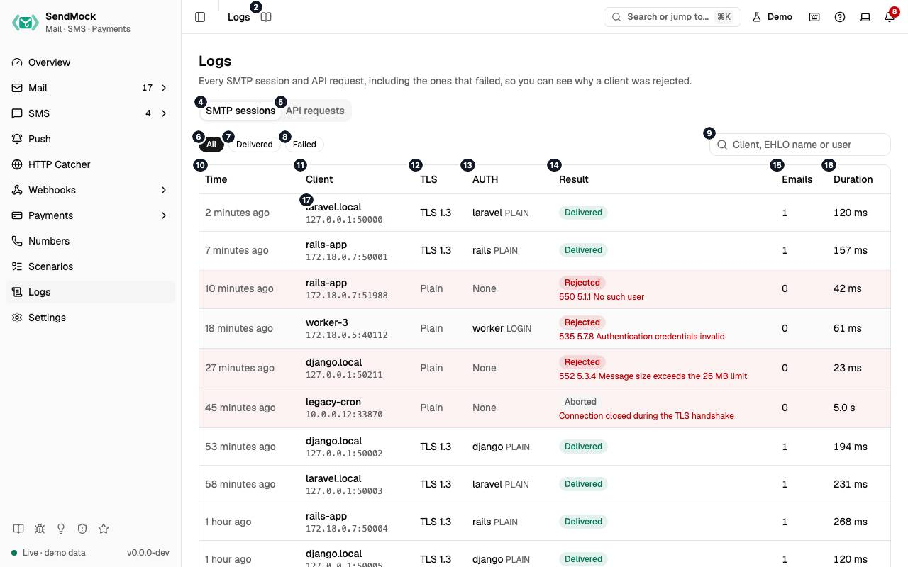

> Every control and text this screen shows, in screen order. The list is read from the demo by a crawl, and CI fails when the screen changes without its entry here.

Logs keeps every SMTP session and every API request, failed ones included, to see why a client was refused.

The screen as a whole: [Logs](../logs.md).

The numbers match the entries below. The picture shows the first screenful; controls further down, and texts, have no marker.

## On the screen

### 1. Logs

Heading.

- **What it does:** Names the screen, in the header and above the tabs.

### 2. Read the Logs guide

Link.

- **What it does:** Opens this screen's page in the user guide, in a new tab.
- **Links to:** [Logs](../../logs.md).

### 3. Every SMTP session and API request, including the ones that failed, so you can see why a client was rejected.

Text.

- **What it does:** Explains the screen.

### 4. SMTP sessions

Tab.

- **What it does:** Every SMTP connection, newest first.
- **Same action elsewhere:** REST [`GET /api/v1/logs/smtp`](/api/logs/#getLogsSmtp), CLI [`sendmock logs smtp`](/cli/logs/#logs-smtp), MCP [`sendmock_logs_smtp`](/mcp/logs/#sendmock_logs_smtp)

### 5. API requests

Tab.

- **What it does:** Every request to the native and provider APIs, rejected ones included.
- **Same action elsewhere:** REST [`GET /api/v1/logs/http`](/api/logs/#getLogsHttp), CLI [`sendmock logs http`](/cli/logs/#logs-http), MCP [`sendmock_logs_http`](/mcp/logs/#sendmock_logs_http)

### 6. All

Button.

- **What it does:** Shows every session.

### 7. Delivered

Button.

- **What it does:** Shows sessions that stored at least one email.

### 8. Failed

Button.

- **What it does:** Shows sessions that ended with an error, such as a refused login or a message too large.

### 9. Search SMTP sessions

Field.

- **What it does:** Filters by client, address or reply.

### 10. Time

Column.

- **What it does:** When the session started.

### 11. Client

Column.

- **What it does:** The client's address and its `EHLO` name.

### 12. TLS

Column.

- **What it does:** Whether it used STARTTLS or implicit TLS.

### 13. AUTH

Column.

- **What it does:** The login it used, if any.

### 14. Result

Column.

- **What it does:** How it ended: delivered, or the error code and reply.

### 15. Emails

Column.

- **What it does:** How many emails it stored.

### 16. Duration

Column.

- **What it does:** How long it lasted.

### 17. …

Link, in each row.

- **What it does:** Opens the session's transcript.
- **Same action elsewhere:** REST [`GET /api/v1/logs/smtp/{sessionId}`](/api/logs/#getLogsSmtpBySessionId), CLI [`sendmock logs smtp show`](/cli/logs/#logs-smtp-show), MCP [`sendmock_logs_smtp_get`](/mcp/logs/#sendmock_logs_smtp_get)

## An SMTP session is open

### 18. SMTP session

Heading.

- **What it does:** The session drawer.

### 19. Every command your app sent and every reply SendMock gave.

Text.

- **What it does:** Explains the drawer.

### 20. Transcript

Heading.

- **What it does:** The conversation, line by line.

### 21. Open email

Link.

- **What it does:** Opens the email the session delivered.
- **Links to:** [Inbox](../../mail/index.md).

### 22. Copy transcript

Button.

- **What it does:** Copies the whole transcript.

### 23. [message # bytes, stored as email]

Link, in each row.

- **What it does:** Where the message was sent in the transcript; opens the email it became.

### 24. AUTH secrets are masked, and the message content is not repeated here: it is stored as the email.

Text.

- **What it does:** Explains what the transcript leaves out.

### 25. Close

Button.

- **What it does:** Closes the drawer.

## API requests tab

### 26. #xx

Button.

- **What it does:** Shows only rejected requests (4xx answers).

### 27. Filter by API

Drop-down.

- **What it does:** Shows one API's requests, such as Twilio or SendGrid, or all.

### 28. Search request paths

Field.

- **What it does:** Filters by path.

### 29. API

Column.

- **What it does:** The API the request was for.

### 30. Request

Column.

- **What it does:** Its method and path.

### 31. Status

Column.

- **What it does:** The status SendMock answered.

### 32. POST …

Link, in each row.

- **What it does:** Opens the request.
- **Same action elsewhere:** REST [`GET /api/v1/logs/http/{requestId}`](/api/logs/#getLogsHttpByRequestId), CLI [`sendmock logs http show`](/cli/logs/#logs-http-show), MCP [`sendmock_logs_http_get`](/mcp/logs/#sendmock_logs_http_get)

## An API request is open

### 33. API request

Heading.

- **What it does:** The request drawer.

### 34. Exactly what your app sent and what SendMock answered.

Text.

- **What it does:** Explains the drawer.

### 35. POST /#-#-#/Accounts/AC#/Messages.json

Text.

- **What it does:** The request's method and path (here a Twilio send).

### 36. Open SMS

Link.

- **What it does:** Opens the SMS the request created.
- **Links to:** [SMS](../../sms/index.md).

### 37. Request headers

Heading.

- **What it does:** The headers received.

### 38. Request body

Heading.

- **What it does:** The body received.

### 39. Copy request body

Button.

- **What it does:** Copies the request body.

### 40. Response body

Heading.

- **What it does:** What SendMock answered, exactly.

### 41. Copy response body

Button.

- **What it does:** Copies the response body.

### 42. Credentials such as API keys and passwords are masked before logging.

Text.

- **What it does:** Explains the masking.

### 43. Close

Button.

- **What it does:** Closes the drawer.

## With no data yet

### 44. No SMTP sessions yet

Text.

- **What it does:** Shown while no app has connected over SMTP.

### 45. Point your app's SMTP settings at SendMock; every connection shows up here, even the ones that fail.

Text.

- **What it does:** Explains how sessions arrive.

### 46. This machine

Choice.

- **What it does:** Shows the addresses for an app on the same machine.
- **What it changes:** Shared with Settings > Connection and remembered in the browser.
- **Same action elsewhere:** REST [`GET /api/v1/info`](/api/system/#getInfo), CLI [`sendmock status`](/cli/system/#status), MCP [`sendmock_status`](/mcp/system/#sendmock_status)

### 47. Docker host

Choice.

- **What it does:** Shows the addresses for an app in a container reaching SendMock on the host.

### 48. Compose

Choice.

- **What it does:** Shows the addresses for an app in the same Docker Compose project.

### 49. Copy SMTP host

Button.

- **What it does:** Copies the SMTP host.

### 50. Copy SMTP port

Button.

- **What it does:** Copies the SMTP port.

### 51. More snippets

Link.

- **What it does:** Opens Settings > Connection.
- **Links to:** [Settings](../../settings.md).

### 52. Send a sample email

Button.

- **What it does:** Stores a sample email.
- **Same action elsewhere:** REST [`POST /api/v1/samples/{kind}`](/api/system/#postSamplesByKind), CLI [`sendmock sample`](/cli/system/#sample), MCP [`sendmock_sample_send`](/mcp/system/#sendmock_sample_send)

## When the data cannot load

### 53. Could not load the SMTP log. Try again

Message.

- **What it does:** Shown when the log could not be loaded.
- **Errors:** Check SendMock is running, then press Try again.

### 54. Could not load the SMTP log.

Text.

- **What it does:** The message inside the alert.

### 55. Try again

Button.

- **What it does:** Loads the log again.
- **Same action elsewhere:** REST [`GET /api/v1/logs/smtp`](/api/logs/#getLogsSmtp), CLI [`sendmock logs smtp`](/cli/logs/#logs-smtp), MCP [`sendmock_logs_smtp`](/mcp/logs/#sendmock_logs_smtp)
