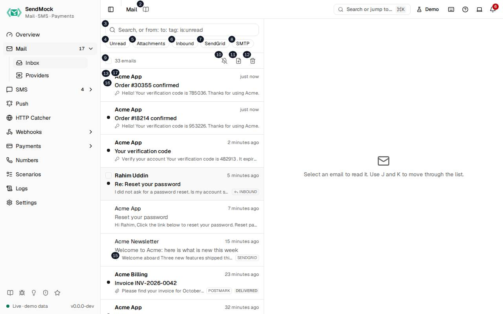

> Every control and text this screen shows, in screen order. The list is read from the demo by a crawl, and CI fails when the screen changes without its entry here.

Mail > Inbox lists every email SendMock caught, whatever the recipient, and shows the one you open beside the list.

The screen as a whole: [Inbox](../../mail/index.md).

The numbers match the entries below. The picture shows the first screenful; controls further down, and texts, have no marker.

## On the screen

### 1. Mail

Heading.

- **What it does:** Names the open screen in the header.

### 2. Read the Mail guide

Link.

- **What it does:** Opens this screen's page in the user guide, in a new tab.
- **Links to:** [Inbox](../../mail/index.md).

### 3. Search emails

Field.

- **What it does:** Filters the list as you type. Free text is a full-text search of the emails; `from:`, `to:`, `tag:`, `source:`, `is:unread`, `is:inbound`, `is:outbound` and `has:attachment` narrow it further, and each one shows as a chip you can remove.
- **Where its text comes from:** The filters are sent to the API, so the list, the count and Delete all emails all follow them.
- **Same action elsewhere:** REST [`GET /api/v1/emails`](/api/email/#getEmails), CLI [`sendmock email list`](/cli/email/#email-list), MCP [`sendmock_email_list`](/mcp/email/#sendmock_email_list)

### 4. Unread

Button.

- **What it does:** Shows only unread emails; press it again to show all. The same as `is:unread`.
- **Same action elsewhere:** REST [`GET /api/v1/emails`](/api/email/#getEmails), CLI [`sendmock email list`](/cli/email/#email-list), MCP [`sendmock_email_list`](/mcp/email/#sendmock_email_list)

### 5. Attachments

Button.

- **What it does:** Shows only emails with an attachment. The same as `has:attachment`.
- **Same action elsewhere:** REST [`GET /api/v1/emails`](/api/email/#getEmails), CLI [`sendmock email list`](/cli/email/#email-list), MCP [`sendmock_email_list`](/mcp/email/#sendmock_email_list)

### 6. Inbound

Button.

- **What it does:** Shows only incoming emails: replies and mail sent to an inbound domain, as opposed to mail your app sent. The same as `is:inbound`.
- **Same action elsewhere:** REST [`GET /api/v1/emails`](/api/email/#getEmails), CLI [`sendmock email list`](/cli/email/#email-list), MCP [`sendmock_email_list`](/mcp/email/#sendmock_email_list)

### 7. SendGrid

Button.

- **What it does:** Shows only the emails that arrived through the SendGrid API. A quick filter appears for each email provider and transport the stored mail came through. The same as `source:sendgrid`.
- **Where its text comes from:** The sources of the emails stored now.
- **Same action elsewhere:** REST [`GET /api/v1/emails`](/api/email/#getEmails), CLI [`sendmock email list`](/cli/email/#email-list), MCP [`sendmock_email_list`](/mcp/email/#sendmock_email_list)

### 8. SMTP

Button.

- **What it does:** Shows only the emails that arrived over SMTP. The same as `source:smtp`.
- **Same action elsewhere:** REST [`GET /api/v1/emails`](/api/email/#getEmails), CLI [`sendmock email list`](/cli/email/#email-list), MCP [`sendmock_email_list`](/mcp/email/#sendmock_email_list)

### 9. Select all loaded emails

Checkbox.

- **What it does:** Selects every email loaded in the list, or clears the selection. Selected emails can be marked read or deleted together.

### 10. Notify me about new emails

Button.

- **What it does:** Asks the browser for permission, then shows a system notification for each new email that matches the current filter, while this tab is open.
- **Errors:** If the browser blocks notifications, allow them for this site in the browser's settings and press the button again.

### 11. Import .eml

Button.

- **What it does:** Opens the Import .eml dialog, to store a whole message from a file or pasted text.

### 12. Delete all emails

Button.

- **What it does:** Asks for confirmation, then deletes every email, or only the ones the current search and filters show.
- **What it changes:** Deletes the emails and their attachments; webhook deliveries and logs are kept.
- **Same action elsewhere:** REST [`DELETE /api/v1/emails`](/api/email/#deleteEmails), CLI [`sendmock email delete-all`](/cli/email/#email-delete-all), MCP [`sendmock_email_delete_all`](/mcp/email/#sendmock_email_delete_all)

### 13. Select email from …

Checkbox, in each row.

- **What it does:** Selects this email for Mark read or Delete.

### 14. Unread

Badge, in each row.

- **What it does:** Marks an email you have not opened yet. Opening it marks it read.
- **Where its text comes from:** The email's `is_read` field.

### 15. Has attachments

Badge, in each row.

- **What it does:** Marks an email with at least one attachment.

### 16. …

Badge, in each row.

- **What it does:** Other markers a row can show, such as Has a code when a one-time code was found in the email.

### 17. …

Link, in each row.

- **What it does:** Opens the email beside the list: the sender, the time it arrived, the subject, the first words of the body, and its source and delivery outcome badges. `J` and `K` open the next and previous email.
- **Same action elsewhere:** REST [`GET /api/v1/emails/{emailId}`](/api/email/#getEmailsByEmailId), CLI [`sendmock email show`](/cli/email/#email-show), MCP [`sendmock_email_get`](/mcp/email/#sendmock_email_get)

### 18. Select an email to read it. Use J and K to move through the list.

Text.

- **What it does:** Shown in the reading pane until an email is open.

## An email is open

### 19. Welcome to Acme: here is what is new this week

Heading.

- **What it does:** The open email's subject (here the demo's newsletter).
- **Where its text comes from:** The email's `Subject` header.

### 20. Reply

Button.

- **What it does:** Opens the composer to answer as the recipient: the reply arrives in SendMock as an incoming email to your app, as a real customer's reply would. Reply all appears beside it when the email had several recipients.
- **Links to:** [Replies and forwards](../../mail/replies-and-forwards.md).

### 21. Forward

Button.

- **What it does:** Opens the composer to forward the email as the recipient, to an address your app receives on.

### 22. Mark as unread

Button.

- **What it does:** Marks the open email unread again (Mark as read when it is unread). Opening an email marks it read.
- **What it changes:** The email's `is_read`; the sidebar's unread count follows.
- **Same action elsewhere:** REST [`PATCH /api/v1/emails/{emailId}`](/api/email/#patchEmailsByEmailId), CLI [`sendmock email update`](/cli/email/#email-update), MCP [`sendmock_email_update`](/mcp/email/#sendmock_email_update)

### 23. Delete email

Button.

- **What it does:** Deletes the open email at once and goes back to the list; a notice confirms it.
- **Same action elsewhere:** REST [`DELETE /api/v1/emails/{emailId}`](/api/email/#deleteEmailsByEmailId), CLI [`sendmock email delete`](/cli/email/#email-delete), MCP [`sendmock_email_delete`](/mcp/email/#sendmock_email_delete)

### 24. Simulate an event

Button.

- **What it does:** Opens a menu of outcomes to simulate for this email, as the provider would report them.

### 25. More actions

Button.

- **What it does:** Opens a menu with Download .eml, Release to real SMTP and Send to webhook.

### 26. SendGrid

Link.

- **What it does:** Says the email came through the SendGrid API, and opens Mail > Providers.
- **Where its text comes from:** The email's `source`: the provider key, or SMTP, sendmail, the native API, Verify or a simulated reply.
- **Links to:** [Mail > Providers](../../mail/providers.md).

### 27. Edit tags

Button.

- **What it does:** Lets you add or remove the email's tags. Tags also come from plus addresses, headers and tag rules.
- **What it changes:** The email's `tags`.
- **Same action elsewhere:** REST [`PATCH /api/v1/emails/{emailId}`](/api/email/#patchEmailsByEmailId), CLI [`sendmock email update`](/cli/email/#email-update), MCP [`sendmock_email_update`](/mcp/email/#sendmock_email_update)

### 28. https://acme.test/blog

Link.

- **What it does:** A link found in the email, opened in a new tab. Verification and reset links are listed first.
- **Where its text comes from:** Extracted from the text and HTML bodies when the email is stored.
- **Same action elsewhere:** REST [`GET /api/v1/emails/{emailId}`](/api/email/#getEmailsByEmailId), CLI [`sendmock email show`](/cli/email/#email-show), MCP [`sendmock_email_get`](/mcp/email/#sendmock_email_get)

### 29. Copy link

Button.

- **What it does:** Copies the link beside it.

### 30. HTML

Tab.

- **What it does:** Shows the HTML body in a sandboxed frame: scripts never run and remote images stay blocked until you load them.

### 31. Text

Tab.

- **What it does:** Shows the plain text body as it was sent.

### 32. Source

Tab.

- **What it does:** Shows the whole raw message, headers and all, byte for byte as received.
- **Same action elsewhere:** REST [`GET /api/v1/emails/{emailId}/raw`](/api/email/#getEmailsByEmailIdRaw), CLI [`sendmock email raw`](/cli/email/#email-raw)

### 33. Headers

Tab.

- **What it does:** Lists every header with its value, in the order received.

### 34. Attachments (#)

Tab.

- **What it does:** Lists the attachments, with a preview for images, and the number of them in the tab's name.

### 35. MIME

Tab.

- **What it does:** Shows the message's MIME tree: each part with its type, encoding and size.
- **Same action elsewhere:** REST [`GET /api/v1/emails/{emailId}/mime`](/api/email/#getEmailsByEmailIdMime), CLI [`sendmock email mime`](/cli/email/#email-mime), MCP [`sendmock_email_mime`](/mcp/email/#sendmock_email_mime)

### 36. Checks

Tab.

- **What it does:** Runs the quality checks: HTML and CSS support across email clients, the links (when you ask) and a spam score.

### 37. Timeline

Tab.

- **What it does:** Lists what happened to the email: received, then each delivery outcome, open and reply, with the webhook deliveries they caused.
- **Same action elsewhere:** REST [`GET /api/v1/emails/{emailId}/timeline`](/api/email/#getEmailsByEmailIdTimeline), CLI [`sendmock email timeline`](/cli/email/#email-timeline), MCP [`sendmock_email_timeline`](/mcp/email/#sendmock_email_timeline)

### 38. Template data

Tab.

- **What it does:** For an email sent with a provider's dynamic template, shows the template id and the data your app sent with it.

### 39. Desktop width

Choice.

- **What it does:** Shows the HTML at a desktop width.

### 40. Tablet width

Choice.

- **What it does:** Shows the HTML at a tablet width.

### 41. Mobile width

Choice.

- **What it does:** Shows the HTML at a phone width, to check the layout responds.

### 42. Load remote images

Button.

- **What it does:** Loads the images the HTML fetches from the internet, which are blocked by default so opening an email sends no request to a tracker.

### 43. Screenshot

Button.

- **What it does:** Saves the HTML preview, at the chosen width, as a PNG file.

## An email with a code is open

### 44. Your verification code

Heading.

- **What it does:** The open email's subject (here the demo's sign-up email).
- **Where its text comes from:** The email's `Subject` header.

### 45. SMTP

Link.

- **What it does:** Says the email came over SMTP, and opens the SMTP session that delivered it in Logs.
- **Links to:** [Logs](../../logs.md).

### 46. Copy code #

Button.

- **What it does:** Copies the one-time code found in the email, here the sign-up code. Your tests read the same code with `GET /api/v1/otp`.
- **Where its text comes from:** The built-in code patterns, plus your own in Settings > OTP patterns.
- **Links to:** [Recipe: read a code](../../recipes/read-a-code.md).

## Attachments tab

### 47. hero.png

Badge.

- **What it does:** A preview of an image attachment.
- **Same action elsewhere:** REST [`GET /api/v1/emails/{emailId}/parts/{attachmentIndex}/thumbnail`](/api/email/#getEmailsByEmailIdPartsByAttachmentIndexThumbnail), CLI [`sendmock email thumbnail`](/cli/email/#email-thumbnail)

### 48. Download hero.png

Link.

- **What it does:** Downloads the attachment.
- **Same action elsewhere:** REST [`GET /api/v1/emails/{emailId}/attachments/{attachmentIndex}`](/api/email/#getEmailsByEmailIdAttachmentsByAttachmentIndex), CLI [`sendmock email attachments`](/cli/email/#email-attachments)

## MIME tab

### 49. Download part …

Link, in each row.

- **What it does:** Downloads one part of the MIME tree as it was encoded in the message.
- **Same action elsewhere:** REST [`GET /api/v1/emails/{emailId}/mime/{partId}`](/api/email/#getEmailsByEmailIdMimeByPartId), CLI [`sendmock email mime-part`](/cli/email/#email-mime-part)

## Checks tab

### 50. HTML compatibility: #%

Heading.

- **What it does:** How much of the email's HTML and CSS is supported across the common email clients, with each finding below it.
- **Where its text comes from:** Can I Email's support data, built into SendMock.
- **Same action elsewhere:** REST [`GET /api/v1/emails/{emailId}/html-check`](/api/email/#getEmailsByEmailIdHtmlCheck), CLI [`sendmock email check html`](/cli/email/#email-check-html), MCP [`sendmock_email_check`](/mcp/email/#sendmock_email_check)

### 51. CSS background (line #): Partly supported in Outlook for Windows (#%).

Text.

- **What it does:** A finding: a feature the HTML uses, the line it is on, and the clients that do not fully support it.

### 52. Inline CID images (line #): Partly supported in Outlook for Windows (#%).

Text.

- **What it does:** A finding about images embedded in the message by `cid:` references.

### 53. Remote images (line #): Partly supported in Outlook for Windows (#%).

Text.

- **What it does:** A finding about images loaded from the internet.

### 54. Links and images

Heading.

- **What it does:** The link check: each link and image with the status it answered, and redirects followed.

### 55. Check links

Button.

- **What it does:** Requests every link and image in the email and shows what each answered; Check again repeats it.
- **Errors:** A link that times out or answers 4xx or 5xx is marked broken; links to `localhost` work only if your app is running.
- **Same action elsewhere:** REST [`POST /api/v1/emails/{emailId}/link-check`](/api/email/#postEmailsByEmailIdLinkCheck), CLI [`sendmock email check links`](/cli/email/#email-check-links), MCP [`sendmock_email_check`](/mcp/email/#sendmock_email_check)

### 56. Runs only when you ask, because it makes real requests to every link.

Text.

- **What it does:** Explains why the link check does not run by itself.

### 57. Spam score: #.# / #

Heading.

- **What it does:** The email's spam score against the threshold, with the rules that matched, from the SpamAssassin you run and point SendMock at with `--spamassassin`.
- **Errors:** Without `--spamassassin`, or when spamd does not answer, the check says it is not available.
- **Same action elsewhere:** REST [`POST /api/v1/emails/{emailId}/spam-check`](/api/email/#postEmailsByEmailIdSpamCheck), CLI [`sendmock email check spam`](/cli/email/#email-check-spam), MCP [`sendmock_email_check`](/mcp/email/#sendmock_email_check)

## Template data tab

### 58. Sent with provider template d-#f#c#b#a#e#d . The template content lives at the provider, so only the data is shown.

Text.

- **What it does:** Names the provider's template id; the template itself lives at the provider, so only the data your app sent is shown.

## Replying

### 59. Reply as recipient

Heading.

- **What it does:** The reply composer: you answer as the person the email was sent to.

### 60. Close composer

Button.

- **What it does:** Closes the composer without sending.

### 61. From

Drop-down.

- **What it does:** Which recipient of the original email the reply or forward comes from.

### 62. Subject

Field.

- **What it does:** The subject, prefilled with `Re:` or `Fwd:` and the original subject.

### 63. Message

Field.

- **What it does:** The raw message to store, or (in a composer) the body of the reply or forward.

### 64. http://localhost:#/webhooks/mail/stored Route Keep everything else

Link.

- **What it does:** One line of the Delivers to row: a URL or address that will receive the reply or forward, and the inbound route or webhook rule that sends it there, in the order they run. The row follows the Forward address as you type. When nothing would receive the email, it says "Nothing receives this yet" with Send replies to your app, which creates a route to your app's URL (only mail to this address, or every incoming email) in one step.
- **What it changes:** Opens that route in Webhooks > Inbound routes, or the rule's endpoint in Webhooks > Rules.
- **Links to:** [Inbound routes](../../webhooks/inbound-routes.md).
- **Same action elsewhere:** REST [`POST /api/v1/inbound-routes/match`](/api/inbound-routes/#postInboundRoutesMatch), CLI [`sendmock route match`](/cli/inbound-routes/#route-match), MCP [`sendmock_inbound_route_match`](/mcp/inbound-routes/#sendmock_inbound_route_match)
- **Same action elsewhere:** REST [`POST /api/v1/inbound-routes`](/api/inbound-routes/#postInboundRoutes), CLI [`sendmock route create`](/cli/inbound-routes/#route-create), MCP [`sendmock_inbound_route_create`](/mcp/inbound-routes/#sendmock_inbound_route_create)

### 65. Change

Button.

- **What it does:** In the Webhooks row: the endpoints the reply or forward's `email.inbound` will reach through your rules (or No webhook), each name opening the endpoint in a new tab with Payload beside it, and Change. Payload opens the request the webhook will send (method, URL, headers with secrets masked, and the body in the code editor), rendered with the endpoint's template; editing the body marks it Edited, Reset puts back the rendered body, and Use this payload keeps the edit for this one action. Choose webhooks lists every enabled endpoint with a search box, the endpoints your rules would pick already checked, each checked one with Payload to see and edit its request, and says how many are chosen (or that no webhook will be sent). Use these keeps the checked endpoints for this send, marked "chosen for this action", and Use the rules goes back to what the rules pick. It checks again as you edit the Forward address, subject or message.
- **What it changes:** The chosen deliveries show `chosen` as their Trigger in Webhooks > Deliveries, and an edited payload `edited`, sent exactly as written and signed over those bytes. Your rules stay as they are.
- **Links to:** [Webhook rules](../../webhooks/rules.md).
- **Same action elsewhere:** REST [`POST /api/v1/webhooks/rules/match`](/api/webhook-rules/#postWebhooksRulesMatch), CLI [`sendmock webhook rule match`](/cli/webhook-rules/#webhook-rule-match), MCP [`sendmock_webhook_rule_match`](/mcp/webhook-rules/#sendmock_webhook_rule_match)
- **Same action elsewhere:** REST [`GET /api/v1/webhooks/endpoints`](/api/webhook-endpoints/#getWebhooksEndpoints), CLI [`sendmock webhook endpoint list`](/cli/webhook-endpoints/#webhook-endpoint-list), MCP [`sendmock_webhook_endpoint_list`](/mcp/webhook-endpoints/#sendmock_webhook_endpoint_list)

### 66. Send reply

Button.

- **What it does:** Stores the reply as an incoming email with `In-Reply-To` and `References` set. It can be sent as prefilled, edited or with an empty message box. A notice says it was created, lists each webhook request it caused with its URL and status (moving from pending to the answer), each linking to the delivery, and offers Open to read it.
- **What it changes:** Fires `email.inbound`; inbound routes and webhook rules deliver it to your app, as the provider would.
- **Same action elsewhere:** REST [`POST /api/v1/emails/{emailId}/reply`](/api/email/#postEmailsByEmailIdReply), CLI [`sendmock email reply`](/cli/email/#email-reply), MCP [`sendmock_email_reply`](/mcp/email/#sendmock_email_reply)
- **Same action elsewhere:** REST [`GET /api/v1/webhooks/deliveries`](/api/webhook-deliveries/#getWebhooksDeliveries), CLI [`sendmock webhook deliveries list`](/cli/webhook-deliveries/#webhook-deliveries-list), MCP [`sendmock_webhook_delivery_list`](/mcp/webhook-deliveries/#sendmock_webhook_delivery_list)

### 67. Cancel

Button.

- **What it does:** Closes the dialog or composer without doing anything.

### 68. Creates an incoming email ( email.inbound ). Inbound routes deliver it to your app.

Text.

- **What it does:** Explains what sending does.
- **Links to:** [Inbound routes](../../webhooks/inbound-routes.md).

## Forwarding

### 69. Forward as recipient

Heading.

- **What it does:** The forward composer: you forward the email as the person it was sent to.

### 70. Close composer

Button.

- **What it does:** Closes the composer without sending.

### 71. From

Drop-down.

- **What it does:** Which recipient of the original email the reply or forward comes from.

### 72. To

Drop-down.

- **What it does:** Where the forward goes: an address your app receives mail on (an inbound domain or route).

### 73. Subject

Field.

- **What it does:** The subject, prefilled with `Re:` or `Fwd:` and the original subject.

### 74. Message

Field.

- **What it does:** The raw message to store, or (in a composer) the body of the reply or forward.

### 75. Include attachments (#)

Checkbox.

- **What it does:** Forwards the original attachments too.

### 76. Change

Button.

- **What it does:** In the Webhooks row: the endpoints the reply or forward's `email.inbound` will reach through your rules (or No webhook), each name opening the endpoint in a new tab with Payload beside it, and Change. Payload opens the request the webhook will send (method, URL, headers with secrets masked, and the body in the code editor), rendered with the endpoint's template; editing the body marks it Edited, Reset puts back the rendered body, and Use this payload keeps the edit for this one action. Choose webhooks lists every enabled endpoint with a search box, the endpoints your rules would pick already checked, each checked one with Payload to see and edit its request, and says how many are chosen (or that no webhook will be sent). Use these keeps the checked endpoints for this send, marked "chosen for this action", and Use the rules goes back to what the rules pick. It checks again as you edit the Forward address, subject or message.
- **What it changes:** The chosen deliveries show `chosen` as their Trigger in Webhooks > Deliveries, and an edited payload `edited`, sent exactly as written and signed over those bytes. Your rules stay as they are.
- **Links to:** [Webhook rules](../../webhooks/rules.md).
- **Same action elsewhere:** REST [`POST /api/v1/webhooks/rules/match`](/api/webhook-rules/#postWebhooksRulesMatch), CLI [`sendmock webhook rule match`](/cli/webhook-rules/#webhook-rule-match), MCP [`sendmock_webhook_rule_match`](/mcp/webhook-rules/#sendmock_webhook_rule_match)
- **Same action elsewhere:** REST [`GET /api/v1/webhooks/endpoints`](/api/webhook-endpoints/#getWebhooksEndpoints), CLI [`sendmock webhook endpoint list`](/cli/webhook-endpoints/#webhook-endpoint-list), MCP [`sendmock_webhook_endpoint_list`](/mcp/webhook-endpoints/#sendmock_webhook_endpoint_list)

### 77. Send forward

Button.

- **What it does:** Stores the forward as an incoming email, once To holds an address; the notice lists each webhook request it caused, with Open to read it.
- **What it changes:** Fires `email.inbound` and runs the inbound routes.
- **Same action elsewhere:** REST [`POST /api/v1/emails/{emailId}/forward`](/api/email/#postEmailsByEmailIdForward), CLI [`sendmock email forward`](/cli/email/#email-forward), MCP [`sendmock_email_forward`](/mcp/email/#sendmock_email_forward)
- **Same action elsewhere:** REST [`GET /api/v1/webhooks/deliveries`](/api/webhook-deliveries/#getWebhooksDeliveries), CLI [`sendmock webhook deliveries list`](/cli/webhook-deliveries/#webhook-deliveries-list), MCP [`sendmock_webhook_delivery_list`](/mcp/webhook-deliveries/#sendmock_webhook_delivery_list)

### 78. Cancel

Button.

- **What it does:** Closes the dialog or composer without doing anything.

### 79. Creates an incoming email ( email.inbound ). Inbound routes deliver it to your app.

Text.

- **What it does:** Explains what sending does.
- **Links to:** [Inbound routes](../../webhooks/inbound-routes.md).

## Emails are selected

### 80. Mark read

Button.

- **What it does:** Marks every selected email as read.
- **Same action elsewhere:** REST [`PATCH /api/v1/emails/{emailId}`](/api/email/#patchEmailsByEmailId), CLI [`sendmock email update`](/cli/email/#email-update), MCP [`sendmock_email_update`](/mcp/email/#sendmock_email_update)

### 81. Delete

Button.

- **What it does:** Deletes every selected email at once, without asking, and says how many were deleted.
- **Same action elsewhere:** REST [`DELETE /api/v1/emails/{emailId}`](/api/email/#deleteEmailsByEmailId), CLI [`sendmock email delete`](/cli/email/#email-delete), MCP [`sendmock_email_delete`](/mcp/email/#sendmock_email_delete)

## Simulate an event menu

### 82. Open (email.opened)

Menu item.

- **What it does:** Records an open of the email, as a tracking pixel would. Under the label, and read out by screen readers as its description: the endpoints the event will reach through your webhook rules, or No webhook.
- **What it changes:** Fires `email.opened` with `first_open` and the open count.
- **Same action elsewhere:** REST [`POST /api/v1/emails/{emailId}/open`](/api/email/#postEmailsByEmailIdOpen), CLI [`sendmock email open`](/cli/email/#email-open), MCP [`sendmock_email_open`](/mcp/email/#sendmock_email_open)

### 83. Choose webhooks for Simulate open

Menu item.

- **What it does:** Opens Choose webhooks for this one action. Choose webhooks lists every enabled endpoint with a search box, the endpoints your rules would pick already checked, each checked one with Payload to see and edit its request, and says how many are chosen (or that no webhook will be sent). Its confirm button, named after the action, runs it once and sends the event to exactly the checked endpoints; Cancel runs nothing.
- **What it changes:** The chosen deliveries show `chosen` as their Trigger in Webhooks > Deliveries, and an edited payload `edited`. Your rules stay as they are; the dialog's rules link opens them in a new tab.
- **Links to:** [Webhook rules](../../webhooks/rules.md).
- **Same action elsewhere:** REST [`POST /api/v1/emails/{emailId}/open`](/api/email/#postEmailsByEmailIdOpen), CLI [`sendmock email open`](/cli/email/#email-open), MCP [`sendmock_email_open`](/mcp/email/#sendmock_email_open)
- **Same action elsewhere:** REST [`POST /api/v1/webhooks/rules/match`](/api/webhook-rules/#postWebhooksRulesMatch), CLI [`sendmock webhook rule match`](/cli/webhook-rules/#webhook-rule-match), MCP [`sendmock_webhook_rule_match`](/mcp/webhook-rules/#sendmock_webhook_rule_match)

### 84. Click a link (email.clicked)

Menu item.

- **What it does:** Lists the email's links; choosing one records a click on it, as a provider's click tracking would. Shown when the email has links.
- **What it changes:** Fires `email.clicked` with the link, `first_click` and the click count, and adds it to the Timeline. A link clicked in the HTML preview does the same with `source: "ui"`.
- **Same action elsewhere:** REST [`POST /api/v1/emails/{emailId}/clicks`](/api/email/#postEmailsByEmailIdClicks), CLI [`sendmock email click`](/cli/email/#email-click), MCP [`sendmock_email_click`](/mcp/email/#sendmock_email_click)

### 85. Delivered

Menu item.

- **What it does:** Marks the email delivered. Under the label, and read out by screen readers as its description: the endpoints the event will reach through your webhook rules, or No webhook.
- **What it changes:** Fires `email.delivered` and adds it to the Timeline.
- **Same action elsewhere:** REST [`POST /api/v1/emails/{emailId}/simulate`](/api/email/#postEmailsByEmailIdSimulate), CLI [`sendmock email simulate`](/cli/email/#email-simulate), MCP [`sendmock_email_simulate`](/mcp/email/#sendmock_email_simulate)

### 86. Choose webhooks for Simulate delivered

Menu item.

- **What it does:** Opens Choose webhooks for this one action. Choose webhooks lists every enabled endpoint with a search box, the endpoints your rules would pick already checked, each checked one with Payload to see and edit its request, and says how many are chosen (or that no webhook will be sent). Its confirm button, named after the action, runs it once and sends the event to exactly the checked endpoints; Cancel runs nothing.
- **What it changes:** The chosen deliveries show `chosen` as their Trigger in Webhooks > Deliveries, and an edited payload `edited`. Your rules stay as they are; the dialog's rules link opens them in a new tab.
- **Links to:** [Webhook rules](../../webhooks/rules.md).
- **Same action elsewhere:** REST [`POST /api/v1/emails/{emailId}/simulate`](/api/email/#postEmailsByEmailIdSimulate), CLI [`sendmock email simulate`](/cli/email/#email-simulate), MCP [`sendmock_email_simulate`](/mcp/email/#sendmock_email_simulate)
- **Same action elsewhere:** REST [`POST /api/v1/webhooks/rules/match`](/api/webhook-rules/#postWebhooksRulesMatch), CLI [`sendmock webhook rule match`](/cli/webhook-rules/#webhook-rule-match), MCP [`sendmock_webhook_rule_match`](/mcp/webhook-rules/#sendmock_webhook_rule_match)

### 87. Hard bounce

Menu item.

- **What it does:** Bounces the email permanently (550 5.1.1). Under the label, and read out by screen readers as its description: the endpoints the event will reach through your webhook rules, or No webhook.
- **What it changes:** Fires `email.bounced` with a permanent bounce type.
- **Same action elsewhere:** REST [`POST /api/v1/emails/{emailId}/simulate`](/api/email/#postEmailsByEmailIdSimulate), CLI [`sendmock email simulate`](/cli/email/#email-simulate), MCP [`sendmock_email_simulate`](/mcp/email/#sendmock_email_simulate)

### 88. Choose webhooks for Simulate hard bounce

Menu item.

- **What it does:** Opens Choose webhooks for this one action. Choose webhooks lists every enabled endpoint with a search box, the endpoints your rules would pick already checked, each checked one with Payload to see and edit its request, and says how many are chosen (or that no webhook will be sent). Its confirm button, named after the action, runs it once and sends the event to exactly the checked endpoints; Cancel runs nothing.
- **What it changes:** The chosen deliveries show `chosen` as their Trigger in Webhooks > Deliveries, and an edited payload `edited`. Your rules stay as they are; the dialog's rules link opens them in a new tab.
- **Links to:** [Webhook rules](../../webhooks/rules.md).
- **Same action elsewhere:** REST [`POST /api/v1/emails/{emailId}/simulate`](/api/email/#postEmailsByEmailIdSimulate), CLI [`sendmock email simulate`](/cli/email/#email-simulate), MCP [`sendmock_email_simulate`](/mcp/email/#sendmock_email_simulate)
- **Same action elsewhere:** REST [`POST /api/v1/webhooks/rules/match`](/api/webhook-rules/#postWebhooksRulesMatch), CLI [`sendmock webhook rule match`](/cli/webhook-rules/#webhook-rule-match), MCP [`sendmock_webhook_rule_match`](/mcp/webhook-rules/#sendmock_webhook_rule_match)

### 89. Soft bounce

Menu item.

- **What it does:** Defers the email, then bounces it as a temporary failure. Under the label, and read out by screen readers as its description: the endpoints the event will reach through your webhook rules, or No webhook.
- **What it changes:** Fires `email.deferred`, then `email.bounced` with a transient bounce type.
- **Same action elsewhere:** REST [`POST /api/v1/emails/{emailId}/simulate`](/api/email/#postEmailsByEmailIdSimulate), CLI [`sendmock email simulate`](/cli/email/#email-simulate), MCP [`sendmock_email_simulate`](/mcp/email/#sendmock_email_simulate)

### 90. Choose webhooks for Simulate soft bounce

Menu item.

- **What it does:** Opens Choose webhooks for this one action. Choose webhooks lists every enabled endpoint with a search box, the endpoints your rules would pick already checked, each checked one with Payload to see and edit its request, and says how many are chosen (or that no webhook will be sent). Its confirm button, named after the action, runs it once and sends the event to exactly the checked endpoints; Cancel runs nothing.
- **What it changes:** The chosen deliveries show `chosen` as their Trigger in Webhooks > Deliveries, and an edited payload `edited`. Your rules stay as they are; the dialog's rules link opens them in a new tab.
- **Links to:** [Webhook rules](../../webhooks/rules.md).
- **Same action elsewhere:** REST [`POST /api/v1/emails/{emailId}/simulate`](/api/email/#postEmailsByEmailIdSimulate), CLI [`sendmock email simulate`](/cli/email/#email-simulate), MCP [`sendmock_email_simulate`](/mcp/email/#sendmock_email_simulate)
- **Same action elsewhere:** REST [`POST /api/v1/webhooks/rules/match`](/api/webhook-rules/#postWebhooksRulesMatch), CLI [`sendmock webhook rule match`](/cli/webhook-rules/#webhook-rule-match), MCP [`sendmock_webhook_rule_match`](/mcp/webhook-rules/#sendmock_webhook_rule_match)

### 91. Spam complaint

Menu item.

- **What it does:** Delivers the email, then records a complaint, as when the recipient marks it as spam. Under the label, and read out by screen readers as its description: the endpoints the event will reach through your webhook rules, or No webhook.
- **What it changes:** Fires `email.delivered`, then `email.complained`.
- **Same action elsewhere:** REST [`POST /api/v1/emails/{emailId}/simulate`](/api/email/#postEmailsByEmailIdSimulate), CLI [`sendmock email simulate`](/cli/email/#email-simulate), MCP [`sendmock_email_simulate`](/mcp/email/#sendmock_email_simulate)

### 92. Choose webhooks for Simulate spam complaint

Menu item.

- **What it does:** Opens Choose webhooks for this one action. Choose webhooks lists every enabled endpoint with a search box, the endpoints your rules would pick already checked, each checked one with Payload to see and edit its request, and says how many are chosen (or that no webhook will be sent). Its confirm button, named after the action, runs it once and sends the event to exactly the checked endpoints; Cancel runs nothing.
- **What it changes:** The chosen deliveries show `chosen` as their Trigger in Webhooks > Deliveries, and an edited payload `edited`. Your rules stay as they are; the dialog's rules link opens them in a new tab.
- **Links to:** [Webhook rules](../../webhooks/rules.md).
- **Same action elsewhere:** REST [`POST /api/v1/emails/{emailId}/simulate`](/api/email/#postEmailsByEmailIdSimulate), CLI [`sendmock email simulate`](/cli/email/#email-simulate), MCP [`sendmock_email_simulate`](/mcp/email/#sendmock_email_simulate)
- **Same action elsewhere:** REST [`POST /api/v1/webhooks/rules/match`](/api/webhook-rules/#postWebhooksRulesMatch), CLI [`sendmock webhook rule match`](/cli/webhook-rules/#webhook-rule-match), MCP [`sendmock_webhook_rule_match`](/mcp/webhook-rules/#sendmock_webhook_rule_match)

### 93. Unsubscribe

Menu item.

- **What it does:** Records an unsubscribe from the email's list. Under the label, and read out by screen readers as its description: the endpoints the event will reach through your webhook rules, or No webhook.
- **What it changes:** Fires `email.unsubscribed`.
- **Same action elsewhere:** REST [`POST /api/v1/emails/{emailId}/simulate`](/api/email/#postEmailsByEmailIdSimulate), CLI [`sendmock email simulate`](/cli/email/#email-simulate), MCP [`sendmock_email_simulate`](/mcp/email/#sendmock_email_simulate)

### 94. Choose webhooks for Simulate unsubscribe

Menu item.

- **What it does:** Opens Choose webhooks for this one action. Choose webhooks lists every enabled endpoint with a search box, the endpoints your rules would pick already checked, each checked one with Payload to see and edit its request, and says how many are chosen (or that no webhook will be sent). Its confirm button, named after the action, runs it once and sends the event to exactly the checked endpoints; Cancel runs nothing.
- **What it changes:** The chosen deliveries show `chosen` as their Trigger in Webhooks > Deliveries, and an edited payload `edited`. Your rules stay as they are; the dialog's rules link opens them in a new tab.
- **Links to:** [Webhook rules](../../webhooks/rules.md).
- **Same action elsewhere:** REST [`POST /api/v1/emails/{emailId}/simulate`](/api/email/#postEmailsByEmailIdSimulate), CLI [`sendmock email simulate`](/cli/email/#email-simulate), MCP [`sendmock_email_simulate`](/mcp/email/#sendmock_email_simulate)
- **Same action elsewhere:** REST [`POST /api/v1/webhooks/rules/match`](/api/webhook-rules/#postWebhooksRulesMatch), CLI [`sendmock webhook rule match`](/cli/webhook-rules/#webhook-rule-match), MCP [`sendmock_webhook_rule_match`](/mcp/webhook-rules/#sendmock_webhook_rule_match)

## More actions menu

### 95. Download .eml

Menu item.

- **What it does:** Downloads the raw message as an `.eml` file.
- **Same action elsewhere:** REST [`GET /api/v1/emails/{emailId}/raw`](/api/email/#getEmailsByEmailIdRaw), CLI [`sendmock email raw`](/cli/email/#email-raw)

### 96. Release to real SMTP

Menu item.

- **What it does:** Opens the Release dialog, to send this email to a real inbox through your relay.

### 97. Send to webhook

Menu item.

- **What it does:** Opens the Send to webhook dialog, to deliver this email's event to an endpoint now.

## Release dialog

### 98. Release to real SMTP

Heading.

- **What it does:** The Release dialog.

### 99. Sends this email through your relay server so you can check it in a real inbox. Only recipients on the relay allowlist are accepted.

Text.

- **What it does:** Explains what Release does and its safety rule.

### 100. Recipients (comma separated)

Field.

- **What it does:** Who to send it to, prefilled with the original recipients.

### 101. Cancel

Button.

- **What it does:** Closes the dialog or composer without doing anything.

### 102. Release

Button.

- **What it does:** Sends the email through the relay SMTP server.
- **Links to:** [Release](../../mail/release.md).
- **Errors:** Refused until `--relay-smtp` and `--relay-allowlist` are set; a recipient outside the allowlist is refused by name.
- **Same action elsewhere:** REST [`POST /api/v1/emails/{emailId}/release`](/api/email/#postEmailsByEmailIdRelease), CLI [`sendmock email release`](/cli/email/#email-release), MCP [`sendmock_email_release`](/mcp/email/#sendmock_email_release)

### 103. Close

Button.

- **What it does:** Closes the dialog without doing anything.

## Send to webhook dialog

### 104. Send to webhook

Heading.

- **What it does:** The Send to webhook dialog.

### 105. Sends "Welcome to Acme: here is what is new this week" to an endpoint now.

Text.

- **What it does:** Names the email the webhook is about.

### 106. Endpoint

Drop-down.

- **What it does:** The webhook endpoint to send to.
- **Links to:** [Endpoints](../../webhooks/endpoints.md).

### 107. Format

Drop-down.

- **What it does:** The template the request is rendered with: the endpoint's own, or another for this send only.

### 108. A template here is used for this send only.

Text.

- **What it does:** Explains that the endpoint keeps its template.

### 109. vars.reason

Field.

- **What it does:** A variable the chosen template asks for on manual sends (here `reason`), filled in for this send.
- **Links to:** [Variables](../../webhooks/variables.md).

### 110. Asked for on manual sends.

Text.

- **What it does:** Explains why the variable is asked for.

### 111. None. A value here wins over the endpoint and global value of that name, for this send only.

Text.

- **What it does:** The variable overrides for this send; none yet.

### 112. Add override

Button.

- **What it does:** Adds a variable value for this send only.

### 113. Edit body

Switch.

- **What it does:** Lets you change the rendered body by hand before sending.

### 114. Copy rendered URL

Button.

- **What it does:** Copies the URL the request goes to, after its template variables are filled in.

### 115. Rendered headers

Heading.

- **What it does:** The headers the request will carry, signature included.

### 116. Rendered body

Heading.

- **What it does:** The body the request will carry.

### 117. Copy rendered body

Button.

- **What it does:** Copies the rendered body.

### 118. Cancel

Button.

- **What it does:** Closes the dialog or composer without doing anything.

### 119. Send

Button.

- **What it does:** Sends the request now and shows the delivery it made.
- **What it changes:** Records a delivery in Webhooks > Deliveries, retried by the endpoint's policy.
- **Errors:** A template that does not render, or a required variable left empty, is refused with the reason.
- **Same action elsewhere:** REST [`POST /api/v1/webhooks/endpoints/{endpointId}/send`](/api/webhook-endpoints/#postWebhooksEndpointsByEndpointIdSend), CLI [`sendmock webhook send`](/cli/webhook-endpoints/#webhook-send), MCP [`sendmock_webhook_send`](/mcp/webhook-endpoints/#sendmock_webhook_send)

### 120. Close

Button.

- **What it does:** Closes the dialog without doing anything.

## Import .eml dialog

### 121. Import .eml

Heading.

- **What it does:** The Import .eml dialog: stores a whole message, headers and all.

### 122. Store a whole message, headers and all, from a file or pasted text.

Text.

- **What it does:** Explains what the dialog does.

### 123. Sent by your app As if your app sent it, like the sendmail shim (POST /send/raw).

Choice.

- **What it does:** Stores the message as mail your app sent, exactly as the sendmail shim would.
- **What it changes:** Fires `email.received`.
- **Same action elsewhere:** REST [`POST /api/v1/send/raw`](/api/email/#postSendRaw), CLI [`sendmock sendmail`](/cli/email/#sendmail), MCP [`sendmock_email_send_raw`](/mcp/email/#sendmock_email_send_raw)

### 124. Incoming to your app As a reply or new mail to your app; inbound routes deliver it.

Choice.

- **What it does:** Stores the message as incoming mail, which inbound routes then deliver to your app.
- **What it changes:** Fires `email.inbound` and runs the inbound routes.
- **Same action elsewhere:** REST [`POST /api/v1/emails/inbound`](/api/email/#postEmailsInbound), CLI [`sendmock email inbound`](/cli/email/#email-inbound), MCP [`sendmock_email_inbound`](/mcp/email/#sendmock_email_inbound)

### 125. Message

Field.

- **What it does:** The raw message to store, or (in a composer) the body of the reply or forward.

### 126. Upload a .eml file

Button.

- **What it does:** Reads a `.eml` file from your computer into the Message field.

### 127. Import

Button.

- **What it does:** Stores the message; a notice says it was imported, with Open to read it.
- **Errors:** A message that cannot be parsed is refused with the reason; fix the headers and try again.

### 128. Close

Button.

- **What it does:** Closes the dialog without doing anything.

## Delete all emails dialog

### 129. Delete all emails?

Heading.

- **What it does:** The confirmation before deleting every email (or every email the filter shows).

### 130. This removes all # captured emails. It cannot be undone.

Text.

- **What it does:** Says how many emails will be deleted.

### 131. Cancel

Button.

- **What it does:** Closes the dialog or composer without doing anything.

### 132. Delete all

Button.

- **What it does:** Deletes the emails.
- **Same action elsewhere:** REST [`DELETE /api/v1/emails`](/api/email/#deleteEmails), CLI [`sendmock email delete-all`](/cli/email/#email-delete-all), MCP [`sendmock_email_delete_all`](/mcp/email/#sendmock_email_delete_all)

## With no data yet

### 133. No emails yet

Text.

- **What it does:** Shown when there is no email at all, with how to connect your app.

### 134. Point your app's SMTP settings at SendMock and send something. No auth or TLS needed.

Text.

- **What it does:** Explains the first step: SendMock accepts any SMTP login, so only the host and port matter.

### 135. This machine

Choice.

- **What it does:** Shows the addresses for an app running on the same machine as SendMock (`127.0.0.1`).
- **What it changes:** The choice is shared with Settings > Connection and remembered in the browser.
- **Where its text comes from:** The ports come from `GET /api/v1/info`.
- **Same action elsewhere:** REST [`GET /api/v1/info`](/api/system/#getInfo), CLI [`sendmock status`](/cli/system/#status), MCP [`sendmock_status`](/mcp/system/#sendmock_status)

### 136. Docker host

Choice.

- **What it does:** Shows the addresses for an app in a container reaching SendMock on the host (`host.docker.internal`).

### 137. Compose

Choice.

- **What it does:** Shows the addresses for an app in the same Docker Compose project (the `sendmock` service name).

### 138. Copy SMTP host

Button.

- **What it does:** Copies the SMTP host for the chosen location.

### 139. Copy SMTP port

Button.

- **What it does:** Copies the SMTP port the running SendMock listens on.

### 140. More snippets

Link.

- **What it does:** Opens Settings > Connection, with the settings for every language and framework.
- **Links to:** [Settings](../../settings.md).

### 141. Send a sample email

Button.

- **What it does:** Stores a realistic sample email, so you can try the screen before connecting your app.
- **What it changes:** Stores an email and fires `email.received`, which your webhook rules can deliver.
- **Same action elsewhere:** REST [`POST /api/v1/samples/{kind}`](/api/system/#postSamplesByKind), CLI [`sendmock sample`](/cli/system/#sample), MCP [`sendmock_sample_send`](/mcp/system/#sendmock_sample_send)

### 142. Choose webhooks for Send a sample email

Button.

- **What it does:** Opens Choose webhooks for this one action. Choose webhooks lists every enabled endpoint with a search box, the endpoints your rules would pick already checked, each checked one with Payload to see and edit its request, and says how many are chosen (or that no webhook will be sent). Its confirm button, named after the action, runs it once and sends the event to exactly the checked endpoints; Cancel runs nothing.
- **What it changes:** The chosen deliveries show `chosen` as their Trigger in Webhooks > Deliveries, and an edited payload `edited`. Your rules stay as they are; the dialog's rules link opens them in a new tab.
- **Links to:** [Webhook rules](../../webhooks/rules.md).
- **Same action elsewhere:** REST [`POST /api/v1/samples/{kind}`](/api/system/#postSamplesByKind), CLI [`sendmock sample`](/cli/system/#sample), MCP [`sendmock_sample_send`](/mcp/system/#sendmock_sample_send)
- **Same action elsewhere:** REST [`POST /api/v1/webhooks/rules/match`](/api/webhook-rules/#postWebhooksRulesMatch), CLI [`sendmock webhook rule match`](/cli/webhook-rules/#webhook-rule-match), MCP [`sendmock_webhook_rule_match`](/mcp/webhook-rules/#sendmock_webhook_rule_match)

## When the data cannot load

### 143. Could not load emails. Try again

Message.

- **What it does:** Shown when the list could not be loaded, for example because SendMock stopped.
- **Errors:** Check SendMock is running (the status at the bottom of the sidebar), then press Try again.

### 144. Could not load emails.

Text.

- **What it does:** The message inside the alert.

### 145. Try again

Button.

- **What it does:** Loads the list again.
- **Same action elsewhere:** REST [`GET /api/v1/emails`](/api/email/#getEmails), CLI [`sendmock email list`](/cli/email/#email-list), MCP [`sendmock_email_list`](/mcp/email/#sendmock_email_list)
