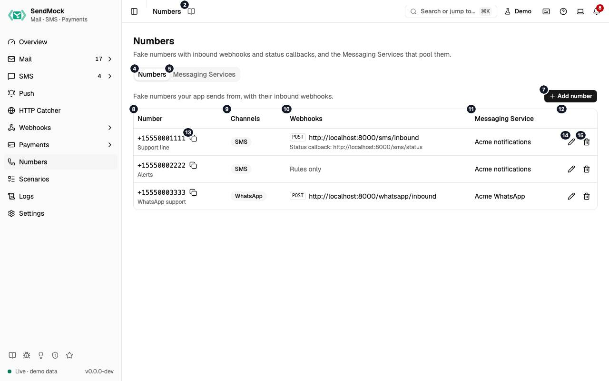

> Every control and text this screen shows, in screen order. The list is read from the demo by a crawl, and CI fails when the screen changes without its entry here.

Numbers holds the fake phone numbers your app owns, with their webhooks, and the Messaging Services that pool them.

The screen as a whole: [Numbers](../numbers.md).

The numbers match the entries below. The picture shows the first screenful; controls further down, and texts, have no marker.

## On the screen

### 1. Numbers

Heading.

- **What it does:** Names the screen, in the header and above the tabs.

### 2. Read the Numbers guide

Link.

- **What it does:** Opens this screen's page in the user guide, in a new tab.
- **Links to:** [Numbers](../../numbers.md).

### 3. Fake numbers with inbound webhooks and status callbacks, and the Messaging Services that pool them.

Text.

- **What it does:** Explains the screen.

### 4. Numbers

Tab.

- **What it does:** Your app's fake phone numbers.
- **Same action elsewhere:** REST [`GET /api/v1/numbers`](/api/numbers/#getNumbers), CLI [`sendmock numbers list`](/cli/numbers/#numbers-list), MCP [`sendmock_number_list`](/mcp/numbers/#sendmock_number_list)

### 5. Messaging Services

Tab.

- **What it does:** Sender pools, as Twilio's Messaging Services.
- **Same action elsewhere:** REST [`GET /api/v1/messaging-services`](/api/numbers/#getMessagingServices), CLI [`sendmock sms services list`](/cli/numbers/#sms-services-list), MCP [`sendmock_messaging_service_list`](/mcp/numbers/#sendmock_messaging_service_list)

### 6. Opt-outs

Tab.

- **What it does:** Contacts who texted STOP, with Lift to let your app send to one again and Lift all.
- **Same action elsewhere:** REST getSmsOptOuts
- **Same action elsewhere:** REST deleteSmsOptOutsBySenderByContactNumber
- **Same action elsewhere:** REST deleteSmsOptOuts

### 7. Fake numbers your app sends from, with their inbound webhooks.

Text.

- **What it does:** Explains numbers.

### 8. Add number

Button.

- **What it does:** Opens the number editor; in it, adds the number.
- **Same action elsewhere:** REST [`POST /api/v1/numbers`](/api/numbers/#postNumbers), CLI [`sendmock numbers add`](/cli/numbers/#numbers-add), MCP [`sendmock_number_upsert`](/mcp/numbers/#sendmock_number_upsert)

### 9. Number

Column.

- **What it does:** The number and its label.

### 10. Channels

Column.

- **What it does:** SMS, WhatsApp or both.

### 11. Webhooks

Column.

- **What it does:** Its inbound webhook URL and fallback.

### 12. Messaging Service

Column.

- **What it does:** The pool it belongs to.

### 13. Actions

Column.

- **What it does:** Copy, Edit and Delete.

### 14. Copy +#

Button, in each row.

- **What it does:** Copies the number.

### 15. Edit +#

Button, in each row.

- **What it does:** Opens the number's editor.

### 16. Delete +#

Button, in each row.

- **What it does:** Deletes the number after you confirm.
- **Same action elsewhere:** REST [`DELETE /api/v1/numbers/{numberId}`](/api/numbers/#deleteNumbersByNumberId), CLI [`sendmock numbers remove`](/cli/numbers/#numbers-remove), MCP [`sendmock_number_delete`](/mcp/numbers/#sendmock_number_delete)

## Messaging Services tab

### 17. Sender pools for sends with MessagingServiceSid.

Text.

- **What it does:** Explains Messaging Services: a send with `MessagingServiceSid` picks a sender from the pool.

### 18. New service

Button.

- **What it does:** Adds a Messaging Service.
- **Same action elsewhere:** REST [`POST /api/v1/messaging-services`](/api/numbers/#postMessagingServices), CLI [`sendmock sms services create`](/cli/numbers/#sms-services-create), MCP [`sendmock_messaging_service_create`](/mcp/numbers/#sendmock_messaging_service_create)

### 19. Name

Column.

- **What it does:** The service's name.

### 20. Senders

Column.

- **What it does:** The numbers in its pool.

### 21. Inbound messages

Column.

- **What it does:** Where its inbound messages go: its own URL, or each number's.

### 22. Copy SID of Acme …

Button, in each row.

- **What it does:** Copies the service's `MG...` SID.

### 23. Edit Acme …

Button, in each row.

- **What it does:** Opens the service's settings.
- **Same action elsewhere:** REST [`PATCH /api/v1/messaging-services/{serviceSid}`](/api/numbers/#patchMessagingServicesByServiceSid), CLI [`sendmock sms services update`](/cli/numbers/#sms-services-update), MCP [`sendmock_messaging_service_update`](/mcp/numbers/#sendmock_messaging_service_update)

### 24. Delete Acme …

Button, in each row.

- **What it does:** Deletes the service after you confirm.
- **Same action elsewhere:** REST [`DELETE /api/v1/messaging-services/{serviceSid}`](/api/numbers/#deleteMessagingServicesByServiceSid), CLI [`sendmock sms services delete`](/cli/numbers/#sms-services-delete), MCP [`sendmock_messaging_service_delete`](/mcp/numbers/#sendmock_messaging_service_delete)

## New number editor

### 25. Add a number

Heading.

- **What it does:** The number editor, for a new number.

### 26. A fake number your app owns, set up like a provider console.

Text.

- **What it does:** Explains the editor.

### 27. Number

Field.

- **What it does:** The number in E.164 form, such as `+15550001111`.

### 28. Label

Field.

- **What it does:** A name for it.

### 29. SMS

Checkbox.

- **What it does:** It sends and receives SMS.

### 30. WhatsApp

Checkbox.

- **What it does:** It sends and receives WhatsApp messages.

### 31. Webhook URL

Field.

- **What it does:** Where an inbound message to the number is posted, as Twilio's reply webhook; the TwiML answer is read.

### 32. Leave empty to deliver inbound messages through webhook rules only.

Text.

- **What it does:** Explains an empty webhook URL.

### 33. Method

Drop-down.

- **What it does:** POST or GET for the webhook.

### 34. Format

Drop-down.

- **What it does:** The webhook's format, Twilio's by default.

### 35. Fallback URL

Field.

- **What it does:** Called when the webhook URL fails.

### 36. Called with ErrorCode and ErrorUrl when the webhook URL fails.

Text.

- **What it does:** Explains the fallback, as Twilio does it.

### 37. Default status callback

Field.

- **What it does:** Where status callbacks go for sends that give none.

### 38. Used when a send from this number has no StatusCallback.

Text.

- **What it does:** Explains the default status callback.

### 39. Messaging Service

Drop-down.

- **What it does:** The pool the number belongs to, if any.

### 40. Twilio account

Drop-down.

- **What it does:** The Twilio account that owns the number: the main account or one of its subaccounts. Inbound messages to the number carry that account's SID and are signed with its token.

### 41. Inbound messages to the number carry this account's SID and are signed with its token.

Text.

- **What it does:** Explains what the account changes.

### 42. Cancel

Button.

- **What it does:** Closes the editor without saving.

### 43. Add number

Button.

- **What it does:** Adds the number.
- **Same action elsewhere:** REST [`POST /api/v1/numbers`](/api/numbers/#postNumbers), CLI [`sendmock numbers add`](/cli/numbers/#numbers-add), MCP [`sendmock_number_upsert`](/mcp/numbers/#sendmock_number_upsert)

### 44. Close

Button.

- **What it does:** Closes the editor without saving.

## Number editor

### 45. Edit number

Heading.

- **What it does:** The number editor, for an existing number.

### 46. A fake number your app owns, set up like a provider console.

Text.

- **What it does:** Explains the editor.

### 47. Number

Field.

- **What it does:** The number in E.164 form, such as `+15550001111`.

### 48. Label

Field.

- **What it does:** A name for it.

### 49. SMS

Checkbox.

- **What it does:** It sends and receives SMS.

### 50. WhatsApp

Checkbox.

- **What it does:** It sends and receives WhatsApp messages.

### 51. Webhook URL

Field.

- **What it does:** Where an inbound message to the number is posted, as Twilio's reply webhook; the TwiML answer is read.

### 52. Leave empty to deliver inbound messages through webhook rules only.

Text.

- **What it does:** Explains an empty webhook URL.

### 53. Method

Drop-down.

- **What it does:** POST or GET for the webhook.

### 54. Format

Drop-down.

- **What it does:** The webhook's format, Twilio's by default.

### 55. Fallback URL

Field.

- **What it does:** Called when the webhook URL fails.

### 56. Called with ErrorCode and ErrorUrl when the webhook URL fails.

Text.

- **What it does:** Explains the fallback, as Twilio does it.

### 57. Default status callback

Field.

- **What it does:** Where status callbacks go for sends that give none.

### 58. Used when a send from this number has no StatusCallback.

Text.

- **What it does:** Explains the default status callback.

### 59. Messaging Service

Drop-down.

- **What it does:** The pool the number belongs to, if any.

### 60. Twilio account

Drop-down.

- **What it does:** The Twilio account that owns the number: the main account or one of its subaccounts. Inbound messages to the number carry that account's SID and are signed with its token.

### 61. Inbound messages to the number carry this account's SID and are signed with its token.

Text.

- **What it does:** Explains what the account changes.

### 62. Cancel

Button.

- **What it does:** Closes the editor without saving.

### 63. Save changes

Button.

- **What it does:** Saves the number.
- **Same action elsewhere:** REST [`PATCH /api/v1/numbers/{numberId}`](/api/numbers/#patchNumbersByNumberId), CLI [`sendmock numbers update`](/cli/numbers/#numbers-update), MCP [`sendmock_number_upsert`](/mcp/numbers/#sendmock_number_upsert)

### 64. Close

Button.

- **What it does:** Closes the editor without saving.

## When the data cannot load

### 65. Could not load the numbers. Try again

Message.

- **What it does:** Shown when the numbers could not be loaded.
- **Errors:** Check SendMock is running, then press Try again.

### 66. Could not load the numbers.

Text.

- **What it does:** The message inside the alert.

### 67. Try again

Button.

- **What it does:** Loads them again.
- **Same action elsewhere:** REST [`GET /api/v1/numbers`](/api/numbers/#getNumbers), CLI [`sendmock numbers list`](/cli/numbers/#numbers-list), MCP [`sendmock_number_list`](/mcp/numbers/#sendmock_number_list)
