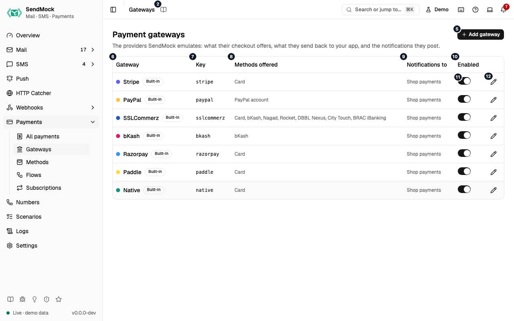

> Every control and text this screen shows, in screen order. The list is read from the demo by a crawl, and CI fails when the screen changes without its entry here.

Payments > Gateways holds the payment providers SendMock emulates: their checkout, redirect and notifications.

The screen as a whole: [Gateways](../../payments/gateways.md).

The numbers match the entries below. The picture shows the first screenful; controls further down, and texts, have no marker.

## On the screen

### 1. Gateways

Heading.

- **What it does:** Names the open screen in the header.

### 2. Read the Gateways guide

Link.

- **What it does:** Opens this screen's page in the user guide, in a new tab.
- **Links to:** [Gateways](../../payments/gateways.md).

### 3. Payment gateways

Heading.

- **What it does:** The payment providers SendMock emulates.
- **Same action elsewhere:** REST [`GET /api/v1/payments/gateways`](/api/payment-gateways/#getPaymentsGateways), CLI [`sendmock payments gateways list`](/cli/payment-gateways/#payments-gateways-list), MCP [`sendmock_payment_gateway_list`](/mcp/payment-gateways/#sendmock_payment_gateway_list)

### 4. The providers SendMock emulates: what their checkout offers, what they send back to your app, and the notifications they post.

Text.

- **What it does:** Explains the screen.

### 5. Add gateway

Button.

- **What it does:** Opens Add a payment gateway; in it, adds the gateway.
- **Same action elsewhere:** REST [`POST /api/v1/payments/gateways`](/api/payment-gateways/#postPaymentsGateways), CLI [`sendmock payments gateways create`](/cli/payment-gateways/#payments-gateways-create), MCP [`sendmock_payment_gateway_create`](/mcp/payment-gateways/#sendmock_payment_gateway_create)

### 6. Gateway

Column.

- **What it does:** The gateway's name.

### 7. Key

Column.

- **What it does:** Its key: the `provider` value in the API and its `/providers/<key>/` paths.

### 8. Methods offered

Column.

- **What it does:** The payment methods its checkout offers.

### 9. Notifications to

Column.

- **What it does:** The webhook endpoint its notifications go to.

### 10. Enabled

Column.

- **What it does:** Whether it takes payments.

### 11. … enabled

Switch, in each row.

- **What it does:** Turns the gateway on or off at once.
- **Same action elsewhere:** REST [`PATCH /api/v1/payments/gateways/{gatewayKey}`](/api/payment-gateways/#patchPaymentsGatewaysByGatewayKey), CLI [`sendmock payments gateways update`](/cli/payment-gateways/#payments-gateways-update), MCP [`sendmock_payment_gateway_update`](/mcp/payment-gateways/#sendmock_payment_gateway_update)

### 12. Edit …

Button, in each row.

- **What it does:** Opens the gateway's editor.
- **Same action elsewhere:** REST [`GET /api/v1/payments/gateways/{gatewayKey}`](/api/payment-gateways/#getPaymentsGatewaysByGatewayKey), CLI [`sendmock payments gateways show`](/cli/payment-gateways/#payments-gateways-show), MCP [`sendmock_payment_gateway_get`](/mcp/payment-gateways/#sendmock_payment_gateway_get)

## Add a payment gateway dialog

### 13. Add a payment gateway

Heading.

- **What it does:** The Add a payment gateway dialog.

### 14. Emulate a provider SendMock does not ship; you set its checkout, redirect and notification next.

Text.

- **What it does:** Explains adding a gateway.
- **Links to:** [Advanced: create a payment gateway](../../advanced/payment-gateway.md).

### 15. Name

Field.

- **What it does:** The gateway's name.

### 16. Key

Field.

- **What it does:** Its key, fixed once added.

### 17. The provider value in the API; fixed once added.

Text.

- **What it does:** Explains the key.

### 18. Start from

Drop-down.

- **What it does:** Blank, or a built-in gateway to copy.

### 19. Cancel

Button.

- **What it does:** Closes the dialog or editor without saving.

### 20. Add gateway

Button.

- **What it does:** Opens Add a payment gateway; in it, adds the gateway.
- **Same action elsewhere:** REST [`POST /api/v1/payments/gateways`](/api/payment-gateways/#postPaymentsGateways), CLI [`sendmock payments gateways create`](/cli/payment-gateways/#payments-gateways-create), MCP [`sendmock_payment_gateway_create`](/mcp/payment-gateways/#sendmock_payment_gateway_create)

### 21. Close

Button.

- **What it does:** Closes the dialog or editor without saving.

## Gateway editor

### 22. Stripe

Heading.

- **What it does:** The gateway open in the editor (here Stripe).

### 23. Built-in gateway, key stripe . # payments.

Text.

- **What it does:** Whether it is built in, its key and how many payments it has.

### 24. General

Tab.

- **What it does:** Name, key, colour and whether it is on.

### 25. Checkout

Tab.

- **What it does:** The methods its checkout page offers, and a test checkout.

### 26. Merchant

Tab.

- **What it does:** Its merchant credentials and where its notifications go.

### 27. Redirect

Tab.

- **What it does:** How the customer is sent back to your app, and with which fields.

### 28. Notification

Tab.

- **What it does:** The notification it posts to your app: format, event names, body and headers.

### 29. Name

Field.

- **What it does:** The gateway's name.

### 30. Key

Field.

- **What it does:** Its key, fixed once added.

### 31. The provider value in the API and in /providers/\<key>/... paths; fixed once added.

Text.

- **What it does:** Explains the key.

### 32. Accent colour

Field.

- **What it does:** Picks the checkout page's colour.

### 33. Accent

Field.

- **What it does:** The colour as a hex value.

### 34. Used on its checkout pages.

Text.

- **What it does:** Explains the accent.

### 35. Enabled

Switch.

- **What it does:** Whether the gateway takes payments.

### 36. Unmatched requests

Heading.

- **What it does:** Sends the requests SendMock does not answer on Stripe's base URL to an HTTP Catcher bin, which answers them with its rules.
- **Links to:** [Provider gaps](../../http/provider-gaps.md)

### 37. Requests on Stripe's base URL that SendMock does not answer. Send them to a bin to answer them with its rules and follow-up webhooks.

Text.

- **What it does:** Explains Unmatched requests: built-in operations still answer first.

### 38. Where Stripe's unmatched requests go

Drop-down.

- **What it does:** Chooses the bin that answers them, or none (they get `404`). A provider has one bin at most; a bin can serve several providers.
- **What it changes:** Attaches or detaches the bin right away, with no restart.
- **Same action elsewhere:** REST [`PUT /api/v1/provider-bins/{area}/{providerKey}`](/api/http-catcher/#putProviderBinsByAreaByProviderKey), CLI [`sendmock http provider-bin attach`](/cli/http-catcher/#http-provider-bin-attach), MCP [`sendmock_http_provider_bin_attach`](/mcp/http-catcher/#sendmock_http_provider_bin_attach)
- **Same action elsewhere:** REST [`DELETE /api/v1/provider-bins/{area}/{providerKey}`](/api/http-catcher/#deleteProviderBinsByAreaByProviderKey), CLI [`sendmock http provider-bin detach`](/cli/http-catcher/#http-provider-bin-detach), MCP [`sendmock_http_provider_bin_detach`](/mcp/http-catcher/#sendmock_http_provider_bin_detach)

### 39. Create a bin for this provider

Button.

- **What it does:** Creates a bin named after the provider and attaches it, so you can add a rule for the endpoint next.
- **What it changes:** Adds an HTTP Catcher bin.
- **Same action elsewhere:** REST [`PUT /api/v1/provider-bins/{area}/{providerKey}`](/api/http-catcher/#putProviderBinsByAreaByProviderKey), CLI [`sendmock http provider-bin attach`](/cli/http-catcher/#http-provider-bin-attach), MCP [`sendmock_http_provider_bin_attach`](/mcp/http-catcher/#sendmock_http_provider_bin_attach)

### 40. Reset to default

Button.

- **What it does:** Brings back the shipped definition of a built-in, after you confirm.
- **Same action elsewhere:** REST [`POST /api/v1/payments/gateways/{gatewayKey}/reset`](/api/payment-gateways/#postPaymentsGatewaysByGatewayKeyReset), CLI [`sendmock payments gateways reset`](/cli/payment-gateways/#payments-gateways-reset), MCP [`sendmock_payment_gateway_reset`](/mcp/payment-gateways/#sendmock_payment_gateway_reset)

### 41. Cancel

Button.

- **What it does:** Closes the dialog or editor without saving.

### 42. Save gateway

Button.

- **What it does:** Saves the gateway; the next payment uses it.
- **Errors:** A template with errors is refused with the reason.
- **Same action elsewhere:** REST [`PATCH /api/v1/payments/gateways/{gatewayKey}`](/api/payment-gateways/#patchPaymentsGatewaysByGatewayKey), CLI [`sendmock payments gateways update`](/cli/payment-gateways/#payments-gateways-update), MCP [`sendmock_payment_gateway_update`](/mcp/payment-gateways/#sendmock_payment_gateway_update)

### 43. Close

Button.

- **What it does:** Closes the dialog or editor without saving.

## Gateway editor, Checkout tab

### 44. Methods offered

Heading.

- **What it does:** The methods its checkout page offers, in order.

### 45. One method shows its flow directly; several show a picker, in this order.

Text.

- **What it does:** Explains how the checkout page shows the methods.

### 46. Move Card up

Button.

- **What it does:** Shows the method earlier (here Card).

### 47. Move Card down

Button.

- **What it does:** Shows the method later.

### 48. Remove Card

Button.

- **What it does:** Stops offering the method.

### 49. Add a method

Drop-down.

- **What it does:** Offers another method.
- **Links to:** [Methods](../../payments/methods.md).

### 50. Creates a test payment with this gateway and opens its checkout page.

Text.

- **What it does:** Explains Open a test checkout.

### 51. Open a test checkout

Button.

- **What it does:** Creates a test payment and opens its checkout page.
- **Same action elsewhere:** REST [`POST /api/v1/payments/checkout`](/api/payments/#postPaymentsCheckout), CLI [`sendmock payments checkout create`](/cli/payments/#payments-checkout-create), MCP [`sendmock_payment_create_checkout`](/mcp/payments/#sendmock_payment_create_checkout)

## Gateway editor, Merchant tab

### 52. Templates read them as merchant.\<name> . Secrets stay masked; the preview masks them too.

Text.

- **What it does:** Explains the merchant credentials.

### 53. Credential # name

Field.

- **What it does:** A credential's name, such as `secret_key`.

### 54. Credential # value

Field.

- **What it does:** Its value; a secret one is masked.

### 55. Secret

Checkbox.

- **What it does:** Masks the value everywhere.

### 56. Reveal secret_key

Button.

- **What it does:** Shows the secret key once, after you confirm.
- **Same action elsewhere:** REST [`GET /api/v1/payments/gateways/{gatewayKey}/credentials/{credentialName}`](/api/payment-gateways/#getPaymentsGatewaysByGatewayKeyCredentialsByCredentialName), CLI [`sendmock payments gateways credential`](/cli/payment-gateways/#payments-gateways-credential)

### 57. Remove credential #

Button.

- **What it does:** Removes the credential.

### 58. Reveal webhook_secret

Button.

- **What it does:** Shows the webhook signing secret once, after you confirm.
- **Same action elsewhere:** REST [`GET /api/v1/payments/gateways/{gatewayKey}/credentials/{credentialName}`](/api/payment-gateways/#getPaymentsGatewaysByGatewayKeyCredentialsByCredentialName), CLI [`sendmock payments gateways credential`](/cli/payment-gateways/#payments-gateways-credential)

### 59. Add credential

Button.

- **What it does:** Adds a credential.

### 60. Notification endpoint

Drop-down.

- **What it does:** The webhook endpoint its notifications go to.
- **Links to:** [Endpoints](../../webhooks/endpoints.md).

### 61. Its IPN or webhook deliveries go to this webhook endpoint, with retries and replay.

Text.

- **What it does:** Explains the notification endpoint.

## Gateway editor, Redirect tab

### 62. GET The fields go in the query string (Stripe, PayPal).

Choice.

- **What it does:** The customer returns with a GET, the fields in the query string.

### 63. POST The browser posts a form with the fields (SSLCommerz).

Choice.

- **What it does:** The customer's browser posts a form back to your app.

### 64. Type \{\{ for suggestions; \{\{ redirect.status \}\} is this gateway's event name for the outcome.

Text.

- **What it does:** Explains the redirect field templates.

### 65. Redirect field # name

Field.

- **What it does:** A redirect field's name.

### 66. Redirect field # template

Field.

- **What it does:** Its value template.

### 67. Redirect field # sent

Drop-down.

- **What it does:** When it is sent: always, or only on success or failure.

### 68. Remove redirect field #

Button.

- **What it does:** Removes the field.

### 69. Add field

Button.

- **What it does:** Adds a redirect field.

### 70. Preview

Tab.

- **What it does:** Shows the redirect and notification as they would be sent.

### 71. Reference

Tab.

- **What it does:** Lists every value the templates can read.

### 72. Preview payment

Drop-down.

- **What it does:** The payment the preview uses.

### 73. Preview event

Drop-down.

- **What it does:** The event the preview renders.

### 74. Preview redirect outcome

Drop-down.

- **What it does:** The outcome the preview's redirect shows.
- **Same action elsewhere:** REST [`POST /api/v1/payments/gateways/{gatewayKey}/preview`](/api/payment-gateways/#postPaymentsGatewaysByGatewayKeyPreview), CLI [`sendmock payments gateways preview`](/cli/payment-gateways/#payments-gateways-preview), MCP [`sendmock_payment_gateway_preview`](/mcp/payment-gateways/#sendmock_payment_gateway_preview)

### 75. Redirect

Heading.

- **What it does:** The redirect as it would be sent.

### 76. GET http://localhost:#/checkout/success

Text.

- **What it does:** The redirect's method and URL (here a GET to the demo app).

### 77. Notification

Heading.

- **What it does:** The notification as it would be sent.

### 78. payment_intent.succeeded

Text.

- **What it does:** The gateway's event name for the preview event (here Stripe's).

## Gateway editor, Notification tab

### 79. JSON application/json (Stripe, PayPal, bKash).

Choice.

- **What it does:** The notification body is JSON.

### 80. Form application/x-www-form-urlencoded; write the body as name=value&... (SSLCommerz IPN).

Choice.

- **What it does:** The notification body is a form.

### 81. This gateway's name for each event, read as \{\{ event.name \}\} . Leave one blank and nothing is sent for it.

Text.

- **What it does:** Explains the event names.

### 82. Event name for payment.created

Field.

- **What it does:** The gateway's own name for `payment.created`; blank sends nothing for it.

### 83. Event name for payment.authorized

Field.

- **What it does:** The gateway's own name for `payment.authorized`; blank sends nothing for it.

### 84. Event name for payment.succeeded

Field.

- **What it does:** The gateway's own name for `payment.succeeded`; blank sends nothing for it.

### 85. Event name for payment.failed

Field.

- **What it does:** The gateway's own name for `payment.failed`; blank sends nothing for it.

### 86. Event name for payment.canceled

Field.

- **What it does:** The gateway's own name for `payment.canceled`; blank sends nothing for it.

### 87. Event name for payment.refunded

Field.

- **What it does:** The gateway's own name for `payment.refunded`; blank sends nothing for it.

### 88. Event name for payment.partially_refunded

Field.

- **What it does:** The gateway's own name for `payment.partially_refunded`; blank sends nothing for it.

### 89. Event name for payment.dispute_opened

Field.

- **What it does:** The gateway's own name for `payment.dispute_opened`; blank sends nothing for it.

### 90. Event name for payment.dispute_updated

Field.

- **What it does:** The gateway's own name for `payment.dispute_updated`; blank sends nothing for it.

### 91. Event name for payment.dispute_closed

Field.

- **What it does:** The gateway's own name for `payment.dispute_closed`; blank sends nothing for it.

### 92. Event name for checkout.completed

Field.

- **What it does:** The gateway's own name for `checkout.completed`; blank sends nothing for it.

### 93. Event name for checkout.expired

Field.

- **What it does:** The gateway's own name for `checkout.expired`; blank sends nothing for it.

### 94. Notification body template

Field.

- **What it does:** The notification body, in the template language.

### 95. Header # name

Field.

- **What it does:** A notification header's name.

### 96. Header # value

Field.

- **What it does:** Its value template, such as a signature.

### 97. Remove header #

Button.

- **What it does:** Removes the header.

### 98. Add header

Button.

- **What it does:** Adds a header.

### 99. Preview

Tab.

- **What it does:** Shows the redirect and notification as they would be sent.

### 100. Reference

Tab.

- **What it does:** Lists every value the templates can read.

### 101. Preview payment

Drop-down.

- **What it does:** The payment the preview uses.

### 102. Preview event

Drop-down.

- **What it does:** The event the preview renders.

### 103. Preview redirect outcome

Drop-down.

- **What it does:** The outcome the preview's redirect shows.
- **Same action elsewhere:** REST [`POST /api/v1/payments/gateways/{gatewayKey}/preview`](/api/payment-gateways/#postPaymentsGatewaysByGatewayKeyPreview), CLI [`sendmock payments gateways preview`](/cli/payment-gateways/#payments-gateways-preview), MCP [`sendmock_payment_gateway_preview`](/mcp/payment-gateways/#sendmock_payment_gateway_preview)

### 104. Redirect

Heading.

- **What it does:** The redirect as it would be sent.

### 105. GET http://localhost:#/checkout/success

Text.

- **What it does:** The redirect's method and URL (here a GET to the demo app).

### 106. Notification

Heading.

- **What it does:** The notification as it would be sent.

### 107. payment_intent.succeeded

Text.

- **What it does:** The gateway's event name for the preview event (here Stripe's).

## When the data cannot load

### 108. Could not load the gateways. Try again

Message.

- **What it does:** Shown when the gateways could not be loaded.
- **Errors:** Check SendMock is running, then press Try again.

### 109. Could not load the gateways.

Text.

- **What it does:** The message inside the alert.

### 110. Try again

Button.

- **What it does:** Loads them again.
- **Same action elsewhere:** REST [`GET /api/v1/payments/gateways`](/api/payment-gateways/#getPaymentsGateways), CLI [`sendmock payments gateways list`](/cli/payment-gateways/#payments-gateways-list), MCP [`sendmock_payment_gateway_list`](/mcp/payment-gateways/#sendmock_payment_gateway_list)
