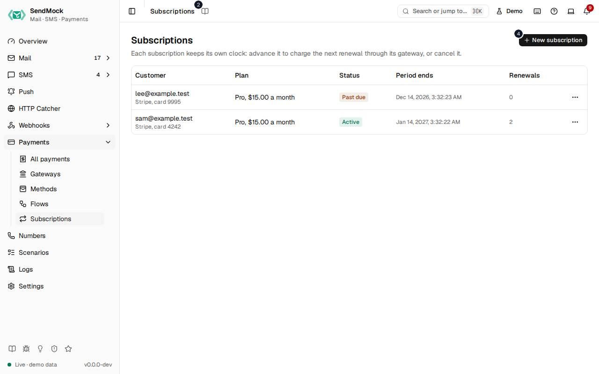

> Every control and text this screen shows, in screen order. The list is read from the demo by a crawl, and CI fails when the screen changes without its entry here.

Payments > Subscriptions tests renewals, failed renewal payments and cancellations, each subscription on its own clock.

The screen as a whole: [Subscriptions](../../payments/subscriptions.md).

The numbers match the entries below. The picture shows the first screenful; controls further down, and texts, have no marker.

## On the screen

### 1. Subscriptions

Heading.

- **What it does:** Names the screen, in the header and above the list.

### 2. Read the Subscriptions guide

Link.

- **What it does:** Opens this screen's page in the user guide, in a new tab.
- **Links to:** [Subscriptions](../../payments/subscriptions.md).

### 3. Each subscription keeps its own clock: advance it to charge the next renewal through its gateway, or cancel it.

Text.

- **What it does:** Explains the screen: renewals happen when you advance a subscription's clock, not on the calendar.
- **Same action elsewhere:** REST [`GET /api/v1/payments/subscriptions`](/api/payments/#getPaymentsSubscriptions), CLI [`sendmock payments subscriptions list`](/cli/payments/#payments-subscriptions-list), MCP [`sendmock_subscription_list`](/mcp/payments/#sendmock_subscription_list)

### 4. New subscription

Button.

- **What it does:** Opens New subscription.

### 5. Select all loaded subscriptions

Checkbox.

- **What it does:** Ticks every row loaded in the list, or clears the ticks; it shows a dash when only some are ticked, and the toolbar says how many are selected. Ticked rows can be deleted together. X ticks the open or focused row.

### 6. Delete all subscriptions

Button.

- **What it does:** Asks first, naming how many go and what stays, then deletes every row the list shows, in the picked project. While a search or filter is on it reads Delete matching and deletes only what it matches. The payments they charged stay in Payments.
- **What it changes:** Publishes one `traffic.cleared` event, so every open tab refreshes; settings and configuration stay.
- **Same action elsewhere:** REST [`DELETE /api/v1/payments/subscriptions`](/api/payments/#deletePaymentsSubscriptions), CLI [`sendmock payments subscriptions delete-all`](/cli/payments/#payments-subscriptions-delete-all), MCP [`sendmock_subscription_delete_all`](/mcp/payments/#sendmock_subscription_delete_all)

### 7. No subscriptions yet

Text.

- **What it does:** Shown while there is none.

### 8. Start one with New subscription, or POST /api/v#/payments/subscriptions, to test renewals, failed payments and cancellations.

Text.

- **What it does:** Explains how to start one.

## New subscription dialog

### 9. New subscription

Heading.

- **What it does:** The New subscription dialog.

### 10. Without a trial the first period is charged at once.

Text.

- **What it does:** Explains the first charge.

### 11. Gateway

Drop-down.

- **What it does:** The gateway renewals are charged through.

### 12. Interval

Drop-down.

- **What it does:** How often it renews: daily, weekly, monthly or yearly.

### 13. Customer email

Field.

- **What it does:** The customer's email.

### 14. Plan name

Field.

- **What it does:** The plan's name.

### 15. Amount

Field.

- **What it does:** What each period costs.

### 16. Currency

Field.

- **What it does:** The currency code.

### 17. Trial days

Field.

- **What it does:** Free days before the first charge.

### 18. Test card

Field.

- **What it does:** The test card renewals use; a declining card makes renewals fail.

### 19. Cancel

Button.

- **What it does:** Closes the dialog without doing anything.

### 20. Start subscription

Button.

- **What it does:** Starts the subscription.
- **What it changes:** Fires `subscription.created`, and a payment for the first period when there is no trial.
- **Same action elsewhere:** REST [`POST /api/v1/payments/subscriptions`](/api/payments/#postPaymentsSubscriptions), CLI [`sendmock payments subscriptions create`](/cli/payments/#payments-subscriptions-create), MCP [`sendmock_subscription_create`](/mcp/payments/#sendmock_subscription_create)

### 21. Close

Button.

- **What it does:** Closes the dialog.

## When the data cannot load

### 22. Could not load the subscriptions. Try again

Message.

- **What it does:** Shown when the subscriptions could not be loaded.
- **Errors:** Check SendMock is running, then press Try again.

### 23. Could not load the subscriptions.

Text.

- **What it does:** The message inside the alert.

### 24. Try again

Button.

- **What it does:** Loads them again.
- **Same action elsewhere:** REST [`GET /api/v1/payments/subscriptions`](/api/payments/#getPaymentsSubscriptions), CLI [`sendmock payments subscriptions list`](/cli/payments/#payments-subscriptions-list), MCP [`sendmock_subscription_list`](/mcp/payments/#sendmock_subscription_list)
