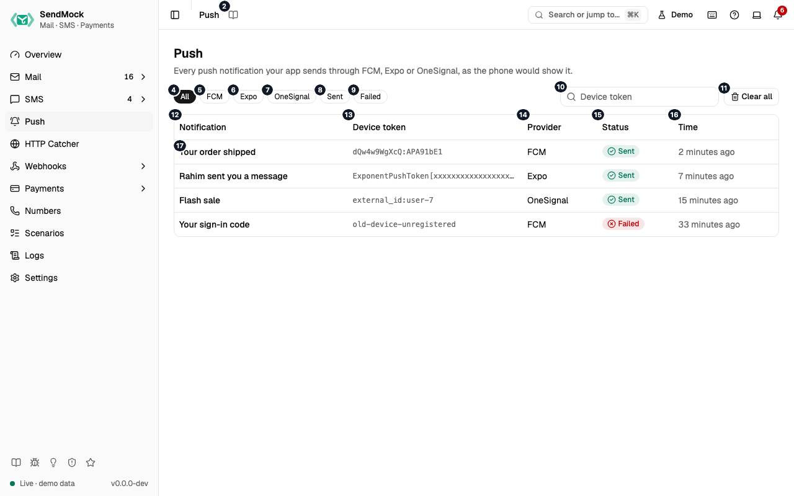

> Every control and text this screen shows, in screen order. The list is read from the demo by a crawl, and CI fails when the screen changes without its entry here.

Push shows every notification your app sends through FCM, Expo or OneSignal, as a phone's lock screen would show it.

The screen as a whole: [Push](../push.md).

The numbers match the entries below. The picture shows the first screenful; controls further down, and texts, have no marker.

## On the screen

### 1. Push

Heading.

- **What it does:** Names the screen.

### 2. Read the Push guide

Link.

- **What it does:** Opens this screen's page in the user guide, in a new tab.
- **Links to:** [Push](../push.md).

### 3. Every push notification your app sends through FCM, Expo or OneSignal, as the phone would show it.

Text.

- **What it does:** Explains the screen.

### 4. All

Button.

- **What it does:** Shows notifications from every provider.
- **Same action elsewhere:** REST [`GET /api/v1/push`](/api/push/#getPush), CLI [`sendmock push list`](/cli/push/#push-list), MCP [`sendmock_push_list`](/mcp/push/#sendmock_push_list)

### 5. FCM

Button.

- **What it does:** Shows only notifications sent through Firebase Cloud Messaging.

### 6. Expo

Button.

- **What it does:** Shows only notifications sent through Expo.

### 7. OneSignal

Button.

- **What it does:** Shows only notifications sent through OneSignal.

### 8. Sent

Button.

- **What it does:** Shows only notifications the provider accepted; press again to show every status.

### 9. Failed

Button.

- **What it does:** Shows only notifications the provider refused, such as one to an unregistered token; press again to show every status.

### 10. Filter by device token

Field.

- **What it does:** Shows only notifications to this exact device token, Expo push token, OneSignal subscription or alias (`external_id:user-7`).

### 11. Clear all

Button.

- **What it does:** Asks, then deletes every notification the filters show.

### 12. Notification

Column.

- **What it does:** The notification's title, or its body when it has no title.

### 13. Device token

Column.

- **What it does:** Where it went: a token, `topic:<name>`, `condition:<expression>`, `<alias>:<id>` or `segment:<names>`.

### 14. Provider

Column.

- **What it does:** FCM, Expo or OneSignal.

### 15. Status

Column.

- **What it does:** Sent, or Failed when the provider refused it.

### 16. Time

Column.

- **What it does:** When your app sent it.

### 17. …

Link, in each row.

- **What it does:** Opens the notification's drawer.
- **Same action elsewhere:** REST [`GET /api/v1/push/{pushId}`](/api/push/#getPushByPushId), CLI [`sendmock push show`](/cli/push/#push-show), MCP [`sendmock_push_get`](/mcp/push/#sendmock_push_get)

## A notification is open

### 18. Push notification

Heading.

- **What it does:** The drawer of one notification; its id is in the URL as `?push=`.

### 19. As the phone shows it, with its data, the request and the answer.

Text.

- **What it does:** Explains the drawer.

### 20. iOS

Choice.

- **What it does:** Shows the lock screen card as iOS draws it, with the image beside the text.

### 21. Android

Choice.

- **What it does:** Shows the card as Android draws it, with the image below the text. The message's platform picks the style first.

### 22. Flash sale

Text.

- **What it does:** The notification's title on the card.
- **Where its text comes from:** FCM's `notification.title` (or a platform block's), Expo's `title`, OneSignal's `headings` in English.

### 23. #% off everything until midnight.

Text.

- **What it does:** The notification's body on the card.
- **Where its text comes from:** FCM's `notification.body`, Expo's `body`, OneSignal's `contents` in English.

### 24. Data

Heading.

- **What it does:** The data payload as key and value rows, as the app receives it.

### 25. Request

Heading.

- **What it does:** The request body as your app sent it (for Expo, the one message).

### 26. Copy request

Button.

- **What it does:** Copies the request as JSON.

### 27. Answer (#)

Heading.

- **What it does:** What SendMock answered, in the provider's own shape, with its HTTP status.

### 28. Copy answer (#)

Button.

- **What it does:** Copies the answer as JSON.

### 29. Delete

Button.

- **What it does:** Asks, then deletes this notification and closes the drawer.
- **Same action elsewhere:** REST [`DELETE /api/v1/push/{pushId}`](/api/push/#deletePushByPushId), CLI [`sendmock push delete`](/cli/push/#push-delete), MCP [`sendmock_push_delete`](/mcp/push/#sendmock_push_delete)

### 30. Close

Button.

- **What it does:** Closes the drawer (or press `Esc`).

## Clear all dialog

### 31. Clear every push notification?

Heading.

- **What it does:** Asks before Clear all.

### 32. Every notification this list shows is deleted; tests waiting for one see only new ones.

Text.

- **What it does:** Explains what Clear all deletes.

### 33. Keep them

Button.

- **What it does:** Closes the dialog without deleting.

### 34. Clear all

Button.

- **What it does:** Deletes every notification the filters show.
- **Same action elsewhere:** REST [`DELETE /api/v1/push`](/api/push/#deletePush), CLI [`sendmock push clear`](/cli/push/#push-clear), MCP [`sendmock_push_delete_all`](/mcp/push/#sendmock_push_delete_all)

## With no data yet

### 35. No push notifications yet

Text.

- **What it does:** Shown when no app has sent a notification yet.

### 36. Point your app's FCM, Expo or OneSignal SDK at SendMock and send one. It shows up here as the phone would show it.

Text.

- **What it does:** Explains how notifications arrive.

### 37. This machine

Choice.

- **What it does:** Shows the addresses for an app on the same machine.
- **What it changes:** Shared with Settings > Connection and remembered in the browser.
- **Same action elsewhere:** REST [`GET /api/v1/info`](/api/system/#getInfo), CLI [`sendmock status`](/cli/system/#status), MCP [`sendmock_status`](/mcp/system/#sendmock_status)

### 38. Docker host

Choice.

- **What it does:** Shows the addresses for an app in a container reaching SendMock on the host.

### 39. Compose

Choice.

- **What it does:** Shows the addresses for an app in the same Docker Compose project.

### 40. Copy FCM base URL

Button.

- **What it does:** Copies the address to send FCM HTTP v1 requests to.

### 41. Copy EXPO_BASE_URL

Button.

- **What it does:** Copies the value for the `EXPO_BASE_URL` environment variable, which `expo-server-sdk` reads.

### 42. Copy OneSignal base URL

Button.

- **What it does:** Copies the address to give the OneSignal SDK as its server.

### 43. More snippets

Link.

- **What it does:** Opens Settings > Connection.
- **Links to:** [Settings](../settings.md).

## When the data cannot load

### 44. Could not load push notifications. Try again

Message.

- **What it does:** Shown when the notifications could not be loaded.
- **Errors:** Check SendMock is running, then press Try again.

### 45. Could not load push notifications.

Text.

- **What it does:** The message inside the alert.

### 46. Try again

Button.

- **What it does:** Loads the notifications again.
- **Same action elsewhere:** REST [`GET /api/v1/push`](/api/push/#getPush), CLI [`sendmock push list`](/cli/push/#push-list), MCP [`sendmock_push_list`](/mcp/push/#sendmock_push_list)
