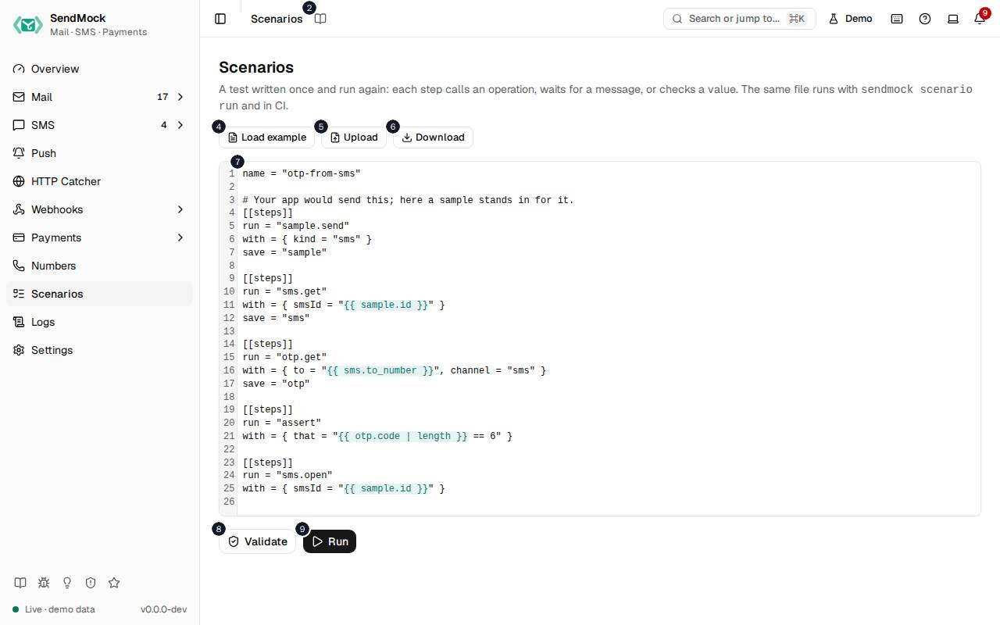

> Every control and text this screen shows, in screen order. The list is read from the demo by a crawl, and CI fails when the screen changes without its entry here.

Scenarios writes, validates and runs a multi-step check against this SendMock.

The screen as a whole: [Scenarios](../scenarios.md).

The numbers match the entries below. The picture shows the first screenful; controls further down, and texts, have no marker.

## On the screen

### 1. Scenarios

Heading.

- **What it does:** Names the screen, in the header and above the editor.

### 2. Read the Scenarios guide

Link.

- **What it does:** Opens this screen's page in the user guide, in a new tab.
- **Links to:** [Scenarios](../../scenarios.md).

### 3. A test written once and run again: each step calls an operation, waits for a message, or checks a value. The same file runs with sendmock scenario run and in CI.

Text.

- **What it does:** Explains scenarios.
- **Links to:** [Advanced: scenarios](../../advanced/scenarios.md).

### 4. Saved

Heading.

- **What it does:** Heads the saved scenarios beside the editor. Click one to open it in the editor; its menu renames or deletes it (after a confirmation).
- **Where its text comes from:** The saved scenarios, which a setup export carries as `[[scenarios]]`.
- **Same action elsewhere:** REST [`GET /api/v1/scenarios`](/api/automation/#getScenarios), CLI [`sendmock scenario list`](/cli/automation/#scenario-list), MCP [`sendmock_scenario_list`](/mcp/automation/#sendmock_scenario_list)

### 5. Nothing saved yet. Save the editor's scenario to run it again by name and keep it in a setup.

Text.

- **What it does:** Shown while no scenario is saved.

### 6. Not saved

Text.

- **What it does:** The name of the saved scenario in the editor; Not saved while the editor holds one that is not saved. An Unsaved changes mark follows while the editor differs from the saved file.

### 7. Save

Button.

- **What it does:** Saves the editor's scenario: asks for a unique name the first time, then updates the opened one. Save as appears once a scenario is opened and saves a copy under a new name.
- **What it changes:** Stores the scenario, so it runs by name with `sendmock scenario run-saved` and travels in a setup.
- **Errors:** An invalid scenario is refused with its errors by step, as Validate lists them; a name already taken is refused.
- **Same action elsewhere:** REST [`POST /api/v1/scenarios`](/api/automation/#postScenarios), CLI [`sendmock scenario save`](/cli/automation/#scenario-save), MCP [`sendmock_scenario_save`](/mcp/automation/#sendmock_scenario_save)
- **Same action elsewhere:** REST [`PATCH /api/v1/scenarios/{scenarioId}`](/api/automation/#patchScenariosByScenarioId), CLI [`sendmock scenario update`](/cli/automation/#scenario-update), MCP [`sendmock_scenario_update`](/mcp/automation/#sendmock_scenario_update)

### 8. Load example

Button.

- **What it does:** Puts an example scenario in the editor.

### 9. Upload

Button.

- **What it does:** Reads a scenario file from your computer.

### 10. Download

Link.

- **What it does:** Saves the scenario in the editor as a file.

### 11. Scenario

Field.

- **What it does:** The scenario, in YAML or JSON.

### 12. Validate

Button.

- **What it does:** Checks the scenario without running it and lists any errors.
- **Same action elsewhere:** REST [`POST /api/v1/scenarios/validate`](/api/automation/#postScenariosValidate), CLI [`sendmock scenario validate`](/cli/automation/#scenario-validate), MCP [`sendmock_scenario_validate`](/mcp/automation/#sendmock_scenario_validate)

### 13. Run

Button.

- **What it does:** Runs the steps in order and shows each one's result; the first failed check stops it.
- **What it changes:** The steps' own effects: sends, waits and checks against this SendMock.
- **Same action elsewhere:** REST [`POST /api/v1/scenarios/run`](/api/automation/#postScenariosRun), CLI [`sendmock scenario run`](/cli/automation/#scenario-run), MCP [`sendmock_scenario_run`](/mcp/automation/#sendmock_scenario_run)

### 14. CI file

Heading.

- **What it does:** Runs a CI file, the file `sendmock ci run` reads in a pipeline, and shows the report your CI will show.
- **Links to:** [CI pipelines](../../advanced/ci-pipelines.md)

### 15. The setup, the app's URL and the scenarios a pipeline runs with sendmock ci run . Run it here to see the report your CI will show.

Text.

- **What it does:** Explains the CI file card.

### 16. CI file URL

Field.

- **What it does:** An address to load a CI file from; the browser downloads it.

### 17. Import from URL

Button.

- **What it does:** Downloads the CI file at the address into the text box.

### 18. CI file

Field.

- **What it does:** The CI file's text, in YAML or JSON.

### 19. Validate CI file

Button.

- **What it does:** Checks the CI file without running it and lists any problem by its line or key path.
- **Same action elsewhere:** REST [`POST /api/v1/ci/validate`](/api/automation/#postCiValidate), CLI [`sendmock ci validate`](/cli/automation/#ci-validate), MCP [`sendmock_ci_validate`](/mcp/automation/#sendmock_ci_validate)

### 20. Run CI file

Button.

- **What it does:** Applies the CI file's setup, runs every scenario against this SendMock and shows each scenario's result, with a JUnit download.
- **What it changes:** The setup it applies and the steps' own effects: sends, webhooks and checks.
- **Errors:** A failing step names the scenario, the step and the reason.
- **Same action elsewhere:** REST [`POST /api/v1/ci/run`](/api/automation/#postCiRun), CLI [`sendmock ci run`](/cli/automation/#ci-run), MCP [`sendmock_ci_run`](/mcp/automation/#sendmock_ci_run)

## The example has run

### 21. Passed: # of # steps in # ms

Status.

- **What it does:** The run's result: how many steps passed, and how long it took.
