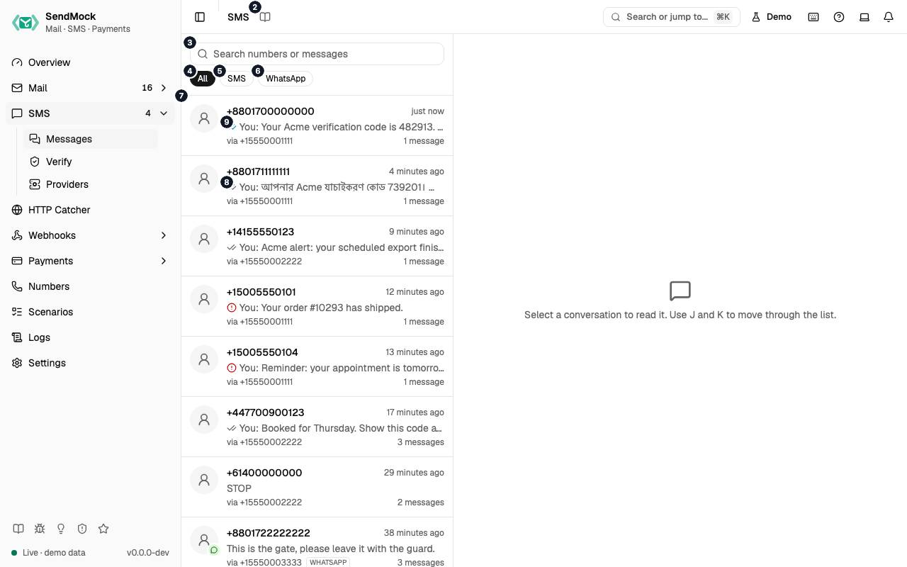

> Every control and text this screen shows, in screen order. The list is read from the demo by a crawl, and CI fails when the screen changes without its entry here.

SMS > Messages groups every SMS, MMS and WhatsApp message into conversations by phone number, and simulates the other side's replies.

The screen as a whole: [SMS](../../sms/index.md).

The numbers match the entries below. The picture shows the first screenful; controls further down, and texts, have no marker.

## On the screen

### 1. SMS

Heading.

- **What it does:** Names the open screen in the header.

### 2. Read the SMS guide

Link.

- **What it does:** Opens this screen's page in the user guide, in a new tab.
- **Links to:** [SMS](../../sms/index.md).

### 3. Search conversations

Field.

- **What it does:** Filters the conversations by phone number or message text as you type.
- **Same action elsewhere:** REST [`GET /api/v1/sms/threads`](/api/sms/#getSmsThreads), CLI [`sendmock sms threads`](/cli/sms/#sms-threads), MCP [`sendmock_sms_threads`](/mcp/sms/#sendmock_sms_threads)

### 4. All

Button.

- **What it does:** Shows every conversation.

### 5. SMS

Button.

- **What it does:** Shows only SMS and MMS conversations.

### 6. WhatsApp

Button.

- **What it does:** Shows only WhatsApp conversations (messages sent with `whatsapp:` addresses).

### 7. +# …

Link, in each row.

- **What it does:** Opens the conversation with that number: the other side's number, the last message and when it was sent. `J` and `K` open the next and previous one.
- **Same action elsewhere:** REST [`GET /api/v1/sms/threads`](/api/sms/#getSmsThreads), CLI [`sendmock sms threads`](/cli/sms/#sms-threads), MCP [`sendmock_sms_threads`](/mcp/sms/#sendmock_sms_threads)

### 8. Delivered

Badge, in each row.

- **What it does:** The last message's status as ticks: sent, delivered or read; a red mark for undelivered or failed.
- **Where its text comes from:** The message's status, moved on by the delivery simulation or Set status.

### 9. …

Badge, in each row.

- **What it does:** Other markers a conversation can show, such as an unread inbound message or media.

### 10. Select a conversation to read it. Use J and K to move through the list.

Text.

- **What it does:** Shown until a conversation is open.

## A conversation is open

### 11. +#

Heading.

- **What it does:** The other side's phone number.

### 12. Copy phone number

Button.

- **What it does:** Copies that number.

### 13. with +#, # message

Text.

- **What it does:** Your app's number in the conversation and how many messages it holds.

### 14. Today

Heading.

- **What it does:** A day separator; messages are grouped by the day they were sent.

### 15. #:#

Link.

- **What it does:** The time a message was sent; opens its Message details.

### 16. Undelivered: # Unreachable destination handset

Badge.

- **What it does:** The message's status, with the error code and its meaning when it was undelivered or failed (here Twilio's 30003).
- **Where its text comes from:** A magic number, your outcome rules, the delivery profile or Set status.
- **Links to:** [Magic numbers and addresses](../../reference/magic-numbers.md).

### 17. Message actions

Button.

- **What it does:** Opens the message's menu: details, Simulate read, Send to webhook, copy and delete.

### 18. Change

Button.

- **What it does:** In the Webhooks row: the endpoints the reply's `sms.inbound` will reach through your rules (or No webhook), each name opening the endpoint in a new tab, and Change. Choose webhooks lists every enabled endpoint with a search box, the endpoints your rules would pick already checked, and says how many are chosen (or that no webhook will be sent). Use these keeps the checked endpoints for this send, marked "chosen for this action", and Use the rules goes back to what the rules pick. It checks again after a pause in typing, since rules can filter on the text.
- **What it changes:** The chosen deliveries show `chosen` as their Trigger in Webhooks > Deliveries. Your rules stay as they are.
- **Links to:** [Webhook rules](../../webhooks/rules.md).
- **Same action elsewhere:** REST [`POST /api/v1/webhooks/rules/match`](/api/webhook-rules/#postWebhooksRulesMatch), CLI [`sendmock webhook rule match`](/cli/webhook-rules/#webhook-rule-match), MCP [`sendmock_webhook_rule_match`](/mcp/webhook-rules/#sendmock_webhook_rule_match)
- **Same action elsewhere:** REST [`GET /api/v1/webhooks/endpoints`](/api/webhook-endpoints/#getWebhooksEndpoints), CLI [`sendmock webhook endpoint list`](/cli/webhook-endpoints/#webhook-endpoint-list), MCP [`sendmock_webhook_endpoint_list`](/mcp/webhook-endpoints/#sendmock_webhook_endpoint_list)

### 19. Attach files

Button.

- **What it does:** Adds images or files to the reply, which then arrives as an MMS with `NumMedia` and `MediaUrl0` in the reply webhook.

### 20. Reply as +#

Field.

- **What it does:** The text of a reply from the other side's phone. `Enter` sends, `Shift`+`Enter` adds a line.

### 21. Send reply

Button.

- **What it does:** Stores the reply as an inbound message, as if the person had answered from their phone.
- **What it changes:** Fires `sms.inbound` and calls your app's reply webhook (the number's or Messaging Service's URL), reading its TwiML answer.
- **Links to:** [Replies and WhatsApp](../../sms/replies-and-whatsapp.md).
- **Same action elsewhere:** REST [`POST /api/v1/sms/inbound`](/api/sms/#postSmsInbound), CLI [`sendmock sms inbound`](/cli/sms/#sms-inbound), MCP [`sendmock_sms_simulate_inbound`](/mcp/sms/#sendmock_sms_simulate_inbound)

### 22. Simulates an inbound message from +#. # / #, # segment, GSM-#. Enter sends, Shift+Enter adds a line.

Text.

- **What it does:** Says who the reply comes from, the characters used out of the segment's limit, the segment count and the encoding (GSM-7 or UCS-2).

## Message actions menu

### 23. Message details

Menu item.

- **What it does:** Opens the drawer with the message's status history, its original request and its callbacks or reply webhook.
- **Same action elsewhere:** REST [`GET /api/v1/sms/{smsId}`](/api/sms/#getSmsBySmsId), CLI [`sendmock sms show`](/cli/sms/#sms-show), MCP [`sendmock_sms_get`](/mcp/sms/#sendmock_sms_get)

### 24. Simulate read

Menu item.

- **What it does:** Records that the recipient read the message, as WhatsApp read receipts do. Under the label, and read out by screen readers as its description: the endpoints the event will reach through your webhook rules, or No webhook.
- **What it changes:** Fires `sms.opened` and sends a `read` status callback.
- **Same action elsewhere:** REST [`POST /api/v1/sms/{smsId}/open`](/api/sms/#postSmsBySmsIdOpen), CLI [`sendmock sms open`](/cli/sms/#sms-open), MCP [`sendmock_sms_open`](/mcp/sms/#sendmock_sms_open)

### 25. Choose webhooks for Simulate read

Menu item.

- **What it does:** Opens Choose webhooks for this one action. Choose webhooks lists every enabled endpoint with a search box, the endpoints your rules would pick already checked, and says how many are chosen (or that no webhook will be sent). Its confirm button, named after the action, runs it once and sends the event to exactly the checked endpoints; Cancel runs nothing.
- **What it changes:** The chosen deliveries show `chosen` as their Trigger in Webhooks > Deliveries. Your rules stay as they are; the dialog's rules link opens them in a new tab.
- **Links to:** [Webhook rules](../../webhooks/rules.md).
- **Same action elsewhere:** REST [`POST /api/v1/sms/{smsId}/open`](/api/sms/#postSmsBySmsIdOpen), CLI [`sendmock sms open`](/cli/sms/#sms-open), MCP [`sendmock_sms_open`](/mcp/sms/#sendmock_sms_open)
- **Same action elsewhere:** REST [`POST /api/v1/webhooks/rules/match`](/api/webhook-rules/#postWebhooksRulesMatch), CLI [`sendmock webhook rule match`](/cli/webhook-rules/#webhook-rule-match), MCP [`sendmock_webhook_rule_match`](/mcp/webhook-rules/#sendmock_webhook_rule_match)

### 26. Send to webhook

Menu item.

- **What it does:** Opens the Send to webhook dialog, to deliver this message's event to an endpoint now.
- **Same action elsewhere:** REST [`POST /api/v1/webhooks/endpoints/{endpointId}/send`](/api/webhook-endpoints/#postWebhooksEndpointsByEndpointIdSend), CLI [`sendmock webhook send`](/cli/webhook-endpoints/#webhook-send), MCP [`sendmock_webhook_send`](/mcp/webhook-endpoints/#sendmock_webhook_send)

### 27. Copy text

Menu item.

- **What it does:** Copies the message text.

### 28. Copy message ID

Menu item.

- **What it does:** Copies the message's id (Twilio's `SM...` SID for Twilio messages).

### 29. Delete

Menu item.

- **What it does:** Deletes the message at once; a notice confirms it.
- **Same action elsewhere:** REST [`DELETE /api/v1/sms/{smsId}`](/api/sms/#deleteSmsBySmsId), CLI [`sendmock sms delete`](/cli/sms/#sms-delete), MCP [`sendmock_sms_delete`](/mcp/sms/#sendmock_sms_delete)

## Message details, Status tab

### 30. Message details

Heading.

- **What it does:** The Message details drawer.

### 31. Status history, the original request and status callbacks.

Text.

- **What it does:** Explains what the drawer shows.

### 32. Your order ## has shipped.

Text.

- **What it does:** The message text (here the demo's shipping notice).

### 33. Twilio

Link.

- **What it does:** The API the message came through; opens SMS > Providers.
- **Links to:** [SMS > Providers](../../sms/providers.md).

### 34. Copy message ID

Button.

- **What it does:** Copies the message's id.

### 35. Set status

Heading.

- **What it does:** Moves the message to a status by hand, as the carrier would report it.

### 36. Error code for Undelivered and Failed

Drop-down.

- **What it does:** The provider error code to report with Undelivered or Failed.

### 37. Delivered

Button.

- **What it does:** Sets the message delivered.
- **What it changes:** Fires `sms.status` and sends the status callback to your app.
- **Same action elsewhere:** REST [`POST /api/v1/sms/{smsId}/status`](/api/sms/#postSmsBySmsIdStatus), CLI [`sendmock sms status`](/cli/sms/#sms-status), MCP [`sendmock_sms_set_status`](/mcp/sms/#sendmock_sms_set_status)

### 38. Undelivered

Button.

- **What it does:** Sets the message undelivered with the chosen error code.
- **What it changes:** Fires `sms.status` and sends the status callback.
- **Same action elsewhere:** REST [`POST /api/v1/sms/{smsId}/status`](/api/sms/#postSmsBySmsIdStatus), CLI [`sendmock sms status`](/cli/sms/#sms-status), MCP [`sendmock_sms_set_status`](/mcp/sms/#sendmock_sms_set_status)

### 39. Failed

Button.

- **What it does:** Sets the message failed with the chosen error code.
- **What it changes:** Fires `sms.status` and sends the status callback.
- **Same action elsewhere:** REST [`POST /api/v1/sms/{smsId}/status`](/api/sms/#postSmsBySmsIdStatus), CLI [`sendmock sms status`](/cli/sms/#sms-status), MCP [`sendmock_sms_set_status`](/mcp/sms/#sendmock_sms_set_status)

### 40. SMS status callbacks

Link.

- **What it does:** In the Webhooks row under Set status: an endpoint the `sms.status` event of the status button under the pointer or focus will reach through your rules, named after the endpoint. The heading says which status it previews.
- **What it changes:** Opens the endpoint in Webhooks > Endpoints in a new tab, so the drawer stays open.
- **Where its text comes from:** Your webhook rules for `sms.status`, which can filter on the status.
- **Same action elsewhere:** REST [`POST /api/v1/webhooks/rules/match`](/api/webhook-rules/#postWebhooksRulesMatch), CLI [`sendmock webhook rule match`](/cli/webhook-rules/#webhook-rule-match), MCP [`sendmock_webhook_rule_match`](/mcp/webhook-rules/#sendmock_webhook_rule_match)

### 41. Change

Button.

- **What it does:** In the Webhooks row: the endpoints setting that status will reach through your rules (or No webhook), each name opening the endpoint in a new tab, and Change. Choose webhooks lists every enabled endpoint with a search box, the endpoints your rules would pick already checked, and says how many are chosen (or that no webhook will be sent). Use these keeps the checked endpoints for this send, marked "chosen for this action", and Use the rules goes back to what the rules pick. The row follows the status button under the pointer or focus, since rules can filter on the status.
- **What it changes:** The chosen deliveries show `chosen` as their Trigger in Webhooks > Deliveries. Your rules stay as they are.
- **Links to:** [Webhook rules](../../webhooks/rules.md).
- **Same action elsewhere:** REST [`POST /api/v1/webhooks/rules/match`](/api/webhook-rules/#postWebhooksRulesMatch), CLI [`sendmock webhook rule match`](/cli/webhook-rules/#webhook-rule-match), MCP [`sendmock_webhook_rule_match`](/mcp/webhook-rules/#sendmock_webhook_rule_match)
- **Same action elsewhere:** REST [`GET /api/v1/webhooks/endpoints`](/api/webhook-endpoints/#getWebhooksEndpoints), CLI [`sendmock webhook endpoint list`](/cli/webhook-endpoints/#webhook-endpoint-list), MCP [`sendmock_webhook_endpoint_list`](/mcp/webhook-endpoints/#sendmock_webhook_endpoint_list)

### 42. Status

Tab.

- **What it does:** Every status the message went through, with the time of each.

### 43. Request

Tab.

- **What it does:** The request your app sent to create the message, exactly as received.

### 44. Callbacks (#)

Tab.

- **What it does:** Each status callback sent to your app: the URL, the request, the answer and retries.

### 45. Close

Button.

- **What it does:** Closes the drawer or dialog.

## Message details, Request tab

### 46. Copy request JSON

Button.

- **What it does:** Copies the original request.

### 47. Open in request log

Link.

- **What it does:** Opens the request in Logs > API requests.
- **Links to:** [Logs](../../logs.md).

## Message details, Callbacks tab

### 48. Sent to http://localhost:#/sms/status

Text.

- **What it does:** The status callback URL your app gave with the message; each attempt is listed below it with the answer it got.

## With no data yet

### 49. No SMS yet

Text.

- **What it does:** Shown when there is no SMS at all, with how to connect your app.

### 50. Send through the SendMock API, or point your Twilio or Vonage SDK at SendMock.

Text.

- **What it does:** Explains the ways in: the native API, or a provider SDK with its base URL changed.

### 51. This machine

Choice.

- **What it does:** Shows the addresses for an app on the same machine.
- **What it changes:** Shared with Settings > Connection and remembered in the browser.
- **Same action elsewhere:** REST [`GET /api/v1/info`](/api/system/#getInfo), CLI [`sendmock status`](/cli/system/#status), MCP [`sendmock_status`](/mcp/system/#sendmock_status)

### 52. Docker host

Choice.

- **What it does:** Shows the addresses for an app in a container reaching SendMock on the host.

### 53. Compose

Choice.

- **What it does:** Shows the addresses for an app in the same Docker Compose project.

### 54. Copy Native API

Button.

- **What it does:** Copies the native send URL, `POST /api/v1/sms`.

### 55. Copy Twilio base URL

Button.

- **What it does:** Copies the base URL to give Twilio's SDK.

### 56. Copy Vonage base URL

Button.

- **What it does:** Copies the base URL to give Vonage's SDK.

### 57. More snippets

Link.

- **What it does:** Opens Settings > Connection, with the settings for every language.
- **Links to:** [Settings](../../settings.md).

### 58. Send a sample SMS

Button.

- **What it does:** Stores a realistic sample SMS, so you can try the screen before connecting your app.
- **What it changes:** Fires `sms.sent` and starts the delivery simulation.
- **Same action elsewhere:** REST [`POST /api/v1/samples/{kind}`](/api/system/#postSamplesByKind), CLI [`sendmock sample`](/cli/system/#sample), MCP [`sendmock_sample_send`](/mcp/system/#sendmock_sample_send)

### 59. Choose webhooks for Send a sample SMS

Button.

- **What it does:** Opens Choose webhooks for this one action. Choose webhooks lists every enabled endpoint with a search box, the endpoints your rules would pick already checked, and says how many are chosen (or that no webhook will be sent). Its confirm button, named after the action, runs it once and sends the event to exactly the checked endpoints; Cancel runs nothing.
- **What it changes:** The chosen deliveries show `chosen` as their Trigger in Webhooks > Deliveries. Your rules stay as they are; the dialog's rules link opens them in a new tab.
- **Links to:** [Webhook rules](../../webhooks/rules.md).
- **Same action elsewhere:** REST [`POST /api/v1/samples/{kind}`](/api/system/#postSamplesByKind), CLI [`sendmock sample`](/cli/system/#sample), MCP [`sendmock_sample_send`](/mcp/system/#sendmock_sample_send)
- **Same action elsewhere:** REST [`POST /api/v1/webhooks/rules/match`](/api/webhook-rules/#postWebhooksRulesMatch), CLI [`sendmock webhook rule match`](/cli/webhook-rules/#webhook-rule-match), MCP [`sendmock_webhook_rule_match`](/mcp/webhook-rules/#sendmock_webhook_rule_match)

## When the data cannot load

### 60. Could not load conversations. Try again

Message.

- **What it does:** Shown when the conversations could not be loaded.
- **Errors:** Check SendMock is running, then press Try again.

### 61. Could not load conversations.

Text.

- **What it does:** The message inside the alert.

### 62. Try again

Button.

- **What it does:** Loads the conversations again.
- **Same action elsewhere:** REST [`GET /api/v1/sms/threads`](/api/sms/#getSmsThreads), CLI [`sendmock sms threads`](/cli/sms/#sms-threads), MCP [`sendmock_sms_threads`](/mcp/sms/#sendmock_sms_threads)
