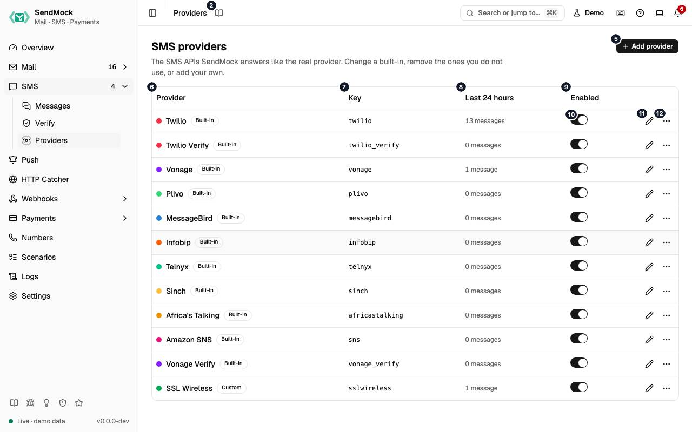

> Every control and text this screen shows, in screen order. The list is read from the demo by a crawl, and CI fails when the screen changes without its entry here.

SMS > Providers lists the SMS APIs SendMock answers like the real provider. The editor changes how each one reads requests, what it answers and the codes it reports.

The screen as a whole: [SMS > Providers](../../sms/providers.md).

The numbers match the entries below. The picture shows the first screenful; controls further down, and texts, have no marker.

## On the screen

### 1. Providers

Heading.

- **What it does:** Names the open screen in the header.

### 2. Read the Providers guide

Link.

- **What it does:** Opens this screen's page in the user guide, in a new tab.
- **Links to:** [SMS > Providers](../../sms/providers.md).

### 3. SMS providers

Heading.

- **What it does:** The list of SMS APIs SendMock answers.
- **Same action elsewhere:** REST [`GET /api/v1/sms/providers`](/api/sms-providers/#getSmsProviders), CLI [`sendmock sms providers list`](/cli/sms-providers/#sms-providers-list), MCP [`sendmock_sms_provider_list`](/mcp/sms-providers/#sendmock_sms_provider_list)

### 4. The SMS APIs SendMock answers like the real provider. Change a built-in, remove the ones you do not use, or add your own.

Text.

- **What it does:** Explains the screen.

### 5. Add provider

Button.

- **What it does:** Opens Add a provider, or (in the dialog) adds it and opens its editor.
- **Same action elsewhere:** REST [`POST /api/v1/sms/providers`](/api/sms-providers/#postSmsProviders), CLI [`sendmock sms providers create`](/cli/sms-providers/#sms-providers-create), MCP [`sendmock_sms_provider_create`](/mcp/sms-providers/#sendmock_sms_provider_create)

### 6. Provider

Column.

- **What it does:** The provider's name and whether it is built in, modified or your own.

### 7. Key

Column.

- **What it does:** Its key: the `/providers/<key>/` path and the source stored on its messages.

### 8. Last # hours

Column.

- **What it does:** How many messages it took in the last 24 hours.

### 9. Enabled

Column.

- **What it does:** Whether it answers requests.

### 10. … enabled

Switch, in each row.

- **What it does:** Turns the provider on or off at once; while off, its paths answer 404.
- **Same action elsewhere:** REST [`PATCH /api/v1/sms/providers/{providerKey}`](/api/sms-providers/#patchSmsProvidersByProviderKey), CLI [`sendmock sms providers update`](/cli/sms-providers/#sms-providers-update), MCP [`sendmock_sms_provider_update`](/mcp/sms-providers/#sendmock_sms_provider_update)

### 11. Edit …

Button, in each row.

- **What it does:** Opens the provider's editor.
- **Same action elsewhere:** REST [`GET /api/v1/sms/providers/{providerKey}`](/api/sms-providers/#getSmsProvidersByProviderKey), CLI [`sendmock sms providers show`](/cli/sms-providers/#sms-providers-show), MCP [`sendmock_sms_provider_get`](/mcp/sms-providers/#sendmock_sms_provider_get)

### 12. More for …

Button, in each row.

- **What it does:** Opens a menu with Reset to default (a modified built-in), Remove (a built-in, which then answers 404 until restored from the Removed group) or Delete (your own provider), each after you confirm.
- **Same action elsewhere:** REST [`POST /api/v1/sms/providers/{providerKey}/reset`](/api/sms-providers/#postSmsProvidersByProviderKeyReset), CLI [`sendmock sms providers reset`](/cli/sms-providers/#sms-providers-reset), MCP [`sendmock_sms_provider_reset`](/mcp/sms-providers/#sendmock_sms_provider_reset)
- **Same action elsewhere:** REST [`DELETE /api/v1/sms/providers/{providerKey}`](/api/sms-providers/#deleteSmsProvidersByProviderKey), CLI [`sendmock sms providers delete`](/cli/sms-providers/#sms-providers-delete), MCP [`sendmock_sms_provider_delete`](/mcp/sms-providers/#sendmock_sms_provider_delete)

## Add a provider dialog

### 13. Add a provider

Heading.

- **What it does:** The Add a provider dialog.

### 14. Answer a provider SendMock does not ship, from blank or from the closest SMS provider; you set its requests and responses next.

Text.

- **What it does:** Explains what adding does.
- **Links to:** [Advanced: create an email provider](../../advanced/email-provider.md).

### 15. Name

Field.

- **What it does:** The name shown in lists and on message badges.

### 16. Key

Field.

- **What it does:** The short id in its paths (`/providers/<key>/`) and stored on each message as its source. It cannot change once added.

### 17. Its /providers/\<key>/ path and the name stored on messages; fixed once added.

Text.

- **What it does:** Explains the key.

### 18. Start from

Drop-down.

- **What it does:** Blank, or a built-in to copy as the starting point.

### 19. Cancel

Button.

- **What it does:** Closes the dialog or editor without saving.

### 20. Add provider

Button.

- **What it does:** Opens Add a provider, or (in the dialog) adds it and opens its editor.
- **Same action elsewhere:** REST [`POST /api/v1/sms/providers`](/api/sms-providers/#postSmsProviders), CLI [`sendmock sms providers create`](/cli/sms-providers/#sms-providers-create), MCP [`sendmock_sms_provider_create`](/mcp/sms-providers/#sendmock_sms_provider_create)

### 21. Close

Button.

- **What it does:** Closes the dialog or editor without saving.

## Provider editor, General tab

### 22. Twilio

Heading.

- **What it does:** The provider open in the editor (here Twilio).

### 23. Built-in Key twilio , # messages in the last # hours.

Text.

- **What it does:** Says whether the provider is built in or your own, its key, and how many SMS it took in the last 24 hours.

### 24. General

Tab.

- **What it does:** Name, key, host, badge colour, whether it is on, and its credentials.

### 25. Accounts

Tab.

- **What it does:** Twilio subaccounts: add, suspend, close or delete one, and reveal its Auth Token.
- **Same action elsewhere:** REST [`GET /api/v1/twilio/subaccounts`](/api/sms/#getTwilioSubaccounts), CLI [`sendmock sms twilio subaccounts list`](/cli/sms/#sms-twilio-subaccounts-list), MCP [`sendmock_twilio_subaccount_list`](/mcp/sms/#sendmock_twilio_subaccount_list)

### 26. Requests

Tab.

- **What it does:** The API paths it answers, how each request's fields map to a stored SMS, and the checks a request must pass.

### 27. Responses

Tab.

- **What it does:** What it answers: the message id format, the success response and each error response, as templates.

### 28. Callbacks

Tab.

- **What it does:** The webhook template its status callbacks are sent with, and its own names for each status.

### 29. Preview

Tab.

- **What it does:** Sends a sample request through the unsaved definition and shows the stored message and the response.

### 30. Try it

Tab.

- **What it does:** The base URLs and a curl command to point your app or the provider's SDK at it.

### 31. Name

Field.

- **What it does:** The name shown in lists and on message badges.

### 32. Key

Field.

- **What it does:** The short id in its paths (`/providers/<key>/`) and stored on each message as its source. It cannot change once added.

### 33. Its /providers/\<key>/ path and the name stored on messages; fixed once added.

Text.

- **What it does:** Explains the key.

### 34. Host

Field.

- **What it does:** The provider's real API host, such as `api.sendgrid.com`.

### 35. The provider's API host. On the provider port it tells apart providers that share a path.

Text.

- **What it does:** Explains why the host matters: on the provider port, requests are matched by host when two providers use the same path.

### 36. Accent colour

Field.

- **What it does:** Picks the badge colour with the browser's colour picker.

### 37. Accent

Field.

- **What it does:** The badge colour as a hex value, such as `#1a82e2`.

### 38. The colour of its badge on messages.

Text.

- **What it does:** Explains the accent.

### 39. Enabled

Switch.

- **What it does:** Turns the provider on or off; while off, its paths answer 404.

### 40. What your app is configured with. Templates read them as credentials.\<name> ; secrets stay masked, in the preview too.

Text.

- **What it does:** Explains the credentials: the API key and other values your app sends, which templates can read.

### 41. Credential # name

Field.

- **What it does:** A credential's name, such as `api_key`.

### 42. Credential # value

Field.

- **What it does:** The credential's value; a secret one is masked.

### 43. Secret

Checkbox.

- **What it does:** Masks the value everywhere: the UI, API answers, logs, MCP results and seed exports.

### 44. Reveal account_sid

Button.

- **What it does:** Shows the Account SID once, after you confirm.
- **Same action elsewhere:** REST [`GET /api/v1/sms/providers/{providerKey}/credentials/{credentialName}`](/api/sms-providers/#getSmsProvidersByProviderKeyCredentialsByCredentialName), CLI [`sendmock sms providers credential`](/cli/sms-providers/#sms-providers-credential)

### 45. Remove credential #

Button.

- **What it does:** Removes the credential.

### 46. Reveal auth_token

Button.

- **What it does:** Shows the Auth Token once, after you confirm.
- **Same action elsewhere:** REST [`GET /api/v1/sms/providers/{providerKey}/credentials/{credentialName}`](/api/sms-providers/#getSmsProvidersByProviderKeyCredentialsByCredentialName), CLI [`sendmock sms providers credential`](/cli/sms-providers/#sms-providers-credential)

### 47. Reveal debugger_url

Button.

- **What it does:** Shows the Debugger webhook URL once, after you confirm.
- **Same action elsewhere:** REST [`GET /api/v1/sms/providers/{providerKey}/credentials/{credentialName}`](/api/sms-providers/#getSmsProvidersByProviderKeyCredentialsByCredentialName), CLI [`sendmock sms providers credential`](/cli/sms-providers/#sms-providers-credential)

### 48. Add credential

Button.

- **What it does:** Adds a credential row.

### 49. Check credentials

Switch.

- **What it does:** When on, a request without the right secret credential gets the provider's own unauthorized answer.

### 50. Off: any credentials pass. On: a request without a secret credential gets the provider's unauthorized answer.

Text.

- **What it does:** Explains Check credentials.

### 51. Opt-out keywords

Switch.

- **What it does:** Twilio's Advanced Opt-Out: a contact who texts STOP (STOPALL, UNSUBSCRIBE, CANCEL, END or QUIT) gets no more sends from that number or Messaging Service; a send answers error 21610 until they text START, YES or UNSTOP. On by default for Twilio.
- **Same action elsewhere:** REST getSmsOptOuts

### 52. A text of STOP blocks later sends to that contact with error # until they text START, as Twilio's Advanced Opt-Out does.

Text.

- **What it does:** Explains Opt-out keywords.

### 53. Opt-out auto-replies

Switch.

- **What it does:** Answers STOP, START and HELP with Twilio's default replies, stored as outbound messages. Needs Opt-out keywords on.

### 54. Answers STOP, START and HELP with Twilio's default replies.

Text.

- **What it does:** Explains Opt-out auto-replies.

### 55. Unmatched requests

Heading.

- **What it does:** Sends the requests SendMock does not answer on Twilio's base URL to an HTTP Catcher bin, which answers them with its rules.
- **Links to:** [Provider gaps](../../http/provider-gaps.md)

### 56. Requests on Twilio's base URL that SendMock does not answer. Send them to a bin to answer them with its rules and follow-up webhooks.

Text.

- **What it does:** Explains Unmatched requests: built-in operations still answer first.

### 57. Where Twilio's unmatched requests go

Drop-down.

- **What it does:** Chooses the bin that answers them, or none (they get `404`). A provider has one bin at most; a bin can serve several providers.
- **What it changes:** Attaches or detaches the bin right away, with no restart.
- **Same action elsewhere:** REST [`PUT /api/v1/provider-bins/{area}/{providerKey}`](/api/http-catcher/#putProviderBinsByAreaByProviderKey), CLI [`sendmock http provider-bin attach`](/cli/http-catcher/#http-provider-bin-attach), MCP [`sendmock_http_provider_bin_attach`](/mcp/http-catcher/#sendmock_http_provider_bin_attach)
- **Same action elsewhere:** REST [`DELETE /api/v1/provider-bins/{area}/{providerKey}`](/api/http-catcher/#deleteProviderBinsByAreaByProviderKey), CLI [`sendmock http provider-bin detach`](/cli/http-catcher/#http-provider-bin-detach), MCP [`sendmock_http_provider_bin_detach`](/mcp/http-catcher/#sendmock_http_provider_bin_detach)

### 58. Create a bin for this provider

Button.

- **What it does:** Creates a bin named after the provider and attaches it, so you can add a rule for the endpoint next.
- **What it changes:** Adds an HTTP Catcher bin.
- **Same action elsewhere:** REST [`PUT /api/v1/provider-bins/{area}/{providerKey}`](/api/http-catcher/#putProviderBinsByAreaByProviderKey), CLI [`sendmock http provider-bin attach`](/cli/http-catcher/#http-provider-bin-attach), MCP [`sendmock_http_provider_bin_attach`](/mcp/http-catcher/#sendmock_http_provider_bin_attach)

### 59. Cancel

Button.

- **What it does:** Closes the dialog or editor without saving.

### 60. Save provider

Button.

- **What it does:** Saves the definition; it applies to the next request, with no restart.
- **Errors:** A template that does not render, or a path another provider already answers, is refused with the reason.
- **Same action elsewhere:** REST [`PATCH /api/v1/sms/providers/{providerKey}`](/api/sms-providers/#patchSmsProvidersByProviderKey), CLI [`sendmock sms providers update`](/cli/sms-providers/#sms-providers-update), MCP [`sendmock_sms_provider_update`](/mcp/sms-providers/#sendmock_sms_provider_update)

### 61. Close

Button.

- **What it does:** Closes the dialog or editor without saving.

## Provider editor, Requests tab

### 62. The paths as the provider's API has them; use \{name\} for a part that changes, like /v#/\{domain\}/messages .

Text.

- **What it does:** Explains request paths and their `{name}` parts.

### 63. Request # kind

Drop-down.

- **What it does:** What the request does: send one SMS, send a batch, or another operation the provider has.

### 64. Request # method

Drop-down.

- **What it does:** The HTTP method it answers.

### 65. Request # path

Field.

- **What it does:** The path it answers.

### 66. Request # format

Drop-down.

- **What it does:** The body format the provider's SDK sends: JSON, a form or multipart.

### 67. Remove request #

Button.

- **What it does:** Removes the request.

### 68. Add request

Button.

- **What it does:** Adds a request the provider answers.

### 69. A JSON path ( personalizations[*].to[*].email ), a form field ( To ) or h:* for every field with a prefix. Anything unmapped is kept as metadata.

Text.

- **What it does:** Explains the field mapping sources.

### 70. Mapping # part

Drop-down.

- **What it does:** Which part of the stored SMS the field fills, such as the recipients or the subject.

### 71. Mapping # source

Field.

- **What it does:** Where in the request that part is read from.

### 72. Remove mapping #

Button.

- **What it does:** Removes the mapping.

### 73. Map a part

Button.

- **What it does:** Adds a mapping.

### 74. Check # part

Drop-down.

- **What it does:** The part a request check looks at.

### 75. Check # kind

Drop-down.

- **What it does:** What the check requires, such as present or at most a length.

### 76. Check # max length

Number field.

- **What it does:** The longest value the check allows.

### 77. Check # error

Drop-down.

- **What it does:** Which error response a request failing the check gets.

### 78. Remove check #

Button.

- **What it does:** Removes the check.

### 79. Add check

Button.

- **What it does:** Adds a check.

## Provider editor, Responses tab

### 80. Templates read request , message , error and credentials ; the Preview tab lists every value with an example.

Text.

- **What it does:** Explains what response templates can read.

### 81. Message id

Field.

- **What it does:** The template for the provider's id of each message.

### 82. The provider's id for each message, e.g. SM\{\{ random_hex(#) \}\}.

Text.

- **What it does:** Gives an example message id template.

### 83. Success response

Heading.

- **What it does:** The answer to an accepted request.

### 84. Success response status

Number field.

- **What it does:** Its HTTP status.

### 85. Success response header # name

Field.

- **What it does:** A response header's name.

### 86. Success response header # value

Field.

- **What it does:** That header's value template.

### 87. Remove Success response header #

Button.

- **What it does:** Removes the header.

### 88. Add header

Button.

- **What it does:** Adds a response header.

### 89. Success response body

Field.

- **What it does:** The body template.

### 90. Error response # kind

Drop-down.

- **What it does:** The error it answers: invalid input, unauthorized, a failed check, and so on.

### 91. Remove error response #

Button.

- **What it does:** Removes the error response.

### 92. Error response # status

Number field.

- **What it does:** Its HTTP status.

### 93. Error response # header # name

Field.

- **What it does:** A header's name.

### 94. Error response # header # value

Field.

- **What it does:** That header's value template.

### 95. Remove Error response # header #

Button.

- **What it does:** Removes the header.

### 96. Error response # body

Field.

- **What it does:** The error body template, in the provider's real error shape.

### 97. Add an error response

Button.

- **What it does:** Adds an error response.

## Provider editor, Callbacks tab

### 98. Callback template

Drop-down.

- **What it does:** The webhook template status callbacks are sent with.
- **Links to:** [Webhooks > Templates](../../webhooks/templates.md).

### 99. The webhook template its status callbacks and inbound messages are sent with; edit it in Webhooks > Templates.

Text.

- **What it does:** Explains the callback template.

### 100. The provider's name for each SendMock status, as its callbacks and fetch answers show it.

Text.

- **What it does:** Explains the status names below.

### 101. queued

Field.

- **What it does:** The provider's name for a message waiting to be sent, as its status callbacks show it.

### 102. sent

Field.

- **What it does:** The provider's name for a message handed to the carrier, as its status callbacks show it.

### 103. delivered

Field.

- **What it does:** The provider's name for a message delivered, as its status callbacks show it.

### 104. undelivered

Field.

- **What it does:** The provider's name for a message not delivered, as its status callbacks show it.

### 105. failed

Field.

- **What it does:** The provider's name for a message failed to send, as its status callbacks show it.

### 106. read

Field.

- **What it does:** The provider's name for a message read, as its status callbacks show it.

### 107. The provider's error code for each outcome, so the magic test numbers fail with its own codes. Leave one empty to use none.

Text.

- **What it does:** Explains the error codes below.
- **Links to:** [Magic numbers and addresses](../../reference/magic-numbers.md).

### 108. invalid_number

Field.

- **What it does:** The provider's error code for an invalid number (Twilio's own is `21211`).

### 109. cannot_route

Field.

- **What it does:** The provider's error code for a number it cannot route to (Twilio's own is `21612`).

### 110. no_international_permission

Field.

- **What it does:** The provider's error code for no international permission (Twilio's own is `21408`).

### 111. blocked

Field.

- **What it does:** The provider's error code for a blocked (opted out) number (Twilio's own is `21610`).

### 112. cannot_receive_sms

Field.

- **What it does:** The provider's error code for a number that cannot receive SMS (Twilio's own is `21614`).

### 113. invalid_from

Field.

- **What it does:** The provider's error code for an invalid sender (Twilio's own is `21212`).

### 114. not_sms_capable

Field.

- **What it does:** The provider's error code for a sender that is not SMS capable (Twilio's own is `21606`).

### 115. queue_full

Field.

- **What it does:** The provider's error code for a full message queue (Twilio's own is `21611`).

### 116. unreachable_handset

Field.

- **What it does:** The provider's error code for an unreachable handset (Twilio's own is `30003`).

### 117. landline

Field.

- **What it does:** The provider's error code for a landline or unreachable carrier (Twilio's own is `30006`).

### 118. carrier_filtered

Field.

- **What it does:** The provider's error code for a message the carrier filtered (Twilio's own is `30007`).

### 119. unknown_error

Field.

- **What it does:** The provider's error code for an unknown error (Twilio's own is `30008`).

## Provider editor, Preview tab

### 120. Sample request

Heading.

- **What it does:** The request the preview sends.

### 121. A send built from the field mapping. Edit it to try another request.

Text.

- **What it does:** Explains the sample.

### 122. Sample method

Drop-down.

- **What it does:** The sample's method.

### 123. Sample path

Field.

- **What it does:** The sample's path.

### 124. Sample body

Field.

- **What it does:** The sample's body.

### 125. Stored message

Heading.

- **What it does:** The SMS SendMock would store for the sample.
- **Same action elsewhere:** REST [`POST /api/v1/sms/providers/{providerKey}/preview`](/api/sms-providers/#postSmsProvidersByProviderKeyPreview), CLI [`sendmock sms providers preview`](/cli/sms-providers/#sms-providers-preview), MCP [`sendmock_sms_provider_preview`](/mcp/sms-providers/#sendmock_sms_provider_preview)

### 126. Response

Heading.

- **What it does:** The response the sample would get.

### 127. Search the reference

Field.

- **What it does:** Filters the template reference: the values, functions and filters templates can use.

### 128. Values

Heading.

- **What it does:** The values a template can read, with an example of each.

### 129. Expand …

Button, in each row.

- **What it does:** Shows the fields inside a value, such as the parts of `request` or `message`.

### 130. …

Button, in each row.

- **What it does:** Inserts the value, function or filter into the template field you were editing.

### 131. Functions

Heading.

- **What it does:** The functions a template can call.

### 132. Filters

Heading.

- **What it does:** The filters a template can use.
- **Links to:** [Template filters](../../reference/template-filters.md).

### 133. … \}\}

Button, in each row.

- **What it does:** Inserts the function into the template field you were editing.

## Provider editor, Try it tab

### 134. Copy sdk base url (provider port)

Button.

- **What it does:** Copies the base URL to give the provider's SDK when the provider port is on.

### 135. Copy base url on the main port

Button.

- **What it does:** Copies the base URL under `/providers/<key>/` on the main port.

### 136. Copy a curl command

Button.

- **What it does:** Copies a curl command that sends the sample request.

### 137. The provider port answers once it is on ( --provider-addr ). The preview shows what this request gets back: #. Settings > Connection has the snippets for each language.

Text.

- **What it does:** Explains where the provider port comes from and what the sample gets back.

## When the data cannot load

### 138. Could not load the providers. Try again

Message.

- **What it does:** Shown when the list could not be loaded.
- **Errors:** Check SendMock is running, then press Try again.

### 139. Could not load the providers.

Text.

- **What it does:** The message inside the alert.

### 140. Try again

Button.

- **What it does:** Loads the list again.
- **Same action elsewhere:** REST [`GET /api/v1/sms/providers`](/api/sms-providers/#getSmsProviders), CLI [`sendmock sms providers list`](/cli/sms-providers/#sms-providers-list), MCP [`sendmock_sms_provider_list`](/mcp/sms-providers/#sendmock_sms_provider_list)
