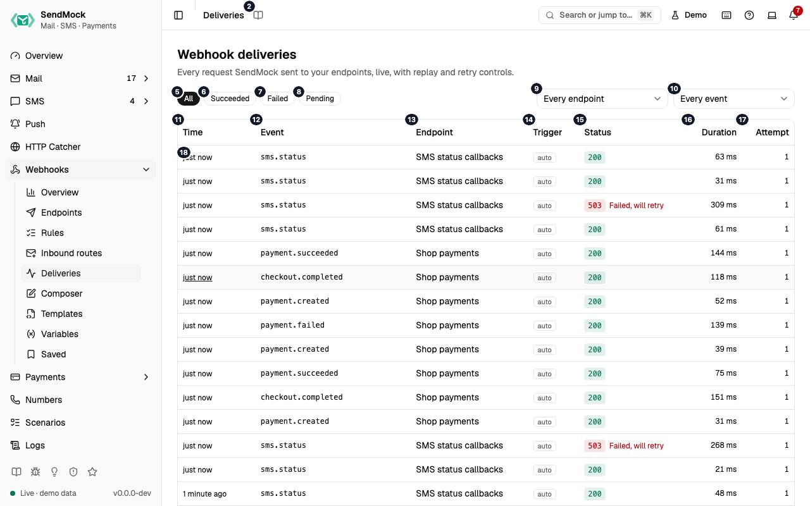

> Every control and text this screen shows, in screen order. The list is read from the demo by a crawl, and CI fails when the screen changes without its entry here.

Webhooks > Deliveries lists every request SendMock sent to your endpoints, with what each answered, and replays any of them.

The screen as a whole: [Deliveries](../../webhooks/deliveries.md).

The numbers match the entries below. The picture shows the first screenful; controls further down, and texts, have no marker.

## On the screen

### 1. Deliveries

Heading.

- **What it does:** Names the open screen in the header.

### 2. Read the Deliveries guide

Link.

- **What it does:** Opens this screen's page in the user guide, in a new tab.
- **Links to:** [Deliveries](../../webhooks/deliveries.md).

### 3. Webhook deliveries

Heading.

- **What it does:** Every request SendMock sent to your endpoints, newest first, updated live.
- **Same action elsewhere:** REST [`GET /api/v1/webhooks/deliveries`](/api/webhook-deliveries/#getWebhooksDeliveries), CLI [`sendmock webhook deliveries list`](/cli/webhook-deliveries/#webhook-deliveries-list), MCP [`sendmock_webhook_delivery_list`](/mcp/webhook-deliveries/#sendmock_webhook_delivery_list)

### 4. Every request SendMock sent to your endpoints, live, with replay and retry controls.

Text.

- **What it does:** Explains the screen.

### 5. All

Button.

- **What it does:** Shows every delivery.

### 6. Succeeded

Button.

- **What it does:** Shows deliveries your endpoint answered 2xx.

### 7. Failed

Button.

- **What it does:** Shows deliveries that failed every attempt, or could not be rendered.

### 8. Pending

Button.

- **What it does:** Shows deliveries waiting for their first try or a retry.

### 9. Endpoint filter

Drop-down.

- **What it does:** Shows one endpoint's deliveries, or all.

### 10. Event filter

Drop-down.

- **What it does:** Shows deliveries of one event type, or all.

### 11. Select all loaded deliveries

Checkbox.

- **What it does:** Ticks every row loaded in the list, or clears the ticks; it shows a dash when only some are ticked, and the toolbar says how many are selected. Ticked rows can be deleted together. X ticks the open or focused row.

### 12. Delete all deliveries

Button.

- **What it does:** Asks first, naming how many go and what stays, then deletes every row the list shows, in the picked project. While a search or filter is on it reads Delete matching and deletes only what it matches. Deliveries still queued or waiting for a retry stay; cancel them first.
- **What it changes:** Publishes one `traffic.cleared` event, so every open tab refreshes; settings and configuration stay.
- **Same action elsewhere:** REST [`DELETE /api/v1/webhooks/deliveries`](/api/webhook-deliveries/#deleteWebhooksDeliveries), CLI [`sendmock webhook deliveries delete-all`](/cli/webhook-deliveries/#webhook-deliveries-delete-all), MCP [`sendmock_webhook_delivery_delete_all`](/mcp/webhook-deliveries/#sendmock_webhook_delivery_delete_all)

### 13. Select

Column.

- **What it does:** The column of tick boxes; it has no visible title.

### 14. Time

Column.

- **What it does:** When the delivery was made.

### 15. Event

Column.

- **What it does:** The event it carried, such as `email.received`.

### 16. Endpoint

Column.

- **What it does:** Where it went.

### 17. Trigger

Column.

- **What it does:** What started it: a rule, a test, a manual send, a replay, a saved delivery, or an endpoint chosen for one simulation.

### 18. Status

Column.

- **What it does:** Succeeded, failed, retrying, pending, canceled, exhausted or render failed, with the HTTP status.

### 19. Duration

Column.

- **What it does:** How long the endpoint took to answer.

### 20. Attempt

Column.

- **What it does:** Which attempt this is, of the endpoint's maximum.

### 21. Select …

Checkbox, in each row.

- **What it does:** Ticks this row, so the toolbar can act on it. Shown on hover, on focus and while anything is ticked, and always on touch screens.

### 22. …

Link, in each row.

- **What it does:** Opens the delivery: its request, its answer and every attempt.
- **Same action elsewhere:** REST [`GET /api/v1/webhooks/deliveries/{deliveryId}`](/api/webhook-deliveries/#getWebhooksDeliveriesByDeliveryId), CLI [`sendmock webhook deliveries show`](/cli/webhook-deliveries/#webhook-deliveries-show), MCP [`sendmock_webhook_delivery_get`](/mcp/webhook-deliveries/#sendmock_webhook_delivery_get)

### 23. Load more

Button.

- **What it does:** Loads the next page of older deliveries.

## A delivery is open

### 24. Delivery

Heading.

- **What it does:** The delivery drawer.

### 25. The request SendMock sent and what your endpoint answered.

Text.

- **What it does:** Explains the drawer.

### 26. Your Acme verification code is #. It expires in # minutes.

Link.

- **What it does:** The message the delivery is about (here an SMS); opens it.

### 27. Copy as cURL

Button.

- **What it does:** Copies the request as a curl command, to run it yourself.

### 28. Replay

Button.

- **What it does:** Sends the same request again, as it was, as a new delivery.
- **What it changes:** Records a replay delivery, linked to this one.
- **Same action elsewhere:** REST [`POST /api/v1/webhooks/deliveries/{deliveryId}/replay`](/api/webhook-deliveries/#postWebhooksDeliveriesByDeliveryIdReplay), CLI [`sendmock webhook deliveries replay`](/cli/webhook-deliveries/#webhook-deliveries-replay), MCP [`sendmock_webhook_delivery_replay`](/mcp/webhook-deliveries/#sendmock_webhook_delivery_replay)

### 29. Edit and replay

Button.

- **What it does:** Opens the request in an editor, then sends your changed copy as a new delivery.
- **Same action elsewhere:** REST [`POST /api/v1/webhooks/deliveries/{deliveryId}/replay`](/api/webhook-deliveries/#postWebhooksDeliveriesByDeliveryIdReplay), CLI [`sendmock webhook deliveries replay`](/cli/webhook-deliveries/#webhook-deliveries-replay), MCP [`sendmock_webhook_delivery_replay`](/mcp/webhook-deliveries/#sendmock_webhook_delivery_replay)

### 30. Save

Button.

- **What it does:** Keeps the request as a saved delivery, which survives pruning and reset.
- **Links to:** [Saved](../../webhooks/composer-and-saved.md).
- **Same action elsewhere:** REST [`POST /api/v1/webhooks/saved`](/api/saved-deliveries/#postWebhooksSaved), CLI [`sendmock webhook saved create`](/cli/saved-deliveries/#webhook-saved-create), MCP [`sendmock_webhook_saved_create`](/mcp/saved-deliveries/#sendmock_webhook_saved_create)

### 31. Request POST

Heading.

- **What it does:** The request's method and URL.

### 32. Request headers

Heading.

- **What it does:** The headers sent, signature included.

### 33. Request body

Heading.

- **What it does:** The body sent.

### 34. Copy request body

Button.

- **What it does:** Copies the request body.

### 35. Response #

Heading.

- **What it does:** Your endpoint's HTTP status and how long it took.

### 36. Response headers

Heading.

- **What it does:** The headers your endpoint answered with.

### 37. Response body

Heading.

- **What it does:** What your endpoint answered.

### 38. Copy response body

Button.

- **What it does:** Copies the response body.

### 39. Close

Button.

- **What it does:** Closes the drawer.

## With no data yet

### 40. No deliveries yet

Text.

- **What it does:** Shown when no webhook has been delivered yet.

### 41. Deliveries appear here when a rule sends an event to an endpoint, or when you send a test from Endpoints.

Text.

- **What it does:** Explains how deliveries start.
- **Links to:** [Rules](../../webhooks/rules.md), [Endpoints](../../webhooks/endpoints.md).

## When the data cannot load

### 42. Could not load the deliveries. Try again

Message.

- **What it does:** Shown when the deliveries could not be loaded.
- **Errors:** Check SendMock is running, then press Try again.

### 43. Could not load the deliveries.

Text.

- **What it does:** The message inside the alert.

### 44. Try again

Button.

- **What it does:** Loads the deliveries again.
- **Same action elsewhere:** REST [`GET /api/v1/webhooks/deliveries`](/api/webhook-deliveries/#getWebhooksDeliveries), CLI [`sendmock webhook deliveries list`](/cli/webhook-deliveries/#webhook-deliveries-list), MCP [`sendmock_webhook_delivery_list`](/mcp/webhook-deliveries/#sendmock_webhook_delivery_list)
