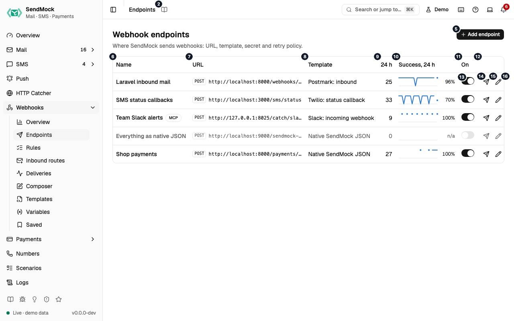

> Every control and text this screen shows, in screen order. The list is read from the demo by a crawl, and CI fails when the screen changes without its entry here.

Webhooks > Endpoints lists the URLs SendMock delivers webhooks to, each with its format, signing secret and retry policy.

The screen as a whole: [Endpoints](../../webhooks/endpoints.md).

The numbers match the entries below. The picture shows the first screenful; controls further down, and texts, have no marker.

## On the screen

### 1. Endpoints

Heading.

- **What it does:** Names the open screen in the header.

### 2. Read the Endpoints guide

Link.

- **What it does:** Opens this screen's page in the user guide, in a new tab.
- **Links to:** [Endpoints](../../webhooks/endpoints.md).

### 3. Webhook endpoints

Heading.

- **What it does:** The list of URLs SendMock delivers webhooks to.
- **Same action elsewhere:** REST [`GET /api/v1/webhooks/endpoints`](/api/webhook-endpoints/#getWebhooksEndpoints), CLI [`sendmock webhook endpoint list`](/cli/webhook-endpoints/#webhook-endpoint-list), MCP [`sendmock_webhook_endpoint_list`](/mcp/webhook-endpoints/#sendmock_webhook_endpoint_list)

### 4. Where SendMock sends webhooks: URL, template, secret and retry policy.

Text.

- **What it does:** Explains the screen.

### 5. Add endpoint

Button.

- **What it does:** Opens the new endpoint editor; in it, adds the endpoint.
- **Same action elsewhere:** REST [`POST /api/v1/webhooks/endpoints`](/api/webhook-endpoints/#postWebhooksEndpoints), CLI [`sendmock webhook endpoint create`](/cli/webhook-endpoints/#webhook-endpoint-create), MCP [`sendmock_webhook_endpoint_create`](/mcp/webhook-endpoints/#sendmock_webhook_endpoint_create)

### 6. Name

Column.

- **What it does:** The endpoint's name.

### 7. URL

Column.

- **What it does:** Where its requests go.

### 8. Template

Column.

- **What it does:** The format its requests are sent in.

### 9. # h

Column.

- **What it does:** Its deliveries over the last 24 hours, as a sparkline.

### 10. Success, # h

Column.

- **What it does:** The share of those deliveries answered 2xx.

### 11. On

Column.

- **What it does:** Whether it receives anything.

### 12. Actions

Column.

- **What it does:** Send test, Edit and Delete.

### 13. … enabled

Switch, in each row.

- **What it does:** Turns the endpoint on or off at once. While off, its rules stay but nothing is sent to it.
- **Same action elsewhere:** REST [`PATCH /api/v1/webhooks/endpoints/{endpointId}`](/api/webhook-endpoints/#patchWebhooksEndpointsByEndpointId), CLI [`sendmock webhook endpoint update`](/cli/webhook-endpoints/#webhook-endpoint-update), MCP [`sendmock_webhook_endpoint_update`](/mcp/webhook-endpoints/#sendmock_webhook_endpoint_update)

### 14. Send test to …

Button, in each row.

- **What it does:** Sends a signed `test.ping` event to the endpoint now and shows what it answered.
- **Same action elsewhere:** REST [`POST /api/v1/webhooks/endpoints/{endpointId}/test`](/api/webhook-endpoints/#postWebhooksEndpointsByEndpointIdTest), CLI [`sendmock webhook endpoint test`](/cli/webhook-endpoints/#webhook-endpoint-test), MCP [`sendmock_webhook_endpoint_test`](/mcp/webhook-endpoints/#sendmock_webhook_endpoint_test)

### 15. Edit …

Button, in each row.

- **What it does:** Opens the endpoint's editor.
- **Same action elsewhere:** REST [`GET /api/v1/webhooks/endpoints/{endpointId}`](/api/webhook-endpoints/#getWebhooksEndpointsByEndpointId), CLI [`sendmock webhook endpoint show`](/cli/webhook-endpoints/#webhook-endpoint-show), MCP [`sendmock_webhook_endpoint_get`](/mcp/webhook-endpoints/#sendmock_webhook_endpoint_get)

### 16. Delete …

Button, in each row.

- **What it does:** Asks for confirmation, then deletes the endpoint.

## New endpoint editor

### 17. Add an endpoint

Heading.

- **What it does:** The new endpoint editor.

### 18. Where SendMock sends webhooks, in which format, and how it retries.

Text.

- **What it does:** Explains the editor.

### 19. General

Tab.

- **What it does:** Name, method, URL, timeout and whether it is on.

### 20. Request

Tab.

- **What it does:** Query parameters, headers and the body: a template, fields, raw text or none.

### 21. Security

Tab.

- **What it does:** The signing secret and its rotation; open once the endpoint is added.

### 22. Retries

Tab.

- **What it does:** How many attempts, how far apart, and what retries.

### 23. Variables

Tab.

- **What it does:** Variables only this endpoint reads; open once the endpoint is added.

### 24. The signing secret and variables can be set once the endpoint is added.

Text.

- **What it does:** Explains why Security and Variables wait.

### 25. Name

Field.

- **What it does:** The endpoint's name in lists, rules and deliveries.

### 26. Method

Drop-down.

- **What it does:** The HTTP method of its requests, POST by default.

### 27. URL

Field.

- **What it does:** Where requests go; it may hold `{{ }}` templates, rendered for each delivery.
- **Errors:** A URL that is not http or https is refused.

### 28. Timeout (seconds)

Field.

- **What it does:** How long SendMock waits for an answer.

### 29. # to # seconds. A slower answer counts as a timeout and is retried.

Text.

- **What it does:** The allowed range and what a timeout does.

### 30. A disabled endpoint keeps its rules but receives nothing.

Text.

- **What it does:** Explains Enabled.

### 31. Enabled

Switch.

- **What it does:** Whether the endpoint receives deliveries.

### 32. Cancel

Button.

- **What it does:** Closes the editor without saving.

### 33. Add endpoint

Button.

- **What it does:** Adds the endpoint and opens its other tabs.
- **Same action elsewhere:** REST [`POST /api/v1/webhooks/endpoints`](/api/webhook-endpoints/#postWebhooksEndpoints), CLI [`sendmock webhook endpoint create`](/cli/webhook-endpoints/#webhook-endpoint-create), MCP [`sendmock_webhook_endpoint_create`](/mcp/webhook-endpoints/#sendmock_webhook_endpoint_create)

### 34. Close

Button.

- **What it does:** Closes the dialog or editor.

## Endpoint editor, General tab

### 35. Laravel inbound mail

Heading.

- **What it does:** The endpoint open in the editor (here the demo's Laravel endpoint).

### 36. Where SendMock sends webhooks, in which format, and how it retries.

Text.

- **What it does:** Explains the editor.

### 37. General

Tab.

- **What it does:** Name, method, URL, timeout and whether it is on.

### 38. Request

Tab.

- **What it does:** Query parameters, headers and the body: a template, fields, raw text or none.

### 39. Security

Tab.

- **What it does:** The signing secret and its rotation; open once the endpoint is added.

### 40. Retries

Tab.

- **What it does:** How many attempts, how far apart, and what retries.

### 41. Variables

Tab.

- **What it does:** Variables only this endpoint reads; open once the endpoint is added.

### 42. Name

Field.

- **What it does:** The endpoint's name in lists, rules and deliveries.

### 43. Method

Drop-down.

- **What it does:** The HTTP method of its requests, POST by default.

### 44. URL

Field.

- **What it does:** Where requests go; it may hold `{{ }}` templates, rendered for each delivery.
- **Errors:** A URL that is not http or https is refused.

### 45. Timeout (seconds)

Field.

- **What it does:** How long SendMock waits for an answer.

### 46. # to # seconds. A slower answer counts as a timeout and is retried.

Text.

- **What it does:** The allowed range and what a timeout does.

### 47. A disabled endpoint keeps its rules but receives nothing.

Text.

- **What it does:** Explains Enabled.

### 48. Enabled

Switch.

- **What it does:** Whether the endpoint receives deliveries.

### 49. Send test

Button.

- **What it does:** Sends a signed `test.ping` to the endpoint as last saved, and shows what it answered.
- **Same action elsewhere:** REST [`POST /api/v1/webhooks/endpoints/{endpointId}/test`](/api/webhook-endpoints/#postWebhooksEndpointsByEndpointIdTest), CLI [`sendmock webhook endpoint test`](/cli/webhook-endpoints/#webhook-endpoint-test), MCP [`sendmock_webhook_endpoint_test`](/mcp/webhook-endpoints/#sendmock_webhook_endpoint_test)

### 50. Close

Button.

- **What it does:** Closes the dialog or editor.

### 51. Save changes

Button.

- **What it does:** Saves the endpoint; the next delivery uses it.
- **Same action elsewhere:** REST [`PATCH /api/v1/webhooks/endpoints/{endpointId}`](/api/webhook-endpoints/#patchWebhooksEndpointsByEndpointId), CLI [`sendmock webhook endpoint update`](/cli/webhook-endpoints/#webhook-endpoint-update), MCP [`sendmock_webhook_endpoint_update`](/mcp/webhook-endpoints/#sendmock_webhook_endpoint_update)

## Endpoint editor, Request tab

### 52. None. Added to the URL, URL-encoded.

Text.

- **What it does:** The query parameters; none yet.

### 53. Add query param

Button.

- **What it does:** Adds a query parameter, whose value may be a template.

### 54. None besides Content-Type and the signature headers.

Text.

- **What it does:** The extra headers; none yet.

### 55. Add header

Button.

- **What it does:** Adds a header, whose value may be a template.

### 56. Template

Choice.

- **What it does:** The body comes from a webhook template.

### 57. Fields

Choice.

- **What it does:** The body is built from name and value fields, as JSON, a form or multipart.

### 58. Raw

Choice.

- **What it does:** The body is text you write, with templates inside.

### 59. None

Choice.

- **What it does:** No body.

### 60. Template

Drop-down.

- **What it does:** The template the body comes from, such as native JSON or a provider's format.
- **Links to:** [Templates](../../webhooks/templates.md).

### 61. Postmark: inbound payload, matching the provider's documented format.

Text.

- **What it does:** Describes the chosen template (here Postmark's inbound format).

### 62. Based on Postmark: inbound rev #. Built-in templates are always linked: edit them on the Templates screen, or clone one for a separate copy.

Text.

- **What it does:** Names the template revision the endpoint uses and how built-ins stay linked.

### 63. Linked Follows template updates; overrides go on top.

Choice.

- **What it does:** The endpoint follows the template as it changes, with its own field overrides on top.

### 64. Detached A private copy that never changes on its own.

Choice.

- **What it does:** The endpoint keeps its own copy of the template.

### 65. None. Added to what the template sends; values accept \{\{ \}\} templates.

Text.

- **What it does:** The extra body fields; none yet.

### 66. Add field

Button.

- **What it does:** Adds a body field on top of the template.

### 67. Keep this endpoint's template and overrides, as last saved, as a template of your own.

Text.

- **What it does:** Explains Save as template.

### 68. Save as template

Button.

- **What it does:** Saves the endpoint's request as a new custom template.
- **Same action elsewhere:** REST [`POST /api/v1/webhooks/endpoints/{endpointId}/save-as-template`](/api/webhook-endpoints/#postWebhooksEndpointsByEndpointIdSaveAsTemplate), CLI [`sendmock webhook endpoint save-as-template`](/cli/webhook-endpoints/#webhook-endpoint-save-as-template), MCP [`sendmock_webhook_endpoint_save_as_template`](/mcp/webhook-endpoints/#sendmock_webhook_endpoint_save_as_template)

### 69. Strict An undefined value stops the delivery as render failed.

Choice.

- **What it does:** A template value that is not defined stops the delivery with `render_failed`.

### 70. Lenient An undefined value renders empty, with a warning.

Choice.

- **What it does:** A value that is not defined renders empty and the delivery goes on.

### 71. Preview with

Drop-down.

- **What it does:** The event the preview renders with: a sample, or a recent real message.
- **Same action elsewhere:** REST [`POST /api/v1/webhooks/endpoints/preview`](/api/webhook-endpoints/#postWebhooksEndpointsPreview), CLI [`sendmock webhook render`](/cli/webhook-endpoints/#webhook-render), MCP [`sendmock_webhook_render`](/mcp/webhook-endpoints/#sendmock_webhook_render)

### 72. Copy rendered URL

Button.

- **What it does:** Copies the URL as rendered for the preview event.

### 73. Rendered headers

Heading.

- **What it does:** The headers a delivery would carry, signature included.

### 74. Rendered body

Heading.

- **What it does:** The body a delivery would carry.

### 75. Copy rendered body

Button.

- **What it does:** Copies the rendered body.

## Endpoint editor, Security tab

### 76. Reveal

Button.

- **What it does:** Shows the signing secret (`whsec_...`) once, after you confirm.
- **Same action elsewhere:** REST [`GET /api/v1/webhooks/endpoints/{endpointId}/secret`](/api/webhook-endpoints/#getWebhooksEndpointsByEndpointIdSecret), CLI [`sendmock webhook endpoint secret`](/cli/webhook-endpoints/#webhook-endpoint-secret)

### 77. Overlap after rotating

Drop-down.

- **What it does:** How long the previous secret keeps signing beside the new one after a rotation.

### 78. Both secrets sign during the overlap, so you can test a rolling update.

Text.

- **What it does:** Explains the overlap: each request carries both signatures.

### 79. Rotate secret

Button.

- **What it does:** Makes a new signing secret.
- **Links to:** [Endpoints](../../webhooks/endpoints.md).
- **Same action elsewhere:** REST [`POST /api/v1/webhooks/endpoints/{endpointId}/rotate-secret`](/api/webhook-endpoints/#postWebhooksEndpointsByEndpointIdRotateSecret), CLI [`sendmock webhook endpoint rotate-secret`](/cli/webhook-endpoints/#webhook-endpoint-rotate-secret), MCP [`sendmock_webhook_endpoint_rotate_secret`](/mcp/webhook-endpoints/#sendmock_webhook_endpoint_rotate_secret)

## Endpoint editor, Retries tab

### 80. Max attempts

Field.

- **What it does:** How many tries in all, counting the first.

### 81. # to #, counting the first try.

Text.

- **What it does:** The allowed range.

### 82. # second to # hours, used in order; the last one repeats.

Text.

- **What it does:** Explains the retry delays.

### 83. Remove retry delay #

Button, in each row.

- **What it does:** Removes that delay.

### 84. Delay before each retry

Field.

- **What it does:** A delay to add, such as `30s` or `5m`.

### 85. Add delay

Button.

- **What it does:** Adds the delay to the schedule.

### 86. #xx answers, timeouts and connection errors always retry.

Text.

- **What it does:** What always retries.

### 87. Retry on #xx

Switch.

- **What it does:** Also retries 4xx answers, which by default end the delivery at once.

### 88. Attempts at # s, # s, # s, # s, # m # s.

Text.

- **What it does:** When each attempt would happen, from the settings above.

## Endpoint editor, Variables tab

### 89. Endpoint variables

Heading.

- **What it does:** Variables only this endpoint reads.

### 90. Add variable

Button.

- **What it does:** Adds a text or secret variable for this endpoint.
- **Same action elsewhere:** REST [`POST /api/v1/webhooks/variables`](/api/webhook-variables/#postWebhooksVariables), CLI [`sendmock webhook var set`](/cli/webhook-variables/#webhook-var-set), MCP [`sendmock_webhook_variable_set`](/mcp/webhook-variables/#sendmock_webhook_variable_set)

### 91. Used as \{\{ vars.name \}\} by this endpoint only; they win over global variables of the same name. Number, JSON, Dynamic, Random and the other kinds are on the Variables screen .

Text.

- **What it does:** Explains endpoint variables.

### 92. Variables screen

Link.

- **What it does:** Opens Webhooks > Variables.
- **Links to:** [Variables](../../webhooks/variables.md).

### 93. No endpoint variables.

Text.

- **What it does:** Shown while it has none.

## Test sent dialog

### 94. Test sent to Laravel inbound mail

Heading.

- **What it does:** The result of a test send (here to the demo's Laravel endpoint).

### 95. A test.ping event, signed like a real delivery.

Text.

- **What it does:** Explains what was sent.

### 96. Signed headers

Heading.

- **What it does:** The headers sent, signature included, so you can check your verification code.

### 97. Response body

Heading.

- **What it does:** What the endpoint answered, with its status and time.

### 98. Open delivery

Link.

- **What it does:** Opens the test's delivery in Webhooks > Deliveries.
- **Links to:** [Deliveries](../../webhooks/deliveries.md).

### 99. Done

Button.

- **What it does:** Closes the result.

### 100. Close

Button.

- **What it does:** Closes the dialog or editor.

## Delete endpoint dialog

### 101. Delete Laravel inbound mail?

Heading.

- **What it does:** The confirmation before deleting an endpoint.

### 102. Its # rule and its variables go with it. Past deliveries stay in the log.

Text.

- **What it does:** Says what is deleted with it and what stays.

### 103. Keep it

Button.

- **What it does:** Closes the confirmation without deleting.

### 104. Delete

Button.

- **What it does:** Deletes the endpoint, its rules and its variables.
- **Same action elsewhere:** REST [`DELETE /api/v1/webhooks/endpoints/{endpointId}`](/api/webhook-endpoints/#deleteWebhooksEndpointsByEndpointId), CLI [`sendmock webhook endpoint delete`](/cli/webhook-endpoints/#webhook-endpoint-delete), MCP [`sendmock_webhook_endpoint_delete`](/mcp/webhook-endpoints/#sendmock_webhook_endpoint_delete)

## When the data cannot load

### 105. Could not load the endpoints. Try again

Message.

- **What it does:** Shown when the endpoints could not be loaded.
- **Errors:** Check SendMock is running, then press Try again.

### 106. Could not load the endpoints.

Text.

- **What it does:** The message inside the alert.

### 107. Try again

Button.

- **What it does:** Loads the endpoints again.
- **Same action elsewhere:** REST [`GET /api/v1/webhooks/endpoints`](/api/webhook-endpoints/#getWebhooksEndpoints), CLI [`sendmock webhook endpoint list`](/cli/webhook-endpoints/#webhook-endpoint-list), MCP [`sendmock_webhook_endpoint_list`](/mcp/webhook-endpoints/#sendmock_webhook_endpoint_list)
