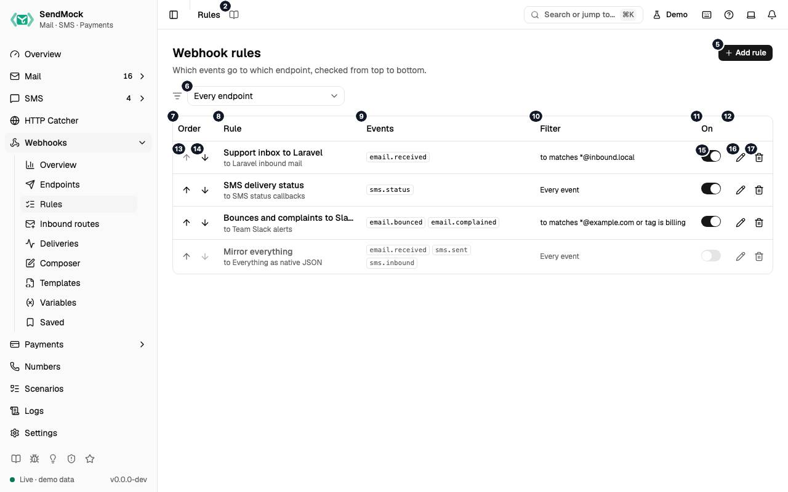

> Every control and text this screen shows, in screen order. The list is read from the demo by a crawl, and CI fails when the screen changes without its entry here.

Webhooks > Rules decides which events go to which endpoint: each rule picks events and, optionally, a filter on their fields.

The screen as a whole: [Rules](../../webhooks/rules.md).

The numbers match the entries below. The picture shows the first screenful; controls further down, and texts, have no marker.

## On the screen

### 1. Rules

Heading.

- **What it does:** Names the open screen in the header.

### 2. Read the Rules guide

Link.

- **What it does:** Opens this screen's page in the user guide, in a new tab.
- **Links to:** [Rules](../../webhooks/rules.md).

### 3. Webhook rules

Heading.

- **What it does:** The rules that decide which events go to which endpoint.
- **Same action elsewhere:** REST [`GET /api/v1/webhooks/rules`](/api/webhook-rules/#getWebhooksRules), CLI [`sendmock webhook rule list`](/cli/webhook-rules/#webhook-rule-list), MCP [`sendmock_webhook_rule_list`](/mcp/webhook-rules/#sendmock_webhook_rule_list)

### 4. Which events go to which endpoint, checked from top to bottom.

Text.

- **What it does:** Explains the screen: every matching rule delivers, in this order.

### 5. Add rule

Button.

- **What it does:** Opens the new rule editor; in it, adds the rule.
- **Same action elsewhere:** REST [`POST /api/v1/webhooks/rules`](/api/webhook-rules/#postWebhooksRules), CLI [`sendmock webhook rule create`](/cli/webhook-rules/#webhook-rule-create), MCP [`sendmock_webhook_rule_create`](/mcp/webhook-rules/#sendmock_webhook_rule_create)

### 6. Endpoint filter

Drop-down.

- **What it does:** Shows the rules of every endpoint, or of one.

### 7. Order

Column.

- **What it does:** The rule's place, with buttons to move it.

### 8. Rule

Column.

- **What it does:** The rule's name and endpoint.

### 9. Events

Column.

- **What it does:** The events it sends.

### 10. Filter

Column.

- **What it does:** Its filter, in words.

### 11. On

Column.

- **What it does:** Whether it is on.

### 12. Actions

Column.

- **What it does:** Edit and Delete.

### 13. Move … up

Button, in each row.

- **What it does:** Moves the rule one place up.
- **Same action elsewhere:** REST [`POST /api/v1/webhooks/rules/{ruleId}/move`](/api/webhook-rules/#postWebhooksRulesByRuleIdMove), CLI [`sendmock webhook rule move`](/cli/webhook-rules/#webhook-rule-move), MCP [`sendmock_webhook_rule_move`](/mcp/webhook-rules/#sendmock_webhook_rule_move)

### 14. Move … down

Button, in each row.

- **What it does:** Moves the rule one place down.
- **Same action elsewhere:** REST [`POST /api/v1/webhooks/rules/{ruleId}/move`](/api/webhook-rules/#postWebhooksRulesByRuleIdMove), CLI [`sendmock webhook rule move`](/cli/webhook-rules/#webhook-rule-move), MCP [`sendmock_webhook_rule_move`](/mcp/webhook-rules/#sendmock_webhook_rule_move)

### 15. … enabled

Switch, in each row.

- **What it does:** Turns the rule on or off at once.
- **Same action elsewhere:** REST [`PATCH /api/v1/webhooks/rules/{ruleId}`](/api/webhook-rules/#patchWebhooksRulesByRuleId), CLI [`sendmock webhook rule update`](/cli/webhook-rules/#webhook-rule-update), MCP [`sendmock_webhook_rule_update`](/mcp/webhook-rules/#sendmock_webhook_rule_update)

### 16. Edit …

Button, in each row.

- **What it does:** Opens the rule's editor.
- **Same action elsewhere:** REST [`GET /api/v1/webhooks/rules/{ruleId}`](/api/webhook-rules/#getWebhooksRulesByRuleId), CLI [`sendmock webhook rule show`](/cli/webhook-rules/#webhook-rule-show), MCP [`sendmock_webhook_rule_get`](/mcp/webhook-rules/#sendmock_webhook_rule_get)

### 17. Delete …

Button, in each row.

- **What it does:** Asks for confirmation, then deletes the rule.

## New rule editor

### 18. Add a rule

Heading.

- **What it does:** The new rule editor.

### 19. Which events go to the endpoint, and only when the filter matches.

Text.

- **What it does:** Explains the editor.

### 20. Name

Field.

- **What it does:** The rule's name.

### 21. Endpoint

Drop-down.

- **What it does:** The endpoint matching events are delivered to.
- **Links to:** [Endpoints](../../webhooks/endpoints.md).

### 22. Events

Heading.

- **What it does:** The events the rule sends; tick one or more.

### 23. email.received

Checkbox.

- **What it does:** Sends `email.received`, fired when an email your app sent arrives (SMTP, a provider API, sendmail or the native API).

### 24. email.inbound

Checkbox.

- **What it does:** Sends `email.inbound`, fired when an incoming email arrives: a simulated reply or forward, or mail to an inbound domain.

### 25. email.opened

Checkbox.

- **What it does:** Sends `email.opened`, fired when an email is opened.

### 26. email.delivered

Checkbox.

- **What it does:** Sends `email.delivered`, fired when an email is marked delivered.

### 27. email.deferred

Checkbox.

- **What it does:** Sends `email.deferred`, fired when an email's delivery is deferred.

### 28. email.bounced

Checkbox.

- **What it does:** Sends `email.bounced`, fired when an email bounces.

### 29. email.complained

Checkbox.

- **What it does:** Sends `email.complained`, fired when a spam complaint is recorded.

### 30. email.unsubscribed

Checkbox.

- **What it does:** Sends `email.unsubscribed`, fired when an unsubscribe is recorded.

### 31. email.released

Checkbox.

- **What it does:** Sends `email.released`, fired when an email is released to a real inbox.

### 32. email.deleted

Checkbox.

- **What it does:** Sends `email.deleted`, fired when an email is deleted.

### 33. sms.sent

Checkbox.

- **What it does:** Sends `sms.sent`, fired when your app sends an SMS.

### 34. sms.status

Checkbox.

- **What it does:** Sends `sms.status`, fired when an SMS changes status.

### 35. sms.opened

Checkbox.

- **What it does:** Sends `sms.opened`, fired when an SMS is read.

### 36. sms.inbound

Checkbox.

- **What it does:** Sends `sms.inbound`, fired when an inbound SMS arrives.

### 37. verify.started

Checkbox.

- **What it does:** Sends `verify.started`, fired when a verification starts.

### 38. verify.checked

Checkbox.

- **What it does:** Sends `verify.checked`, fired when a code is checked, or a verification is approved, canceled or runs out of attempts.

### 39. verify.expired

Checkbox.

- **What it does:** Sends `verify.expired`, fired when a verification expires.

### 40. http.captured

Checkbox.

- **What it does:** Sends `http.captured`, fired when the HTTP catcher captures a request.

### 41. payment.created

Checkbox.

- **What it does:** Sends `payment.created`, fired when a payment is created.

### 42. payment.authorized

Checkbox.

- **What it does:** Sends `payment.authorized`, fired when a payment is authorized.

### 43. payment.succeeded

Checkbox.

- **What it does:** Sends `payment.succeeded`, fired when a payment succeeds.

### 44. payment.failed

Checkbox.

- **What it does:** Sends `payment.failed`, fired when a payment fails.

### 45. payment.canceled

Checkbox.

- **What it does:** Sends `payment.canceled`, fired when a payment is canceled or voided.

### 46. payment.refunded

Checkbox.

- **What it does:** Sends `payment.refunded`, fired when a payment is refunded in full.

### 47. payment.partially_refunded

Checkbox.

- **What it does:** Sends `payment.partially_refunded`, fired when part of a payment is refunded.

### 48. payment.dispute_opened

Checkbox.

- **What it does:** Sends `payment.dispute_opened`, fired when a dispute is opened.

### 49. payment.dispute_updated

Checkbox.

- **What it does:** Sends `payment.dispute_updated`, fired when a dispute is answered or changes.

### 50. payment.dispute_closed

Checkbox.

- **What it does:** Sends `payment.dispute_closed`, fired when a dispute is closed.

### 51. checkout.completed

Checkbox.

- **What it does:** Sends `checkout.completed`, fired when a checkout is completed.

### 52. checkout.expired

Checkbox.

- **What it does:** Sends `checkout.expired`, fired when a checkout expires.

### 53. subscription.created

Checkbox.

- **What it does:** Sends `subscription.created`, fired when a subscription is created.

### 54. subscription.renewed

Checkbox.

- **What it does:** Sends `subscription.renewed`, fired when a subscription renews.

### 55. subscription.payment_failed

Checkbox.

- **What it does:** Sends `subscription.payment_failed`, fired when a subscription's renewal payment fails.

### 56. subscription.canceled

Checkbox.

- **What it does:** Sends `subscription.canceled`, fired when a subscription is canceled.

### 57. webhook.failed

Checkbox.

- **What it does:** Sends `webhook.failed`, fired when a webhook delivery fails for good.

### 58. test.ping

Checkbox.

- **What it does:** Sends `test.ping`, fired when an endpoint test is sent.

### 59. Filter

Heading.

- **What it does:** Conditions on the event's fields; with none, every selected event is sent.
- **Links to:** [Advanced: rules and filters](../../advanced/rules-and-filters.md).

### 60. Negate filter

Button.

- **What it does:** Sends the events that do not match the filter instead.

### 61. Filter combinator

Drop-down.

- **What it does:** Whether all conditions must match, or any one.

### 62. No conditions: every selected event fires.

Text.

- **What it does:** Shown while the filter is empty.

### 63. Add condition

Button.

- **What it does:** Adds a condition.

### 64. Add group

Button.

- **What it does:** Adds a group of conditions with its own all or any.

### 65. Preview

Heading.

- **What it does:** Tries the rule on recent real messages before you save it.
- **Same action elsewhere:** REST [`POST /api/v1/webhooks/rules/preview`](/api/webhook-rules/#postWebhooksRulesPreview), CLI [`sendmock webhook rule preview`](/cli/webhook-rules/#webhook-rule-preview), MCP [`sendmock_webhook_rule_preview`](/mcp/webhook-rules/#sendmock_webhook_rule_preview)

### 66. Matches # of the last # messages

Text.

- **What it does:** How many recent messages the rule would send.

### 67. Show non-matching

Switch.

- **What it does:** Lists the recent messages that would not be sent too, with the condition that failed.

### 68. Matches

Badge.

- **What it does:** Marks a recent message the rule matches.

### 69. Cancel

Button.

- **What it does:** Closes the editor without saving.

### 70. Add rule

Button.

- **What it does:** Adds the rule; it applies to the next event.
- **Same action elsewhere:** REST [`POST /api/v1/webhooks/rules`](/api/webhook-rules/#postWebhooksRules), CLI [`sendmock webhook rule create`](/cli/webhook-rules/#webhook-rule-create), MCP [`sendmock_webhook_rule_create`](/mcp/webhook-rules/#sendmock_webhook_rule_create)

### 71. Close

Button.

- **What it does:** Closes the editor without saving.

## Rule editor

### 72. Support inbox to Laravel

Heading.

- **What it does:** The rule open in the editor (here a demo rule).

### 73. Which events go to the endpoint, and only when the filter matches.

Text.

- **What it does:** Explains the editor.

### 74. Name

Field.

- **What it does:** The rule's name.

### 75. Endpoint

Drop-down.

- **What it does:** The endpoint matching events are delivered to.
- **Links to:** [Endpoints](../../webhooks/endpoints.md).

### 76. Events

Heading.

- **What it does:** The events the rule sends; tick one or more.

### 77. email.received

Checkbox.

- **What it does:** Sends `email.received`, fired when an email your app sent arrives (SMTP, a provider API, sendmail or the native API).

### 78. email.inbound

Checkbox.

- **What it does:** Sends `email.inbound`, fired when an incoming email arrives: a simulated reply or forward, or mail to an inbound domain.

### 79. email.opened

Checkbox.

- **What it does:** Sends `email.opened`, fired when an email is opened.

### 80. email.delivered

Checkbox.

- **What it does:** Sends `email.delivered`, fired when an email is marked delivered.

### 81. email.deferred

Checkbox.

- **What it does:** Sends `email.deferred`, fired when an email's delivery is deferred.

### 82. email.bounced

Checkbox.

- **What it does:** Sends `email.bounced`, fired when an email bounces.

### 83. email.complained

Checkbox.

- **What it does:** Sends `email.complained`, fired when a spam complaint is recorded.

### 84. email.unsubscribed

Checkbox.

- **What it does:** Sends `email.unsubscribed`, fired when an unsubscribe is recorded.

### 85. email.released

Checkbox.

- **What it does:** Sends `email.released`, fired when an email is released to a real inbox.

### 86. email.deleted

Checkbox.

- **What it does:** Sends `email.deleted`, fired when an email is deleted.

### 87. sms.sent

Checkbox.

- **What it does:** Sends `sms.sent`, fired when your app sends an SMS.

### 88. sms.status

Checkbox.

- **What it does:** Sends `sms.status`, fired when an SMS changes status.

### 89. sms.opened

Checkbox.

- **What it does:** Sends `sms.opened`, fired when an SMS is read.

### 90. sms.inbound

Checkbox.

- **What it does:** Sends `sms.inbound`, fired when an inbound SMS arrives.

### 91. verify.started

Checkbox.

- **What it does:** Sends `verify.started`, fired when a verification starts.

### 92. verify.checked

Checkbox.

- **What it does:** Sends `verify.checked`, fired when a code is checked, or a verification is approved, canceled or runs out of attempts.

### 93. verify.expired

Checkbox.

- **What it does:** Sends `verify.expired`, fired when a verification expires.

### 94. http.captured

Checkbox.

- **What it does:** Sends `http.captured`, fired when the HTTP catcher captures a request.

### 95. payment.created

Checkbox.

- **What it does:** Sends `payment.created`, fired when a payment is created.

### 96. payment.authorized

Checkbox.

- **What it does:** Sends `payment.authorized`, fired when a payment is authorized.

### 97. payment.succeeded

Checkbox.

- **What it does:** Sends `payment.succeeded`, fired when a payment succeeds.

### 98. payment.failed

Checkbox.

- **What it does:** Sends `payment.failed`, fired when a payment fails.

### 99. payment.canceled

Checkbox.

- **What it does:** Sends `payment.canceled`, fired when a payment is canceled or voided.

### 100. payment.refunded

Checkbox.

- **What it does:** Sends `payment.refunded`, fired when a payment is refunded in full.

### 101. payment.partially_refunded

Checkbox.

- **What it does:** Sends `payment.partially_refunded`, fired when part of a payment is refunded.

### 102. payment.dispute_opened

Checkbox.

- **What it does:** Sends `payment.dispute_opened`, fired when a dispute is opened.

### 103. payment.dispute_updated

Checkbox.

- **What it does:** Sends `payment.dispute_updated`, fired when a dispute is answered or changes.

### 104. payment.dispute_closed

Checkbox.

- **What it does:** Sends `payment.dispute_closed`, fired when a dispute is closed.

### 105. checkout.completed

Checkbox.

- **What it does:** Sends `checkout.completed`, fired when a checkout is completed.

### 106. checkout.expired

Checkbox.

- **What it does:** Sends `checkout.expired`, fired when a checkout expires.

### 107. subscription.created

Checkbox.

- **What it does:** Sends `subscription.created`, fired when a subscription is created.

### 108. subscription.renewed

Checkbox.

- **What it does:** Sends `subscription.renewed`, fired when a subscription renews.

### 109. subscription.payment_failed

Checkbox.

- **What it does:** Sends `subscription.payment_failed`, fired when a subscription's renewal payment fails.

### 110. subscription.canceled

Checkbox.

- **What it does:** Sends `subscription.canceled`, fired when a subscription is canceled.

### 111. webhook.failed

Checkbox.

- **What it does:** Sends `webhook.failed`, fired when a webhook delivery fails for good.

### 112. test.ping

Checkbox.

- **What it does:** Sends `test.ping`, fired when an endpoint test is sent.

### 113. Filter

Heading.

- **What it does:** Conditions on the event's fields; with none, every selected event is sent.
- **Links to:** [Advanced: rules and filters](../../advanced/rules-and-filters.md).

### 114. Negate filter

Button.

- **What it does:** Sends the events that do not match the filter instead.

### 115. Filter combinator

Drop-down.

- **What it does:** Whether all conditions must match, or any one.

### 116. Negate condition #

Button.

- **What it does:** Turns that one condition around.

### 117. Field #

Drop-down.

- **What it does:** The event field the condition reads, such as `data.to[0].address` or `data.subject`.

### 118. Remove condition #

Button.

- **What it does:** Removes the condition.

### 119. Operator #

Drop-down.

- **What it does:** How the field is compared: equals, contains, matches a pattern, is in a list, and so on.

### 120. Value #

Field.

- **What it does:** What the field is compared with.

### 121. Add condition

Button.

- **What it does:** Adds a condition.

### 122. Add group

Button.

- **What it does:** Adds a group of conditions with its own all or any.

### 123. Preview

Heading.

- **What it does:** Tries the rule on recent real messages before you save it.
- **Same action elsewhere:** REST [`POST /api/v1/webhooks/rules/preview`](/api/webhook-rules/#postWebhooksRulesPreview), CLI [`sendmock webhook rule preview`](/cli/webhook-rules/#webhook-rule-preview), MCP [`sendmock_webhook_rule_preview`](/mcp/webhook-rules/#sendmock_webhook_rule_preview)

### 124. Matches # of the last # messages

Text.

- **What it does:** How many recent messages the rule would send.

### 125. Show non-matching

Switch.

- **What it does:** Lists the recent messages that would not be sent too, with the condition that failed.

### 126. No recent message matches.

Text.

- **What it does:** Shown when none of the recent messages would be sent.

### 127. Cancel

Button.

- **What it does:** Closes the editor without saving.

### 128. Save changes

Button.

- **What it does:** Saves the rule; it applies to the next event.
- **Same action elsewhere:** REST [`PATCH /api/v1/webhooks/rules/{ruleId}`](/api/webhook-rules/#patchWebhooksRulesByRuleId), CLI [`sendmock webhook rule update`](/cli/webhook-rules/#webhook-rule-update), MCP [`sendmock_webhook_rule_update`](/mcp/webhook-rules/#sendmock_webhook_rule_update)

### 129. Close

Button.

- **What it does:** Closes the editor without saving.

## Delete rule dialog

### 130. Delete Support inbox to Laravel?

Heading.

- **What it does:** The confirmation before deleting a rule (here a demo rule).

### 131. Its events stop going to the endpoint. Past deliveries stay in the log.

Text.

- **What it does:** Says what deleting changes.

### 132. Keep it

Button.

- **What it does:** Closes the confirmation without deleting.

### 133. Delete

Button.

- **What it does:** Deletes the rule.
- **Same action elsewhere:** REST [`DELETE /api/v1/webhooks/rules/{ruleId}`](/api/webhook-rules/#deleteWebhooksRulesByRuleId), CLI [`sendmock webhook rule delete`](/cli/webhook-rules/#webhook-rule-delete), MCP [`sendmock_webhook_rule_delete`](/mcp/webhook-rules/#sendmock_webhook_rule_delete)

## When the data cannot load

### 134. Could not load the rules. Try again

Message.

- **What it does:** Shown when the rules could not be loaded.
- **Errors:** Check SendMock is running, then press Try again.

### 135. Could not load the rules.

Text.

- **What it does:** The message inside the alert.

### 136. Try again

Button.

- **What it does:** Loads the rules again.
- **Same action elsewhere:** REST [`GET /api/v1/webhooks/rules`](/api/webhook-rules/#getWebhooksRules), CLI [`sendmock webhook rule list`](/cli/webhook-rules/#webhook-rule-list), MCP [`sendmock_webhook_rule_list`](/mcp/webhook-rules/#sendmock_webhook_rule_list)
