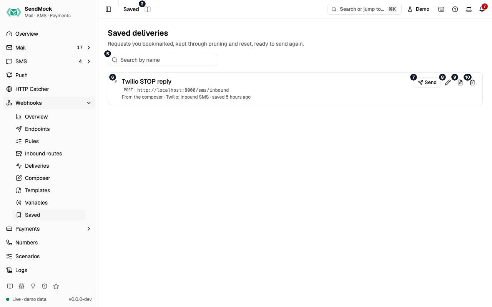

> Every control and text this screen shows, in screen order. The list is read from the demo by a crawl, and CI fails when the screen changes without its entry here.

Webhooks > Saved keeps the requests you bookmarked, through pruning and reset, to send to any endpoint again.

The screen as a whole: [Composer and saved deliveries](../../webhooks/composer-and-saved.md).

The numbers match the entries below. The picture shows the first screenful; controls further down, and texts, have no marker.

## On the screen

### 1. Saved

Heading.

- **What it does:** Names the open screen in the header.

### 2. Read the Saved guide

Link.

- **What it does:** Opens this screen's page in the user guide, in a new tab.
- **Links to:** [Composer and saved deliveries](../../webhooks/composer-and-saved.md).

### 3. Saved deliveries

Heading.

- **What it does:** Requests you bookmarked, from a delivery or the composer.
- **Same action elsewhere:** REST [`GET /api/v1/webhooks/saved`](/api/saved-deliveries/#getWebhooksSaved), CLI [`sendmock webhook saved list`](/cli/saved-deliveries/#webhook-saved-list), MCP [`sendmock_webhook_saved_list`](/mcp/saved-deliveries/#sendmock_webhook_saved_list)

### 4. Requests you bookmarked, kept through pruning and reset, ready to send again.

Text.

- **What it does:** Explains the screen.

### 5. Search saved deliveries

Field.

- **What it does:** Filters by name, URL or template.

### 6. Twilio STOP reply POST http://localhost:#/sms/inbound From the composer · Twilio: inbound SMS · saved # hours ago

Button.

- **What it does:** A saved delivery (here the demo's Twilio STOP reply): its name, method, URL, where it came from, its template and when it was saved. Shows or hides its stored request.

### 7. Send Twilio STOP reply

Button.

- **What it does:** Opens the Send dialog for it.

### 8. Rename Twilio STOP reply

Button.

- **What it does:** Renames it.
- **Same action elsewhere:** REST [`PATCH /api/v1/webhooks/saved/{savedId}`](/api/saved-deliveries/#patchWebhooksSavedBySavedId), CLI [`sendmock webhook saved rename`](/cli/saved-deliveries/#webhook-saved-rename), MCP [`sendmock_webhook_saved_update`](/mcp/saved-deliveries/#sendmock_webhook_saved_update)

### 9. Save as template Twilio STOP reply

Button.

- **What it does:** Turns it into a custom template.
- **Links to:** [Templates](../../webhooks/templates.md).
- **Same action elsewhere:** REST [`POST /api/v1/webhooks/saved/{savedId}/template`](/api/saved-deliveries/#postWebhooksSavedBySavedIdTemplate), CLI [`sendmock webhook saved save-as-template`](/cli/saved-deliveries/#webhook-saved-save-as-template), MCP [`sendmock_webhook_saved_save_as_template`](/mcp/saved-deliveries/#sendmock_webhook_saved_save_as_template)

### 10. Delete Twilio STOP reply

Button.

- **What it does:** Deletes it after you confirm.
- **Same action elsewhere:** REST [`DELETE /api/v1/webhooks/saved/{savedId}`](/api/saved-deliveries/#deleteWebhooksSavedBySavedId), CLI [`sendmock webhook saved delete`](/cli/saved-deliveries/#webhook-saved-delete), MCP [`sendmock_webhook_saved_delete`](/mcp/saved-deliveries/#sendmock_webhook_saved_delete)

## Send a saved delivery dialog

### 11. Send "Twilio STOP reply"

Heading.

- **What it does:** The Send dialog of a saved delivery.

### 12. The stored body goes to the endpoint's URL with its method.

Text.

- **What it does:** Explains what is sent.

### 13. Endpoint

Drop-down.

- **What it does:** The endpoint to send it to; any endpoint works.

### 14. Re-render with fresh values

Checkbox.

- **What it does:** Renders the template again instead of sending the stored body as it was.

### 15. New timestamp, signature and random values, as a fresh event would get.

Text.

- **What it does:** Explains what re-rendering changes.

### 16. Cancel

Button.

- **What it does:** Closes the dialog without sending.

### 17. Send

Button.

- **What it does:** Sends it now as a new delivery.
- **Same action elsewhere:** REST [`POST /api/v1/webhooks/saved/{savedId}/send`](/api/saved-deliveries/#postWebhooksSavedBySavedIdSend), CLI [`sendmock webhook saved send`](/cli/saved-deliveries/#webhook-saved-send), MCP [`sendmock_webhook_saved_send`](/mcp/saved-deliveries/#sendmock_webhook_saved_send)

### 18. Close

Button.

- **What it does:** Closes the dialog without sending.

## When the data cannot load

### 19. Could not load the saved deliveries. Try again

Message.

- **What it does:** Shown when the saved deliveries could not be loaded.
- **Errors:** Check SendMock is running, then press Try again.

### 20. Could not load the saved deliveries.

Text.

- **What it does:** The message inside the alert.

### 21. Try again

Button.

- **What it does:** Loads them again.
- **Same action elsewhere:** REST [`GET /api/v1/webhooks/saved`](/api/saved-deliveries/#getWebhooksSaved), CLI [`sendmock webhook saved list`](/cli/saved-deliveries/#webhook-saved-list), MCP [`sendmock_webhook_saved_list`](/mcp/saved-deliveries/#sendmock_webhook_saved_list)
