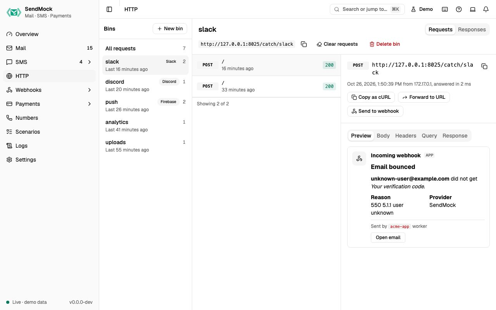

> Try it in the [demo](/demo/http). Works in your install from Phase 4 (bins, responses, Slack, Discord, Telegram and FCM presets) and Phase 5 (Teams, Google Chat, Expo, OneSignal presets).

Apps send more than email and SMS: Slack alerts, Discord messages, push notifications, analytics pings, calls to partner APIs. Point any of them at a SendMock bin and every request is recorded, shown, and answered with a reply your app accepts.



## What it solves

- **Alerts reaching real people during development.** A Slack or push notification from your laptop lands in a bin instead of the team channel or a customer's phone. See [Recipe: Slack and push](../recipes/slack-and-push.md).
- **"What exactly did my app send?"** Method, URL, headers, body and uploaded files, for any API call.
- **Testing how your app handles slow or failing APIs.** A bin can answer 429 or 500, slowly, or a share of the time. See [Responses](./responses.md).
- **A local target for webhooks.** Webhook endpoints can post to a bin, so you can see what SendMock sends before your app is ready.

## How it connects

| Gets from | Sends to |
| --- | --- |
| any HTTP call to `http://127.0.0.1:8025/catch/<bin>/...` | the reply chosen by the bin's [response rules](./responses.md) |
| [Webhooks](../webhooks/endpoints.md) endpoints pointing at a bin (**Add a catcher endpoint**) | `http.captured` events to [Webhooks > Rules](../webhooks/rules.md) |
| | **Forward to URL**: the captured request, sent on to a real or local URL |
| | **Send to webhook**: the request as the `data` of an `http.captured` event |

## Use it

1. Press **New bin**, name it `slack`, pick the **Slack incoming webhook** preset and press **Add bin**. (A bin is also created the first time something posts to it.)
2. Copy the catch URL, `http://127.0.0.1:8025/catch/slack`, into your app's Slack webhook setting.
3. Trigger an alert in your app. The request appears under the bin and its **Preview** shows it as a Slack message.
4. Open the **Response** tab: SendMock answered `200 ok`, as Slack does, so your app carried on.

## Everything on this screen

The screen has three columns like Mail (bins, requests, detail), stacked on phones. The bin, tab and request are kept in the URL.

### Bins

"All requests", then each bin with its preset badge, request count and last request time. **New bin** asks for a name (lowercase letters, digits, `-` and `_`) and a preset, which sets the bin's default reply:

| Preset | Answers like |
| --- | --- |
| Slack incoming webhook | `200 ok` as plain text |
| Discord webhook | `204`, or the message JSON with `?wait=true` |
| Microsoft Teams, Google Chat | `200` |
| Telegram Bot API | `{"ok": true, "result": {...}}` |
| Firebase Cloud Messaging v1 | `{"name": "projects/.../messages/<id>"}` |
| Expo push | tickets with `status: ok` |
| OneSignal | `{"id": ..., "recipients": 1}` |
| Generic JSON API | an echo with a generated `id` |

The bin header shows its catch URL with a copy button, **Clear requests** and **Delete bin** (both ask first).

### Requests

Newest first, 50 at a time, new ones appearing live: method, path, the status code SendMock answered (errors highlighted) and time.

### Request detail

Method and full URL, time, client IP and duration, then tabs:

- **Preview** (when recognised): Slack Block Kit as a Slack message, Discord content and embeds as a Discord message, FCM, Expo and OneSignal pushes as phone notification cards.
- **Body:** pretty (JSON indented, form and multipart fields as rows) or raw, with uploaded files to download.
- **Headers** and **Query**.
- **Response:** the status, headers and body SendMock answered with, and what produced it ("Rule: ...", "Default reply" or "Simulated failure").
- Actions: **Copy as cURL**, **Forward to URL** (remembers the last URL; shows the status and time it got) and **Send to webhook**.

### Responses tab

The bin's response rules and default reply. See [Responses](./responses.md).

## Customize

- Rules per path and method, templated bodies that echo the request, delays and failure rates: [Advanced: catcher responses](../advanced/catcher-responses.md).
- A new preset (a service whose reply shape SendMock does not know yet) needs code; ask for it with a provider request issue.

## From your code

Create a bin that answers like Firebase Cloud Messaging, then point your app's push base URL at its catch URL.

The examples call SendMock's REST API with each language's usual HTTP client and test framework. JavaScript, Go, Java, Rust, Ruby and C# use the small `call` helper shown under **Test helper** on their page in [Connect your app](../connect/index.md).

```bash tab="CLI" tab-group="language"
bin=$(sendmock http bin create --name push --preset fcm --json)

jq -e '.name == "push"' <<<"$bin" >/dev/null
```

```php tab="PHP"
<?php

use Illuminate\Support\Facades\Http;

const SENDMOCK = 'http://127.0.0.1:8025/api/v1';

it('creates a push bin', function () {
    $bin = Http::post(SENDMOCK.'/http/bins', [
        'name' => 'push',
        'preset' => 'fcm',
    ])->throw()->json();

    expect($bin['name'])->toBe('push');
});
```

```js tab="JavaScript"
import { expect, test } from "vitest";

import { call, SENDMOCK } from "./sendmock.js";

test("creates a push bin", async () => {
  const bin = await call("POST", `${SENDMOCK}/http/bins`, { name: "push", preset: "fcm" });

  expect(bin.name).toBe("push");
});
```

```python tab="Python"
import requests

SENDMOCK = "http://127.0.0.1:8025/api/v1"
APP = "http://localhost:8000"


def test_creates_a_push_bin():
    bin = requests.post(
        f"{SENDMOCK}/http/bins",
        json={"name": "push", "preset": "fcm"},
    ).json()

    assert bin["name"] == "push"
```

```go tab="Go"
package app_test

import "testing"

func TestCreatesAPushBin(t *testing.T) {
	bin := call(t, "POST", sendmock+"/http/bins", map[string]any{"name": "push", "preset": "fcm"}).(map[string]any)

	if got := bin["name"]; got != "push" {
		t.Errorf("name is %v, want %v", got, "push")
	}
}
```

```java tab="Java"
import static app.SendMock.SENDMOCK;
import static app.SendMock.call;
import static org.junit.jupiter.api.Assertions.assertEquals;

import java.util.Map;
import org.junit.jupiter.api.Test;

class HttpTest {
    @Test
    void createsAPushBin() throws Exception {
        var bin = call("POST", SENDMOCK + "/http/bins", Map.of("name", "push", "preset", "fcm"));

        assertEquals("push", bin.get("name").asText());
    }
}
```

```rust tab="Rust"
mod sendmock;

use serde_json::json;
use sendmock::{call, SENDMOCK};

#[tokio::test]
async fn creates_a_push_bin() {
    let bin = call("POST", &format!("{SENDMOCK}/http/bins"), Some(json!({"name": "push", "preset": "fcm"}))).await;

    assert_eq!(bin["name"], "push");
}
```

```ruby tab="Ruby"
require_relative "sendmock_helper"

RSpec.describe "Http" do
  it "creates a push bin" do
    bin = call("POST", "#{SENDMOCK}/http/bins", { "name" => "push", "preset" => "fcm" })

    expect(bin["name"]).to eq("push")
  end
end
```

```csharp tab="C#"
using static SendMock;

public class HttpTests
{
    [Fact]
    public async Task CreatesAPushBin()
    {
        var bin = await Call("POST", Sendmock + "/http/bins", new { name = "push", preset = "fcm" });

        Assert.Equal("push", bin.GetProperty("name").GetString());
    }
}
```

## From the CLI, API and AI

| Do this | CLI | API | MCP tool |
| --- | --- | --- | --- |
| bins | [`sendmock http bin list`](/cli/http-catcher/#http-bin-list) | [`GET /api/v1/http/bins`](/api/http-catcher/#getHttpBins) | [`sendmock_http_bin_list`](/mcp/http-catcher/#sendmock_http_bin_list) |
| add a bin | [`sendmock http bin create`](/cli/http-catcher/#http-bin-create) | [`POST /api/v1/http/bins`](/api/http-catcher/#postHttpBins) | [`sendmock_http_bin_create`](/mcp/http-catcher/#sendmock_http_bin_create) |
| delete a bin | [`sendmock http bin delete <binId>`](/cli/http-catcher/#http-bin-delete) | [`DELETE /api/v1/http/bins/{binId}`](/api/http-catcher/#deleteHttpBinsByBinId) | [`sendmock_http_bin_delete`](/mcp/http-catcher/#sendmock_http_bin_delete) |
| requests | [`sendmock http list`](/cli/http-catcher/#http-list) | [`GET /api/v1/http/requests`](/api/http-catcher/#getHttpRequests) | [`sendmock_http_list`](/mcp/http-catcher/#sendmock_http_list) |
| one request | [`sendmock http show <requestId>`](/cli/http-catcher/#http-show) | [`GET /api/v1/http/requests/{requestId}`](/api/http-catcher/#getHttpRequestsByRequestId) | [`sendmock_http_get`](/mcp/http-catcher/#sendmock_http_get) |
| wait in a test | [`sendmock http wait`](/cli/test-helpers/#http-wait) | [`GET /api/v1/wait/http`](/api/test-helpers/#getWaitHttp) | [`sendmock_http_wait`](/mcp/test-helpers/#sendmock_http_wait) |
| send a test request | [`sendmock http send <bin>`](/cli/http-catcher/#http-send) | [`POST /catch/{binPath}`](/api/http-catcher/#postCatchByBinPath) | [`sendmock_http_send`](/mcp/http-catcher/#sendmock_http_send) |
| forward | [`sendmock http forward <requestId>`](/cli/http-catcher/#http-forward) | [`POST /api/v1/http/requests/{requestId}/forward`](/api/http-catcher/#postHttpRequestsByRequestIdForward) | [`sendmock_http_forward`](/mcp/http-catcher/#sendmock_http_forward) |
| clear requests | [`sendmock http clear`](/cli/http-catcher/#http-clear) | [`DELETE /api/v1/http/requests`](/api/http-catcher/#deleteHttpRequests) | [`sendmock_http_clear`](/mcp/http-catcher/#sendmock_http_clear) |

## Related

- [Responses](./responses.md)
- [Webhooks > Endpoints](../webhooks/endpoints.md)
