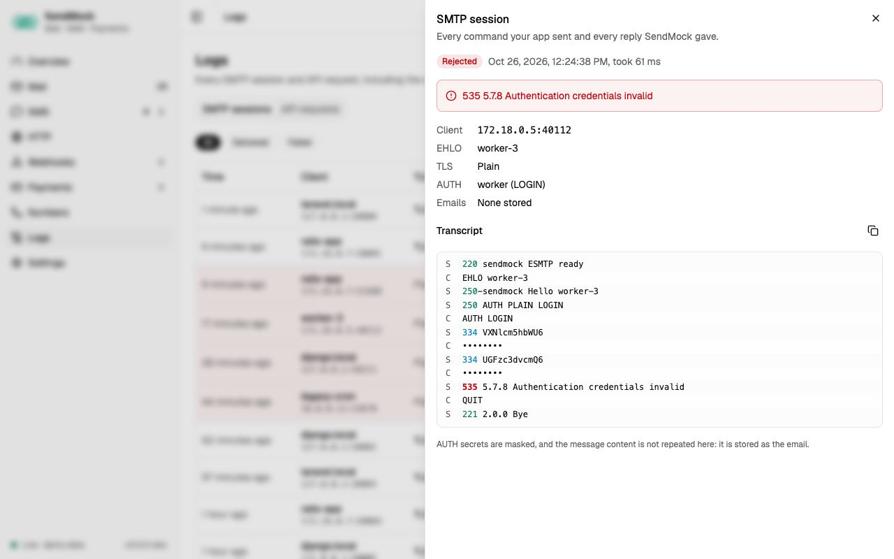

> Try it in the [demo](/demo/logs). Works in your install from Phase 1 (SMTP) and Phase 2 (API requests).

Mail, SMS and Payments show what arrived. Logs show **how** it arrived, and what did not: every SMTP conversation and every API call, including failed and rejected ones.

## What it solves

- "My app says it sent the email, but nothing shows in Mail." The SMTP session shows the TLS or AUTH problem, or the command that failed.
- "My SMS call returns 400." The API request shows the body your app sent and SendMock's error, for example a Twilio test number's 21211.
- Checking what credentials, TLS version and EHLO name your mailer uses.

## How it connects

| Gets from | Sends to |
| --- | --- |
| every SMTP session behind [Mail](./mail/index.md) | **Open email**: the email a session stored |
| every API request behind [SMS](./sms/index.md), [Verify](./sms/verify.md), [Payments](./payments/index.md) and the email APIs | **Open message**: the SMS or email a request created |
| the SMS drawer's "Open in request log" and the email's source badge link here | |

## Use it

1. Press `G L`.
2. On **SMTP sessions**, press the **Failed** chip.
3. Open a session and read the transcript: client commands and server replies, colour-coded, with the failure reason on top.

## Everything on this screen

Two tabs, kept in the URL. Both load 50 rows at a time, the next page as you scroll ("Showing 50 of 5,021"), and their filters and search run over every row.

### SMTP sessions

A table: time, client address, EHLO name, TLS (version or Plain), AUTH (user and mechanism), result (Delivered, Rejected, Aborted), emails stored and duration. Failed sessions are highlighted with their reason. Chips (All, Delivered, Failed) and a search on client, EHLO name and user.

The drawer: the session facts, the failure reason, and the **transcript**, one line per command or reply, client and server told apart by colour and a C or S marker, reply codes coloured by class (2xx, 3xx, 4xx, 5xx), AUTH secrets masked, and the DATA line linking to the stored email. **Copy transcript** and **Open email**.

### API requests

A table: time, API (Native, Twilio, Vonage, SendGrid, ...), method, path, status and duration. Rejected requests (4xx and 5xx) are highlighted. Chips by status class (All, 2xx, 4xx, 5xx), an API picker and a path search.

The drawer: method, full path, status, duration and time; request headers (credentials masked); the request body (JSON formatted, forms as a field table) and the response body; **Open message** for what the request created.

## Customize

How long logs are kept follows retention in [Settings > General](./settings.md#general). To make SMTP fail on purpose, see [Advanced: chaos](./advanced/chaos.md).

## From the CLI, API and AI

| Do this | CLI | API | MCP tool |
| --- | --- | --- | --- |
| SMTP sessions | `sendmock logs smtp --failed` | `GET /api/v1/logs/smtp` | `sendmock_logs_smtp` |
| API requests | `sendmock logs http --tail` | `GET /api/v1/logs/http` | `sendmock_logs_http` |

## Related

- [Troubleshooting](./troubleshooting.md)
- [Mail](./mail/index.md)
