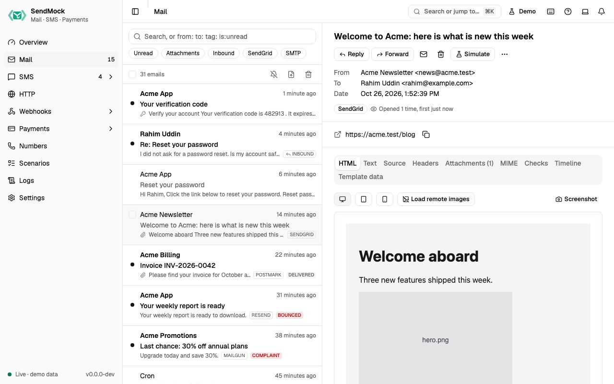

> Try it in the [demo](/demo/mail). Works in your install from Phase 1 (SMTP and the native API), Phase 3 (outcome events) and Phase 4 (provider APIs, checks, replies and release).

Every email your app sends lands here, whatever the recipient, and nothing is delivered to a real inbox.

## What it solves

- **Testing email without real inboxes.** Sign-up, password reset, invoices and alerts can be sent to any address, including real customers' addresses copied from production data, and none of them leave your machine. See [Recipe: password reset](../recipes/password-reset-email.md).
- **Reading codes and links in tests.** One-time codes and links are pulled out of every email, ready to copy or read from the CLI. See [Recipe: read a code](../recipes/read-a-code.md).
- **Checking the email looks right** on phones and in common clients, with broken links and spam score flagged. See [Reading and checks](./reading-and-checks.md).
- **Handling what happens after sending:** bounces, spam complaints, unsubscribes and replies. See [Outcomes](./outcomes.md) and [Replies and forwards](./replies-and-forwards.md).

## How it connects

| Gets from | Sends to |
| --- | --- |
| your app over SMTP (port `1025`), the SendGrid, Mailgun, Postmark, Resend, SES and Brevo APIs, or `POST /api/v1/send` | `email.received` and the other `email.*` events to [Webhooks > Rules](../webhooks/rules.md) |
| **Reply as recipient** and **Forward as recipient** on an email | an incoming email (`email.inbound`) for [Inbound routes](../webhooks/inbound-routes.md) |
| [Settings > Email](../settings.md#email): outcome addresses, delivery profile, inbound domains, relay | the SMTP session to [Logs > SMTP](../logs.md), the API request to [Logs > API requests](../logs.md) |
| [Settings > OTP patterns](../settings.md#otp-patterns): what counts as a code | **Release** to a real SMTP relay, only to allowlisted addresses ([Release](./release.md)) |
| | **Send to webhook**: one email to any endpoint, by hand ([Composer and Saved](../webhooks/composer-and-saved.md#send-to-webhook)) |

## Use it

1. Point your app's mail settings at `127.0.0.1:1025` (any username and password, no TLS needed), or press **Send a sample email** on the empty screen.
2. Trigger an email in your app. It appears at the top of the list within a second.
3. Open it. Read the **HTML** tab, switch to the phone width, and copy the code or link from the extracted panel.
4. Press **Simulate** and pick **Hard bounce**. The email shows the outcome, its **Timeline** gets an entry, and any rule on `email.bounced` sends a delivery.

## Everything on this screen

### Sending to SendMock

- **SMTP** on `127.0.0.1:1025`. Any username and password are accepted; every recipient is accepted.
- **Provider APIs** at their real paths on port `8026`: SendGrid, Mailgun, Postmark, Resend, Amazon SES and Brevo. Your app keeps its SDK and only changes the base URL.
- **Native send:** `POST /api/v1/send` with JSON (`from`, `to`, `subject`, `html`, `text`, optional `cc`, `bcc`, `tags`, `headers` and base64 `attachments`).

### The list

Newest first, with sender, subject, snippet, time, an unread dot, an attachment icon, tags, the source (SMTP, SendGrid, ...) and any outcome badge (bounced, complained). It loads more as you scroll.

- **Search** with plain words or prefixes: `from:`, `to:`, `tag:`, `source:`, `has:attachment`, `is:unread`, `is:inbound`.
- **Chips** toggle unread, attachments, inbound and each source.
- **Import .eml**: upload or paste a whole message and store it as **Sent by your app** (like the `sendmail` shim) or **Incoming to your app** (inbound routes deliver it).
- **Bulk select** and **Delete all** (asks first).
- The bell button in the list header turns on browser notifications for new email.
- Keys: `J` and `K` move, `Enter` opens, `D` deletes, `/` searches.

### The open email

- **Header:** subject, from, to, cc, time, tags, the source badge (it links to the SMTP session in Logs), and "Opened N times" once opened.
- **Extracted panel:** one-time codes and links, each with copy and open buttons.
- **Tabs:** HTML, Text, Source, Headers, Attachments, MIME, Checks, Timeline and Template data. Each is explained in [Reading and checks](./reading-and-checks.md).
- **Actions:** mark read or unread, **Simulate** (Delivered, Hard bounce, Soft bounce, Spam complaint, Unsubscribe; see [Outcomes](./outcomes.md)), **Reply**, **Reply all**, **Forward** (see [Replies and forwards](./replies-and-forwards.md)), tag, download `.eml`, **Send to webhook**, **Release to real SMTP** (see [Release](./release.md)) and delete.

## Customize

- Make your own addresses bounce, defer or be rejected: [Advanced: email outcome addresses](../advanced/email-outcome-addresses.md).
- Teach SendMock your code format: [Advanced: OTP patterns](../advanced/otp-patterns.md).
- Choose what happens to every email by default (nothing, always delivered, or realistic bounce rates): [Settings > Email](../settings.md#email).
- Test what happens when the mail server misbehaves: [Advanced: chaos](../advanced/chaos.md).

## From the CLI, API and AI

| Do this | CLI | API | MCP tool |
| --- | --- | --- | --- |
| list and search | [`sendmock email list`](/cli/email/#email-list) | [`GET /api/v1/emails`](/api/email/#getEmails) | [`sendmock_email_list`](/mcp/email/#sendmock_email_list) |
| the newest email to a recipient | [`sendmock email latest --to <address>`](/cli/email/#email-latest) | [`GET /api/v1/emails/latest`](/api/email/#getEmailsLatest) | [`sendmock_email_latest`](/mcp/email/#sendmock_email_latest) |
| wait for an email in a test | [`sendmock email wait`](/cli/test-helpers/#email-wait) | [`GET /api/v1/wait/email`](/api/test-helpers/#getWaitEmail) | [`sendmock_email_wait`](/mcp/test-helpers/#sendmock_email_wait) |
| read the latest code | [`sendmock otp --to <recipient>`](/cli/test-helpers/#otp) | [`GET /api/v1/otp`](/api/test-helpers/#getOtp) | [`sendmock_otp_get`](/mcp/test-helpers/#sendmock_otp_get) |
| read the latest links | [`sendmock links --to <recipient>`](/cli/test-helpers/#links) | [`GET /api/v1/links`](/api/test-helpers/#getLinks) | [`sendmock_links_get`](/mcp/test-helpers/#sendmock_links_get) |
| mark read, tag | [`sendmock email update <emailId>`](/cli/email/#email-update) | [`PATCH /api/v1/emails/{emailId}`](/api/email/#patchEmailsByEmailId) | [`sendmock_email_update`](/mcp/email/#sendmock_email_update) |
| simulate an outcome | [`sendmock email simulate <emailId> <event>`](/cli/email/#email-simulate) | [`POST /api/v1/emails/{emailId}/simulate`](/api/email/#postEmailsByEmailIdSimulate) | [`sendmock_email_simulate`](/mcp/email/#sendmock_email_simulate) |
| import a raw message | [`sendmock sendmail`](/cli/email/#sendmail) | [`POST /api/v1/send/raw`](/api/email/#postSendRaw) | [`sendmock_email_send_raw`](/mcp/email/#sendmock_email_send_raw) |
| create an incoming email | [`sendmock email inbound`](/cli/email/#email-inbound) | [`POST /api/v1/emails/inbound`](/api/email/#postEmailsInbound) | [`sendmock_email_inbound`](/mcp/email/#sendmock_email_inbound) |
| delete one | [`sendmock email delete <emailId>`](/cli/email/#email-delete) | [`DELETE /api/v1/emails/{emailId}`](/api/email/#deleteEmailsByEmailId) | [`sendmock_email_delete`](/mcp/email/#sendmock_email_delete) |
| delete everything | [`sendmock email delete-all --yes`](/cli/email/#email-delete-all) | [`DELETE /api/v1/emails`](/api/email/#deleteEmails) | [`sendmock_email_delete_all`](/mcp/email/#sendmock_email_delete_all) |

The email commands and tools arrive in Phase 1.

## Related

- [Logs](../logs.md): the SMTP session behind each email.
- [Webhooks](../webhooks/index.md): send email events to your app.
- [Recipe: inbound email](../recipes/inbound-email.md)
