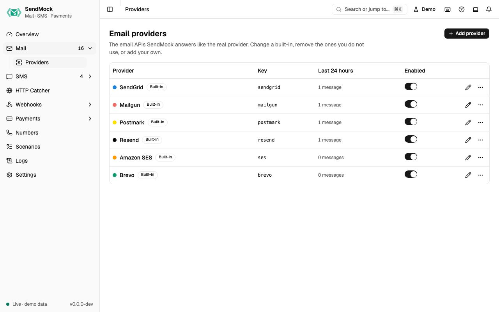

> Try it in the [demo](/demo/mail/providers). The screen works today; requests to the provider APIs are answered from Phase 4.

An email provider is one API SendMock answers like the real one: SendGrid, Mailgun, Postmark, Resend, Amazon SES, Brevo, or one you add. Providers are data, not code, like [payment gateways](../payments/gateways.md): the requests a provider answers, how SendMock reads them and what it answers are all editable, and **Reset to default** brings a built-in back. The full list is on [Supported providers](../providers.md).

## What it solves

- **An email API SendMock does not ship.** Add it from blank or from the closest built-in, with its own paths, fields and answers. See [Advanced: create an email provider](../advanced/email-provider.md).
- **A built-in that differs from your account:** another API version, an extra required field, a message id your app checks.
- **Providers you do not use** clutter the filters and Settings > Connection; remove them, and restore them any time.

## How it connects

| Gets from | Sends to |
| --- | --- |
| your app's API calls at the provider's real path on port `8026`, or at `/providers/<key>/...` | [Mail](./index.md): every send is stored with its provider, shown as a badge that opens this screen |
| [Webhooks > Templates](../webhooks/templates.md): the template its delivery callbacks use | your app: the provider's own answer, success or error |
| its credentials, when **Check credentials** is on | [Settings > Connection](../settings.md#connection): the base URL of every enabled provider |

## Use it

1. Press **Edit SendGrid**.
2. Open **Preview**: the sample send is stored with `ana@example.test` as recipient, and SendGrid answers `202`.
3. Clear the sample body to `{}`: nothing is stored, and the answer is SendGrid's own `400` error.

## Everything on this screen

### The table

Name with its accent dot, Built-in or Custom, **Modified** once a built-in is edited, the key, messages in the last 24 hours, and an enabled switch. The row menu has **Reset to default** (a modified built-in), **Remove** (a built-in) and **Delete** (a custom provider), each asking first. **Add provider** asks for a name, a key and **Start from** (blank, or a copy of another provider).

### Removed

Built-ins you removed are listed here. Requests to their paths get a 404 until you press **Restore**; their messages stay.

### The provider sheet

| Tab | Holds |
| --- | --- |
| **General** | name, key (fixed after creation), host (tells apart providers that share a path), accent, enabled, credentials (secrets masked, reveal asks first) and **Check credentials** |
| **Requests** | the requests it answers (kind, method, path with `{name}` parts, format), the **field mapping** (where to, from, subject, text, html and the rest are read from) and the **checks** on a send |
| **Responses** | the message id template, the success response and one response per error kind (missing field, invalid value, unauthorized, not found, rate limited) |
| **Callbacks** | the webhook template for its delivery callbacks and the provider's name for each status |
| **Preview** | a sample request, the message SendMock would store, the answer it would give, the problems, and what templates can read |
| **Try it** | the base URLs and a `curl` command for this provider |

A provider with template errors cannot be saved, and a path that another enabled provider answers is refused with its name.

## Customize

The full walkthrough, from the provider's API docs to a working provider: [Advanced: create an email provider](../advanced/email-provider.md).

## From the CLI, API and AI

| Do this | CLI | API | MCP tool |
| --- | --- | --- | --- |
| list | [`sendmock email providers list`](/cli/email-providers/#email-providers-list) | [`GET /api/v1/emails/providers`](/api/email-providers/#getEmailsProviders) | [`sendmock_email_provider_list`](/mcp/email-providers/#sendmock_email_provider_list) |
| one provider | [`sendmock email providers show <providerKey>`](/cli/email-providers/#email-providers-show) | [`GET /api/v1/emails/providers/{providerKey}`](/api/email-providers/#getEmailsProvidersByProviderKey) | [`sendmock_email_provider_get`](/mcp/email-providers/#sendmock_email_provider_get) |
| add | [`sendmock email providers create`](/cli/email-providers/#email-providers-create) | [`POST /api/v1/emails/providers`](/api/email-providers/#postEmailsProviders) | [`sendmock_email_provider_create`](/mcp/email-providers/#sendmock_email_provider_create) |
| change | [`sendmock email providers update <providerKey>`](/cli/email-providers/#email-providers-update) | [`PATCH /api/v1/emails/providers/{providerKey}`](/api/email-providers/#patchEmailsProvidersByProviderKey) | [`sendmock_email_provider_update`](/mcp/email-providers/#sendmock_email_provider_update) |
| preview | [`sendmock email providers preview <providerKey>`](/cli/email-providers/#email-providers-preview) | [`POST /api/v1/emails/providers/{providerKey}/preview`](/api/email-providers/#postEmailsProvidersByProviderKeyPreview) | [`sendmock_email_provider_preview`](/mcp/email-providers/#sendmock_email_provider_preview) |
| reset a built-in | [`sendmock email providers reset <providerKey>`](/cli/email-providers/#email-providers-reset) | [`POST /api/v1/emails/providers/{providerKey}/reset`](/api/email-providers/#postEmailsProvidersByProviderKeyReset) | [`sendmock_email_provider_reset`](/mcp/email-providers/#sendmock_email_provider_reset) |
| remove a built-in or delete a custom one | [`sendmock email providers delete <providerKey>`](/cli/email-providers/#email-providers-delete) | [`DELETE /api/v1/emails/providers/{providerKey}`](/api/email-providers/#deleteEmailsProvidersByProviderKey) | [`sendmock_email_provider_delete`](/mcp/email-providers/#sendmock_email_provider_delete) |
| restore a removed built-in | [`sendmock email providers restore <providerKey>`](/cli/email-providers/#email-providers-restore) | [`POST /api/v1/emails/providers/{providerKey}/restore`](/api/email-providers/#postEmailsProvidersByProviderKeyRestore) | [`sendmock_email_provider_restore`](/mcp/email-providers/#sendmock_email_provider_restore) |
| reveal a credential (agents cannot) | [`sendmock email providers credential <providerKey> <credentialName> --reveal`](/cli/email-providers/#email-providers-credential) | [`GET /api/v1/emails/providers/{providerKey}/credentials/{credentialName}`](/api/email-providers/#getEmailsProvidersByProviderKeyCredentialsByCredentialName) | none: agents never read secrets |

## Related

- [Supported providers](../providers.md)
- [SMS providers](../sms/providers.md)
- [Gateways](../payments/gateways.md)
