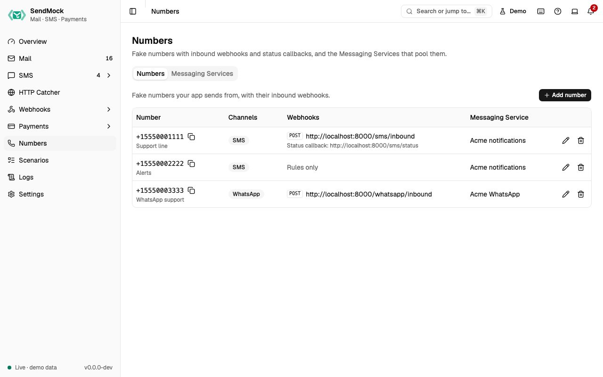

> Try it in the [demo](/demo/numbers). Works in your install from Phase 3 (number webhooks) and Phase 4 (the full registry).

You do not need numbers to send SMS: any `From` is accepted. Numbers matter when the contact **replies**: like a Twilio number, each one says where incoming messages go. Messaging Services group numbers into a **sender pool**.



## What it solves

- **Two-way SMS:** when a contact replies to `+15550001111`, which URL of your app gets it, in which format, with which fallback?
- **Twilio Messaging Services:** your app sends with `MessagingServiceSid` and Twilio picks the number; SendMock does the same.
- **Matching your production setup**, so replies behave locally as they do on the provider.

## How it connects

| Gets from | Sends to |
| --- | --- |
| replies typed in an [SMS](./sms/index.md) conversation (`sms.inbound`) | the number's (or its service's) inbound webhook, logged in [Deliveries](./webhooks/deliveries.md); TwiML answers come back into the conversation |
| your app's sends with `MessagingServiceSid` | the number the service picks, shown on the message |
| | each number's default status callback for messages it sends |

## Use it

1. Press **Add number** (or **Add a sample number** on the empty screen).
2. Enter `+15550001111` with the label "Support line", and tick **SMS**.
3. Under **Inbound messages**, set **Webhook URL** to your app's handler (or a catcher bin such as `http://127.0.0.1:8025/catch/sms-replies`) and **Format** to Twilio.
4. Save. In SMS, open a conversation with this number and reply as the contact: the request goes to that URL.

## Everything on this screen

Two tabs, kept in the URL.

### Numbers

A table: number (E.164, copy), label, channel badges (SMS, WhatsApp), webhooks (the inbound method and URL, or **Rules only**, with the default status callback below), Messaging Service, and Edit and Delete.

The number sheet:

- **Number** (E.164, unique) and **Label**.
- **Channels:** SMS and/or WhatsApp (at least one).
- **Inbound messages:** **Webhook URL**, **Method** (POST or GET), **Fallback URL** and **Format** (Twilio, Vonage, Plivo, ... or native JSON). Leave the URL empty and only [webhook rules](./webhooks/rules.md) receive incoming messages; when a rule on `sms.inbound` also exists, both receive them, and the sheet says so.
- **Default status callback**.
- **Messaging Service:** none or one; a number belongs to at most one.

Delete asks first and removes the number from its service.

### Messaging Services

A table: name, SID (copy), sender pool (number chips), inbound handling and actions. **New Messaging Service** and Edit open a sheet with the name, the **Sender pool** (a checkbox per number; picking one from another service moves it, and the list says so) and the inbound handling:

| Choice | Incoming messages to the pool's numbers |
| --- | --- |
| **Send a webhook** | go to the service's **Request URL**, with its **Fallback URL** |
| **Defer to sender's webhook** | go to each number's own inbound URL |
| **Drop the message** | are stored but not sent anywhere |

Delete asks first and leaves the numbers unassigned.

## Customize

Two-way SMS and sender pools in depth: [Advanced: numbers and Messaging Services](./advanced/numbers-and-services.md). Numbers and services go into the seed file, so your team gets the same ones.

## From your code

Register your app's sending number with its reply webhook, as the test setup.

The examples call SendMock's REST API with each language's usual HTTP client and test framework. JavaScript, Go, Java, Rust, Ruby and C# use the small `call` helper shown under **Test helper** on their page in [Connect your app](./connect/index.md).

```bash tab="CLI" tab-group="language"
number=$(sendmock numbers add --number +15550001111 --label 'Support line' --channel sms --inbound-url http://localhost:3000/sms/inbound --inbound-method POST --json)

jq -e '.number == "+15550001111"' <<<"$number" >/dev/null
```

```php tab="PHP"
<?php

use Illuminate\Support\Facades\Http;

const SENDMOCK = 'http://127.0.0.1:8025/api/v1';

it('registers the support number', function () {
    $number = Http::post(SENDMOCK.'/numbers', [
        'number' => '+15550001111',
        'label' => 'Support line',
        'channels' => ['sms'],
        'inbound_url' => 'http://localhost:3000/sms/inbound',
        'inbound_method' => 'POST',
    ])->throw()->json();

    expect($number['number'])->toBe('+15550001111');
});
```

```js tab="JavaScript"
import { expect, test } from "vitest";

import { call, SENDMOCK } from "./sendmock.js";

test("registers the support number", async () => {
  const number = await call("POST", `${SENDMOCK}/numbers`, {
    number: "+15550001111",
    label: "Support line",
    channels: ["sms"],
    inbound_url: "http://localhost:3000/sms/inbound",
    inbound_method: "POST",
  });

  expect(number.number).toBe("+15550001111");
});
```

```python tab="Python"
import requests

SENDMOCK = "http://127.0.0.1:8025/api/v1"
APP = "http://localhost:8000"


def test_registers_the_support_number():
    number = requests.post(
        f"{SENDMOCK}/numbers",
        json={
            "number": "+15550001111",
            "label": "Support line",
            "channels": ["sms"],
            "inbound_url": "http://localhost:3000/sms/inbound",
            "inbound_method": "POST",
        },
    ).json()

    assert number["number"] == "+15550001111"
```

```go tab="Go"
package app_test

import "testing"

func TestRegistersTheSupportNumber(t *testing.T) {
	number := call(t, "POST", sendmock+"/numbers", map[string]any{
		"number":         "+15550001111",
		"label":          "Support line",
		"channels":       []any{"sms"},
		"inbound_url":    "http://localhost:3000/sms/inbound",
		"inbound_method": "POST",
	}).(map[string]any)

	if got := number["number"]; got != "+15550001111" {
		t.Errorf("number is %v, want %v", got, "+15550001111")
	}
}
```

```java tab="Java"
import static app.SendMock.SENDMOCK;
import static app.SendMock.call;
import static org.junit.jupiter.api.Assertions.assertEquals;

import java.util.List;
import java.util.Map;
import org.junit.jupiter.api.Test;

class NumbersTest {
    @Test
    void registersTheSupportNumber() throws Exception {
        var number = call("POST", SENDMOCK + "/numbers", Map.of(
            "number", "+15550001111",
            "label", "Support line",
            "channels", List.of("sms"),
            "inbound_url", "http://localhost:3000/sms/inbound",
            "inbound_method", "POST"
        ));

        assertEquals("+15550001111", number.get("number").asText());
    }
}
```

```rust tab="Rust"
mod sendmock;

use serde_json::json;
use sendmock::{call, SENDMOCK};

#[tokio::test]
async fn registers_the_support_number() {
    let number = call("POST", &format!("{SENDMOCK}/numbers"), Some(json!({
        "number": "+15550001111",
        "label": "Support line",
        "channels": ["sms"],
        "inbound_url": "http://localhost:3000/sms/inbound",
        "inbound_method": "POST"
    }))).await;

    assert_eq!(number["number"], "+15550001111");
}
```

```ruby tab="Ruby"
require_relative "sendmock_helper"

RSpec.describe "Numbers" do
  it "registers the support number" do
    number = call("POST", "#{SENDMOCK}/numbers", {
      "number" => "+15550001111",
      "label" => "Support line",
      "channels" => ["sms"],
      "inbound_url" => "http://localhost:3000/sms/inbound",
      "inbound_method" => "POST",
    })

    expect(number["number"]).to eq("+15550001111")
  end
end
```

```csharp tab="C#"
using static SendMock;

public class NumbersTests
{
    [Fact]
    public async Task RegistersTheSupportNumber()
    {
        var number = await Call("POST", Sendmock + "/numbers", new
        {
            number = "+15550001111",
            label = "Support line",
            channels = new[] { "sms" },
            inbound_url = "http://localhost:3000/sms/inbound",
            inbound_method = "POST",
        });

        Assert.Equal("+15550001111", number.GetProperty("number").GetString());
    }
}
```

## From the CLI, API and AI

| Do this | CLI | API | MCP tool |
| --- | --- | --- | --- |
| list numbers | [`sendmock numbers list`](/cli/numbers/#numbers-list) | [`GET /api/v1/numbers`](/api/numbers/#getNumbers) | [`sendmock_number_list`](/mcp/numbers/#sendmock_number_list) |
| add a number | [`sendmock numbers add`](/cli/numbers/#numbers-add) | [`POST /api/v1/numbers`](/api/numbers/#postNumbers) | [`sendmock_number_upsert`](/mcp/numbers/#sendmock_number_upsert) |
| change a number | [`sendmock numbers update <numberId>`](/cli/numbers/#numbers-update) | [`PATCH /api/v1/numbers/{numberId}`](/api/numbers/#patchNumbersByNumberId) | [`sendmock_number_upsert`](/mcp/numbers/#sendmock_number_upsert) |
| remove a number | [`sendmock numbers remove <numberId>`](/cli/numbers/#numbers-remove) | [`DELETE /api/v1/numbers/{numberId}`](/api/numbers/#deleteNumbersByNumberId) | [`sendmock_number_delete`](/mcp/numbers/#sendmock_number_delete) |
| list Messaging Services | [`sendmock sms services list`](/cli/numbers/#sms-services-list) | [`GET /api/v1/messaging-services`](/api/numbers/#getMessagingServices) | [`sendmock_messaging_service_list`](/mcp/numbers/#sendmock_messaging_service_list) |
| add a service | [`sendmock sms services create`](/cli/numbers/#sms-services-create) | [`POST /api/v1/messaging-services`](/api/numbers/#postMessagingServices) | [`sendmock_messaging_service_create`](/mcp/numbers/#sendmock_messaging_service_create) |
| change a service | [`sendmock sms services update <serviceSid>`](/cli/numbers/#sms-services-update) | [`PATCH /api/v1/messaging-services/{serviceSid}`](/api/numbers/#patchMessagingServicesByServiceSid) | [`sendmock_messaging_service_update`](/mcp/numbers/#sendmock_messaging_service_update) |

## Related

- [Replies and WhatsApp](./sms/replies-and-whatsapp.md)
- [Recipe: two-way SMS](./recipes/two-way-sms.md)
