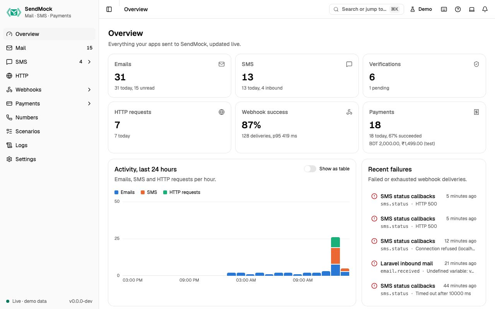

> Try it in the [demo](/demo/). Works in your install from Phase 1 (message counts) and Phase 3 (webhook health).

The first screen you see: what SendMock has caught, how your webhooks are doing, and the addresses your app needs.

## What it solves

- "Did my last test send anything at all?" The counts and latest messages answer it at a glance.
- "Which webhook is failing, and why?" Webhooks by endpoint and Recent failures point at it.
- "Where do I point my app again?" The connect card has the SMTP address and API URL to copy.

## How it connects

| Gets from | Sends to |
| --- | --- |
| counts from [Mail](./mail/index.md), [SMS](./sms/index.md), [Verify](./sms/verify.md), [HTTP](./http/index.md) and [Payments](./payments/index.md) | each tile links to its screen |
| delivery health from [Webhooks](./webhooks/index.md) | each failure links to its delivery in [Deliveries](./webhooks/deliveries.md) |
| the listeners from [Settings > Connection](./settings.md#connection) | copy buttons for your app's settings |

Everything updates live as events arrive; there is nothing to refresh.

## Use it

1. Open SendMock (or press `G O`).
2. Read the KPI row: emails, SMS, verifications (pending ones called out), HTTP requests, webhook success rate and payments, each with today's count.
3. If a webhook failed, click it under **Recent failures** to open the delivery and see your app's answer.
4. Copy the SMTP address or API base URL from **Connect your app** into your app's settings.

## Everything on this screen

### KPI row

One tile per area with its total and today's count, linking to its screen. Verify calls out pending verifications. Payments shows the payment count, success rate (succeeded among finished payments) and test revenue per currency (captured minus refunded).

### Activity, last 24 hours

Stacked columns per hour for emails, SMS and HTTP requests. Hover a column, or focus the chart and use the arrow keys, to see every series for that hour. **Show as table** shows the same numbers as a table.

### Webhooks by endpoint

For each endpoint: deliveries in the last 24 hours, a success-rate meter, p50 and p95 latency, retries and the most common failure codes. The full version, with ranges and filters, is [Webhooks > Overview](./webhooks/index.md#the-webhooks-overview-screen).

### Recent failures

The last failed or exhausted deliveries: time, endpoint, event, and the status code or error. Each opens the delivery.

### Latest messages

The newest emails and SMS, each linking to it. With nothing yet, it offers **Send a sample email** and **Send a sample SMS**.

### Connect your app

The SMTP address and API base URL with copy buttons, and a link to [Settings > Connection](./settings.md#connection) for full snippets per language.

## Customize

Nothing to configure here. What the tiles count follows your retention in [Settings > General](./settings.md#general).

## From the CLI, API and AI

| Do this | CLI | API | MCP tool |
| --- | --- | --- | --- |
| the same counts | `sendmock stats` | [`GET /api/v1/stats`](/api/system/#getStats) | `sendmock_stats` |
| is it running, which ports | `sendmock status` | [`GET /api/v1/info`](/api/system/#getInfo) | `sendmock_status` |
| is it alive | `sendmock health` | [`GET /api/v1/health`](/api/system/#getHealth) | `sendmock_status` |

## Related

- [How it all connects](./how-it-connects.md)
- [Webhooks](./webhooks/index.md)
