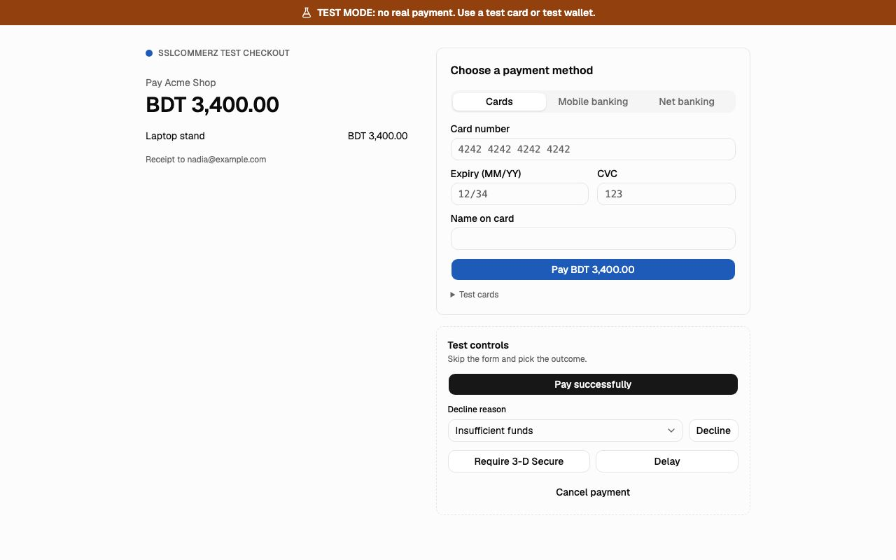

> Try it in the [demo](/demo/payments). Works in your install from Phase 3P.

When your app creates a hosted checkout, the gateway's answer points the browser at SendMock's test checkout page, `http://127.0.0.1:8025/pay/<sessionId>`. It looks like a gateway's page, uses the gateway's accent colour, and always says **TEST MODE: no real payment**.

## What it solves

- Clicking through your whole checkout locally: your page, the gateway's page, back to your success page.
- Producing any outcome on demand, including 3-D Secure, cancel and a payment that stays pending.

## What the page shows

- The **TEST MODE** banner, the merchant name ([Settings > Payments](../settings.md#payments)), the order summary (line items, total) and the customer's email.
- The gateway's **methods**. One method shows its steps directly; several show a picker grouped into tabs by each method's flow (Cards, Mobile banking, Net banking, Accounts, ...).
- The method's **flow**, step by step, with its own labels:

| Flow | The customer |
| --- | --- |
| Card | fills card number, expiry, CVC and name; the test card decides the outcome |
| Wallet | enters the wallet number, then the OTP, then the PIN (test values shown on the page) |
| Bank | picks the bank and confirms |
| Account | signs in as the test account and approves (PayPal) |
| QR | scans a test QR code and presses **I have paid** |
| Bank transfer | gets a reference code to pay with and presses **I have paid** |
| Voucher | enters a voucher code |

With the built-in setup: a card form for **Stripe** and **Native**, PayPal's approve for **PayPal**, the method picker for **SSLCommerz**, and the wallet steps for **bKash**.

## Test controls

Beside the payment form, **Test controls** settle the payment without filling it in: **Pay successfully**, **Decline** (with a **Decline reason**), **Cancel payment**, **Require 3-D Secure** (cards only; opens a challenge with Approve and Fail) and **Delay** (leaves it pending, to settle later with **Simulate**).

## After paying

The result shows what SendMock does next: the URL it sends the browser to (success, fail or cancel), the method (GET or POST) and the fields, and a **Return to merchant** button (a link, or a form for gateways that POST back). At the same time, the gateway's notification goes to its notification endpoint.

A completed, failed, canceled or expired session shows that it is closed and cannot be paid again.

## Safety

Only test values are accepted. A card number that passes the Luhn check but is not a test card is refused with "Use a test card" and is never stored or logged, not even masked. A wallet number that is not a test number is refused the same way.

## Keyboard

Every control is reachable with `Tab` in order, and `Enter` submits the current step.

## Related

- [Payments](./index.md)
- [Flows](./flows.md)
