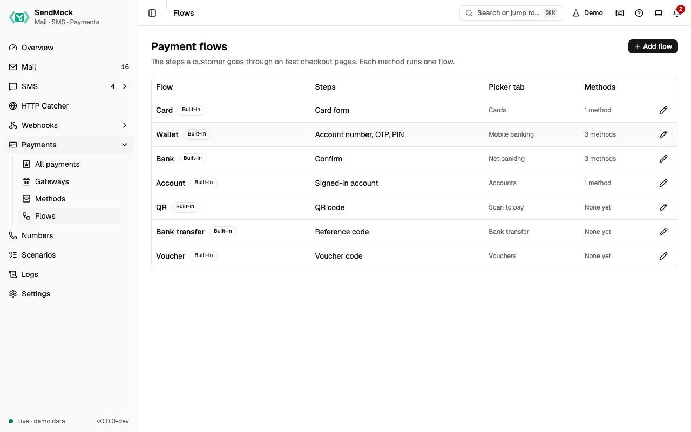

> Try it in the [demo](/demo/payments/flows). Works in your install from Phase 3P.

A flow is the sequence of steps a customer goes through for one kind of method: a card form; or an account number, then an OTP, then a PIN; or a QR code to scan. Methods use flows, so changing a flow changes every method that runs it.

## What it solves

- **A provider's checkout has different steps** (a PIN before the OTP, a QR code, a voucher): compose the same steps here, and your checkout test matches the real one.
- **Labels that match the provider's page:** `Your Upay account number`, `SMS code for {method}`.

## How it connects

| Gets from | Sends to |
| --- | --- |
| the step catalogue (what SendMock knows how to show and check) | [Methods](./methods.md) that run it |
| | the [checkout page](./checkout-page.md): the steps, labels and the picker tab |

## Use it

1. Press **Edit Wallet**.
2. In **Step 2: OTP**, change **Field label** to `SMS code for {method}`. The preview under the step shows "SMS code for bKash".
3. Press **Save flow**, then open a bKash checkout: the label has changed for every wallet method.
4. Press **Reset to default** on the flow to undo.

## Everything on this screen

### The table

Name, steps in order (for example "Account number, OTP, PIN"), picker tab, the methods using it ("None yet"), Built-in or Custom, and **Modified**. **Add flow** asks for a name, a key and the **Picker tab** (the tab the checkout page groups it under, such as "Mobile banking").

Built-in flows:

| Flow | Steps | Picker tab |
| --- | --- | --- |
| Card | card form | Cards |
| Wallet | account number, OTP, PIN | Mobile banking |
| Bank | confirm | Net banking |
| Account | signed-in account | Accounts |
| QR | QR code | Scan to pay |
| Bank transfer | reference code | Bank transfer |
| Voucher | voucher code | Vouchers |

### The step catalogue

| Step | Shows | Checked against the method's |
| --- | --- | --- |
| Card form | number, expiry, CVC, name (and a 3-D Secure challenge when the card asks) | test cards |
| Account number | a wallet, phone or account number | test numbers |
| Voucher code | a code field | test numbers |
| OTP | a verification code | test OTP |
| PIN | a PIN (asked again when wrong) | test PIN |
| Signed-in account | the test account with Approve and Cancel | test account |
| QR code | a QR code and "I have paid" | outcome |
| Reference code | a reference to pay with elsewhere and "I have paid" | outcome |
| Confirm | a confirm button | outcome |

A flow has 1 to 6 steps and at most one **deciding** step (card form, account number or voucher code); without one, the method's outcome decides.

### The flow sheet

- **Steps** in order: **Add step** from the catalogue, move up and down, remove. Each step has **Title**, **Field label**, **Hint** and **Button text**.
- **Label variables** above the steps, each with what it becomes and an example, and **Insert variable** beside each label: `{method}`, `{amount}`, `{currency}`, `{merchant}`, `{gateway}`, `{reference}`, `{customer_email}`.
- A **preview** line under each step shows its labels filled in.
- Problems show before saving: no step, two deciding steps, an unknown variable ("`{ammount}` is not a variable").

A built-in shows **Modified** and **Reset to default**; it cannot be deleted. A custom flow can be deleted while no method uses it.

A step type SendMock cannot show yet needs code (a checkout component and a server check); ask for it with a provider request issue.

## Customize

Compose a QR wallet flow from scratch: [Advanced: payment flow](../advanced/payment-flow.md).

## From the CLI, API and AI

| Do this | CLI | API | MCP tool |
| --- | --- | --- | --- |
| list | [`sendmock payments flows list`](/cli/payment-flows/#payments-flows-list) | [`GET /api/v1/payments/flows`](/api/payment-flows/#getPaymentsFlows) | [`sendmock_payment_flow_list`](/mcp/payment-flows/#sendmock_payment_flow_list) |
| one flow | [`sendmock payments flows show <flowKey>`](/cli/payment-flows/#payments-flows-show) | [`GET /api/v1/payments/flows/{flowKey}`](/api/payment-flows/#getPaymentsFlowsByFlowKey) | [`sendmock_payment_flow_get`](/mcp/payment-flows/#sendmock_payment_flow_get) |
| create | [`sendmock payments flows create`](/cli/payment-flows/#payments-flows-create) | [`POST /api/v1/payments/flows`](/api/payment-flows/#postPaymentsFlows) | [`sendmock_payment_flow_create`](/mcp/payment-flows/#sendmock_payment_flow_create) |
| add a step | [`sendmock payments flows steps add <flowKey>`](/cli/payment-flows/#payments-flows-steps-add) | [`POST /api/v1/payments/flows/{flowKey}/steps`](/api/payment-flows/#postPaymentsFlowsByFlowKeySteps) | [`sendmock_payment_flow_step_add`](/mcp/payment-flows/#sendmock_payment_flow_step_add) |
| change or move a step | [`sendmock payments flows steps update <flowKey> <stepIndex>`](/cli/payment-flows/#payments-flows-steps-update) | [`PATCH /api/v1/payments/flows/{flowKey}/steps/{stepIndex}`](/api/payment-flows/#patchPaymentsFlowsByFlowKeyStepsByStepIndex) | [`sendmock_payment_flow_step_update`](/mcp/payment-flows/#sendmock_payment_flow_step_update) |
| remove a step | [`sendmock payments flows steps remove <flowKey> <stepIndex>`](/cli/payment-flows/#payments-flows-steps-remove) | [`DELETE /api/v1/payments/flows/{flowKey}/steps/{stepIndex}`](/api/payment-flows/#deletePaymentsFlowsByFlowKeyStepsByStepIndex) | [`sendmock_payment_flow_step_remove`](/mcp/payment-flows/#sendmock_payment_flow_step_remove) |
| the step catalogue | [`sendmock payments flows step-types`](/cli/payment-flows/#payments-flows-step-types) | [`GET /api/v1/payments/step-types`](/api/payment-flows/#getPaymentsStepTypes) | [`sendmock_payment_step_type_list`](/mcp/payment-flows/#sendmock_payment_step_type_list) |
| the label variables | [`sendmock payments flows variables`](/cli/payment-flows/#payments-flows-variables) | [`GET /api/v1/payments/flow-variables`](/api/payment-flows/#getPaymentsFlowVariables) | [`sendmock_payment_flow_variable_list`](/mcp/payment-flows/#sendmock_payment_flow_variable_list) |
| reset a built-in | [`sendmock payments flows reset <flowKey>`](/cli/payment-flows/#payments-flows-reset) | [`POST /api/v1/payments/flows/{flowKey}/reset`](/api/payment-flows/#postPaymentsFlowsByFlowKeyReset) | [`sendmock_payment_flow_reset`](/mcp/payment-flows/#sendmock_payment_flow_reset) |

## Related

- [Methods](./methods.md)
- [Checkout page](./checkout-page.md)
