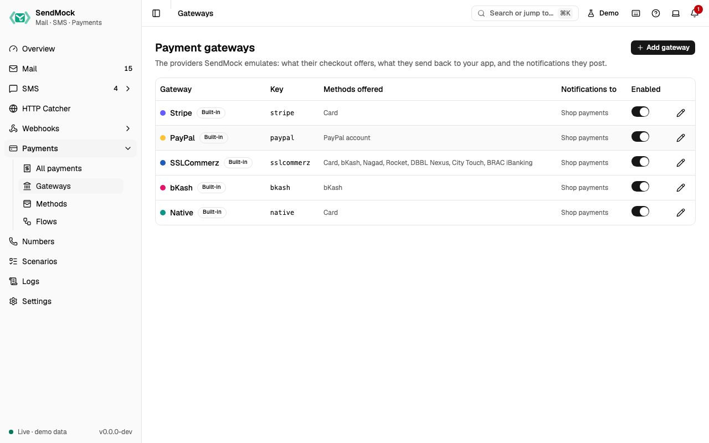

> Try it in the [demo](/demo/payments/gateways). Works in your install from Phase 3P.

A gateway is one emulated payment provider: Stripe, PayPal, SSLCommerz, bKash, Native, or one you add. Gateways are data, not code: what a gateway offers, what its redirect carries and what its notification looks like are all editable, and **Reset to default** brings a built-in back.

## What it solves

- **A gateway SendMock does not ship.** Add it from blank or from the closest built-in, with its own fields and signature. See [Advanced: create a gateway](../advanced/payment-gateway.md).
- **A built-in that differs from your account's setup:** another event name, an extra redirect field, a method your merchant account does not offer.
- **Credentials your app checks**, such as SSLCommerz's store id and password, in one place, masked.

## How it connects

| Gets from | Sends to |
| --- | --- |
| [Methods](./methods.md): the ones it offers at checkout, in order | the [checkout page](./checkout-page.md): which methods and steps it shows |
| your app's API calls at `/providers/<key>/...` on port `8026` | redirects to your app, with the fields set on the **Redirect** tab |
| [Settings > Payments](../settings.md#payments): merchant name and currency | notifications to its **notification endpoint** (a [webhooks endpoint](../webhooks/endpoints.md)), logged in [Deliveries](../webhooks/deliveries.md) |

## Use it

1. Press **Edit SSLCommerz**.
2. In **Checkout**, see the methods it offers (Card, bKash, Nagad, Rocket, DBBL Nexus, City Touch, BRAC iBanking), and press **Open a test checkout**.
3. Pay with a test bKash number. Back on the gateway, the **Redirect** and **Notification** tabs show exactly what was sent, with a live preview.

## Everything on this screen

### The table

Name, key, the methods offered, the notification endpoint, Built-in or Custom, **Modified** once a built-in is edited, and an enabled switch. **Add gateway** asks for a name, a key (the `provider` value in the API and in `/providers/<key>/...` paths) and **Start from** (a built-in to copy, or blank).

### The gateway sheet

| Tab | Holds |
| --- | --- |
| **General** | name, key (fixed after creation), accent colour (the checkout page uses it), enabled |
| **Checkout** | **Methods offered**, in order: **Add a method**, move up and down, remove; and **Open a test checkout**, which creates a test payment on this gateway and opens its page |
| **Merchant** | credentials as name and value rows (store id, secret key, ...), secrets masked with a reveal that asks first; the **Notification endpoint** |
| **Redirect** | GET or POST, and the fields sent back to your app: a name and a template each, sent **Always** or **Only on success** (like PayPal's `PayerID`) |
| **Notification** | JSON or Form, the gateway's **event name** for each native event (blank sends nothing for it), the **body template** and **header templates** (for signatures) |

Beside Redirect and Notification, a **Preview** renders them against a chosen payment, event and redirect outcome, with secrets masked and problems under each part. A gateway with template errors cannot be saved ("Fix 1 template error to save").

### What templates can read

| Value | Holds |
| --- | --- |
| `payment` | id, reference, `amount_minor` and `amount_major`, currency, status, failure code, customer, method, provider ids, metadata |
| `event` | id, the native `type`, the gateway's `name` for it, `created` as Unix seconds |
| `redirect` | `outcome` (success, fail or cancel) and `status` |
| `merchant` | the credentials by name, for example `merchant.store_passwd` |

Plus the template functions and filters, and `uuid()`, `random_hex(length)`, `now_iso()` and `stripe_signature(secret)` for signature headers. A form body is written encoded, for example `tran_id={{ payment.reference | urlencode }}&status=...`.

### Built-in and custom

A built-in can be edited and disabled but not deleted; it shows **Modified** once edited, and **Reset to default** (asks first) restores it. A custom gateway can be deleted while no payment uses it.

## Customize

The full walkthrough, from the provider's docs to a working checkout and a seed export: [Advanced: create a gateway](../advanced/payment-gateway.md). An AI agent can do it for you: [AI: create a gateway with AI](../ai/payment-gateway-with-ai.md).

## From the CLI, API and AI

| Do this | CLI | API | MCP tool |
| --- | --- | --- | --- |
| list, show | `sendmock payments gateways list` | `GET /api/v1/payments/gateways` | `sendmock_payment_gateway_list`, `_get` |
| create, update | `sendmock payments gateways create`, `... update` | `POST`, `PATCH /api/v1/payments/gateways` | `sendmock_payment_gateway_create`, `_update` |
| preview | `sendmock payments gateways preview <key>` | `POST /api/v1/payments/gateways/{gatewayKey}/preview` | `sendmock_payment_gateway_preview` |
| reset a built-in | `sendmock payments gateways reset <key>` | `POST /api/v1/payments/gateways/{gatewayKey}/reset` | `sendmock_payment_gateway_reset` |

## Related

- [Methods](./methods.md)
- [Flows](./flows.md)
