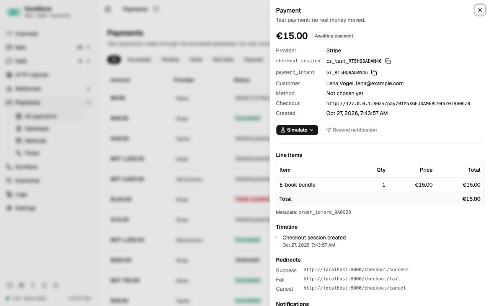

> Try it in the [demo](/demo/payments). Works in your install from Phase 3P (Stripe, PayPal, SSLCommerz and the native API) and Phase 4 (bKash, Razorpay, Paddle).

SendMock is a fake payment gateway. Your app creates a payment through the gateway's real API; SendMock answers like the gateway, shows a test checkout page, sends the browser back to your app and posts the gateway's notification (IPN or webhook), signed as the gateway signs it. No real money moves and no real card is accepted.



## What it solves

- **Checkout without sandbox accounts, internet or a tunnel** for the notification URL. See [Recipe: Stripe payment](../recipes/stripe-payment.md).
- **Regional gateways** (SSLCommerz, bKash) whose sandboxes are limited or slow. See [Recipe: SSLCommerz and bKash](../recipes/sslcommerz-bkash-checkout.md).
- **The paths you rarely see:** declines with each reason, 3-D Secure, cancel, a payment that stays pending, refunds (full and partial), captures, disputes.
- **Your IPN handler:** signature check, order validation, and what happens when the notification arrives twice.
- **A gateway SendMock does not ship.** See [Advanced: create a gateway](../advanced/payment-gateway.md).

## How it connects

| Gets from | Sends to |
| --- | --- |
| your app over a gateway API (Stripe, PayPal, SSLCommerz, bKash) on port `8026`, or `POST /api/v1/payments/checkout` | the [test checkout page](./checkout-page.md), which drives the outcome |
| [Gateways](./gateways.md), which offer [Methods](./methods.md), which run [Flows](./flows.md) | the browser back to your app's success, fail or cancel URL |
| [Settings > Payments](../settings.md#payments): merchant name, currency, automatic outcomes | the notification through the gateway's endpoint, logged in [Deliveries](../webhooks/deliveries.md) |
| | `payment.*` and `checkout.*` events to [Rules](../webhooks/rules.md); the API request to [Logs](../logs.md) |

```
Gateway (Stripe, SSLCommerz, your own)
  └── offers Methods in order (Card, bKash, Nagad, ...)
        └── each Method runs one Flow (Card form; Account number → OTP → PIN; ...)
              └── a Flow is steps from the step catalogue
```

## Use it

1. Open **Payments > Gateways**, edit **Stripe**, open the **Checkout** tab and press **Open a test checkout**.
2. On the checkout page, pay with the test card `4242 4242 4242 4242`, any future expiry and any CVC.
3. The result shows where the browser goes (your success URL with Stripe's fields) and **Return to merchant**.
4. Back in **Payments**, open the payment: the timeline shows it succeeded and the notification sent. Press **Simulate** > **Refund...** and refund part of it; a second notification goes out.

## Everything on this screen

### The list

Amount in the currency's own format, provider, status, customer and time, newest first, 50 at a time, new and changed payments appearing live. Status chips (All, Succeeded, Pending, Failed, Refunded, Disputed), a provider picker and a currency picker narrow it; filters and the open payment are kept in the URL.

### The payment drawer

- Amount, status, provider and the provider's ids (session, intent, order, transaction), the customer, the payment method (card brand, last 4 and expiry, or a masked wallet number; never a full card number), the failure reason, the refunded amount and the dispute state.
- **Line items** and metadata.
- **Timeline:** created, 3-D Secure, authorized, captured, succeeded or failed, refunds, disputes, redirects and notifications.
- **Redirects:** the success, fail and cancel URLs, which one was used, with the method (GET or POST) and the fields sent.
- **Notifications:** each IPN or webhook sent (the gateway's event name, the native event, status code, time), linking to its delivery.

### Simulate

The **Simulate** menu offers only what the payment's status allows:

| Status | Actions |
| --- | --- |
| waiting for payment | **Succeed**, **Decline** (Insufficient funds, Expired card, Incorrect CVC, Generic decline, Fraud), **Expire checkout** |
| authorized | **Capture**, **Void authorization** |
| paid | **Refund...** (full by default, never more than what is left), **Open dispute** |
| disputed | **Resolve dispute** > **Won** or **Lost** |

**Resend notification** posts the last notification again, to test that your handler copes with duplicates. Every result shows at once in the status, timeline and notifications.

### Test values

| Card | Outcome |
| --- | --- |
| `4242 4242 4242 4242` | succeeds (Visa) |
| `5555 5555 5555 4444` | succeeds (Mastercard) |
| `4000 0000 0000 0002` | declined: generic decline |
| `4000 0000 0000 9995` | declined: insufficient funds |
| `4000 0000 0000 0069` | declined: expired card |
| `4000 0000 0000 0127` | declined: incorrect CVC |
| `4000 0025 0000 3155` | asks for 3-D Secure |
| `4000 0000 0000 0259` | succeeds, then a dispute opens |

Wallets (bKash, Nagad, Rocket) use test numbers such as `01770000001` (succeeds) and `01770000002` (insufficient balance), the OTP `123456` and the PIN `12121`. [Settings > Payments](../settings.md#payments) lists the test values of every enabled method. A real card number is refused with "Use a test card" and never stored or logged.

## Customize

- Change what a built-in gateway sends, or add your own: [Gateways](./gateways.md), [Advanced: create a gateway](../advanced/payment-gateway.md).
- Add a wallet or bank: [Advanced: payment method](../advanced/payment-method.md).
- Change the checkout steps: [Advanced: payment flow](../advanced/payment-flow.md).
- Settle payments automatically in automated tests: **Automatic outcome** in [Settings > Payments](../settings.md#payments).

## From your code

Create a test checkout, settle it from the test and read the payment.

The examples call SendMock's REST API with each language's usual HTTP client and test framework. JavaScript, Go, Java, Rust, Ruby and C# use the small `call` helper shown under **Test helper** on their page in [Connect your app](../connect/index.md).

```bash tab="CLI" tab-group="language"
payment=$(sendmock payments checkout create --provider stripe --amount-minor 1999 --currency USD --json)

paid=$(sendmock payments simulate "$(jq -r '.id' <<<"$payment")" succeed --json)

jq -e '.status == "succeeded"' <<<"$paid" >/dev/null
```

```php tab="PHP"
<?php

use Illuminate\Support\Facades\Http;

const SENDMOCK = 'http://127.0.0.1:8025/api/v1';

it('settles a test payment', function () {
    $payment = Http::post(SENDMOCK.'/payments/checkout', [
        'provider' => 'stripe',
        'amount_minor' => 1999,
        'currency' => 'USD',
    ])->throw()->json();

    $paid = Http::post(SENDMOCK."/payments/{$payment['id']}/simulate", ['action' => 'succeed'])->throw()->json();

    expect($paid['status'])->toBe('succeeded');
});
```

```js tab="JavaScript"
import { expect, test } from "vitest";

import { call, SENDMOCK } from "./sendmock.js";

test("settles a test payment", async () => {
  const payment = await call("POST", `${SENDMOCK}/payments/checkout`, { provider: "stripe", amount_minor: 1999, currency: "USD" });

  const paid = await call("POST", `${SENDMOCK}/payments/${payment.id}/simulate`, { action: "succeed" });

  expect(paid.status).toBe("succeeded");
});
```

```python tab="Python"
import requests

SENDMOCK = "http://127.0.0.1:8025/api/v1"
APP = "http://localhost:8000"


def test_settles_a_test_payment():
    payment = requests.post(
        f"{SENDMOCK}/payments/checkout",
        json={
            "provider": "stripe",
            "amount_minor": 1999,
            "currency": "USD",
        },
    ).json()

    paid = requests.post(
        f"{SENDMOCK}/payments/{payment['id']}/simulate",
        json={"action": "succeed"},
    ).json()

    assert paid["status"] == "succeeded"
```

```go tab="Go"
package app_test

import "testing"

func TestSettlesATestPayment(t *testing.T) {
	payment := call(t, "POST", sendmock+"/payments/checkout", map[string]any{
		"provider":     "stripe",
		"amount_minor": 1999,
		"currency":     "USD",
	}).(map[string]any)

	paid := call(t, "POST", sendmock+"/payments/"+payment["id"].(string)+"/simulate", map[string]any{"action": "succeed"}).(map[string]any)

	if got := paid["status"]; got != "succeeded" {
		t.Errorf("status is %v, want %v", got, "succeeded")
	}
}
```

```java tab="Java"
import static app.SendMock.SENDMOCK;
import static app.SendMock.call;
import static org.junit.jupiter.api.Assertions.assertEquals;

import java.util.Map;
import org.junit.jupiter.api.Test;

class PaymentsTest {
    @Test
    void settlesATestPayment() throws Exception {
        var payment = call("POST", SENDMOCK + "/payments/checkout", Map.of(
            "provider", "stripe",
            "amount_minor", 1999,
            "currency", "USD"
        ));

        var paid = call("POST", SENDMOCK + "/payments/" + payment.get("id").asText() + "/simulate", Map.of("action", "succeed"));

        assertEquals("succeeded", paid.get("status").asText());
    }
}
```

```rust tab="Rust"
mod sendmock;

use serde_json::json;
use sendmock::{call, SENDMOCK};

#[tokio::test]
async fn settles_a_test_payment() {
    let payment = call("POST", &format!("{SENDMOCK}/payments/checkout"), Some(json!({
        "provider": "stripe",
        "amount_minor": 1999,
        "currency": "USD"
    }))).await;

    let paid = call("POST", &format!("{SENDMOCK}/payments/{}/simulate", payment["id"].as_str().unwrap()), Some(json!({"action": "succeed"}))).await;

    assert_eq!(paid["status"], "succeeded");
}
```

```ruby tab="Ruby"
require_relative "sendmock_helper"

RSpec.describe "Payments" do
  it "settles a test payment" do
    payment = call("POST", "#{SENDMOCK}/payments/checkout", {
      "provider" => "stripe",
      "amount_minor" => 1999,
      "currency" => "USD",
    })

    paid = call("POST", "#{SENDMOCK}/payments/#{payment["id"]}/simulate", { "action" => "succeed" })

    expect(paid["status"]).to eq("succeeded")
  end
end
```

```csharp tab="C#"
using static SendMock;

public class PaymentsTests
{
    [Fact]
    public async Task SettlesATestPayment()
    {
        var payment = await Call("POST", Sendmock + "/payments/checkout", new
        {
            provider = "stripe",
            amount_minor = 1999,
            currency = "USD",
        });

        var paid = await Call("POST", Sendmock + "/payments/" + payment.GetProperty("id").GetString() + "/simulate", new { action = "succeed" });

        Assert.Equal("succeeded", paid.GetProperty("status").GetString());
    }
}
```

## From the CLI, API and AI

| Do this | CLI | API | MCP tool |
| --- | --- | --- | --- |
| create a checkout | [`sendmock payments checkout create`](/cli/payments/#payments-checkout-create) | [`POST /api/v1/payments/checkout`](/api/payments/#postPaymentsCheckout) | [`sendmock_payment_create_checkout`](/mcp/payments/#sendmock_payment_create_checkout) |
| list | [`sendmock payments list`](/cli/payments/#payments-list) | [`GET /api/v1/payments`](/api/payments/#getPayments) | [`sendmock_payment_list`](/mcp/payments/#sendmock_payment_list) |
| one payment | [`sendmock payments show <paymentId>`](/cli/payments/#payments-show) | [`GET /api/v1/payments/{paymentId}`](/api/payments/#getPaymentsByPaymentId) | [`sendmock_payment_get`](/mcp/payments/#sendmock_payment_get) |
| simulate | [`sendmock payments simulate <paymentId> <action>`](/cli/payments/#payments-simulate) | [`POST /api/v1/payments/{paymentId}/simulate`](/api/payments/#postPaymentsByPaymentIdSimulate) | [`sendmock_payment_simulate`](/mcp/payments/#sendmock_payment_simulate) |
| resend the notification | [`sendmock payments notify <paymentId>`](/cli/payments/#payments-notify) | [`POST /api/v1/payments/{paymentId}/notify`](/api/payments/#postPaymentsByPaymentIdNotify) | [`sendmock_payment_notify`](/mcp/payments/#sendmock_payment_notify) |
| test values | [`sendmock payments test-cards`](/cli/payments/#payments-test-cards) | [`GET /api/v1/payments/test-cards`](/api/payments/#getPaymentsTestCards) | [`sendmock_payment_test_cards`](/mcp/payments/#sendmock_payment_test_cards) |
| wait in a test | [`sendmock payments wait`](/cli/test-helpers/#payments-wait) | [`GET /api/v1/wait/payment`](/api/test-helpers/#getWaitPayment) | [`sendmock_payment_wait`](/mcp/test-helpers/#sendmock_payment_wait) |

## Related

- [Checkout page](./checkout-page.md)
- [Gateways](./gateways.md)
