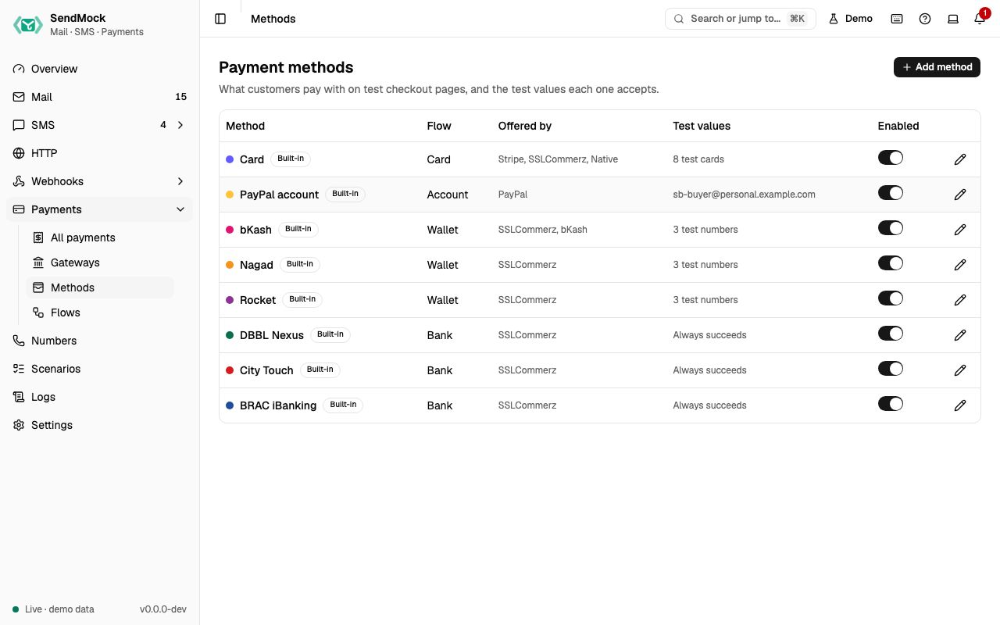

> Try it in the [demo](/demo/payments/methods). Works in your install from Phase 3P.

A payment method is what the customer picks on the checkout page: a card, a PayPal account, a wallet such as bKash or Nagad, an internet bank. Each method runs one [flow](./flows.md) and holds the test values its steps check.

## What it solves

- **A wallet or bank SendMock does not ship** (Upay, a local bank): add it as a method and offer it on any gateway.
- **Test values that match your tests:** a different OTP, PIN or test number, or a method that always succeeds.
- **A method your merchant account does not offer:** switch it off and it disappears from every checkout.

## How it connects

| Gets from | Sends to |
| --- | --- |
| [Flows](./flows.md): the steps it asks for | [Gateways](./gateways.md) that offer it |
| | the [checkout page](./checkout-page.md): its name, colour, steps and the test values shown |
| | [Settings > Payments](../settings.md#payments): the test values list |

## Use it

1. Press **Edit bKash**.
2. Set **Test OTP** to `654321` and press **Save method**. The row shows **Modified**.
3. Open a bKash checkout: the page now says "Test code: 654321".
4. Back here, press **Reset to default** to undo.

## Everything on this screen

### The table

Name, flow, the gateways offering it ("No gateway yet" for none), test values count (or "Always succeeds"), Built-in or Custom, **Modified**, and an enabled switch. Built-ins: Card, PayPal account, bKash, Nagad, Rocket, DBBL Nexus, City Touch, BRAC iBanking.

**Add method** asks for the **Flow** and a **Name** (the key is suggested from it).

### The method sheet

Name, key and flow (fixed after creation), accent colour, and the test values the flow's steps need:

| Flow has | You set |
| --- | --- |
| a card form | **Test cards**: number and outcome (Succeeds, Declined with a reason, Requires 3-D Secure, Succeeds then a dispute opens). Only numbers from the documented test ranges that pass the Luhn check are accepted. |
| an account number or voucher step | test numbers or codes, each with an outcome (Succeeds, Declined: insufficient balance, Wrong PIN (asked again)) |
| an OTP step | **Test OTP** |
| a PIN step | **Test PIN** (4 to 6 digits) |
| a signed-in account step | **Test account** |
| no deciding step | the **Outcome**: Succeeds or Declined |

A built-in shows **Reset to default** (asks first). A custom method can be deleted while no payment uses it.

## Customize

Add a new wallet end to end: [Advanced: payment method](../advanced/payment-method.md).

## From the CLI, API and AI

| Do this | CLI | API | MCP tool |
| --- | --- | --- | --- |
| list | `sendmock payments methods list` | [`GET /api/v1/payments/methods`](/api/payment-methods/#getPaymentsMethods) | `sendmock_payment_method_list` |
| one method | `sendmock payments methods show <methodKey>` | [`GET /api/v1/payments/methods/{methodKey}`](/api/payment-methods/#getPaymentsMethodsByMethodKey) | `sendmock_payment_method_get` |
| create | `sendmock payments methods create` | [`POST /api/v1/payments/methods`](/api/payment-methods/#postPaymentsMethods) | `sendmock_payment_method_create` |
| update | `sendmock payments methods update <methodKey>` | [`PATCH /api/v1/payments/methods/{methodKey}`](/api/payment-methods/#patchPaymentsMethodsByMethodKey) | `sendmock_payment_method_update` |
| reset a built-in | `sendmock payments methods reset <methodKey>` | [`POST /api/v1/payments/methods/{methodKey}/reset`](/api/payment-methods/#postPaymentsMethodsByMethodKeyReset) | `sendmock_payment_method_reset` |
| delete a custom one | `sendmock payments methods delete <methodKey>` | [`DELETE /api/v1/payments/methods/{methodKey}`](/api/payment-methods/#deletePaymentsMethodsByMethodKey) | `sendmock_payment_method_delete` |

## Related

- [Flows](./flows.md)
- [Gateways](./gateways.md)
