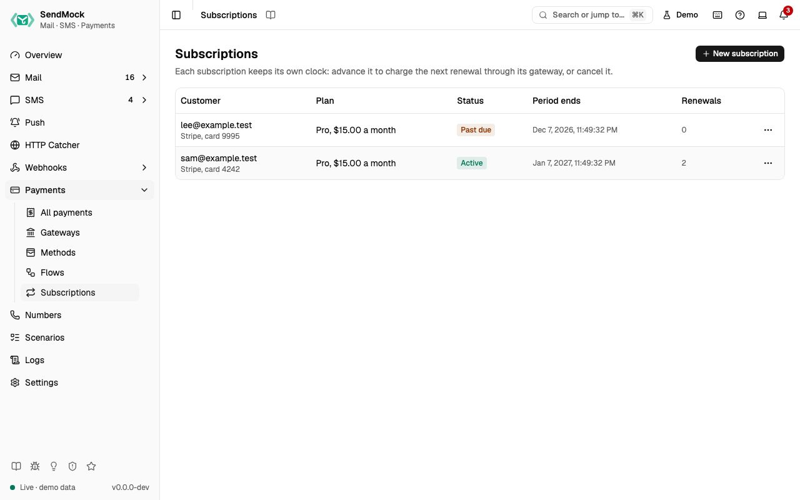

> Try it in the [demo](/demo/payments/subscriptions).

A subscription charges a test card on a gateway every day, week, month or year. Nothing waits for real time: each subscription keeps its own clock, and **Advance to renewal** moves it to the next renewal and charges the card as a payment through the gateway, so your app receives the same notifications it gets from a real renewal.

## What it solves

- **Renewals take a month to test:** advance the clock as often as you like, each advance is one renewal.
- **Failed renewals are hard to reproduce:** subscribe with a test card that declines, and the renewal fails and the subscription goes past due.
- **Cancellation paths:** cancel now, or at the end of the period, and see what your app receives.

## How it connects

| Gets from | Sends to |
| --- | --- |
| a [gateway](./gateways.md) and a test card from [Methods](./methods.md) | each renewal as a payment in [Payments](./index.md), with the gateway's notification |
| | `subscription.created`, `subscription.renewed`, `subscription.payment_failed` and `subscription.canceled` for [webhook rules](../webhooks/rules.md) |

## Use it

1. Press **New subscription**, pick **Stripe**, enter `sam@example.test`, keep the plan **Pro** at `15.00` USD every month, and press **Start subscription**. The first period is charged at once: the row shows **Active** and one renewal, and the payment is in Payments.
2. Open the row's menu and choose **Advance to renewal**. The period moves on a month and the card is charged again.
3. Start another subscription with the test card `4000000000009995`, which declines for insufficient funds. The first charge fails and the row shows **Past due**.
4. Choose **Cancel at period end** on the first one: it shows "Ends at period end", and the next advance ends it.

## Everything on this screen

### The table

The customer with the gateway and the card's last four digits, the plan with its amount and interval, the status (**Trialing**, **Active**, **Past due** or **Canceled**, with "Ends at period end" when cancelled at the period end), when the current period ends, and how many periods were paid. The row's menu offers **Advance to renewal**, **Cancel at period end** and **Cancel now** until the subscription is canceled.

### New subscription

| Field | What it does |
| --- | --- |
| Gateway | the gateway the renewals are charged through |
| Interval | every day, week, month or year |
| Customer email | who pays |
| Plan name, Amount, Currency | what each renewal charges |
| Trial days | days before the first charge; `0` charges at once |
| Test card | the test card that pays each renewal; a real card number is refused |

Every control and text, one by one: [Subscriptions in depth](../deeper/payments/subscriptions.md).
## Customize

Write the renewal into a test: start a subscription with the API, advance it, and wait for the renewal's payment with `sendmock payments wait`.

## From the CLI, API and AI

| Do this | CLI | API | MCP tool |
| --- | --- | --- | --- |
| list | [`sendmock payments subscriptions list`](/cli/payments/#payments-subscriptions-list) | [`GET /api/v1/payments/subscriptions`](/api/payments/#getPaymentsSubscriptions) | [`sendmock_subscription_list`](/mcp/payments/#sendmock_subscription_list) |
| start one | [`sendmock payments subscriptions create`](/cli/payments/#payments-subscriptions-create) | [`POST /api/v1/payments/subscriptions`](/api/payments/#postPaymentsSubscriptions) | [`sendmock_subscription_create`](/mcp/payments/#sendmock_subscription_create) |
| one subscription | [`sendmock payments subscriptions show <subscriptionId>`](/cli/payments/#payments-subscriptions-show) | [`GET /api/v1/payments/subscriptions/{subscriptionId}`](/api/payments/#getPaymentsSubscriptionsBySubscriptionId) | [`sendmock_subscription_get`](/mcp/payments/#sendmock_subscription_get) |
| advance to the next renewal | [`sendmock payments subscriptions advance <subscriptionId>`](/cli/payments/#payments-subscriptions-advance) | [`POST /api/v1/payments/subscriptions/{subscriptionId}/advance`](/api/payments/#postPaymentsSubscriptionsBySubscriptionIdAdvance) | [`sendmock_subscription_advance`](/mcp/payments/#sendmock_subscription_advance) |
| cancel | [`sendmock payments subscriptions cancel <subscriptionId>`](/cli/payments/#payments-subscriptions-cancel) | [`POST /api/v1/payments/subscriptions/{subscriptionId}/cancel`](/api/payments/#postPaymentsSubscriptionsBySubscriptionIdCancel) | [`sendmock_subscription_cancel`](/mcp/payments/#sendmock_subscription_cancel) |

## Related

- [Payments](./index.md)
- [Gateways](./gateways.md)
- [Webhook rules](../webhooks/rules.md)
