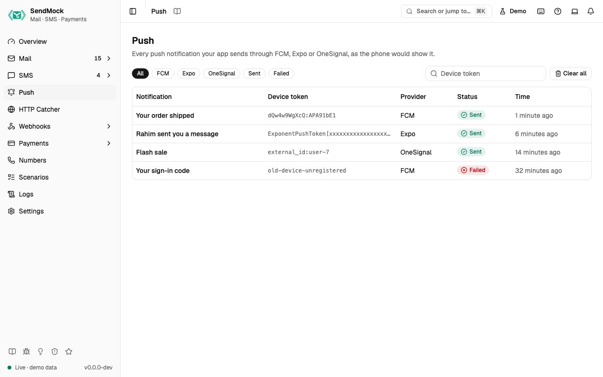

> Try it in the [demo](/demo/push).

Your app sends push notifications through FCM, Expo or OneSignal with their own SDKs. Point the SDK at SendMock instead and **Push** shows every notification as a lock screen card, with its data payload, the request and what SendMock answered, in the provider's own shape.



## What it solves

- **Seeing the notification** without a phone, a Firebase project or an Expo account: the title, body, image and data exactly as your app built them.
- **Automated tests:** wait for "the push to this device" and assert on its title or data, instead of mocking the SDK.
- **The answers your code handles:** FCM's message name, Expo's tickets and receipts, OneSignal's notification id, all in the provider's format.

## How it connects

| Gets from | Sends to |
| --- | --- |
| your app's FCM HTTP v1 send (`POST /v1/projects/{project}/messages:send`) at `http://127.0.0.1:8026` or `http://127.0.0.1:8025/providers/fcm` | this screen, one row per message |
| your app's Expo sends (`POST /--/api/v2/push/send`, one message or a batch) and receipt checks (`POST /--/api/v2/push/getReceipts`) | this screen, one row per recipient |
| your app's OneSignal sends (`POST /notifications`) | this screen, one row per subscription or alias |
| the `X-SendMock-Project` header or a `/projects/<key>/` prefix | the notification's [project](./settings.md#projects) |
| | the API request to [Logs > API requests](./logs.md) |

## Use it

1. Point your SDK at SendMock:
   - Expo: set the environment variable before your server starts.

     ```sh
     EXPO_BASE_URL=http://127.0.0.1:8026
     ```

   - OneSignal (Node): give the client SendMock as its server.

     ```ts
     const configuration = OneSignal.createConfiguration({
       restApiKey: "any",
       baseServer: new OneSignal.ServerConfiguration("http://127.0.0.1:8026", {}),
     });
     ```

   - FCM: send to `http://127.0.0.1:8026/v1/projects/<your-project>/messages:send`; `firebase-admin` has no base URL option, so route its requests to that address in development.
2. Send a notification from your app (an order shipped, a chat message). A row appears with its title, device token, provider and status.
3. Click the row. The drawer shows the lock screen card (switch between **iOS** and **Android**), the data payload, the request and the answer.

## Everything on this screen

- **Filters:** a chip per provider (All, FCM, Expo, OneSignal), **Sent** and **Failed**, and a device token filter (exact match).
- **The table:** the notification's title (or its body when it has none), the device token, the provider, the status and the time. FCM topic and condition sends show as `topic:<name>` and `condition:<expression>`, OneSignal aliases as `<label>:<id>` and segment sends as `segment:<names>`.
- **Clear all:** deletes every notification the filters show, after asking.

### The notification drawer

Click a row (or open `?push=<id>`; `Esc` closes): the phone preview in the style of the message's platform (iOS puts the image beside the text, Android below it), the status and the reason when it failed, the provider, the device token, the provider's message id, the project and the time, the **Data** payload as key and value rows, the **Request** and the **Answer** as JSON with copy buttons, and **Delete**.

Every control and text, one by one: [Push in depth](./deeper/push.md).

## Customize

- **Projects:** send with `X-SendMock-Project: <key>`, or put `/projects/<key>/` before the provider's path in the base URL, to keep each app's notifications apart ([Projects](./settings.md#projects)).
- **One address per provider:** without the provider port, use `http://127.0.0.1:8025/providers/fcm`, `/providers/expo` or `/providers/onesignal` as the base URL.

## From the CLI, API and AI

| Do this | CLI | API | MCP tool |
| --- | --- | --- | --- |
| list | [`sendmock push list`](/cli/push/#push-list) | [`GET /api/v1/push`](/api/push/#getPush) | [`sendmock_push_list`](/mcp/push/#sendmock_push_list) |
| one notification | [`sendmock push show <pushId>`](/cli/push/#push-show) | [`GET /api/v1/push/{pushId}`](/api/push/#getPushByPushId) | [`sendmock_push_get`](/mcp/push/#sendmock_push_get) |
| wait for one | [`sendmock push wait`](/cli/push/#push-wait) | [`GET /api/v1/wait/push`](/api/push/#getWaitPush) | [`sendmock_push_wait`](/mcp/push/#sendmock_push_wait) |
| delete one | [`sendmock push delete <pushId>`](/cli/push/#push-delete) | [`DELETE /api/v1/push/{pushId}`](/api/push/#deletePushByPushId) | [`sendmock_push_delete`](/mcp/push/#sendmock_push_delete) |
| clear | [`sendmock push clear`](/cli/push/#push-clear) | [`DELETE /api/v1/push`](/api/push/#deletePush) | [`sendmock_push_delete_all`](/mcp/push/#sendmock_push_delete_all) |
