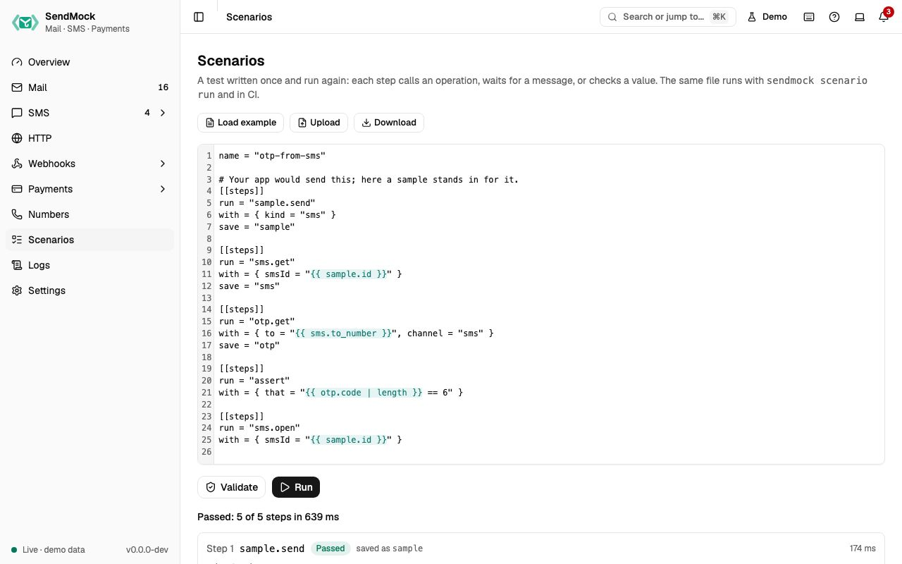

> Try it in the [demo](/demo/scenarios). Works in your install from Phase 4.

A scenario is a short TOML file: set things up, make your app do something, wait for the message, check a value, simulate what happens next. The **Scenarios** screen writes, checks and runs one, and shows every step's input and answer.

## What it solves

- **A flow you test by hand every time** (sign up with a code, reply to a ticket, pay a checkout) becomes one file you run again.
- **The same test in CI:** the file you run here runs with `sendmock scenario run` in your pipeline.
- **An AI agent's work, kept:** after an agent sets something up, it can write a scenario that proves it works.

## How it connects

| Gets from | Sends to |
| --- | --- |
| a scenario file: typed, loaded from an example, or uploaded | each step calls the same operation as the REST API, CLI and MCP tool of that name |
| the values earlier steps saved (`save = "otp"`, then `{{ otp.code }}`) | everything those operations do: emails in [Mail](./mail/index.md), SMS in [SMS](./sms/index.md), payments in [Payments](./payments/index.md), deliveries in [Deliveries](./webhooks/deliveries.md) |

## Use it

1. Open **Scenarios** (`G C`).
2. Press **Load example** and pick **Read the code of an SMS**.
3. Press **Validate**: "Valid: 5 steps".
4. Press **Run**. Each step shows **Passed**, its input and answer, and what it saved. The summary says "Passed: 5 of 5 steps".

## Everything on this screen

### The editor

The scenario's text, with **Load example** (read the code of an SMS, reply to an email as its recipient, pay a Stripe checkout with a test card), **Upload** a `.toml` file and **Download** the current text.

### Steps

Each `[[steps]]` table has:

- `run`: an operation, named after its MCP tool without the `sendmock_` prefix and with dots: `sendmock_sms_get` is `sms.get`, `sendmock_payment_create_checkout` is `payment.create.checkout`. Also `http` (call your app), `assert` (check a value) and `sleep`.
- `with`: the operation's input. Path parameters by name (`smsId`, `emailId`), the rest as the query or body. Values may use `{{ saved.value }}` and `{{ saved.list | length }}`.
- `save`: a name for the step's answer, for later steps.

### Validate and Run

**Validate** lists problems with their step number (an unknown operation, a missing `run`). **Run** runs the steps in order and stops at the first failure; later steps show **Skipped**. In Demo mode, `http` steps that call your app are skipped.

### The report

The summary ("Passed: 5 of 5 steps in 120 ms", or "Failed at step 2: ..."), then each step with its status, time, the value it saved, and **Input and answer** to open. Nothing is stored: the report stays until the next run.

## Customize

The full file format and a CI example: [Advanced: scenarios](./advanced/scenarios.md).

## From the CLI, API and AI

| Do this | CLI | API | MCP tool |
| --- | --- | --- | --- |
| check a scenario file | `sendmock scenario validate <file>` | [`POST /api/v1/scenarios/validate`](/api/automation/#postScenariosValidate) | `sendmock_scenario_validate` |
| run it | `sendmock scenario run <file>` | [`POST /api/v1/scenarios/run`](/api/automation/#postScenariosRun) | `sendmock_scenario_run` |

## Related

- [Advanced: scenarios](./advanced/scenarios.md)
- [AI](./ai/index.md)
