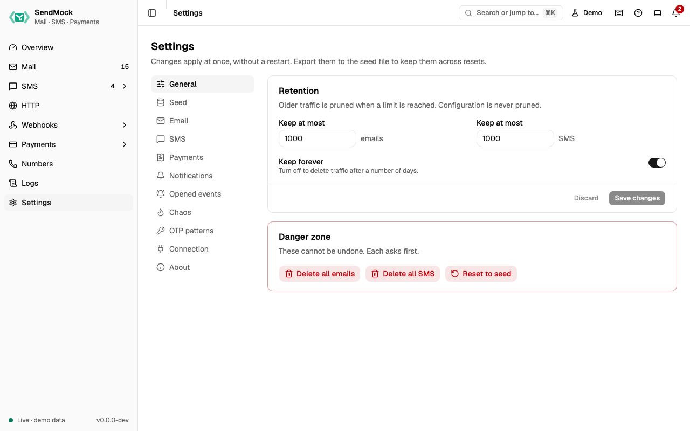

> Try it in the [demo](/demo/settings). Works in your install from Phase 0 (the server settings), with each section arriving with its feature.

Settings decide how every capture menu behaves. They take effect at once, without a restart.



## What it solves

| Section | Solves |
| --- | --- |
| [General](#general) | the database growing forever; starting clean |
| [Seed](#seed) | the same setup for every teammate and every CI run |
| [Email](#email) | bounce and complaint tests, reply domains, safe release to real SMTP |
| [SMS](#sms) | failure and delay tests, matching Twilio's test credentials |
| [Payments](#payments) | the merchant name, currency, automatic outcomes for automated tests, the test values to type |
| [Notifications](#notifications) | pop-ups while you work, or the bell only |
| [Opened events](#opened-events) | testing read receipts and open tracking |
| [Chaos](#chaos) | testing your app when the mail server rejects, is slow or drops the connection |
| [OTP patterns](#otp-patterns) | your app's code format is not found by default |
| [Connection](#connection) | the exact settings your app needs, per language and per place it runs |
| [About](#about) | version, listeners and updates |

## How it connects

| Gets from | Sends to |
| --- | --- |
| your choices, or the [seed file](./advanced/seed-file.md) | [Mail](./mail/index.md): outcome addresses, delivery profile, inbound domains, relay |
| | [SMS](./sms/index.md): simulation profile, failure rate, outcome numbers |
| | [Payments](./payments/index.md): merchant name, currency, automatic outcome |
| | every screen: retention, notifications, opened events, OTP patterns |

## Use it

1. Press `G ,` and pick a section on the left (a picker on phones). The section is kept in the URL, for example `/settings?section=sms`.
2. Change a value. **Save changes** turns on; **Discard** puts the old values back.
3. Press **Save changes**. Invalid values show a message under the field.

## Everything on this screen

### General

**Retention:** **Keep at most** a number of emails and SMS, and **Delete traffic older than** a number of days, or **Keep forever**. Older traffic is pruned when a limit is reached; configuration is never pruned. **Danger zone:** **Delete all emails**, **Delete all SMS** and **Reset to seed** (deletes all traffic and restores the seed file), each asking first.

### Seed

The seed file (`sendmock.seed.toml`) is the configuration SendMock starts from and resets to, kept in your repository. The card shows its path, when it was applied, and what changed since. **Export** downloads the current configuration (secrets written as `${ENV_VAR}` references, never in plain text). **Apply a seed file** takes an upload or pasted text; **Validate** lists errors with line numbers and a summary of the changes before you confirm. See [Advanced: seed file](./advanced/seed-file.md).

### Email

- **Receiving and delivery outcomes:** **Tag by plus address** (`user+invoice@app.test` gets the tag `invoice`), the delivery profile (**Off**, **Auto-delivered**, **Realistic** with a **Bounce rate** and **Complaint rate**), **Inbound domains** (mail to them arrives as incoming, for [inbound routes](./webhooks/inbound-routes.md)) and **SpamAssassin address** (empty means no spam score).
- **Magic addresses:** the switch, and the reference table of the SES simulator and SendMock addresses ([Outcomes](./mail/outcomes.md)).
- **Custom outcome addresses:** your own rules, with **Test an address** ([Advanced: email outcome addresses](./advanced/email-outcome-addresses.md)).
- **Release to real SMTP:** **Relay SMTP URL** (password masked) and **Allowed recipients**; release stays off until the list has an entry ([Release](./mail/release.md)).
- **Tag rules:** add a tag to arriving emails that match a filter (the webhook rule filter builder, with a preview of the last 50 emails), in order; each can be switched off, moved and deleted.
- **Auto-forward rules:** release a real copy of matching arriving emails to fixed addresses, through the relay and only to allowed recipients; the email's **Timeline** says where it went, or why not.

### SMS

- **Delivery simulation:** the profile (**Instant**, **Realistic**, **Manual**), the **Failure rate**, **Strict Twilio test mode** (reject `From` numbers that are not Twilio test numbers with 21606).
- **Magic numbers:** the switch, and the reference table of Twilio's test numbers and SendMock's after-send numbers ([Delivery and test numbers](./sms/delivery-and-test-numbers.md)).
- **Custom outcome numbers:** your own rules, with **Test a number**, which says whether a rule, a magic number or the profile applies ([Advanced: SMS outcome numbers](./advanced/sms-outcome-numbers.md)).

### Payments

**Checkout:** **Merchant name** (shown on checkout pages and in the `{merchant}` label), **Default currency**, and **Automatic outcome** for new hosted checkouts: **Interactive** (wait for the checkout page), **Always succeed**, **Always decline**, or **Random** with a **Success rate**. **Test values:** every enabled method's test cards, numbers, OTP, PIN or account, with the gateways offering it.

### Notifications

**Show pop-up toasts** for new emails, SMS and failed webhook deliveries, and where they appear (top or bottom; left, center or right), with a preview. Off, the bell still counts and lists everything. Saved in this browser only.

### Opened events

**Fire opened events when I view messages:** opening an email, or scrolling an SMS into view, counts as the recipient reading it and fires `email.opened` or `sms.opened`. Choose first open only or every open.

### Chaos

Make SMTP fail on purpose: **Reject the next** N messages **With code** 421, 450, 550 or 552; **Reject recipients matching** a pattern with 550; **Latency per SMTP command**; **Drop the connection during DATA**. While any is on, the section list shows "Chaos on". SMS failures use the failure rate above. See [Advanced: chaos](./advanced/chaos.md).

### OTP patterns

**OTP patterns** are regular expressions tried in order on every new email and SMS; the first capture group of the first match is the code. Add, remove, **Restore defaults**, and **Try a message** to see which pattern matched and the code it found. See [Advanced: OTP patterns](./advanced/otp-patterns.md).

### Connection

**Connect your app:** copy-ready settings for SMTP, the email API, SMS and the HTTP Catcher. Pick a **Language** (Laravel and PHP, Node.js, Python, Go, Java, Ruby, .NET, cURL) and **Where does your app run?** (this machine `127.0.0.1`, a container talking to the host `host.docker.internal`, or the same Docker Compose project `sendmock`). Edit the request headers and the email and SMS bodies; every snippet follows as you type, and a value `"{{file:invoice.pdf}}"` is read and base64-encoded the way each language does it. **Send this request** under each body runs that email or SMS call against this SendMock, with your headers, so you see exactly what your app's call will do. The same content is in [Connect your app](./connect/index.md).

**AI agents** (its own card): pick Claude Code, Codex, Cursor, Gemini CLI or VS Code to see the install command, the MCP configuration and where it goes, and **Download the skill**. See [AI](./ai/index.md).

### About

Version and channel, uptime, listeners (SMTP, HTTP and API, provider port), the database path and size, links to the changelog and docs, the help and feedback links, and **Updates**:

- **Check GitHub Releases for updates** has three modes. **Off** (the default) never calls out. **Manual** checks only when you press **Check for updates**. **Daily** checks on start and once a day, and a new version shows once in the notification bell.
- Stable installs are offered stable releases; beta installs the newer of the newest beta and the newest stable. Edge and development builds are offered nothing.
- A found version shows its release date, its release notes and the upgrade command for how you installed SendMock (Homebrew, Scoop, Docker, the install script or npm), with a copy button. When SendMock does not know how it was installed, use the release page link.
- A check is kept for 24 hours. When GitHub cannot be reached, it says "Could not check for updates" and tries again on the next check.

## Customize

Settings are part of the seed file, so a team shares them: [Advanced: seed file](./advanced/seed-file.md) and [Recipe: share your setup](./recipes/share-your-setup.md). To check a whole flow on every run, write a [scenario](./advanced/scenarios.md).

## From your code

Change a setting for one test, for example a 10% random SMS failure rate.

The examples call SendMock's REST API with each language's usual HTTP client and test framework. JavaScript, Go, Java, Rust, Ruby and C# use the small `call` helper shown under **Test helper** on their page in [Connect your app](./connect/index.md).

```bash tab="CLI" tab-group="language"
settings=$(sendmock settings set --sms-failure-rate-percent 10 --json)

jq -e '.sms_failure_rate_percent == 10' <<<"$settings" >/dev/null
```

```php tab="PHP"
<?php

use Illuminate\Support\Facades\Http;

const SENDMOCK = 'http://127.0.0.1:8025/api/v1';

it('fails one SMS in ten', function () {
    $settings = Http::patch(SENDMOCK.'/settings', ['sms_failure_rate_percent' => 10])->throw()->json();

    expect($settings['sms_failure_rate_percent'])->toBe(10);
});
```

```js tab="JavaScript"
import { expect, test } from "vitest";

import { call, SENDMOCK } from "./sendmock.js";

test("fails one SMS in ten", async () => {
  const settings = await call("PATCH", `${SENDMOCK}/settings`, { sms_failure_rate_percent: 10 });

  expect(settings.sms_failure_rate_percent).toBe(10);
});
```

```python tab="Python"
import requests

SENDMOCK = "http://127.0.0.1:8025/api/v1"
APP = "http://localhost:8000"


def test_fails_one_sms_in_ten():
    settings = requests.patch(
        f"{SENDMOCK}/settings",
        json={"sms_failure_rate_percent": 10},
    ).json()

    assert settings["sms_failure_rate_percent"] == 10
```

```go tab="Go"
package app_test

import "testing"

func TestFailsOneSmsInTen(t *testing.T) {
	settings := call(t, "PATCH", sendmock+"/settings", map[string]any{"sms_failure_rate_percent": 10}).(map[string]any)

	if got := settings["sms_failure_rate_percent"]; got != float64(10) {
		t.Errorf("sms_failure_rate_percent is %v, want %v", got, float64(10))
	}
}
```

```java tab="Java"
import static app.SendMock.SENDMOCK;
import static app.SendMock.call;
import static org.junit.jupiter.api.Assertions.assertEquals;

import java.util.Map;
import org.junit.jupiter.api.Test;

class SettingsTest {
    @Test
    void failsOneSmsInTen() throws Exception {
        var settings = call("PATCH", SENDMOCK + "/settings", Map.of("sms_failure_rate_percent", 10));

        assertEquals(10, settings.get("sms_failure_rate_percent").asInt());
    }
}
```

```rust tab="Rust"
mod sendmock;

use serde_json::json;
use sendmock::{call, SENDMOCK};

#[tokio::test]
async fn fails_one_sms_in_ten() {
    let settings = call("PATCH", &format!("{SENDMOCK}/settings"), Some(json!({"sms_failure_rate_percent": 10}))).await;

    assert_eq!(settings["sms_failure_rate_percent"], 10);
}
```

```ruby tab="Ruby"
require_relative "sendmock_helper"

RSpec.describe "Settings" do
  it "fails one SMS in ten" do
    settings = call("PATCH", "#{SENDMOCK}/settings", { "sms_failure_rate_percent" => 10 })

    expect(settings["sms_failure_rate_percent"]).to eq(10)
  end
end
```

```csharp tab="C#"
using static SendMock;

public class SettingsTests
{
    [Fact]
    public async Task FailsOneSmsInTen()
    {
        var settings = await Call("PATCH", Sendmock + "/settings", new { sms_failure_rate_percent = 10 });

        Assert.Equal(10, settings.GetProperty("sms_failure_rate_percent").GetInt32());
    }
}
```

## From the CLI, API and AI

| Do this | CLI | API | MCP tool |
| --- | --- | --- | --- |
| read | [`sendmock settings get`](/cli/system/#settings-get) | [`GET /api/v1/settings`](/api/system/#getSettings) | [`sendmock_settings_get`](/mcp/system/#sendmock_settings_get) |
| change, chaos too | [`sendmock settings set`](/cli/system/#settings-set) | [`PATCH /api/v1/settings`](/api/system/#patchSettings) | [`sendmock_settings_update`](/mcp/system/#sendmock_settings_update) |
| reset to seed | [`sendmock reset --yes`](/cli/system/#reset) | [`POST /api/v1/reset`](/api/system/#postReset) | [`sendmock_reset`](/mcp/system/#sendmock_reset) |
| seed status | [`sendmock seed status`](/cli/seed/#seed-status) | [`GET /api/v1/seed/status`](/api/seed/#getSeedStatus) | [`sendmock_seed_status`](/mcp/seed/#sendmock_seed_status) |
| export the seed | [`sendmock seed export`](/cli/seed/#seed-export) | [`GET /api/v1/seed/export`](/api/seed/#getSeedExport) | [`sendmock_seed_export`](/mcp/seed/#sendmock_seed_export) |
| validate a seed file | [`sendmock seed validate <file>`](/cli/seed/#seed-validate) | [`POST /api/v1/seed/validate`](/api/seed/#postSeedValidate) | [`sendmock_seed_validate`](/mcp/seed/#sendmock_seed_validate) |
| apply a seed file | [`sendmock seed apply <file>`](/cli/seed/#seed-apply) | [`POST /api/v1/seed/apply`](/api/seed/#postSeedApply) | [`sendmock_seed_apply`](/mcp/seed/#sendmock_seed_apply) |
| tag rules | [`sendmock email tag-rules list`](/cli/tag-rules/#email-tag-rules-list) | [`GET /api/v1/tag-rules`](/api/tag-rules/#getTagRules) | [`sendmock_tag_rule_list`](/mcp/tag-rules/#sendmock_tag_rule_list) |
| add a tag rule | [`sendmock email tag-rules create`](/cli/tag-rules/#email-tag-rules-create) | [`POST /api/v1/tag-rules`](/api/tag-rules/#postTagRules) | [`sendmock_tag_rule_create`](/mcp/tag-rules/#sendmock_tag_rule_create) |
| auto-forward rules | [`sendmock email forward-rules list`](/cli/forward-rules/#email-forward-rules-list) | [`GET /api/v1/forward-rules`](/api/forward-rules/#getForwardRules) | [`sendmock_forward_rule_list`](/mcp/forward-rules/#sendmock_forward_rule_list) |
| add an auto-forward rule | [`sendmock email forward-rules create`](/cli/forward-rules/#email-forward-rules-create) | [`POST /api/v1/forward-rules`](/api/forward-rules/#postForwardRules) | [`sendmock_forward_rule_create`](/mcp/forward-rules/#sendmock_forward_rule_create) |
| connection snippet for a stack | [`sendmock integrate <stack>`](/cli/automation/#integrate) | [`GET /api/v1/integrations/{stack}`](/api/automation/#getIntegrationsByStack) | [`sendmock_integration_snippet`](/mcp/automation/#sendmock_integration_snippet) |
| AI agent setup | [`sendmock ai install --target <agent>`](/cli/automation/#ai-install) | [`GET /api/v1/ai/agents`](/api/automation/#getAiAgents) | [`sendmock_ai_agents`](/mcp/automation/#sendmock_ai_agents) |
| the agent skill | [`sendmock ai skill`](/cli/automation/#ai-skill) | [`GET /api/v1/ai/skill`](/api/automation/#getAiSkill) | [`sendmock://docs/skill`](/mcp/automation/#resource-docs-skill) |
| send a sample | [`sendmock sample <kind>`](/cli/system/#sample) | [`POST /api/v1/samples/{kind}`](/api/system/#postSamplesByKind) | [`sendmock_sample_send`](/mcp/system/#sendmock_sample_send) |
| check for updates | [`sendmock update check`](/cli/system/#update-check) | [`GET /api/v1/updates`](/api/system/#getUpdates) | [`sendmock_update_check`](/mcp/system/#sendmock_update_check) |

## Related

- [Configuration and seed file](./configuration.md)
- [Advanced](./advanced/index.md)
