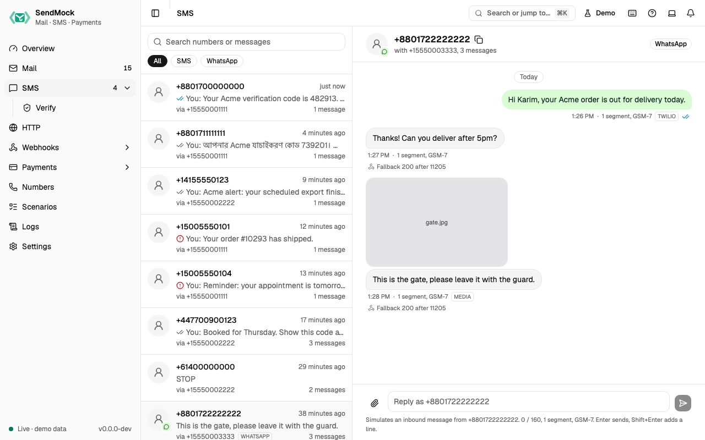

> Try it in the [demo](/demo/sms). Works in your install from Phase 2 (sending, status and callbacks), Phase 3 (reply webhooks) and Phase 4 (WhatsApp and more providers).

Every SMS and WhatsApp message your app sends lands here, grouped into conversations like a phone shows them. Nothing reaches a real phone.

## What it solves

- **OTP and alert SMS without a phone or provider credits.** Read the code on screen or from the CLI. See [Recipe: read a code](../recipes/read-a-code.md).
- **Failures with real error codes.** Twilio's official test numbers fail exactly as on Twilio. See [Recipe: failed SMS](../recipes/failed-sms.md).
- **Status callbacks.** Your app's handler for sent, delivered and failed is called the way the provider calls it. See [Delivery and test numbers](./delivery-and-test-numbers.md).
- **Two-way SMS:** STOP, YES, support chats. Reply as the contact and your app's webhook is called. See [Recipe: two-way SMS](../recipes/two-way-sms.md).
- **Cost surprises:** each bubble shows its segment count and encoding, so a stray emoji that doubles the price is visible.

## How it connects

| Gets from | Sends to |
| --- | --- |
| your app over `POST /api/v1/sms`, the Twilio Messages API or the Vonage SMS API | `sms.sent`, `sms.status`, `sms.opened` and `sms.inbound` events to [Webhooks > Rules](../webhooks/rules.md) |
| [Settings > SMS](../settings.md#sms): profile, failure rate, magic and custom outcome numbers | each message's status callback, logged in [Deliveries](../webhooks/deliveries.md) |
| replies you type in a conversation | the number's reply webhook, set in [Numbers](../numbers.md), and TwiML answers back into the conversation |
| [Verify](./verify.md): codes go out as SMS | the API request to [Logs > API requests](../logs.md) |
| [Settings > OTP patterns](../settings.md#otp-patterns) | **Send to webhook**: one message to any endpoint, by hand |

## Use it

1. Point your app's SMS provider base URL at `http://127.0.0.1:8026` (Twilio and Vonage SDKs keep working), or press **Send a sample SMS** on the empty screen.
2. Send an SMS from your app. The conversation for that number pair moves to the top.
3. Open it. Watch the ticks go from sent to delivered, and copy the code if the message has one.
4. Type "YES" in **Reply as recipient** at the bottom and send. The contact's reply appears on the left, and the number's reply webhook is called.

## Everything on this screen

### Sending to SendMock

- **Native API:** `POST /api/v1/sms` with `from`, `to` and `body`, plus optional `status_callback`, `media_urls` or inline `media`.
- **Twilio** (Messages API, Messaging Services, WhatsApp with `whatsapp:` addresses) and **Vonage** at their real paths on port `8026`.
- Any `from` is accepted. Numbers only matter for replies and sender pools ([Numbers](../numbers.md)).

### The conversation list

One row per contact and number pair, with the last message, time and a channel badge (SMS or WhatsApp). Search finds numbers and message text.

### The conversation

- **Bubbles:** your app's messages on the right, the contact's on the left, WhatsApp styling for that channel.
- **Ticks:** queued, sent, delivered, read (blue, after `sms.opened`) or failed, with the error code on hover.
- **Badges:** segments and encoding (GSM-7 or UCS-2), the API used (native, twilio, vonage), the Messaging Service, MMS or media.
- **Under an incoming message:** the reply webhook's result, for example "Reply webhook 200", "Fallback 200 after 11205" or "Rules only". See [Replies and WhatsApp](./replies-and-whatsapp.md).
- **Reply as recipient** at the bottom, with **Attach files** for media.

### Message actions

Each bubble's menu has **Message details**, **Simulate read**, **Send to webhook**, **Copy text**, **Copy message ID** and delete.

### Message details drawer

Facts (id, from, to, API, channel, segments, Messaging Service), the **status history**, the original **request JSON** (with a link to the API request log), each **callback attempt**, the media list, and **Set status** (Delivered, Undelivered or Failed with an error code) to move a message by hand. Incoming messages also get a **Reply webhook** tab.

## Customize

- Make your own numbers fail, arrive late or be read: [Advanced: SMS outcome numbers](../advanced/sms-outcome-numbers.md).
- Choose how every message is delivered (instantly, realistically, or only when you click): [Settings > SMS](../settings.md#sms).
- Give numbers a reply webhook and sender pools: [Advanced: numbers and Messaging Services](../advanced/numbers-and-services.md).

## From the CLI, API and AI

| Do this | CLI | API | MCP tool |
| --- | --- | --- | --- |
| send | `sendmock sms send` | [`POST /api/v1/sms`](/api/sms/#postSms) | `sendmock_sms_send` |
| list | `sendmock sms list` | [`GET /api/v1/sms`](/api/sms/#getSms) | `sendmock_sms_list` |
| conversations | `sendmock sms threads` | [`GET /api/v1/sms/threads`](/api/sms/#getSmsThreads) | `sendmock_sms_threads` |
| one message with its history | `sendmock sms show <smsId>` | [`GET /api/v1/sms/{smsId}`](/api/sms/#getSmsBySmsId) | `sendmock_sms_get` |
| wait in a test | `sendmock sms wait` | [`GET /api/v1/wait/sms`](/api/test-helpers/#getWaitSms) | `sendmock_sms_wait` |
| read the latest code | `sendmock otp --to <recipient>` | [`GET /api/v1/otp`](/api/test-helpers/#getOtp) | `sendmock_otp_get` |
| set a status | `sendmock sms status <smsId> <status>` | [`POST /api/v1/sms/{smsId}/status`](/api/sms/#postSmsBySmsIdStatus) | `sendmock_sms_set_status` |
| reply as the contact | `sendmock sms inbound` | [`POST /api/v1/sms/inbound`](/api/sms/#postSmsInbound) | `sendmock_sms_simulate_inbound` |
| delete one | `sendmock sms delete <smsId>` | [`DELETE /api/v1/sms/{smsId}`](/api/sms/#deleteSmsBySmsId) | `sendmock_sms_delete` |
| delete everything | `sendmock sms delete-all --yes` | [`DELETE /api/v1/sms`](/api/sms/#deleteSms) | `sendmock_sms_delete_all` |

The SMS commands and tools arrive in Phase 2.

## Related

- [Verify](./verify.md)
- [Numbers](../numbers.md)
- [Logs](../logs.md)
