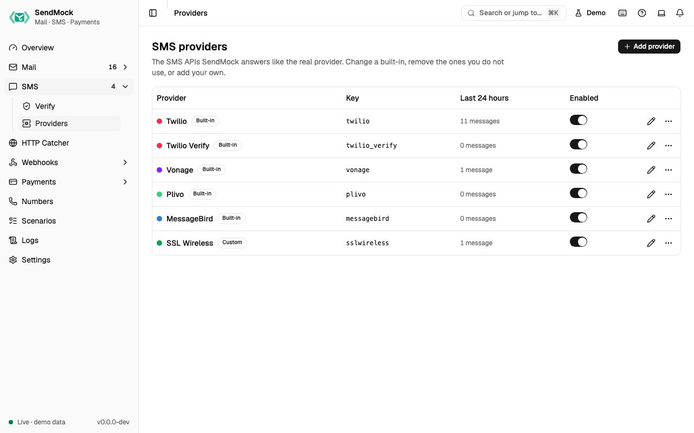

> Try it in the [demo](/demo/sms/providers). The screen works today; requests to the provider APIs are answered from Phase 2 (Twilio, Verify, Vonage) and Phase 4 (the rest and your own).

An SMS provider is one API SendMock answers like the real one: Twilio, Twilio Verify, Vonage, Plivo, MessageBird, or one you add. The demo already has one you could add yourself: **SSL Wireless**, a regional vendor, added from blank. Providers are data, not code, like [payment gateways](../payments/gateways.md), and **Reset to default** brings a built-in back. The full list is on [Supported providers](../providers.md).

## What it solves

- **A regional or smaller SMS vendor SendMock does not ship.** Add it from blank or from the closest built-in, with its own paths, fields, answers and error codes. See [Advanced: create an SMS provider](../advanced/sms-provider.md).
- **A built-in that differs from your account:** another field, a status name your app checks, a message id format.
- **Providers you do not use**: remove them from the filters, the rule picker and Settings > Connection, and restore them any time.

## How it connects

| Gets from | Sends to |
| --- | --- |
| your app's API calls at the provider's real path on port `8026`, or at `/providers/<key>/...` | [SMS](./index.md): every message is stored with its provider, shown as a badge that opens this screen |
| [Webhooks > Templates](../webhooks/templates.md): the template its status callbacks use | your app: the provider's own answer, success or error, and its error code for each [test number](./delivery-and-test-numbers.md) outcome |
| its credentials, when **Check credentials** is on | [Webhook rules](../webhooks/rules.md): the SMS API filter lists every provider |

## Use it

1. Press **Edit Twilio**.
2. Open **Preview**: the sample send is stored and Twilio answers `201` with an `SM` message id.
3. Remove `To` from the sample body: nothing is stored, and the answer is Twilio's own error, code `21604`.

## Everything on this screen

### The table

Name with its accent dot, Built-in or Custom, **Modified** once a built-in is edited, the key, messages in the last 24 hours, and an enabled switch. The row menu has **Reset to default**, **Remove** (a built-in) and **Delete** (a custom provider), each asking first. **Add provider** asks for a name, a key and **Start from** (blank, or a copy of another provider).

### Removed

Built-ins you removed are listed here. Requests to their paths get a 404 until you press **Restore**; their messages stay.

### The provider sheet

| Tab | Holds |
| --- | --- |
| **General** | name, key (fixed after creation), host, accent, enabled, credentials (secrets masked, reveal asks first) and **Check credentials** |
| **Requests** | the requests it answers (send, fetch, list, cancel, start and check verification), the **field mapping** (from, to, body, media and the rest) and the **checks** on a send, such as an E.164 number |
| **Responses** | the message id template, the success response and one response per error kind |
| **Callbacks** | the webhook template for status callbacks, the provider's name for each status, and its **error code** for each delivery outcome |
| **Preview** | a sample request, the message SendMock would store, the answer it would give, the problems, and what templates can read |
| **Try it** | the base URLs and a `curl` command for this provider |

## Customize

The full walkthrough, adding Africa's Talking from its API docs: [Advanced: create an SMS provider](../advanced/sms-provider.md).

## From the CLI, API and AI

| Do this | CLI | API | MCP tool |
| --- | --- | --- | --- |
| list | [`sendmock sms providers list`](/cli/sms-providers/#sms-providers-list) | [`GET /api/v1/sms/providers`](/api/sms-providers/#getSmsProviders) | [`sendmock_sms_provider_list`](/mcp/sms-providers/#sendmock_sms_provider_list) |
| one provider | [`sendmock sms providers show <providerKey>`](/cli/sms-providers/#sms-providers-show) | [`GET /api/v1/sms/providers/{providerKey}`](/api/sms-providers/#getSmsProvidersByProviderKey) | [`sendmock_sms_provider_get`](/mcp/sms-providers/#sendmock_sms_provider_get) |
| add | [`sendmock sms providers create`](/cli/sms-providers/#sms-providers-create) | [`POST /api/v1/sms/providers`](/api/sms-providers/#postSmsProviders) | [`sendmock_sms_provider_create`](/mcp/sms-providers/#sendmock_sms_provider_create) |
| change | [`sendmock sms providers update <providerKey>`](/cli/sms-providers/#sms-providers-update) | [`PATCH /api/v1/sms/providers/{providerKey}`](/api/sms-providers/#patchSmsProvidersByProviderKey) | [`sendmock_sms_provider_update`](/mcp/sms-providers/#sendmock_sms_provider_update) |
| preview | [`sendmock sms providers preview <providerKey>`](/cli/sms-providers/#sms-providers-preview) | [`POST /api/v1/sms/providers/{providerKey}/preview`](/api/sms-providers/#postSmsProvidersByProviderKeyPreview) | [`sendmock_sms_provider_preview`](/mcp/sms-providers/#sendmock_sms_provider_preview) |
| reset a built-in | [`sendmock sms providers reset <providerKey>`](/cli/sms-providers/#sms-providers-reset) | [`POST /api/v1/sms/providers/{providerKey}/reset`](/api/sms-providers/#postSmsProvidersByProviderKeyReset) | [`sendmock_sms_provider_reset`](/mcp/sms-providers/#sendmock_sms_provider_reset) |
| remove a built-in or delete a custom one | [`sendmock sms providers delete <providerKey>`](/cli/sms-providers/#sms-providers-delete) | [`DELETE /api/v1/sms/providers/{providerKey}`](/api/sms-providers/#deleteSmsProvidersByProviderKey) | [`sendmock_sms_provider_delete`](/mcp/sms-providers/#sendmock_sms_provider_delete) |
| restore a removed built-in | [`sendmock sms providers restore <providerKey>`](/cli/sms-providers/#sms-providers-restore) | [`POST /api/v1/sms/providers/{providerKey}/restore`](/api/sms-providers/#postSmsProvidersByProviderKeyRestore) | [`sendmock_sms_provider_restore`](/mcp/sms-providers/#sendmock_sms_provider_restore) |
| reveal a credential (agents cannot) | [`sendmock sms providers credential <providerKey> <credentialName> --reveal`](/cli/sms-providers/#sms-providers-credential) | [`GET /api/v1/sms/providers/{providerKey}/credentials/{credentialName}`](/api/sms-providers/#getSmsProvidersByProviderKeyCredentialsByCredentialName) | none: agents never read secrets |

## Related

- [Supported providers](../providers.md)
- [Email providers](../mail/providers.md)
- [Delivery and test numbers](./delivery-and-test-numbers.md)
