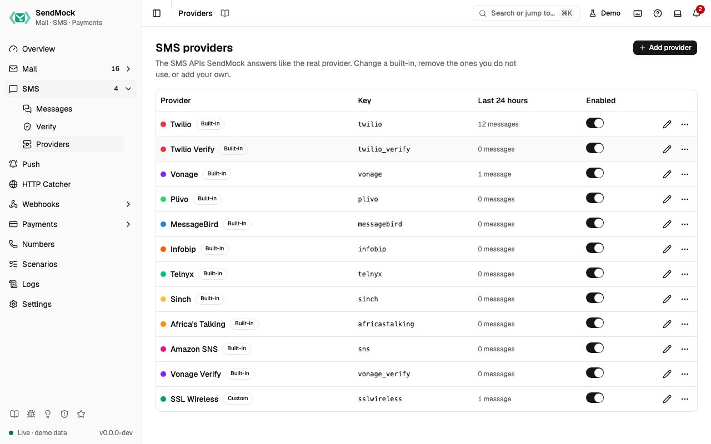

> Try it in the [demo](/demo/sms/providers).

An SMS provider is one API SendMock answers like the real one: Twilio, Twilio Verify, Vonage, Vonage Verify, Plivo, MessageBird, Infobip, Telnyx, Sinch, Africa's Talking, Amazon SNS, WhatsApp Cloud, or one you add. The demo already has one you could add yourself: **SSL Wireless**, a regional vendor, added from blank. Providers are data, not code, like [payment gateways](../payments/gateways.md), and **Reset to default** brings a built-in back. The full list is on [Supported providers](../providers.md).



## What it solves

- **A regional or smaller SMS vendor SendMock does not ship.** Add it from blank or from the closest built-in, with its own paths, fields, answers and error codes. See [Advanced: create an SMS provider](../advanced/sms-provider.md).
- **A built-in that differs from your account:** another field, a status name your app checks, a message id format.
- **Providers you do not use**: remove them from the filters, the rule picker and Settings > Connection, and restore them any time.

## How it connects

| Gets from | Sends to |
| --- | --- |
| your app's API calls at the provider's real path on port `8026`, or at `/providers/<key>/...` | [SMS](./index.md): every message is stored with its provider, shown as a badge that opens this screen |
| [Webhooks > Templates](../webhooks/templates.md): the template its status callbacks use | your app: the provider's own answer, success or error, and its error code for each [test number](./delivery-and-test-numbers.md) outcome |
| its credentials, when **Check credentials** is on | [Webhook rules](../webhooks/rules.md): the SMS API filter lists every provider |

## Use it

1. Press **Edit Twilio**.
2. Open **Preview**: the sample send is stored and Twilio answers `201` with an `SM` message id.
3. Remove `To` from the sample body: nothing is stored, and the answer is Twilio's own error, code `21604`.

## Everything on this screen

### The table

Name with its accent dot, Built-in or Custom, **Modified** once a built-in is edited, the key, messages in the last 24 hours, and an enabled switch. The row menu has **Reset to default**, **Remove** (a built-in) and **Delete** (a custom provider), each asking first. **Add provider** asks for a name, a key and **Start from** (blank, or a copy of another provider).

### Removed

Built-ins you removed are listed here. Requests to their paths get a 404 until you press **Restore**; their messages stay.

### The provider sheet

| Tab | Holds |
| --- | --- |
| **General** | name, key (fixed after creation), host, accent, enabled, credentials (secrets masked, reveal asks first) and **Check credentials** |
| **Accounts** | Twilio only: the main account and its **subaccounts**, each with a name, a status, its own auth token (masked, reveal asks first) and a Debugger webhook URL; **Add subaccount**, edit and remove |
| **Requests** | the requests it answers (send, fetch, list, cancel, start and check verification), the **field mapping** (from, to, body, media and the rest) and the **checks** on a send, such as an E.164 number |
| **Responses** | the message id template, the success response and one response per error kind |
| **Callbacks** | the webhook template for status callbacks, the provider's name for each status, and its **error code** for each delivery outcome |
| **Preview** | a sample request, the message SendMock would store, the answer it would give, the problems, and what templates can read |
| **Try it** | the base URLs and a `curl` command for this provider |


Every control and text, one by one: [SMS providers in depth](../deeper/sms/providers.md).
## Opt-out keywords

SendMock emulates Twilio's Advanced Opt-Out, on by default for the Twilio provider as on Twilio:

- A contact who texts STOP, STOPALL, UNSUBSCRIBE, CANCEL, END or QUIT (the whole text, in any case) to one of your numbers is opted out of that number, or of the Messaging Service the number is in.
- A later send through the Twilio API from that number or Messaging Service to the contact answers Twilio's error `21610`, and nothing is stored.
- START, YES or UNSTOP lifts it; HELP and INFO are left as they are.
- The inbound message still reaches your app's webhook, as on Twilio.

**Opt-out keywords** in the provider's General tab turns it off (`opt_out_keywords`); the same switch on a number or a Messaging Service (Numbers) turns it off for just that one. **Opt-out auto-replies** (`opt_out_auto_replies`, off by default) answers STOP, START and HELP with Twilio's default replies, stored as outbound messages. The list of opt-outs is on the Numbers screen's **Opt-outs** tab; see [Numbers](../numbers.md#opt-outs).

## Twilio subaccounts

Apps that give each customer a Twilio subaccount send under `/2010-04-01/Accounts/{AccountSid}/Messages.json` with that subaccount's SID and token, and check every webhook with the subaccount's own token. SendMock does the same:

- Add subaccounts on the **Accounts** tab of SMS > Providers > Twilio, with `sendmock sms twilio subaccounts create`, the REST API, MCP or the seed file (`[[sms.twilio_subaccounts]]`, with the token as an `${ENV_VAR}` reference).
- Or create them the way your app does on Twilio: the provider port answers `GET` and `POST /2010-04-01/Accounts.json` (list, filtered by `FriendlyName` and `Status`, and create) and `GET` and `POST /2010-04-01/Accounts/{AccountSid}.json` (fetch, and change `FriendlyName` and `Status`), in Twilio's shapes. These answers hold auth tokens, so they always check credentials: the main account sees every account, a subaccount only itself, and anything else gets Twilio's `401`.
- A send under a **suspended** or **closed** subaccount is refused with Twilio's error `20005` and nothing is stored.

## Twilio phone numbers

The provider port answers Twilio's number APIs over the same numbers and pools as the [Numbers](../numbers.md) screen, so a change on either side shows on the other:

| Path | What it does |
| --- | --- |
| `GET /2010-04-01/Accounts/{AccountSid}/IncomingPhoneNumbers.json` | lists the account's numbers, filtered by `PhoneNumber` and `FriendlyName` |
| `POST /2010-04-01/Accounts/{AccountSid}/IncomingPhoneNumbers.json` | adds a number from `PhoneNumber` (E.164) or `AreaCode` (a free `+1<area>555....` number), with `FriendlyName`, `SmsUrl`, `SmsMethod`, `SmsFallbackUrl` and `StatusCallback` |
| `GET`, `POST`, `DELETE /2010-04-01/Accounts/{AccountSid}/IncomingPhoneNumbers/{PhoneNumberSid}.json` | fetches, changes and deletes one number |
| `GET`, `POST /v1/Services/{ServiceSid}/PhoneNumbers` | lists a Messaging Service's numbers and adds one by `PhoneNumberSid` |
| `GET`, `DELETE /v1/Services/{ServiceSid}/PhoneNumbers/{PhoneNumberSid}` | fetches one and takes it out of the pool |

Each number has a `PN` SID, shown under it on the Numbers screen. A number belongs to the account it was created under (numbers made on the Numbers screen belong to the main account) and lists only under that account. An invalid number answers Twilio's `21421`, one already registered `21422`, and adding a number that is in another Messaging Service answers `21712`.

## Twilio Debugger

Twilio's Console sends a **Debugger event** to a webhook URL when something goes wrong. SendMock does the same:

1. Set the URL: `debugger_url` among the Twilio provider's credentials on the **General** tab for the main account, or **Debugger webhook URL** on a subaccount in the **Accounts** tab.
2. Send a message that ends `failed` or `undelivered` with an error code (a [test number](./delivery-and-test-numbers.md) such as `+15005550101`, an outcome rule or Simulate): one event with that code and the message's SID.
3. Or let a status callback or the inbound URL fail: one event with error `11200` and the `webhook` request and answer.

The event is a form POST in the `twilio.debugger` template: `Sid` (`NO...`), `AccountSid`, `ParentAccountSid` for a subaccount, `Timestamp`, `Level` (`ERROR`), `PayloadType` (`application/json`) and `Payload`, signed with the account's token. It shows on the message's timeline with its callbacks and is retried like them. The template can also be picked for any webhook endpoint.

## Twilio signatures

Every Twilio webhook carries `X-Twilio-Signature`, made with the auth token of the account the message belongs to:

| Webhook | Signed with |
| --- | --- |
| Status callbacks (`StatusCallback`) | the token of the account in the send's path: a subaccount's own token, or the main token for any other SID |
| Inbound messages and their replies | the token of the account that sent the last message in the conversation, or the main token |
| A webhook endpoint with the `twilio.status_callback` or `twilio.inbound_sms` template | the provider's token for the event's account, unless a webhook variable named `twilio_auth_token` is set, which then wins |

The main account's token is `twilio-test-token` until you change it on the **General** tab. A value such as `••••oken` in the UI, the API or `GET /api/v1/webhooks/variables` is the token **masked**, not the token: checking a signature against it always fails. To read the real token:

```bash
sendmock sms providers credential twilio auth_token --reveal
```

For a subaccount:

```bash
sendmock sms twilio subaccounts token <accountSid> --reveal
```

Or press the eye button next to the token on the provider sheet, which asks first.

## Customize

The full walkthrough, adding Africa's Talking from its API docs: [Advanced: create an SMS provider](../advanced/sms-provider.md).

## From the CLI, API and AI

| Do this | CLI | API | MCP tool |
| --- | --- | --- | --- |
| list | [`sendmock sms providers list`](/cli/sms-providers/#sms-providers-list) | [`GET /api/v1/sms/providers`](/api/sms-providers/#getSmsProviders) | [`sendmock_sms_provider_list`](/mcp/sms-providers/#sendmock_sms_provider_list) |
| one provider | [`sendmock sms providers show <providerKey>`](/cli/sms-providers/#sms-providers-show) | [`GET /api/v1/sms/providers/{providerKey}`](/api/sms-providers/#getSmsProvidersByProviderKey) | [`sendmock_sms_provider_get`](/mcp/sms-providers/#sendmock_sms_provider_get) |
| add | [`sendmock sms providers create`](/cli/sms-providers/#sms-providers-create) | [`POST /api/v1/sms/providers`](/api/sms-providers/#postSmsProviders) | [`sendmock_sms_provider_create`](/mcp/sms-providers/#sendmock_sms_provider_create) |
| change | [`sendmock sms providers update <providerKey>`](/cli/sms-providers/#sms-providers-update) | [`PATCH /api/v1/sms/providers/{providerKey}`](/api/sms-providers/#patchSmsProvidersByProviderKey) | [`sendmock_sms_provider_update`](/mcp/sms-providers/#sendmock_sms_provider_update) |
| preview | [`sendmock sms providers preview <providerKey>`](/cli/sms-providers/#sms-providers-preview) | [`POST /api/v1/sms/providers/{providerKey}/preview`](/api/sms-providers/#postSmsProvidersByProviderKeyPreview) | [`sendmock_sms_provider_preview`](/mcp/sms-providers/#sendmock_sms_provider_preview) |
| reset a built-in | [`sendmock sms providers reset <providerKey>`](/cli/sms-providers/#sms-providers-reset) | [`POST /api/v1/sms/providers/{providerKey}/reset`](/api/sms-providers/#postSmsProvidersByProviderKeyReset) | [`sendmock_sms_provider_reset`](/mcp/sms-providers/#sendmock_sms_provider_reset) |
| remove a built-in or delete a custom one | [`sendmock sms providers delete <providerKey>`](/cli/sms-providers/#sms-providers-delete) | [`DELETE /api/v1/sms/providers/{providerKey}`](/api/sms-providers/#deleteSmsProvidersByProviderKey) | [`sendmock_sms_provider_delete`](/mcp/sms-providers/#sendmock_sms_provider_delete) |
| restore a removed built-in | [`sendmock sms providers restore <providerKey>`](/cli/sms-providers/#sms-providers-restore) | [`POST /api/v1/sms/providers/{providerKey}/restore`](/api/sms-providers/#postSmsProvidersByProviderKeyRestore) | [`sendmock_sms_provider_restore`](/mcp/sms-providers/#sendmock_sms_provider_restore) |
| reveal a credential (agents cannot) | [`sendmock sms providers credential <providerKey> <credentialName> --reveal`](/cli/sms-providers/#sms-providers-credential) | [`GET /api/v1/sms/providers/{providerKey}/credentials/{credentialName}`](/api/sms-providers/#getSmsProvidersByProviderKeyCredentialsByCredentialName) | none: agents never read secrets |
| list Twilio subaccounts | [`sendmock sms twilio subaccounts list`](/cli/sms/#sms-twilio-subaccounts-list) | [`GET /api/v1/twilio/subaccounts`](/api/sms/#getTwilioSubaccounts) | [`sendmock_twilio_subaccount_list`](/mcp/sms/#sendmock_twilio_subaccount_list) |
| add a Twilio subaccount | [`sendmock sms twilio subaccounts create`](/cli/sms/#sms-twilio-subaccounts-create) | [`POST /api/v1/twilio/subaccounts`](/api/sms/#postTwilioSubaccounts) | [`sendmock_twilio_subaccount_create`](/mcp/sms/#sendmock_twilio_subaccount_create) |
| change a Twilio subaccount | [`sendmock sms twilio subaccounts update <accountSid>`](/cli/sms/#sms-twilio-subaccounts-update) | [`PATCH /api/v1/twilio/subaccounts/{accountSid}`](/api/sms/#patchTwilioSubaccountsByAccountSid) | [`sendmock_twilio_subaccount_update`](/mcp/sms/#sendmock_twilio_subaccount_update) |
| remove a Twilio subaccount | [`sendmock sms twilio subaccounts delete <accountSid>`](/cli/sms/#sms-twilio-subaccounts-delete) | [`DELETE /api/v1/twilio/subaccounts/{accountSid}`](/api/sms/#deleteTwilioSubaccountsByAccountSid) | [`sendmock_twilio_subaccount_delete`](/mcp/sms/#sendmock_twilio_subaccount_delete) |
| reveal a subaccount's token (agents cannot) | [`sendmock sms twilio subaccounts token <accountSid> --reveal`](/cli/sms/#sms-twilio-subaccounts-token) | [`GET /api/v1/twilio/subaccounts/{accountSid}/auth-token`](/api/sms/#getTwilioSubaccountsByAccountSidAuthToken) | none: agents never read secrets |

## Related

- [Supported providers](../providers.md)
- [Email providers](../mail/providers.md)
- [Delivery and test numbers](./delivery-and-test-numbers.md)
