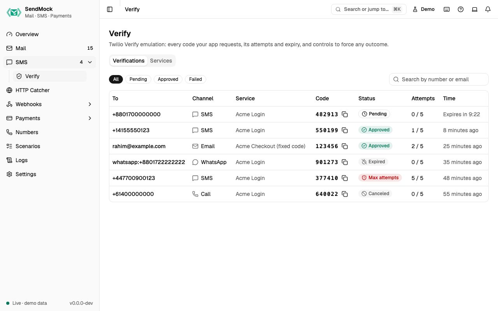

> Try it in the [demo](/demo/sms/verify). Works in your install from Phase 2.

Your app starts and checks verifications through Twilio Verify's real API. **SMS > Verify** shows every verification with its code, so you, a test or an agent can read it instead of waiting for a phone.

## What it solves

- **Login and sign-up by code** without a phone, credits or a Twilio account.
- **The error paths:** an expired code, a canceled verification, too many wrong attempts. They are hard to produce on Twilio; here they are a button.
- **Automated tests:** a service with a fixed code (`123456`) makes every run the same.

## How it connects

| Gets from | Sends to |
| --- | --- |
| your app over the Twilio Verify API at `http://127.0.0.1:8026` | the code as an SMS (shown in [SMS](./index.md)) or an email (shown in [Mail](../mail/index.md)) |
| Verify services (this screen's **Services** tab, or the seed file) | `verify.started`, `verify.checked` and `verify.expired` events to [Webhooks > Rules](../webhooks/rules.md) |
| | the API request to [Logs > API requests](../logs.md) |

## Use it

1. Point your app's Twilio client at `http://127.0.0.1:8026`, or press **Start a sample verification** on the empty screen.
2. Start a verification in your app (log in, sign up). A row appears with the code and a countdown ("Expires in 9:41").
3. Copy the code and enter it in your app. The row turns **Approved**.
4. Start another, open it and press **Expire**. Your app's next check fails the way Twilio fails.

## Everything on this screen

The screen has two tabs, kept in the URL.

### Verifications

- A table: To, channel (SMS, WhatsApp, Email or Call), service, the **code** with a copy button, status, check attempts ("2 / 5") and a live countdown for pending ones.
- Status chips (All, Pending, Approved, Failed for canceled, expired and max attempts) and a search on To.

### The verification drawer

Click a row (or open `?verification=<sid>`; `Esc` closes): the code large with copy, status, To, channel, service, attempts, created and expiry times, **Open the message** (the SMS or email that carried the code), the timeline (started, code sent, failed checks, approved, canceled, expired, max attempts reached, forced), and, while pending, the force buttons: **Approve**, **Cancel**, **Expire** and **Max attempts**.

### Services

A table of Verify services: name, SID (copy), code length, fixed code (or Random), lifetime, and Edit and Delete. **New service** asks for a name, a code length (4 to 10), an optional fixed code (digits, exactly the code length) and the lifetime in minutes (1 to 1,440).

## Customize

- A **fixed code** per service makes automated tests deterministic.
- The code length and lifetime follow what your production service uses.
- Services go into the seed file, so your team and CI get the same ones ([Advanced: seed file](../advanced/seed-file.md)).

## From the CLI, API and AI

| Do this | CLI | API | MCP tool |
| --- | --- | --- | --- |
| list | [`sendmock verify list`](/cli/verify/#verify-list) | [`GET /api/v1/verify`](/api/verify/#getVerify) | [`sendmock_verify_list`](/mcp/verify/#sendmock_verify_list) |
| one verification | [`sendmock verify show <verificationSid>`](/cli/verify/#verify-show) | [`GET /api/v1/verify/{verificationSid}`](/api/verify/#getVerifyByVerificationSid) | [`sendmock_verify_get`](/mcp/verify/#sendmock_verify_get) |
| read the latest code | [`sendmock otp --to <recipient>`](/cli/test-helpers/#otp) | [`GET /api/v1/otp`](/api/test-helpers/#getOtp) | [`sendmock_otp_get`](/mcp/test-helpers/#sendmock_otp_get) |
| force an outcome | [`sendmock verify force <verificationSid> <status>`](/cli/verify/#verify-force) | [`POST /api/v1/verify/{verificationSid}/force`](/api/verify/#postVerifyByVerificationSidForce) | [`sendmock_verify_force`](/mcp/verify/#sendmock_verify_force) |
| list services | [`sendmock verify services list`](/cli/verify/#verify-services-list) | [`GET /api/v1/verify/services`](/api/verify/#getVerifyServices) | [`sendmock_verify_service_list`](/mcp/verify/#sendmock_verify_service_list) |
| add a service | [`sendmock verify services create`](/cli/verify/#verify-services-create) | [`POST /api/v1/verify/services`](/api/verify/#postVerifyServices) | [`sendmock_verify_service_create`](/mcp/verify/#sendmock_verify_service_create) |
| change a service | [`sendmock verify services update <serviceSid>`](/cli/verify/#verify-services-update) | [`PATCH /api/v1/verify/services/{serviceSid}`](/api/verify/#patchVerifyServicesByServiceSid) | [`sendmock_verify_service_update`](/mcp/verify/#sendmock_verify_service_update) |

## Related

- [Recipe: Twilio Verify login](../recipes/twilio-verify-login.md)
- [SMS](./index.md)
