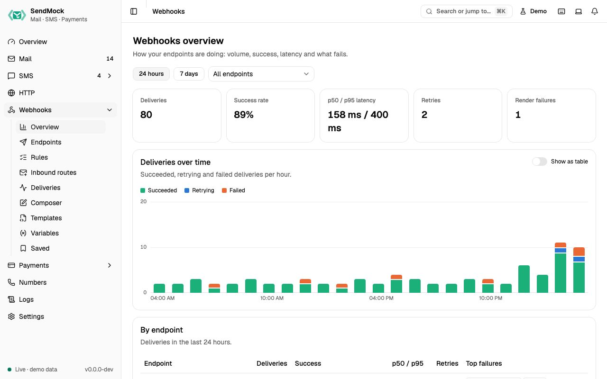

> **The screens are in the [live demo](/demo/webhooks/overview). Deliveries to real URLs arrive in Phase 3.**

## Endpoints

An endpoint is where SendMock posts: a URL, a method, a [template](./templates.md) for the request, a signing secret and a retry policy. **Send test** posts a `test.ping`.

## Rules

Rules pick which events go to which endpoint, checked from top to bottom, with filters on fields such as the recipient or a tag. The preview shows which recent messages a rule would match.

## Deliveries

Every request is logged with its headers, body, response and each retry. Failed deliveries can be replayed as they were or edited first, and saved for later.

## Signing

Native webhooks follow Standard Webhooks: `webhook-id`, `webhook-timestamp` and `webhook-signature` headers, so the official libraries verify them. Provider templates sign the way that provider does.

## Inbound routes

Inbound routes decide what happens to incoming email (replies to mail your app sent), in priority order like Mailgun Routes: match a recipient or header, then forward to a URL, store, or stop.
