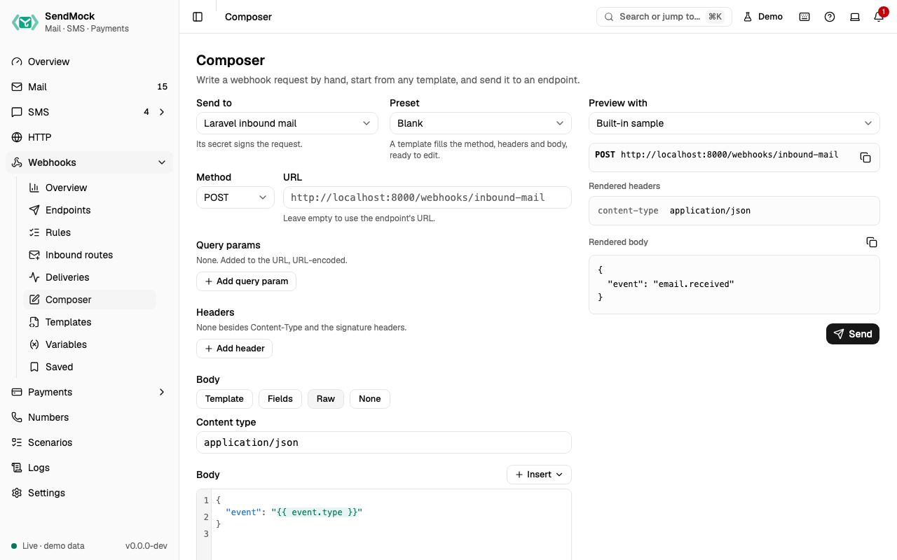

> Try it in the [demo](/demo/webhooks/composer). Works in your install from Phase 3.

Rules send automatically. These three tools send when you say so.

## What it solves

- Sending one particular email or SMS to a handler, now, without a rule.
- Testing a payload your app should reject: a missing field, a wrong type, a huge body.
- Keeping a request that once broke your app, to send again after every change (a regression check by hand).

## How it connects

| Gets from | Sends to |
| --- | --- |
| a message in [Mail](../mail/index.md), [SMS](../sms/index.md) or the [HTTP catcher](../http/index.md) (**Send to webhook**) | an [endpoint](./endpoints.md), which signs the request |
| [templates](./templates.md) as presets, [variables](./variables.md) and Prompt variables | a `manual` delivery in [Deliveries](./deliveries.md) |
| **Save** on a delivery | Saved deliveries, and **Save as template** to [Templates](./templates.md) |

## Use it

1. Open an email in Mail and choose **Send to webhook** from its actions.
2. Pick the **Endpoint**. Keep **Format** as the endpoint sends it, or pick another template for this send only.
3. Fill any **Prompt variables**, and check the preview.
4. Press **Send**. The result shows the status and time, with **Open delivery** and **Save**.

## Everything on this screen

### Send to webhook

Available on emails, SMS and captured HTTP requests. The dialog has:

- **Endpoint** (enabled ones, starting with the first whose template fits the message) and **Format**.
- **Prompt variables:** an input per Prompt variable, prefilled with its default.
- **Override variables:** name and value rows that win over the endpoint's and global values, for this send only.
- **Preview** of the method, URL, headers and body, with problems under each part. **Edit body** puts the body in the editor; an edited body is sent as written.
- **Send** records a `manual` delivery. A render error blocks sending.

### Composer

A request written by hand, like a small Postman, at **Webhooks > Composer**:

- **Send to:** an endpoint, which supplies the secret and signing, and the URL unless you type another. Pick the **Method** here.
- **Preset:** **Blank** or any template; a template fills the method, headers, content type and body, ready to edit.
- The same request editor as the endpoint sheet (query params, headers, body mode, Strict or Lenient; see [Advanced: request editor](../advanced/request-editor.md)), Prompt variables and overrides, and a live preview against the sample or a recent email or SMS.
- **Send** works as in Send to webhook.

### Saved deliveries

Bookmarks made with **Save** on a delivery, at **Webhooks > Saved**, newest first, with a search by name. Each shows the name, method and URL, its endpoint and template, and when it was saved; open it to see the stored headers and body.

| Action | Does |
| --- | --- |
| **Send** | to the original endpoint or another one, optionally re-rendered with fresh values; shows the result and a link to the new delivery |
| **Rename**, **Delete** | as named (Delete asks first) |
| **Save as template** | turns the stored request into a custom template |

Saved deliveries survive pruning and reset, and are written to the seed export (without signature headers, which are made fresh on each send).

## Customize

- Presets come from [templates](./templates.md); a stored request becomes one with **Save as template** ([Advanced: templates](../advanced/templates.md)).
- Values asked for at send time are Prompt variables ([Advanced: variables](../advanced/variables.md)).
- Body modes and Strict or Lenient rendering: [Advanced: request editor](../advanced/request-editor.md).

## From the CLI, API and AI

| Do this | CLI | API | MCP tool |
| --- | --- | --- | --- |
| send a message or a written request | `sendmock webhook send --endpoint <endpointId>` | [`POST /api/v1/webhooks/endpoints/{endpointId}/send`](/api/webhook-endpoints/#postWebhooksEndpointsByEndpointIdSend) | `sendmock_webhook_send` |
| render without sending | `sendmock webhook render --endpoint <endpointId>` | [`POST /api/v1/webhooks/endpoints/preview`](/api/webhook-endpoints/#postWebhooksEndpointsPreview) | `sendmock_webhook_render` |
| saved list | `sendmock webhook saved list` | [`GET /api/v1/webhooks/saved`](/api/saved-deliveries/#getWebhooksSaved) | `sendmock_webhook_saved_list` |
| send a saved one | `sendmock webhook saved send <savedId>` | [`POST /api/v1/webhooks/saved/{savedId}/send`](/api/saved-deliveries/#postWebhooksSavedBySavedIdSend) | `sendmock_webhook_saved_send` |
| rename | `sendmock webhook saved rename <savedId>` | [`PATCH /api/v1/webhooks/saved/{savedId}`](/api/saved-deliveries/#patchWebhooksSavedBySavedId) | `sendmock_webhook_saved_update` |
| save as template | `sendmock webhook saved save-as-template <savedId>` | [`POST /api/v1/webhooks/saved/{savedId}/template`](/api/saved-deliveries/#postWebhooksSavedBySavedIdTemplate) | `sendmock_webhook_saved_save_as_template` |

## Related

- [Deliveries](./deliveries.md)
- [Variables](./variables.md)
