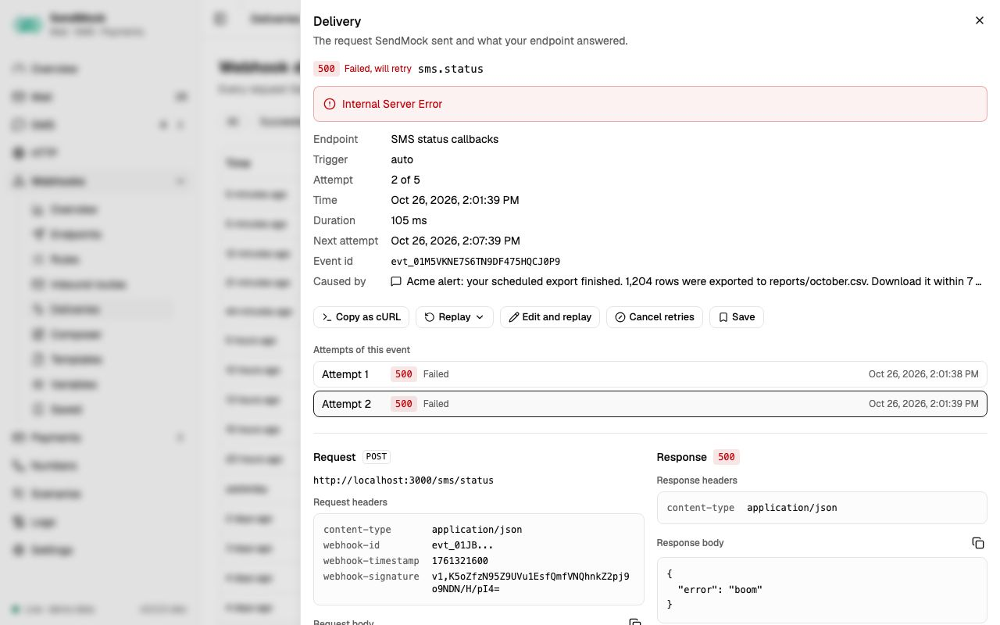

> Try it in the [demo](/demo/webhooks/deliveries). Works in your install from Phase 3.

Every request SendMock sends to your app is logged here: rule deliveries, status callbacks, reply webhooks, inbound routes, payment notifications, tests and manual sends.

## What it solves

- "My handler returned 500. What exactly did it get?" Request and response side by side.
- Fixing a handler and trying the same request again, without making the event happen again.
- Testing a payload your app should reject, by editing a real one.

## How it connects

| Gets from | Sends to |
| --- | --- |
| [Rules](./rules.md), status callbacks ([SMS](../sms/index.md)), reply webhooks ([Numbers](../numbers.md)), [inbound routes](./inbound-routes.md), gateway notifications ([Payments](../payments/index.md)), **Send test**, **Send to webhook** and the [Composer](./composer-and-saved.md) | **Replay** to your app again |
| | **Save** to [Saved](./composer-and-saved.md#saved-deliveries) |
| | its counts to the [Overview](../overview.md) and the bell (failed deliveries) |

## Use it

1. Press `G D` or open **Webhooks > Deliveries**.
2. Press the **Failed** chip to see only failures.
3. Open one. Read your app's response on the right; fix your handler.
4. Press **Replay** > **Replay as-is**. A new delivery appears; it should now succeed.

## Everything on this screen

### The log

A live table, newest first, 50 rows at a time ("Showing 50 of N", more as you scroll or press **Load more**): time, event, endpoint, trigger (auto, manual or replay), status (the status code, or failed, exhausted, render failed, pending, cancelled with the error on hover), duration and attempt ("2 / 5"). Chips (All, Succeeded, Failed, Pending), an endpoint picker and an event picker narrow it; `?status=failed&endpoint=<id>` opens it filtered.

### The delivery drawer

- Status, event, endpoint, trigger, attempt "N of M", duration, time, the next attempt while it will retry, the event id, and **Caused by** (the email or SMS behind it).
- **Attempts:** every attempt of the same event, each opening its own detail.
- **Request** and **Response** side by side (stacked on phones): method and URL, headers, and the body formatted when it is JSON, each with copy. Long responses are cut at 64 KB, and say so.
- A **render failed** delivery shows the template error instead of a request ("Nothing was sent"), with a link to the endpoint.

### Actions

| Action | Does |
| --- | --- |
| **Copy as cURL** | the request as a cURL command, to run it yourself |
| **Replay** > **Replay as-is** | sends the stored request again |
| **Replay** > **Re-render with fresh values** | renders the template again, with new random values and current variables |
| **Edit and replay** | edit the body and headers first (JSON is checked), then **Send edited request** |
| **Cancel retries** | stops a delivery that would retry (asks first) |
| **Save** | keeps the request under a name in [Saved](./composer-and-saved.md#saved-deliveries) |

## Customize

The retry schedule is per endpoint ([Endpoints](./endpoints.md), Retries tab).

## From the CLI, API and AI

| Do this | CLI | API | MCP tool |
| --- | --- | --- | --- |
| list | `sendmock webhook deliveries list` | [`GET /api/v1/webhooks/deliveries`](/api/webhook-deliveries/#getWebhooksDeliveries) | `sendmock_webhook_delivery_list` |
| one delivery | `sendmock webhook deliveries show <deliveryId>` | [`GET /api/v1/webhooks/deliveries/{deliveryId}`](/api/webhook-deliveries/#getWebhooksDeliveriesByDeliveryId) | `sendmock_webhook_delivery_get` |
| replay | `sendmock webhook deliveries replay <deliveryId>` | [`POST /api/v1/webhooks/deliveries/{deliveryId}/replay`](/api/webhook-deliveries/#postWebhooksDeliveriesByDeliveryIdReplay) | `sendmock_webhook_delivery_replay` |
| cancel retries | `sendmock webhook deliveries cancel <deliveryId>` | [`POST /api/v1/webhooks/deliveries/{deliveryId}/cancel`](/api/webhook-deliveries/#postWebhooksDeliveriesByDeliveryIdCancel) | `sendmock_webhook_delivery_cancel` |
| save | `sendmock webhook saved create --delivery <deliveryId>` | [`POST /api/v1/webhooks/saved`](/api/saved-deliveries/#postWebhooksSaved) | `sendmock_webhook_saved_create` |
| wait in a test | `sendmock webhook deliveries wait` | [`GET /api/v1/wait/webhook`](/api/test-helpers/#getWaitWebhook) | `sendmock_webhook_delivery_wait` |

## Related

- [Recipe: replay a failed webhook](../recipes/replay-a-failed-webhook.md)
- [Composer and Saved](./composer-and-saved.md)
