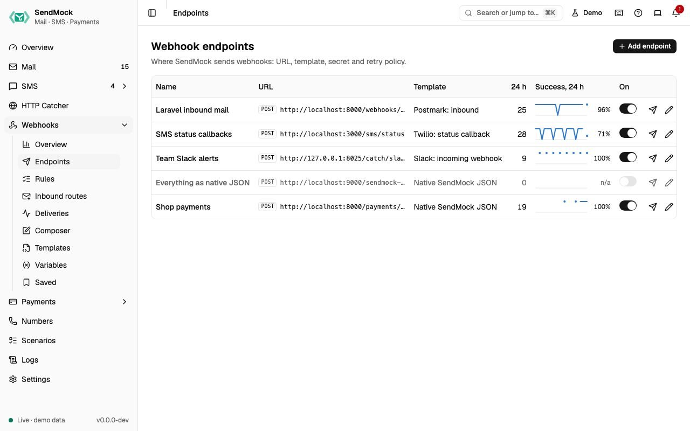

> Try it in the [demo](/demo/webhooks/endpoints). Works in your install from Phase 3.

An endpoint is one destination for webhooks, usually one handler in your app.

## What it solves

- One place to say "my app's inbound mail handler is at this URL and expects Postmark's format".
- Testing that your handler checks signatures, and keeps working while a secret is rotated.
- Testing retries: what your app does when it gets the same webhook again.

## How it connects

| Gets from | Sends to |
| --- | --- |
| [Rules](./rules.md) that point at it | requests to your app, logged in [Deliveries](./deliveries.md) |
| its [template](./templates.md) and [variables](./variables.md) | payments' gateway notifications, when a [gateway](../payments/gateways.md) names it as its notification endpoint |
| **Send to webhook**, the [Composer](./composer-and-saved.md) and saved deliveries | its success rate to the [Overview](../overview.md) and [Webhooks overview](./index.md#the-webhooks-overview-screen) |

## Use it

1. Press **Add endpoint**.
2. In **General**, give it a name and your handler's URL, for example `http://localhost:8000/webhooks/sms`.
3. In **Request**, pick a template, for example "Twilio: inbound SMS". Its required variables show in **Variables** with a **Missing** badge until you set them.
4. Press **Add endpoint**, then **Send test** on its row. The dialog shows the status code, time, your app's answer, the signed headers and a link to the delivery.

## Everything on this screen

### The table

Name, method and URL, template, an enabled switch (applies at once), deliveries in the last 24 hours, and a success-rate sparkline with the rate. Row actions: **Send test**, Edit and Delete (the confirmation says how many rules go with it). When SendMock runs in Docker, a `localhost` URL shows a hint to use `host.docker.internal`, with a button that swaps it in.

With no endpoints yet, the screen offers **Add endpoint** and **Add a catcher endpoint** (native JSON to `/catch/webhooks`, so test sends land in the [HTTP catcher](../http/index.md)).

### The edit sheet

| Tab | Holds |
| --- | --- |
| **General** | name, method, URL (it may use `{{ }}` templates), timeout (1 to 60 s), enabled |
| **Request** | the body mode (Template, Fields, Raw or None), the template with "Based on ... rev N", link mode (Linked follows template updates; Detached keeps a private copy), extra headers and body fields, query params, Strict or Lenient rendering, and a live preview. See [Advanced: request editor](../advanced/request-editor.md) |
| **Security** | the secret, masked (`whsec_••••3f9a`); **Reveal** asks first and is logged; **Copy secret**; **Rotate secret** with an overlap (1 hour, 24 hours or 7 days) during which the old secret still verifies; the signing scheme the template uses |
| **Retries** | max attempts (1 to 10), the delay before each retry (1 s to 24 h, the last one repeats), **Retry on 4xx**, and the attempt schedule ("attempts at 0 s, 1 s, 6 s, 36 s, ...") |
| **Variables** | the endpoint's own variables, and the template's required ones with **Missing** until set here or globally; names with token, secret, key or password are stored as secrets |

## Customize

- Your own request shapes: [Advanced: templates](../advanced/templates.md) and [Advanced: request editor](../advanced/request-editor.md).
- Values per send: [Advanced: variables](../advanced/variables.md).
- Keep endpoints in the seed file for your team: [Advanced: seed file](../advanced/seed-file.md).

## From the CLI, API and AI

| Do this | CLI | API | MCP tool |
| --- | --- | --- | --- |
| list | [`sendmock webhook endpoint list`](/cli/webhook-endpoints/#webhook-endpoint-list) | [`GET /api/v1/webhooks/endpoints`](/api/webhook-endpoints/#getWebhooksEndpoints) | [`sendmock_webhook_endpoint_list`](/mcp/webhook-endpoints/#sendmock_webhook_endpoint_list) |
| one endpoint | [`sendmock webhook endpoint show <endpointId>`](/cli/webhook-endpoints/#webhook-endpoint-show) | [`GET /api/v1/webhooks/endpoints/{endpointId}`](/api/webhook-endpoints/#getWebhooksEndpointsByEndpointId) | [`sendmock_webhook_endpoint_get`](/mcp/webhook-endpoints/#sendmock_webhook_endpoint_get) |
| create | [`sendmock webhook endpoint create`](/cli/webhook-endpoints/#webhook-endpoint-create) | [`POST /api/v1/webhooks/endpoints`](/api/webhook-endpoints/#postWebhooksEndpoints) | [`sendmock_webhook_endpoint_create`](/mcp/webhook-endpoints/#sendmock_webhook_endpoint_create) |
| update | [`sendmock webhook endpoint update <endpointId>`](/cli/webhook-endpoints/#webhook-endpoint-update) | [`PATCH /api/v1/webhooks/endpoints/{endpointId}`](/api/webhook-endpoints/#patchWebhooksEndpointsByEndpointId) | [`sendmock_webhook_endpoint_update`](/mcp/webhook-endpoints/#sendmock_webhook_endpoint_update) |
| send a test | [`sendmock webhook endpoint test <endpointId>`](/cli/webhook-endpoints/#webhook-endpoint-test) | [`POST /api/v1/webhooks/endpoints/{endpointId}/test`](/api/webhook-endpoints/#postWebhooksEndpointsByEndpointIdTest) | [`sendmock_webhook_endpoint_test`](/mcp/webhook-endpoints/#sendmock_webhook_endpoint_test) |
| rotate the secret | [`sendmock webhook endpoint rotate-secret <endpointId>`](/cli/webhook-endpoints/#webhook-endpoint-rotate-secret) | [`POST /api/v1/webhooks/endpoints/{endpointId}/rotate-secret`](/api/webhook-endpoints/#postWebhooksEndpointsByEndpointIdRotateSecret) | [`sendmock_webhook_endpoint_rotate_secret`](/mcp/webhook-endpoints/#sendmock_webhook_endpoint_rotate_secret) |
| reveal the secret (agents cannot) | [`sendmock webhook endpoint secret <endpointId> --reveal`](/cli/webhook-endpoints/#webhook-endpoint-secret) | [`GET /api/v1/webhooks/endpoints/{endpointId}/secret`](/api/webhook-endpoints/#getWebhooksEndpointsByEndpointIdSecret) | none: agents never read secrets |
| save as a template | [`sendmock webhook endpoint save-as-template <endpointId>`](/cli/webhook-endpoints/#webhook-endpoint-save-as-template) | [`POST /api/v1/webhooks/endpoints/{endpointId}/save-as-template`](/api/webhook-endpoints/#postWebhooksEndpointsByEndpointIdSaveAsTemplate) | [`sendmock_webhook_endpoint_save_as_template`](/mcp/webhook-endpoints/#sendmock_webhook_endpoint_save_as_template) |

Agents can set secrets but never read them back.

## Related

- [Rules](./rules.md)
- [Deliveries](./deliveries.md)
