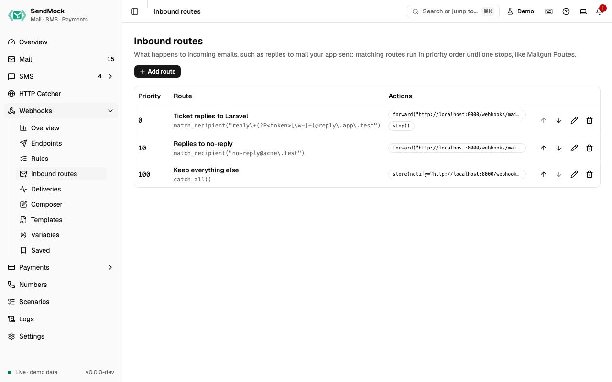

> Try it in the [demo](/demo/webhooks/inbound-routes). Works in your install from Phase 4.

Incoming email (a reply or forward you simulated in [Mail](../mail/replies-and-forwards.md), or mail to an inbound domain) is delivered by routes. They follow Mailgun's model exactly, so a route copied from the Mailgun dashboard, or created by your app through Mailgun's Routes API, behaves the same.

## What it solves

- Your "reply to this email" feature needs the reply posted to your app, with only the new text.
- Each reply should reach the right ticket: `reply+<ticket>@reply.app.test` carries the ticket id.
- Your app creates its Mailgun routes on boot; they should work locally too.

## How it connects

| Gets from | Sends to |
| --- | --- |
| incoming email from [Mail](../mail/replies-and-forwards.md) (`email.inbound`) | your app, in Mailgun's format (or SendGrid Inbound Parse or Postmark inbound), as deliveries in [Deliveries](./deliveries.md) |
| your app, through the Mailgun Routes API (`/v3/routes`) on port `8026` | a real address, only through the [Release](../mail/release.md) allowlist |
| | the email's **Timeline**: "Forwarded by route ... to ..." |

## Use it

1. Press **Add route** and give it a description, for example "Ticket replies".
2. Choose **Match recipient** and type the pattern `reply\+(?P<ticket>.+)@reply.app.test`. The expression shows as Mailgun writes it, and the preview lists the incoming emails it matches with the `ticket` each one captured.
3. A new route starts with a **Forward to URL** action: set its target to `http://localhost:8000/webhooks/mail?ticket=\g<ticket>`. Then **Add action** > **Stop** to skip lower routes.
4. Press **Add route**. Reply to an email in Mail: the reply is posted to your app.

## Everything on this screen

### The list

Routes by priority (lower runs first) with move up and down, description, the expression in Mailgun syntax (`match_recipient(...)`, `match_header(...)`, `catch_all()`), the actions as chips (`forward(...)`, `store(...)`, `stop()`), and edit and delete.

### The route sheet

- **Priority** and **Description**.
- **Filter:** Match recipient (a regex on each recipient), Match header (a header name and a regex) or Catch all. Invalid regexes are flagged under the field.
- **Actions**, in order: Forward to URL, Forward to email, Store and notify (keeps the message and posts a notification with a `message-url` your app can fetch), Stop. Named groups like `(?P<token>...)` can be used in actions as `\g<token>`.
- **Preview:** "Matches N of the last 50 incoming emails", with each match and the groups it captured, updated as you type.

### How routes run

Matching routes run by priority until one calls Stop. The forward is Mailgun's `multipart/form-data` with `recipient`, `sender`, `subject`, `body-plain`, `stripped-text` (the new text without the quoted original), `stripped-signature`, `body-html`, attachments, `message-headers`, and `timestamp`, `token` and `signature` (signed with the webhook signing key). Your app answering `406` rejects the message without retries; other errors are retried.

## Customize

Ticket routing with named groups, store and notify, and other providers' formats: [Advanced: inbound routes](../advanced/inbound-routes.md).

## From the CLI, API and AI

| Do this | CLI | API | MCP tool |
| --- | --- | --- | --- |
| list | [`sendmock route list`](/cli/inbound-routes/#route-list) | [`GET /api/v1/inbound-routes`](/api/inbound-routes/#getInboundRoutes) | [`sendmock_inbound_route_list`](/mcp/inbound-routes/#sendmock_inbound_route_list) |
| create | [`sendmock route create`](/cli/inbound-routes/#route-create) | [`POST /api/v1/inbound-routes`](/api/inbound-routes/#postInboundRoutes) | [`sendmock_inbound_route_create`](/mcp/inbound-routes/#sendmock_inbound_route_create) |
| update or reorder | [`sendmock route update <routeId>`](/cli/inbound-routes/#route-update) | [`PATCH /api/v1/inbound-routes/{routeId}`](/api/inbound-routes/#patchInboundRoutesByRouteId) | [`sendmock_inbound_route_update`](/mcp/inbound-routes/#sendmock_inbound_route_update) |
| delete | [`sendmock route delete <routeId>`](/cli/inbound-routes/#route-delete) | [`DELETE /api/v1/inbound-routes/{routeId}`](/api/inbound-routes/#deleteInboundRoutesByRouteId) | [`sendmock_inbound_route_delete`](/mcp/inbound-routes/#sendmock_inbound_route_delete) |
| test a filter | [`sendmock route test`](/cli/inbound-routes/#route-test) | [`POST /api/v1/inbound-routes/test`](/api/inbound-routes/#postInboundRoutesTest) | [`sendmock_inbound_route_test`](/mcp/inbound-routes/#sendmock_inbound_route_test) |

## Related

- [Replies and forwards](../mail/replies-and-forwards.md)
- [Recipe: reply by email](../recipes/reply-by-email.md)
