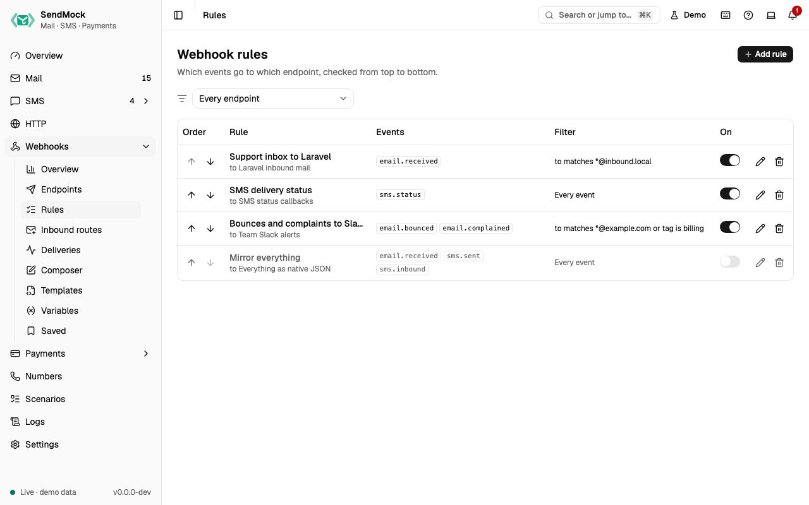

> Try it in the [demo](/demo/webhooks/rules). Works in your install from Phase 3.

A rule says "when these events happen, and they match this filter, send them to this endpoint". Rules are what make webhooks automatic.

## What it solves

- Only some messages should reach a handler: mail to `support@`, SMS to one number, bounces only.
- One event should reach several handlers (your app and a Slack alert).
- You want to know which messages a filter catches before saving it.

## How it connects

| Gets from | Sends to |
| --- | --- |
| events from every capture menu ([Events](./index.md#events)) | the rule's [endpoint](./endpoints.md), as a delivery in [Deliveries](./deliveries.md) |

## Use it

1. Press **Add rule** and give it a name, for example "Support inbox to Laravel".
2. Pick the endpoint and tick the events, for example `email.received`.
3. Press **Add condition**: field **To**, operator **matches**, value `*@support.local`.
4. Watch the preview: "Matches N of the last 50 messages", with the matching ones listed.
5. Press **Add rule**. The next matching email creates a delivery.

## Everything on this screen

### The list

Rules in firing order with move up and down, name, endpoint, event chips, a plain-language filter ("to matches \*@support.local and subject contains Ticket"), an enabled switch that applies at once, and edit and delete. Disabled rules are dimmed. An endpoint filter at the top narrows the list (also from `?endpoint=`).

### The rule sheet

- **Name**, **endpoint**, and **events** as checkboxes grouped by area (Email, SMS, Verify, HTTP, Webhooks).
- **Filter builder:** a group says "Match **all** / **any** of these"; each row is field, operator and value, with a **not** toggle. **Add condition** adds a row, **Add group** one nested group. No conditions means every selected event fires.
- **Fields** follow the events: email fields (from, to, cc, subject, body, header, has attachment, tag) for `email.*`, SMS fields (from, to, body, status, API) for `sms.*`, open fields (open count, first open, source) for opened events. A condition on a field the event does not have never matches.
- **Operators:** equals, contains, starts with, matches (glob, like `*@support.local`), regex, exists. All but regex ignore case.
- Problems show as you type: a missing value, an invalid regex, a missing header name.
- **Preview:** "Matches N of the last 50 messages", the messages listed with matches marked, and **Show non-matching**. Events without filter fields (Verify, HTTP, Webhooks) skip the preview.

### How rules fire

Every enabled rule is checked, top to bottom, and **each matching rule creates its own delivery**. Order matters for reading the list and for the delivery order, not for stopping: a message can match several rules.

## Customize

Grouped filters, `not`, header fields and regex: [Advanced: rules and filters](../advanced/rules-and-filters.md).

## From the CLI, API and AI

| Do this | CLI | API | MCP tool |
| --- | --- | --- | --- |
| list | `sendmock webhook rule list` | [`GET /api/v1/webhooks/rules`](/api/webhook-rules/#getWebhooksRules) | `sendmock_webhook_rule_list` |
| one rule | `sendmock webhook rule show <ruleId>` | [`GET /api/v1/webhooks/rules/{ruleId}`](/api/webhook-rules/#getWebhooksRulesByRuleId) | `sendmock_webhook_rule_get` |
| create | `sendmock webhook rule create` | [`POST /api/v1/webhooks/rules`](/api/webhook-rules/#postWebhooksRules) | `sendmock_webhook_rule_create` |
| update | `sendmock webhook rule update <ruleId>` | [`PATCH /api/v1/webhooks/rules/{ruleId}`](/api/webhook-rules/#patchWebhooksRulesByRuleId) | `sendmock_webhook_rule_update` |
| move | `sendmock webhook rule move <ruleId>` | [`POST /api/v1/webhooks/rules/{ruleId}/move`](/api/webhook-rules/#postWebhooksRulesByRuleIdMove) | `sendmock_webhook_rule_move` |
| preview a filter | `sendmock webhook rule preview` | [`POST /api/v1/webhooks/rules/preview`](/api/webhook-rules/#postWebhooksRulesPreview) | `sendmock_webhook_rule_preview` |

## Related

- [Endpoints](./endpoints.md)
- [Inbound routes](./inbound-routes.md) (rules for incoming email)
