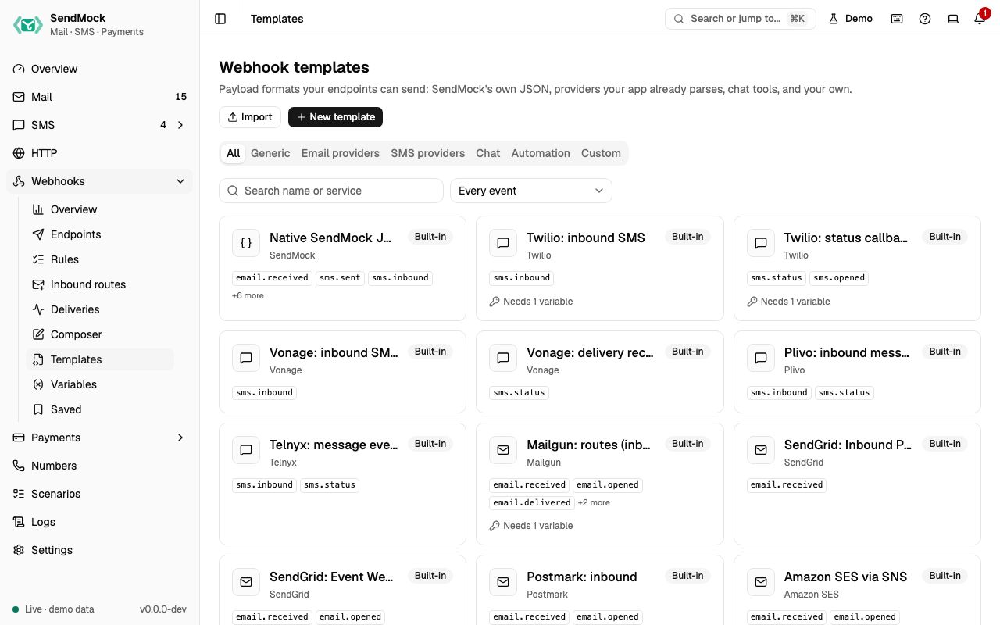

> Try it in the [demo](/demo/webhooks/templates). Works in your install from Phase 3 (native, Twilio, Vonage, Slack, Discord and custom templates) and Phase 4 (the other providers, import and export).

A template is a recipe for a webhook request: method, content type, headers, body and signature, written with `{{ }}` placeholders that are filled from the event and [variables](./variables.md).

## What it solves

- **Your production handler, unchanged.** Pick "Postmark inbound" and the request is the one Postmark would send, so the code you run in production is the code you test.
- **Team alerts.** Slack, Discord and Teams templates post a readable message about the event.
- **A service SendMock does not ship.** Clone the closest template, or write your own.

## How it connects

| Gets from | Sends to |
| --- | --- |
| the event's data (`event`, `data`), [variables](./variables.md) (`vars`), the endpoint and delivery | the request an [endpoint](./endpoints.md) sends |
| **Save as template** from an endpoint or a [saved delivery](./composer-and-saved.md#saved-deliveries) | presets in the [Composer](./composer-and-saved.md) and **Format** in Send to webhook |

## Use it

1. Open **Webhooks > Templates** and pick the **Email providers** tab.
2. Open "Postmark inbound". The detail shows the events it fits, its required variables, a link to Postmark's docs, and a live preview against a sample.
3. Pick a recent email in **Preview with** to see the request your app would get.
4. Press **Use in new endpoint**. The endpoint sheet opens with the template chosen; add your URL and save.

## Everything on this screen

### The gallery

Category tabs (All, Generic, Email providers, SMS providers, Chat, Automation, Custom), a search on name or service, and an event filter. Each card shows the service, name and events; badges mark **Modified** built-ins and templates loaded from files.

### Built-in templates

**Act like the provider** (your app receives what the provider would send):

| Area | Services |
| --- | --- |
| Email | Mailgun, SendGrid, Postmark, Amazon SES (via SNS), Resend, Brevo, Mailchimp Transactional, SparkPost: inbound mail and delivery, open, bounce and complaint events |
| SMS | Twilio, Vonage, Plivo, MessageBird, Telnyx, Sinch, Infobip, Africa's Talking, AWS SNS: inbound SMS and status callbacks |

**Notify a tool** (post the event to a team tool): Slack, Discord, Microsoft Teams, Google Chat, Telegram, Mattermost and Rocket.Chat, n8n, Zapier, Make and Pipedream, and **Generic** (SendMock's native JSON signed with Standard Webhooks, the default).

Payment notifications (Stripe, PayPal, SSLCommerz, bKash) are shaped by each [gateway](../payments/gateways.md), not here.

### The template detail

The request shape (method, content type, headers, body template), **Events it fits**, required **Variables**, **Provider docs**, which endpoints use it, a **Preview** against the built-in sample or a recent message (with warnings and errors), and actions: **Use in new endpoint**, **Edit** (built-ins too), **Clone**, **Export**, **History** (revisions with a diff and restore) and Delete (custom only).

## Customize

Edit a built-in (it shows **Modified**; **Reset to default** brings back the shipped one), create from blank, clone, import and export, share a templates folder with your team: [Advanced: templates](../advanced/templates.md).

## From the CLI, API and AI

| Do this | CLI | API | MCP tool |
| --- | --- | --- | --- |
| list | `sendmock webhook template list` | [`GET /api/v1/webhooks/templates`](/api/webhook-templates/#getWebhooksTemplates) | `sendmock_webhook_template_list` |
| one template | `sendmock webhook template show <templateId>` | [`GET /api/v1/webhooks/templates/{templateId}`](/api/webhook-templates/#getWebhooksTemplatesByTemplateId) | `sendmock_webhook_template_get` |
| render a preview | `sendmock webhook template render <templateId>` | [`POST /api/v1/webhooks/templates/{templateId}/render`](/api/webhook-templates/#postWebhooksTemplatesByTemplateIdRender) | `sendmock_webhook_template_render` |
| clone | `sendmock webhook template clone <templateId>` | [`POST /api/v1/webhooks/templates/{templateId}/clone`](/api/webhook-templates/#postWebhooksTemplatesByTemplateIdClone) | `sendmock_webhook_template_clone` |
| export | `sendmock webhook template export <templateId>` | [`GET /api/v1/webhooks/templates/{templateId}/export`](/api/webhook-templates/#getWebhooksTemplatesByTemplateIdExport) | `sendmock_webhook_template_export` |
| import | `sendmock webhook template import <file>` | [`POST /api/v1/webhooks/templates/import`](/api/webhook-templates/#postWebhooksTemplatesImport) | `sendmock_webhook_template_import` |
| history | `sendmock webhook template history <templateId>` | [`GET /api/v1/webhooks/templates/{templateId}/revisions`](/api/webhook-templates/#getWebhooksTemplatesByTemplateIdRevisions) | `sendmock_webhook_template_revisions` |
| reset a built-in | `sendmock webhook template reset <templateId>` | [`POST /api/v1/webhooks/templates/{templateId}/reset`](/api/webhook-templates/#postWebhooksTemplatesByTemplateIdReset) | `sendmock_webhook_template_reset` |
| the reference of values and filters | `sendmock webhook template reference` | [`GET /api/v1/webhooks/template-reference`](/api/webhook-templates/#getWebhooksTemplateReference) | `sendmock_webhook_template_reference` |

## Related

- [Variables](./variables.md)
- [Advanced: request editor](../advanced/request-editor.md)
