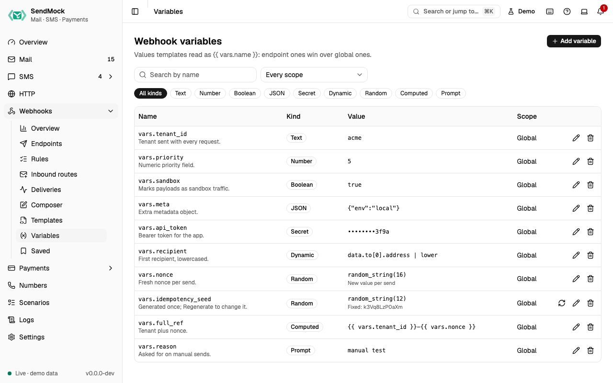

> Try it in the [demo](/demo/webhooks/variables). Works in your install from Phase 3.

Templates read variables as `{{ vars.name }}`. They hold what a template needs that is not in the event: an auth token for a signature, a tenant id, a chat id, a fresh random id per send.

## What it solves

- A provider signature needs your app's real auth token (Twilio's `X-Twilio-Signature`), and it must never show on screen or in exports.
- Each request needs a fresh id or nonce, or a value copied from the message (the first recipient, lowercased).
- One template serves several endpoints that differ only in a value.

## How it connects

| Gets from | Sends to |
| --- | --- |
| you, the seed file, or **Missing** prompts on an [endpoint](./endpoints.md) | [templates](./templates.md), endpoint URLs and headers, [catcher responses](../http/responses.md) |
| the event, for Dynamic variables | Send to webhook and the Composer, which ask for Prompt variables |

## Use it

1. Press **Add variable**.
2. Name it `tenant_id`, keep **Global**, pick **Text** and enter `acme`.
3. The sheet shows what it **resolves to**. Press **Add variable**.
4. Use it in a template or header as `{{ vars.tenant_id }}`.

## Everything on this screen

### The table

Every global and endpoint variable: name (as `vars.name`), kind, value (secrets masked; the expression for Dynamic, Random and Computed; the current value of a fixed Random), scope (Global or the endpoint) and description. Filters: scope (also `?endpoint=`), kind chips and a name search. Row actions: Edit, Delete, and **Regenerate** for fixed Random variables.

### Kinds

| Kind | Value | Example |
| --- | --- | --- |
| Text, Number, Boolean, JSON | a fixed value, checked for its type | `acme`, `3`, `true`, `{"plan": "pro"}` |
| Secret | a fixed value, masked everywhere, never shown again after saving, never exported in plain text | an auth token |
| Dynamic | a path or expression over the event | `data.to[0].address \| lower` |
| Random | a generator, **Per send** or **Fixed** (generated once until you press Regenerate) | `random_string(16)` |
| Computed | a template made of other variables | `{{ vars.tenant_id }}-{{ vars.nonce }}` |
| Prompt | a default value; manual sends ask for it, automatic sends use the default | a customer id to try |

### Scope

A variable is **Global** or belongs to one endpoint. An endpoint's variable wins over a global one of the same name, and a send-time override wins over both.

## Customize

Dynamic expressions, generators, computed values and send-time overrides in depth: [Advanced: variables](../advanced/variables.md).

## From the CLI, API and AI

| Do this | CLI | API | MCP tool |
| --- | --- | --- | --- |
| list | `sendmock webhook var list` | [`GET /api/v1/webhooks/variables`](/api/webhook-variables/#getWebhooksVariables) | `sendmock_webhook_variable_list` |
| set | `sendmock webhook var set <name> <value>` | [`POST /api/v1/webhooks/variables`](/api/webhook-variables/#postWebhooksVariables) | `sendmock_webhook_variable_set` |
| change | `sendmock webhook var update <variableId>` | [`PATCH /api/v1/webhooks/variables/{variableId}`](/api/webhook-variables/#patchWebhooksVariablesByVariableId) | `sendmock_webhook_variable_update` |
| unset | `sendmock webhook var unset <variableId>` | [`DELETE /api/v1/webhooks/variables/{variableId}`](/api/webhook-variables/#deleteWebhooksVariablesByVariableId) | `sendmock_webhook_variable_unset` |
| regenerate | `sendmock webhook var regenerate <variableId>` | [`POST /api/v1/webhooks/variables/{variableId}/regenerate`](/api/webhook-variables/#postWebhooksVariablesByVariableIdRegenerate) | `sendmock_webhook_variable_regenerate` |
| preview what it resolves to | `sendmock webhook var preview` | [`POST /api/v1/webhooks/variables/preview`](/api/webhook-variables/#postWebhooksVariablesPreview) | `sendmock_webhook_variable_preview` |

## Related

- [Templates](./templates.md)
- [Endpoints](./endpoints.md)
